# 飞书文档：调价管理

调价管理

当前版本：V2.0.2

## 功能介绍

1. 针对已生效的报价单，可进行调价的申请，提升产品的竞争力，占据市场份额
2. 通过合理的价格定位，可以塑造企业的良好形象，提升消费者的认知度和忠诚度

## 注意事项

1. 新申请的价格审核通过后Amazon Listing页面更新有一定延迟，请不要着急，若长时间未更新，可联系平台运营经理；
2. 当您申请了新的价格后，我们将进行审核，若审核通过，我们会提供新的采购价给到您，请您确认最新的采购价格；
3. 调价按照业务模式分开进行申请，若您需要调整PO与DF的报价，需分开进行申请；
4. 为保证您的产品能够正常销售，若您需上调MSRP，每次调价的范围不能超过5%；
5. 上调MSRP成功后需等待来单或产生实际订单后，才能再次调高MSRP，否则您的申请将被驳回或影响您目前正常的销售；
6. 每次调价的申请都有可能影响您的产品，并造成一定程度销量的影响，请您慎重修改；
7. 建议您使用谷歌浏览器登录系统。

## 平台调价与自主调价

自主调价自主调价表示您或者我司主动发起的调价，您可以自主决定是否进行调价的申请，需注意调价频率，频率过多将影响您的产品销售；平台调价平台调价表示平台将根据您产品的实际销售情况、退货率表现、订单履约以及亚马逊利润等综合表现，不定期对平台采购价进行审核与调整，请您务必关注平台调价的调价单；“平台调价”的调价单，设有倒计时操作为7天，请您在7天内进行操作。每个产品的拒绝次数为2次的，超过次数后，若您在倒计时结束后仍未操作，系统将自动接受该笔调价；若平台采购价被平台调整，您可以参考后续提升平台采购价。

## 操作流程

##

#### 操作路径【销售】-【报价管理】-【调价管理】

> 1. 可通过SKU/ASIN/调价ID或其他条件搜索您所需要的数据
> 2. **？显示为已驳回/已拒绝/Amazon审核失败的原因**
> 3. 列表分为2个Tab页，点击可进行切换：全部、待确认调价
>
> 1. 全部：指所有的调价单
> 2. 待确认调价：需操作的调价，表示我们已重新制定了采购价格，您需要查看并操作是否接受/拒绝；
> 4. PO/DF需单独进行调价的申请；
> 5. 带有倒计时的调价单，请您在倒计时结束内进行操作。

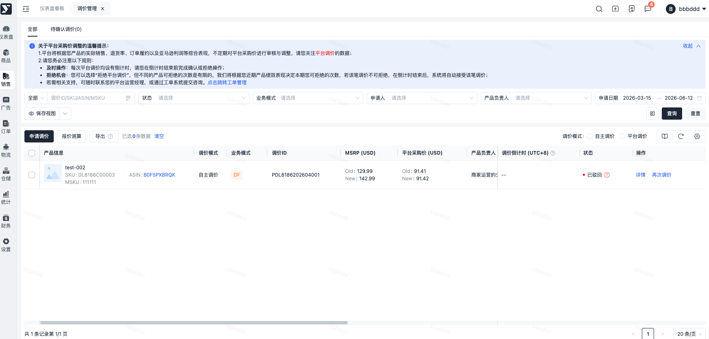

##

#### 操作路径【销售】-【报价管理】-【调价管理】-【详情】

> 1. 详情将展示更多的信息，可以通过顶部查看当前调价单状态、调价业务模式、调价模式等信息；
> 2. 详情支持快捷操作接受or拒绝调价。

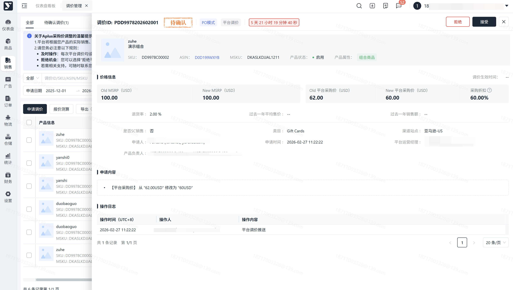

##

#### 操作路径【销售】-【报价管理】-【调价管理】-【申请调价】

> 1. MSRP有价格的校验，请您按照规则进行输入；
> 2. 支持通过SKU/ASIN/MSKU进行快速检索，产品ID会带有对应的【PO/DF】，即表示您将针对对应的业务模式进行调价的申请；
> 3. 点击【提交】弹窗2次确认，请您再次确认；
> 4. 具体操作步骤：点击申请调价->输入SKU/ASIN/MSKU->选择对应的业务模式->输入调价的信息->点击确定->若有报错，按照报错文案进行处理；/若无报错，返回列表；->列表生成调价数据，状态：审核中；等待审核结果即可；

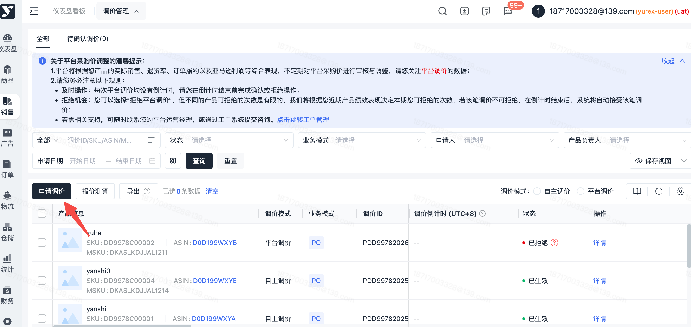

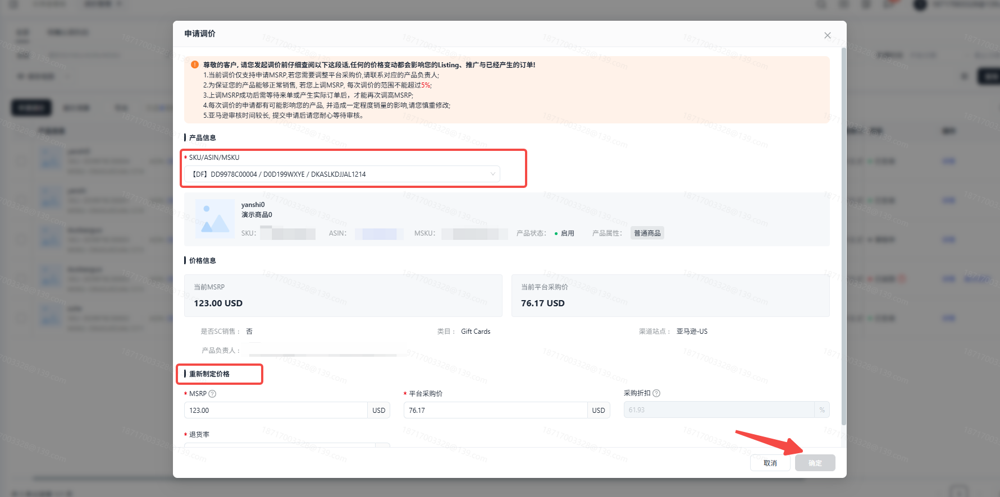

##

#### 操作路径【销售】-【报价管理】-【调价管理】-【再次调价】

> 1. 针对已驳回/已拒绝的调价，您可再次发起调价的申请；
> 2. 入口为【申请调价】或该调价单对应的【再次调价】按钮，点击后可再次发起调价的申请。

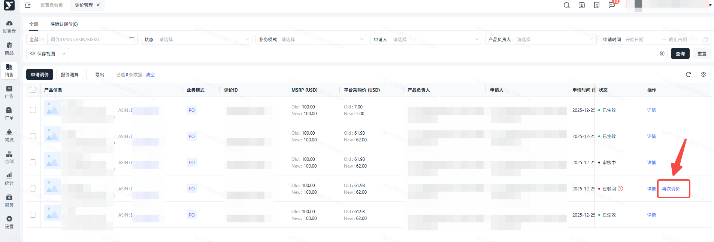

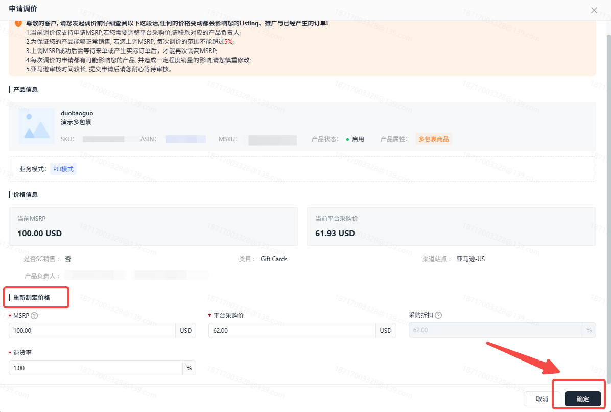

##

#### 操作路径1【销售】-【报价管理】-【调价管理】-【待确认】-【接受/拒绝】

> 1. **可点击【待确认调价】快速筛选需处理的调价单；**
> 2. **若带有调价倒计时的调价单，请您务必在调价倒计时结束内进行操作，超时系统将自动接受；**
> 3. 可通过筛选区【状态】筛选【待确认】进行快速检索；
> 4. 点击【接受】弹窗2次确认，点击【拒绝】弹窗2次确认，并需要您输入具体原因，请您谅解。

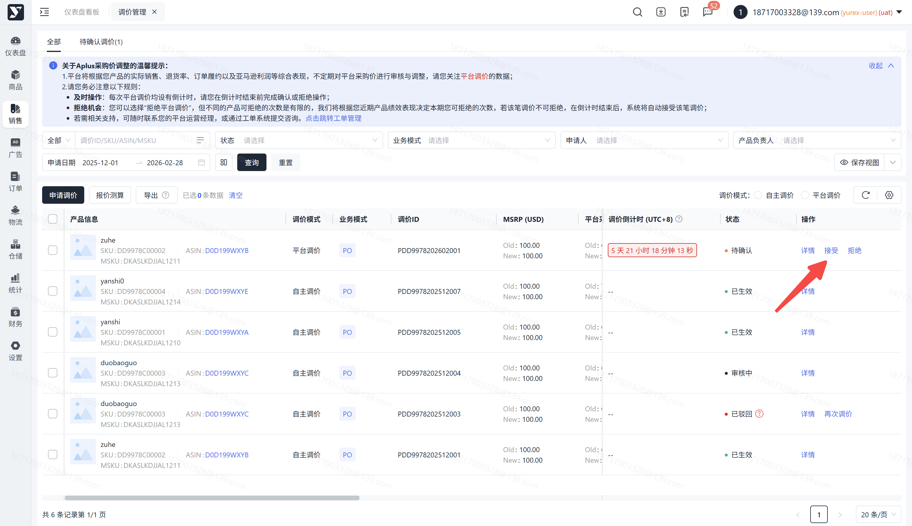

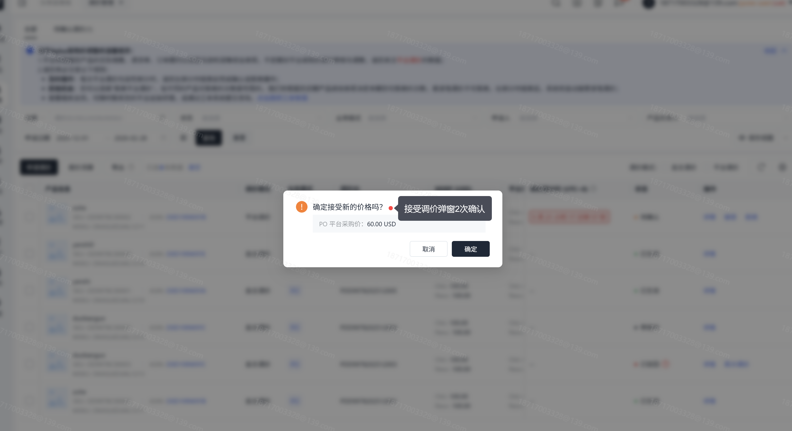

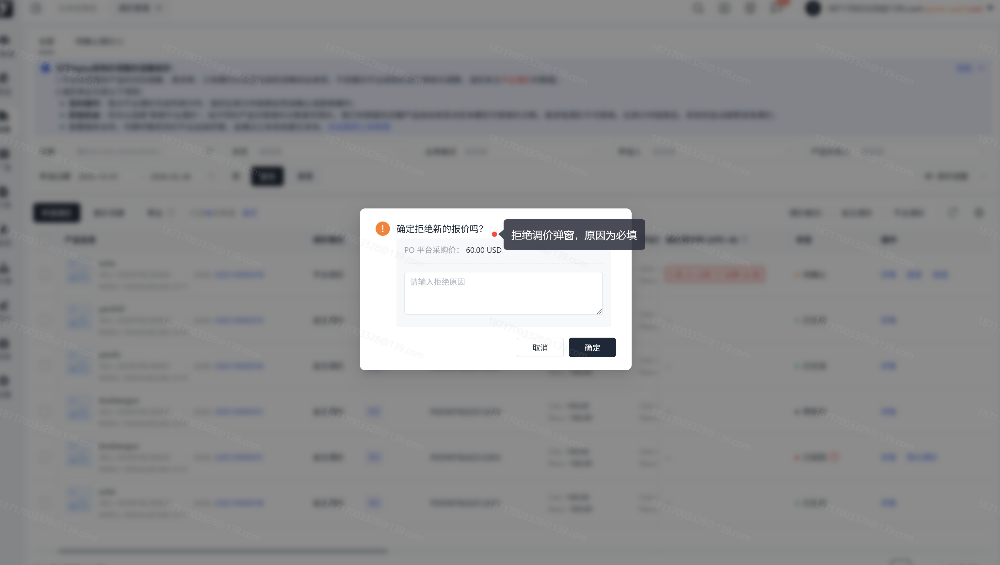

#### 操作路径2【销售】-【报价管理】-【调价管理】-【详情】

> 1. 提供详情页快捷操作，可进行对应的调价单操作；
> 2. 点击【接受】弹窗2次确认，点击【拒绝】弹窗2次确认，并需要您输入具体原因，请您谅解。

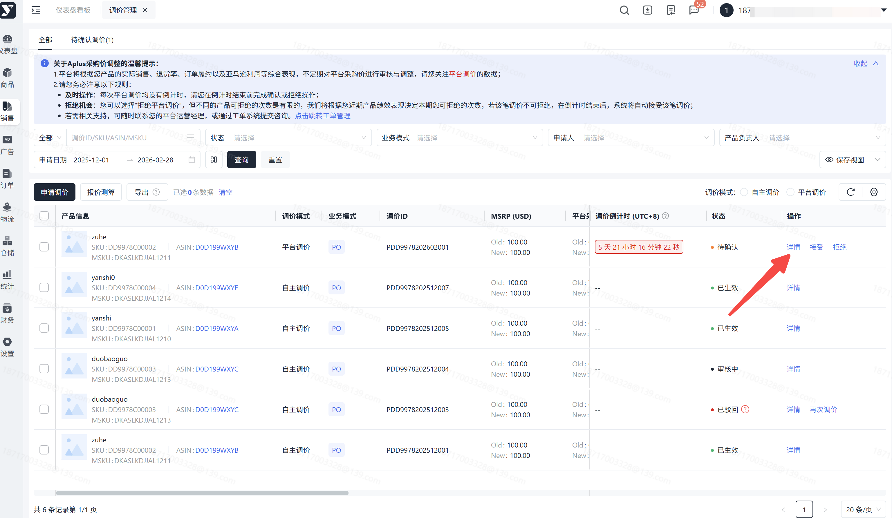

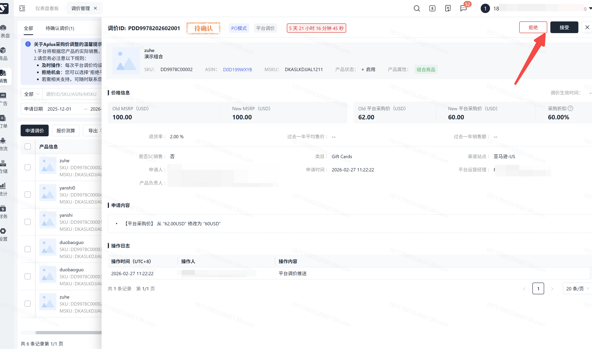

##

#### 操作路径【销售】-【报价管理】-【采购报价】-【调价记录】

> 1. 若您想查看历史的调价记录，可通过【采购报价】进行查询，我们将记录历史调价明细；
> 2. 【调价记录】分成不同的业务模式进行统计展示，请您按照业务模式分开进行查看。

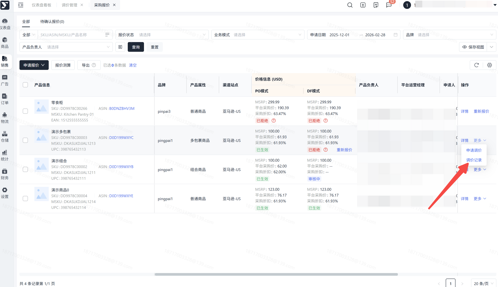

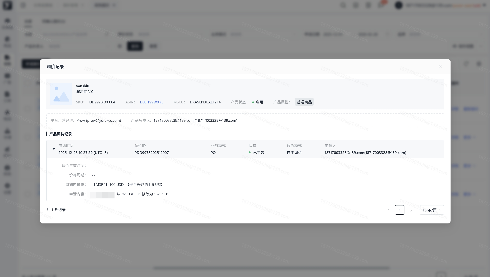

## 常见问题

##

“调价倒计时”暂时仅针对调价模式为“平台调价”存在，因平台调价是基于产品近期销售情况、订单履约、实际退货率等因素，由平台自动发起的调价，我们需要再7天内进行确认，超时系统将自行确认。为避免产生分歧，请您务必在倒计时结束前进行操作，感谢您的理解。

##

 Amazon Listing页面更新有一定延迟，请不要着急，若长时间未更新，可联系平台运营经理。

##

调价审核时间较久，请您耐心等待，我们会及时处理您的调价申请，另外调价的申请都有可能影响您的产品, 并造成一定程度销量的影响,请您慎重修改。

##

调价需要一定的时间，若您的订单来之前调价还未生效，我们将根据原来的价格进行订单的结算，调价生效后，我们会按照最新的价格进行订单的结算。

##

调价也与报价一致，需按照业务模式单独进行申请；若您操作的为PO调价，成功后仅表示对PO业务模式的价格进行了申请，DF的价格需要您单独进行操作。

##

MSRP是支持调高的，只是每次最多仅能上浮5%，请您按照当前调价规则进行申请，若您期望多次调价，请等待上次调价结果结束后，再次发起调价申请。
