# 飞书文档：优惠券

## 功能介绍

Coupon是指优惠券促销活动，消费者领取优惠券后，结算时可享受专属优惠。

## 注意事项

1. 每个ASIN在同一个时间段内只能存在一个活动组，请注意优惠券的活动起止时间
2. 优惠券可与Promotions存在同个时间段内的活动
3. 亚马逊对创建优惠券活动的ASIN有一定条件，若创建失败，请提升产品的竞争力
4. 优惠券名称会自动生成唯一值

## 操作流程

### 操作路径

【销售】-【营销推广】-【优惠券】

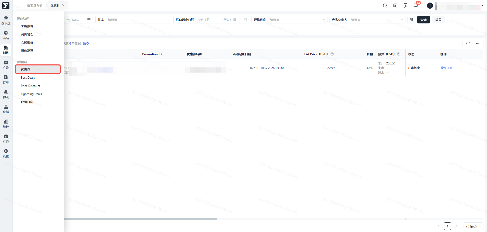

### 点击【创建Coupon】

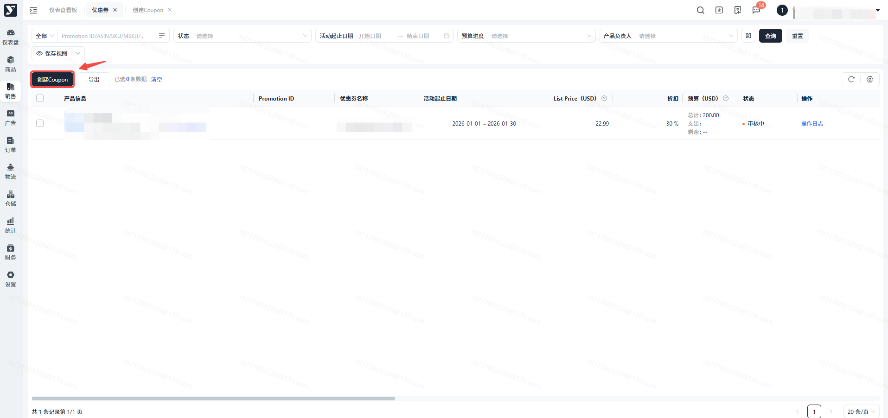

### 填写基本信息

1. 一条ASIN表示一张优惠券
2. 需填写ASIN、折扣、预算、Amazon显示名称、活动起止日期、是否领取一次
3. 最多可添加20个ASIN

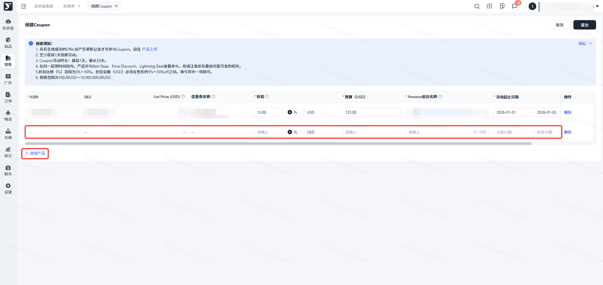

### 提交 Coupon

填写完成后，点击【提交】

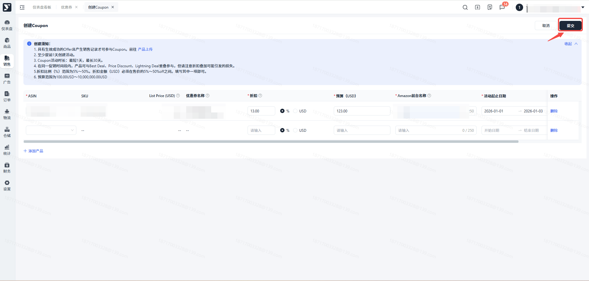

### 创建失败

创建失败的Coupon，支持删除或编辑后再提交

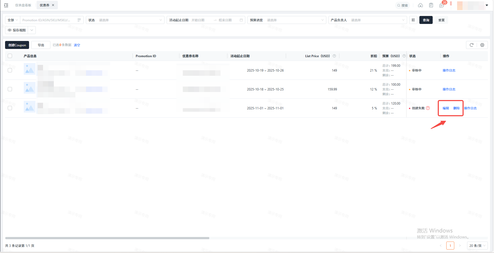

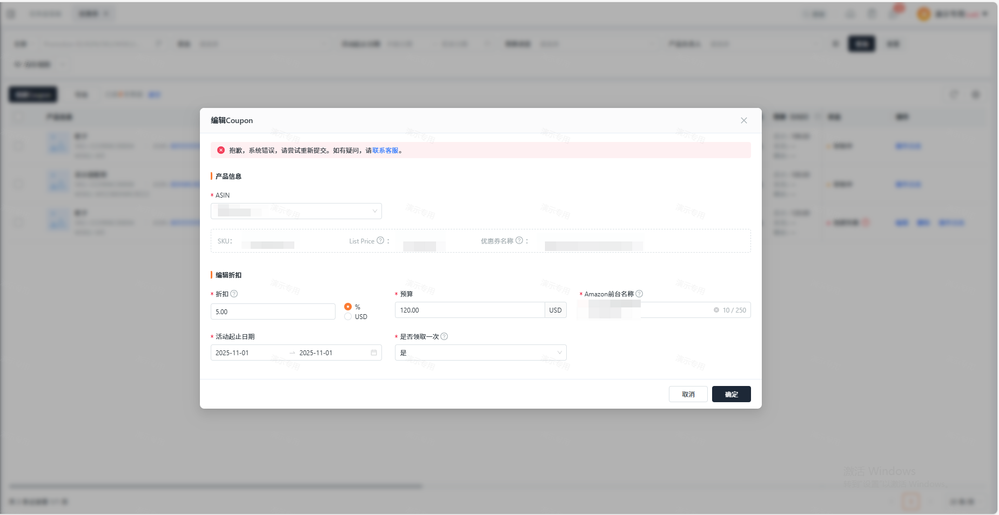

### 创建超时

创建Coupon超时，支持点击确认再次提交

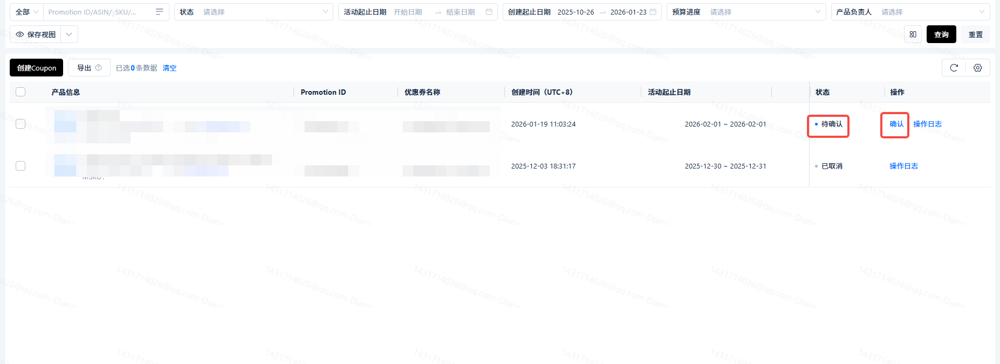

### 列表页可查看Coupon使用情况

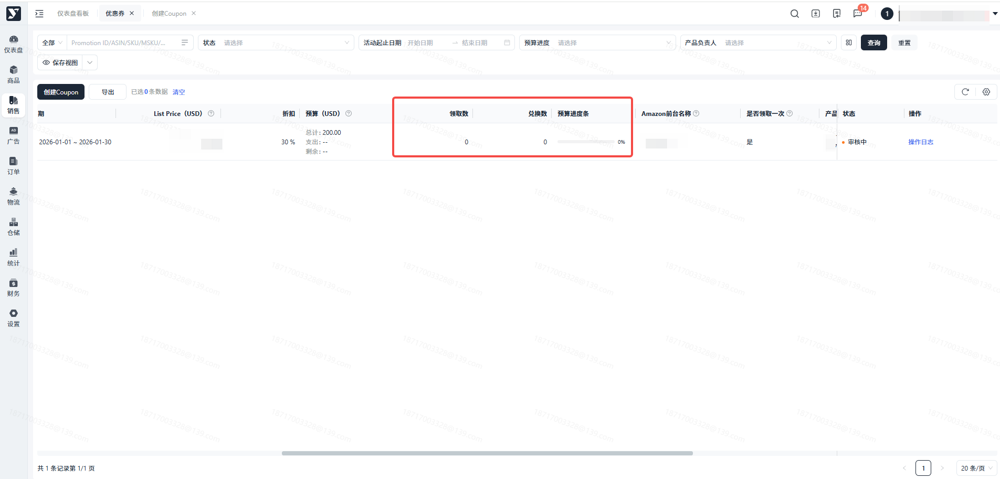

### 编辑或取消 Coupon

待生效/生效中/预算不足的Coupon，可编辑预算、取消Coupon

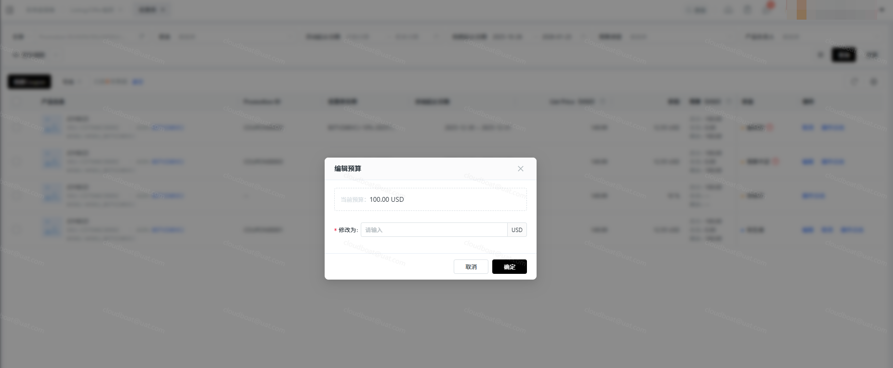

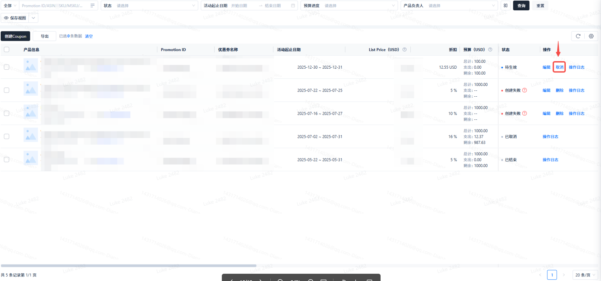

### Coupon 被抑制

待生效/生效中/预算不足的Coupon，检测到错误，此Coupon状态会变为“被抑制”，可取消Coupon

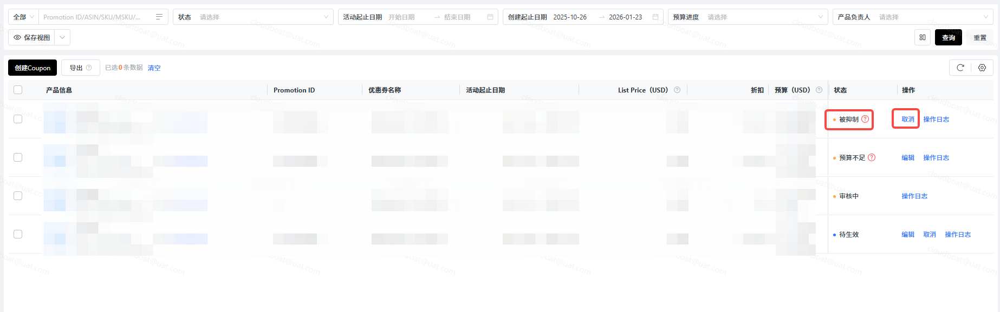

### 预算使用率≥80%，系统自动发送站内通知

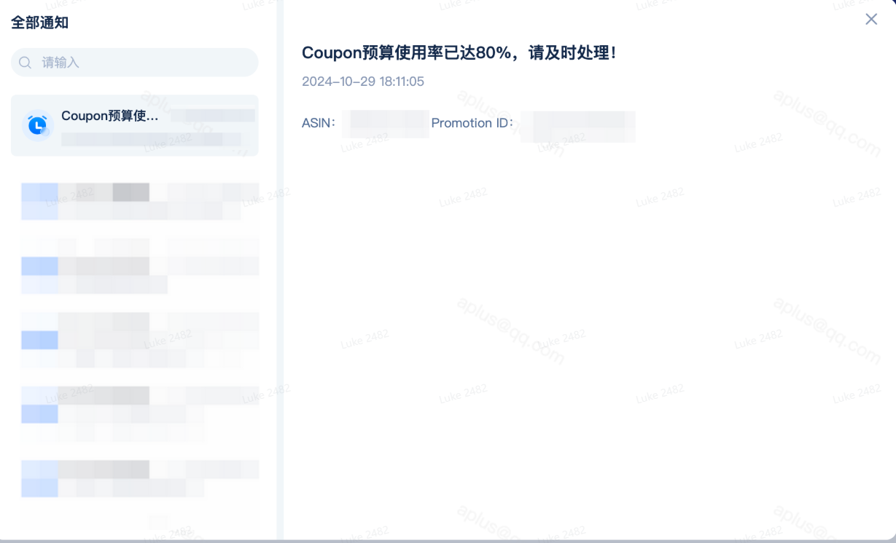

## 常见问题

答：Amazon针对做活动的产品，会有一些限制，我们可以通过提高产品Listing页面与销量让产品达到做活动的标准。另外，也可根据报错原因，再次编辑提交。
