# 飞书文档：促销异常统计

## 文档信息

| 项 | 内容 |
| --- | --- |
| 远程文档 | https://q1njej8cpab.feishu.cn/wiki/Vu8ywiWnmiQpxsk5wapcbdFzn6g |
| 图片处理 | 本地下载（assets/images） |
| 快照时间 | 2026-08-06 |
| 来源命令 | `lark-cli docs +fetch --api-version v2 --doc https://q1njej8cpab.feishu.cn/wiki/Vu8ywiWnmiQpxsk5wapcbdFzn6g --doc-format markdown --as user --format json --jq .data.document.content` |
| 格式处理 | fd-doc-markdown-sync/scripts/normalize-feishu-doc-markdown.mjs |

---

促销异常统计

当前版本：v2.0.0

## 功能介绍

1. 当检查到优惠券、BD、PD和LD活动下ASIN报错时，系统自动记录活动报错信息，并抓取报错ASIN当时前台页面、购物车、价格和库存等相关指标异常情况；
2. 当检查到报错ASIN报错消失时，记录报错消失时间，并再次抓取该ASIN现在前台页面、购物车、价格和库存等相关指标异常情况；
3. 再通过饼图和趋势图等可视化组件，直观展示异常分布与趋势，以及查看活动ASIN当前和历史报错情况；

特别说明：北京时间2026-05-19 18点之后活动出现的报错，系统才会记录。

## 页面路径

【销售】-【营销推广】-【促销异常统计】

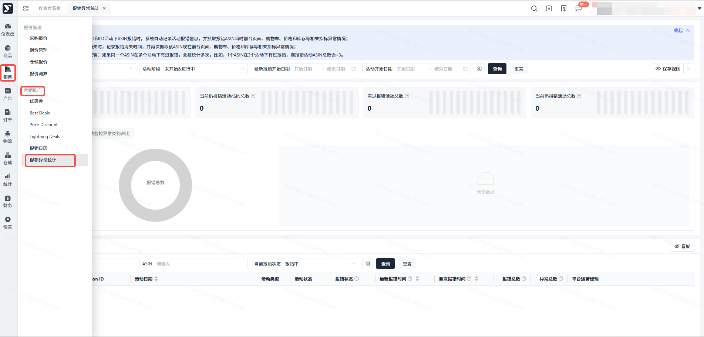

## 操作说明

### 功能须知，可点击收起

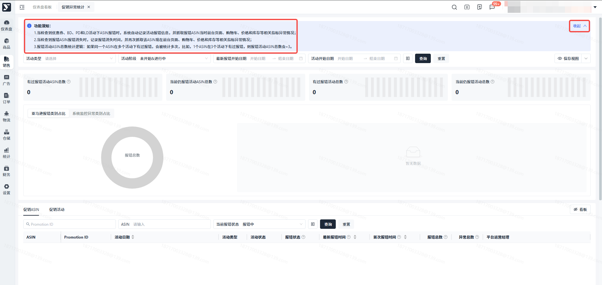

### 支持按 活动类型、动类型、活动阶段、最新报错开始日期、活动开始日期 筛选，默认查看 未开始&进行中 活动阶段

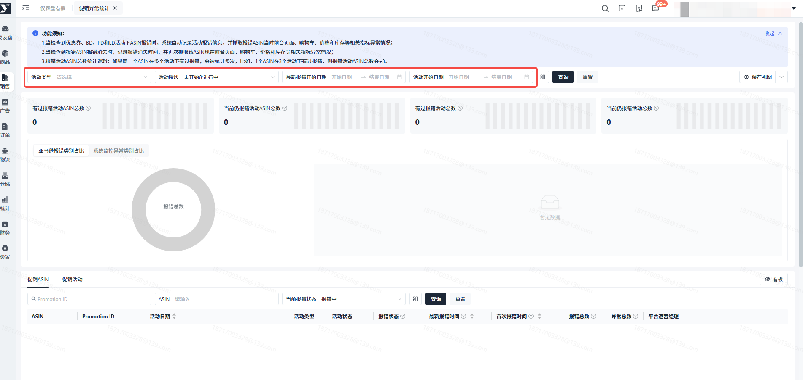

### 只能查看自己有权限的促销产品

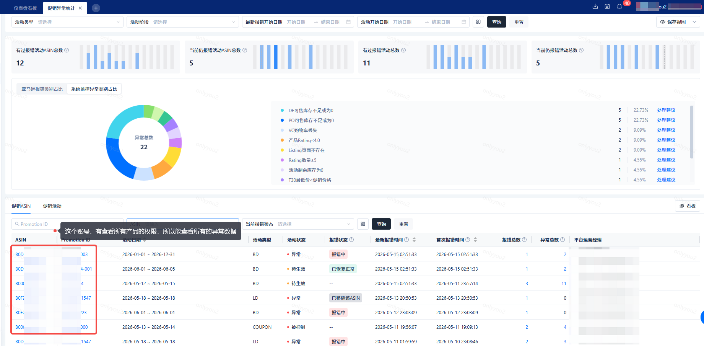

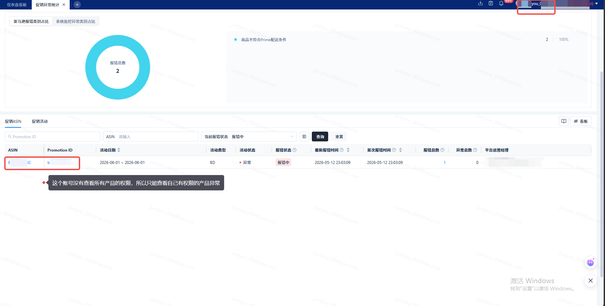

### 上方根据筛选条件统计 有过报错活动ASIN总数、当前仍报错活动ASIN总数、有过报错活动总数、当前仍报错活动总数 4个指标，悬停？小图标查看指标释义

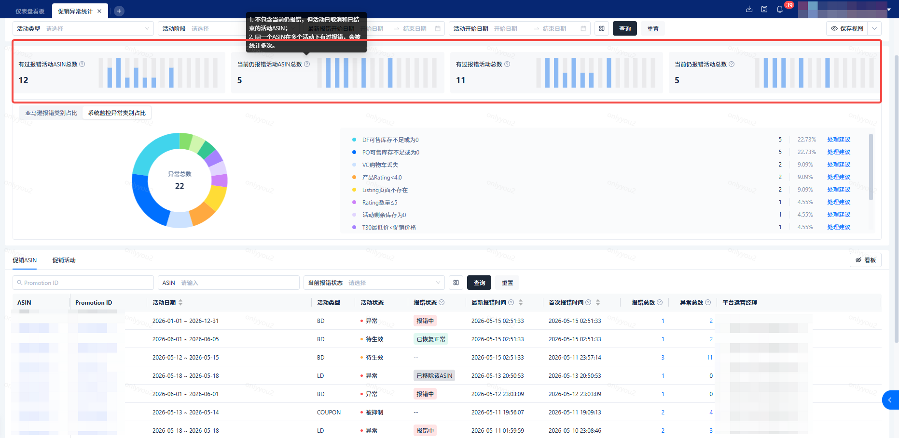

### 4个统计指标右侧展示最近14天首次报错的数据柱状图，数据与上方筛选条件联动

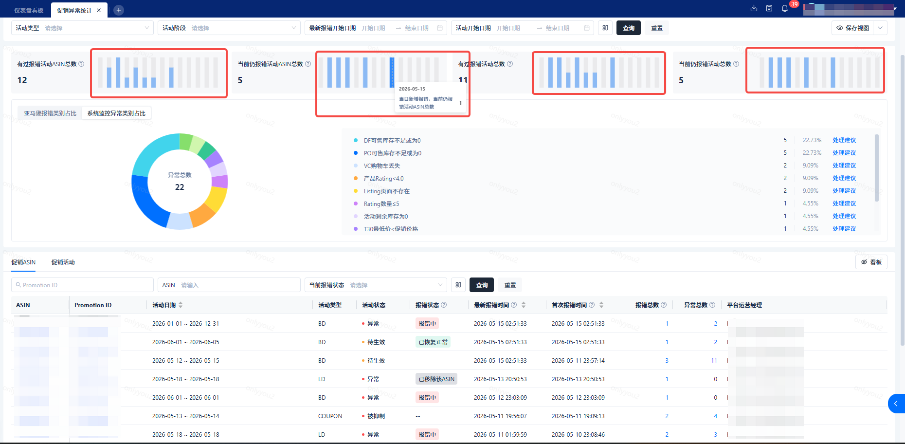

### 中间左侧饼状图，右侧表格展示亚马逊报错类型占比和系统监控异常类型占比，数据与上方筛选条件联动

> 1. 左侧饼状图，中间展示报错/异常总数，悬停到具体的某个色块，展示对应的报错/异常信息、占比和数量
> 2. 右侧表格：依次展示报错/异常信息、占比和数量，按占比倒序
> 3. 某个活动的某个ASIN，同一种错误/异常出现多次，直接统计多次，不会去重
> 4. 报错信息展示的是系统包装后的错误文案，未包装的错误，按亚马逊报错的信息展示
> 5. 特别说明：这里统计是满足筛选条件的报错活动ASIN，历史所有的报错和异常情况

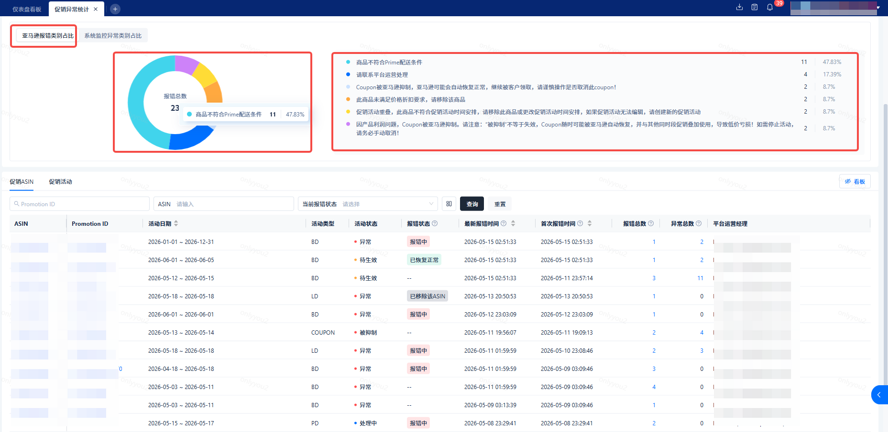

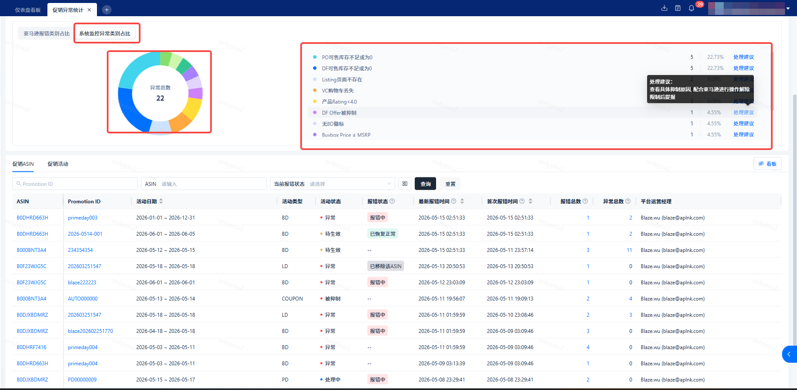

> 下方列表右侧，可以点击 看板 按钮，隐藏和展示统计区域

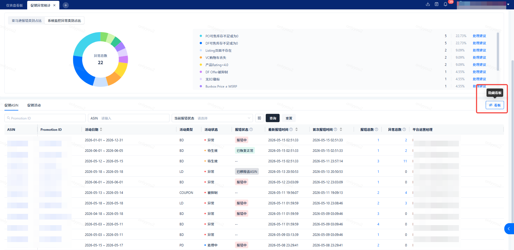

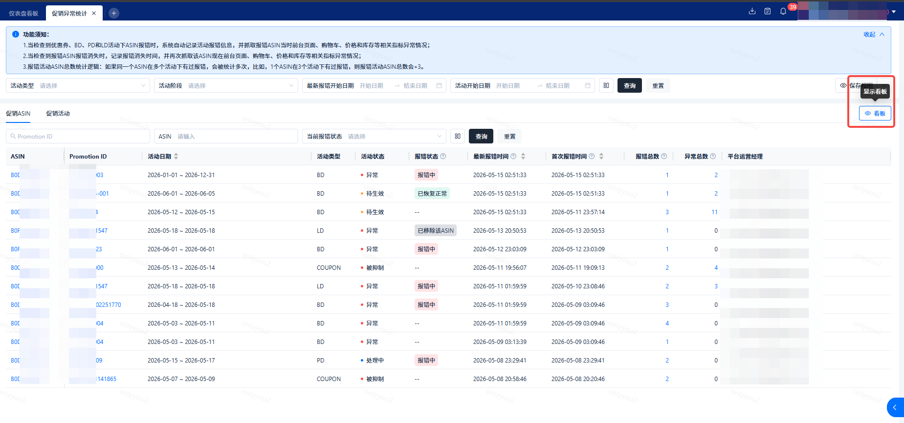

### 下方促销ASIN异常列表

#### 支持按 Promotion ID、ASIN和当前报错状态 筛选，默认查看 报错中，与上方搜索条件联动

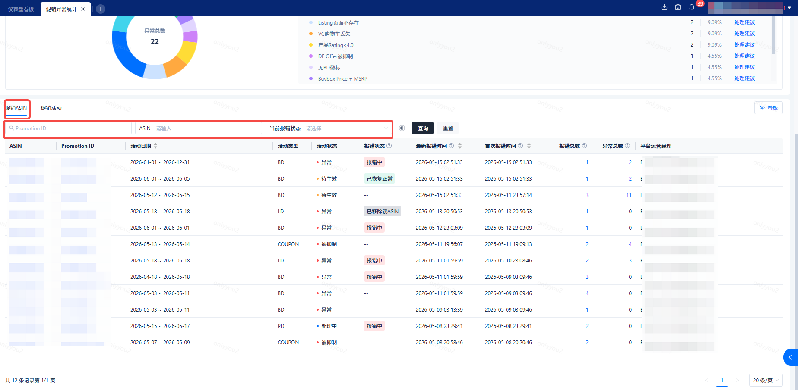

#### 列表展示 ASIN、Promotion ID、活动日期、活动类型、活动状态、报错状态、最新报错时间、首次报错时间、报错总数、异常总数、平台运营经理

> - ASIN：支持复制和跳转到亚马逊前台
> - Promotion ID：支持复制和跳转到对应活动列表页
> - 活动日期、最新报错日期、首次报错时间支持排序
> - 报错状态、最新报错日期、首次报错时间、报错总数、异常总数有气泡提示
> - 报错和异常总数大于0时，点击弹窗查看历史

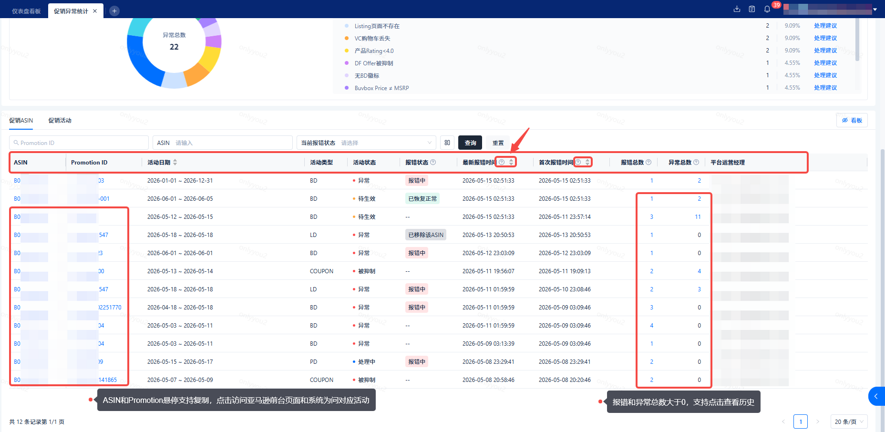

#### 某个活动下如果有多个ASIN报错，那么会记录多条

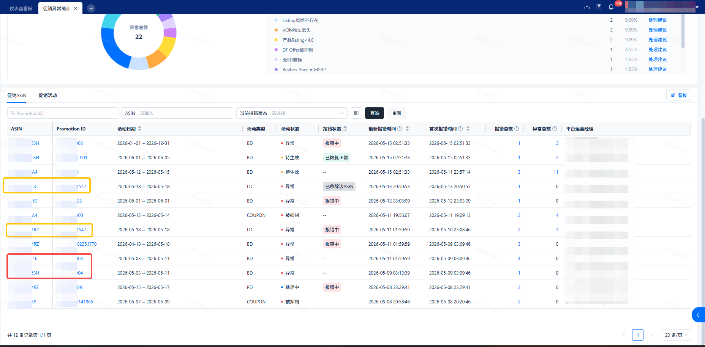

#### 促销ASIN报错详情

> 1. 上方展示：Promotion ID、活动状态、活动类型、ASIN、报错状态
> 2. 下方表格展示：报错发生时间、报错消失时间和具体报错信，按报错发生时间倒序

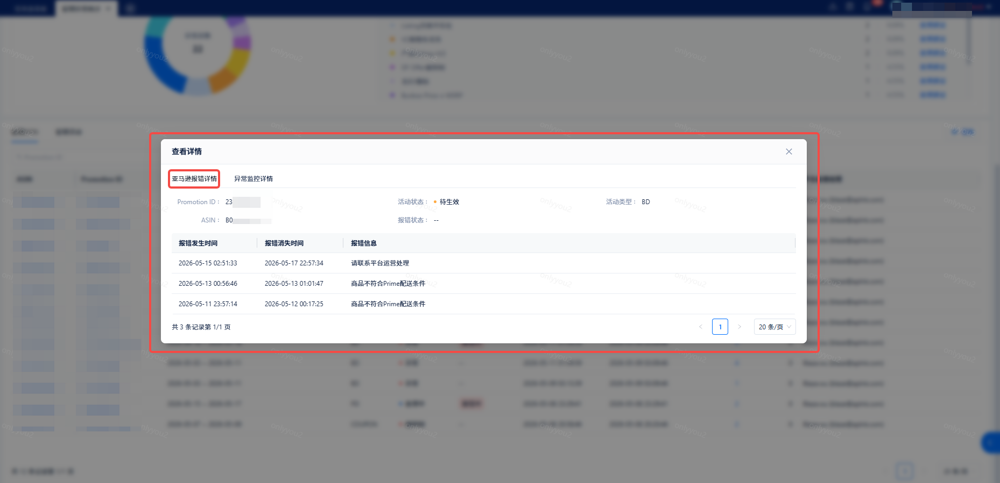

#### 促销ASIN异常详情

> 1. 上方展示：Promotion ID、活动状态、活动类型、ASIN、报错状态
> 2. 下方表格展示：监控异常时间、异常消失时间和具体异常信息，默认按监控异常时间倒序

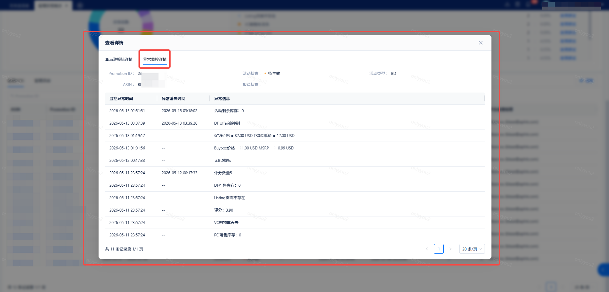

### 下方促销活动异常列表

#### 支持按 Promotion ID和当前是否存在报错ASIN 筛选，默认查看 存在报错ASIN数据，与上方搜索条件联动

#### 列表展示 Promotion ID、活动日期、活动类型、活动状态、当前报错活动ASIN数、历史报错活动ASIN数、最新报错时间、首次报错时间、报错总数、异常总数、平台运营经理

> - Promotion ID：支持复制和跳转到对应活动列表页
> - 活动日期、最新报错日期、首次报错时间支持排序
> - 当前报错活动ASIN数、历史报错活动ASIN数、报错状态、最新报错日期、首次报错时间、报错总数、异常总数有气泡提示
> - 报错和异常总数大于0时，点击弹窗查看历史

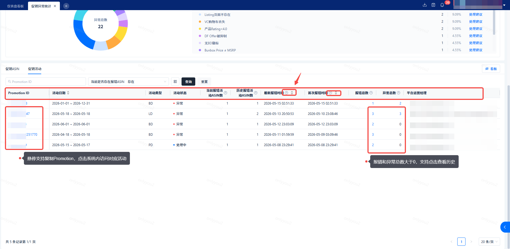

#### 促销ASIN报错详情

> 1. 上方展示：Promotion ID、活动状态、活动类型
> 2. 下方表格展示：报错ASIN、报错发生时间、报错消失时间和具体报错信，默认按 报错发生时间 + ASIN 倒序（双排序）
> 3. 支持按ASIN排序

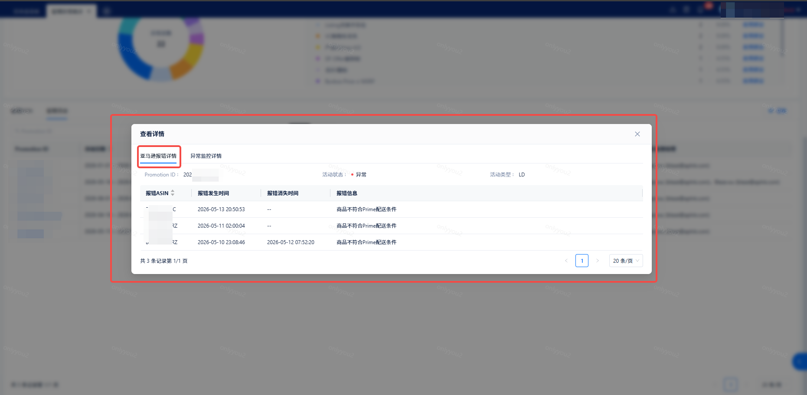

#### 促销ASIN异常详情

> 1. 上方展示：Promotion ID、活动状态、活动类型
> 2. 下方表格展示：报错ASIN、监控异常时间、异常消失时间和具体异常信息，默认按 监控异常时间 + ASIN 倒序（双排序）
> 3. 支持按ASIN排序

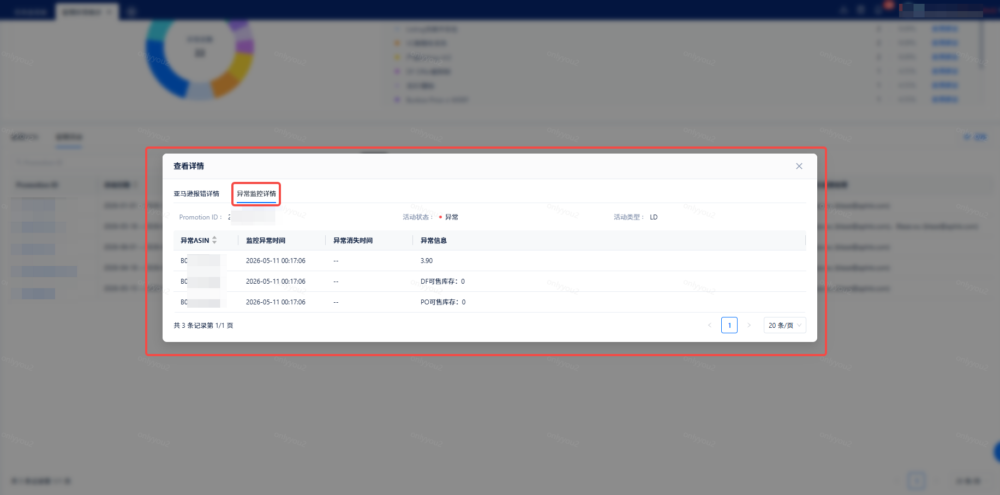

## 常见问题

### Q1：为什么某个活动出现了报错，报错异常统计功能页面没有被统计呢？

A1：系统每隔一个小时检查一次活动报错情况，如果活动出现报错，马上就被处理了，系统检查时活动已恢复正常，这种情况的报错不会被记录。
