# 飞书文档：促销日历

## 功能介绍

1. 功能说明：促销日历整合了Coupon/BD/PD/LD各类促销活动的排期信息。通过周/月/年视图，可直观掌握各产品的促销分布、价格策略及转化效果。
2. 功能价值：

- 运营层面： 帮助运营人员科学规划亚马逊VC各类促销活动时间，做到有章可循。通过分析历史促销节奏、价格走势及转化数据，最大化资源效益。
- 管理层面： 确保促销活动与平台大促、节日及公司营销计划紧密协同，清晰呈现活动效果，为管理层调配资源和决策提供有力依据。

## 页面路径

【促销】-【营销推广】-【促销日历】

## 操作说明

### 3.1 日历模式

#### ①周

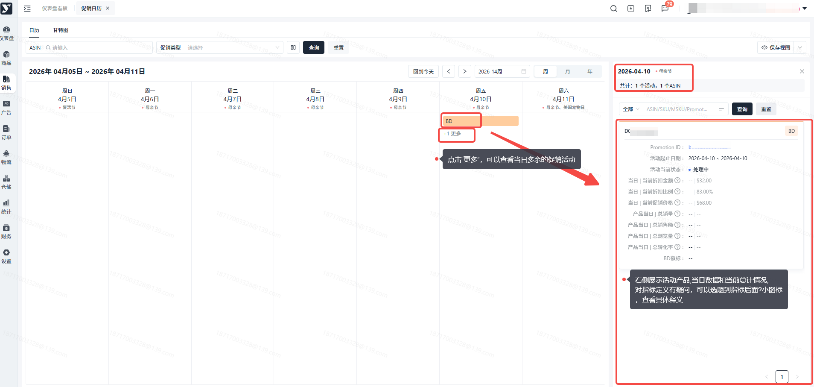

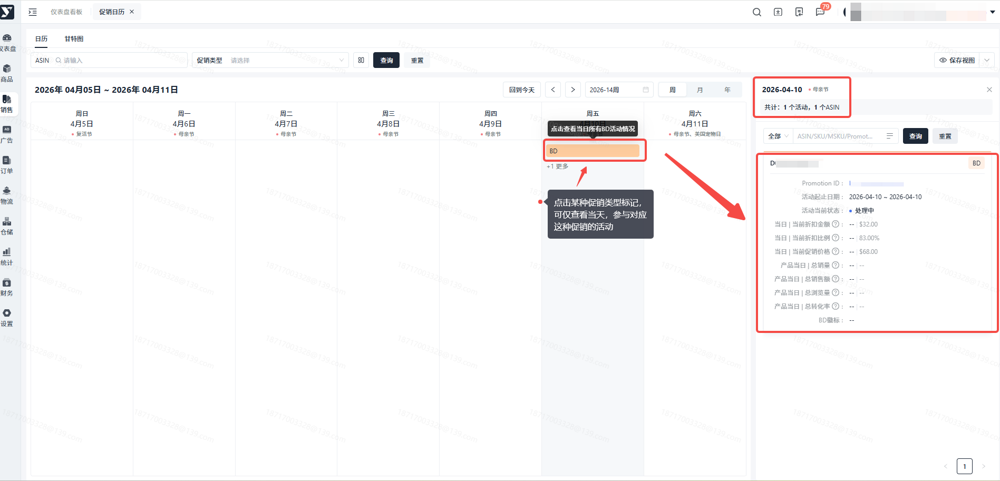

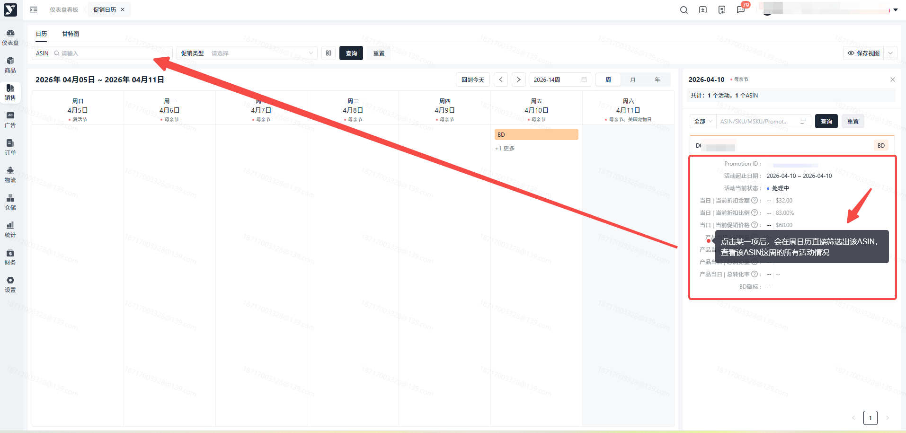

以**单周日历（通常周日到周六）** 为视图，**聚焦展示单个特定ASIN**在该周内所有促销活动的更详细、更临时的执行信息。

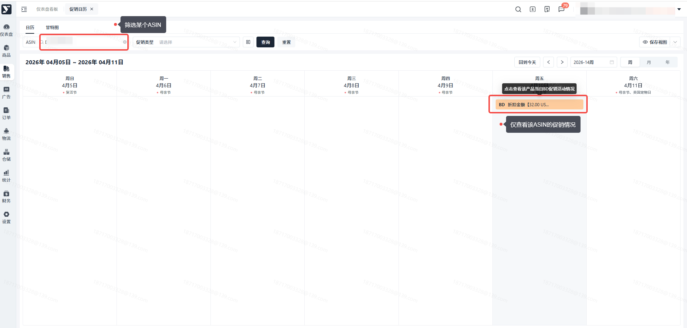

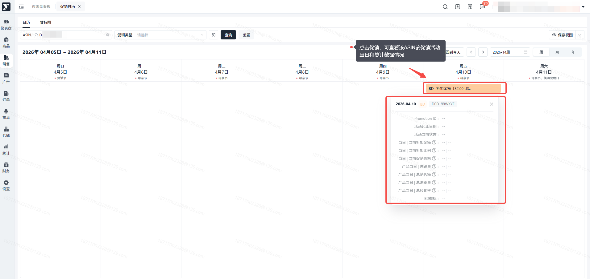

#### ②月

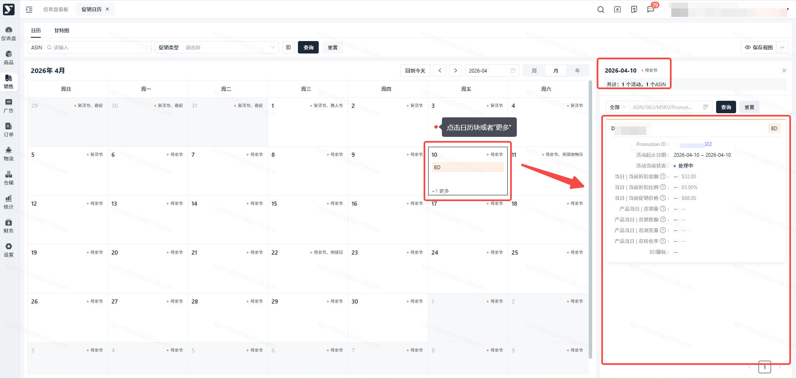

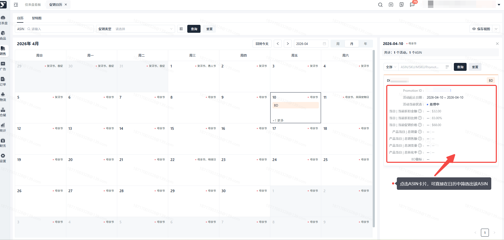

以**单月日历**为视图，**聚焦展示单个特定ASIN**在该月内所有已安排和计划中的促销活动详细信息。

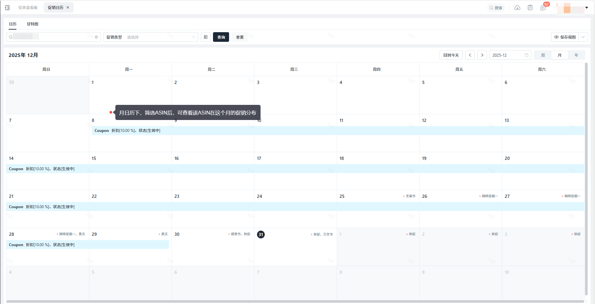

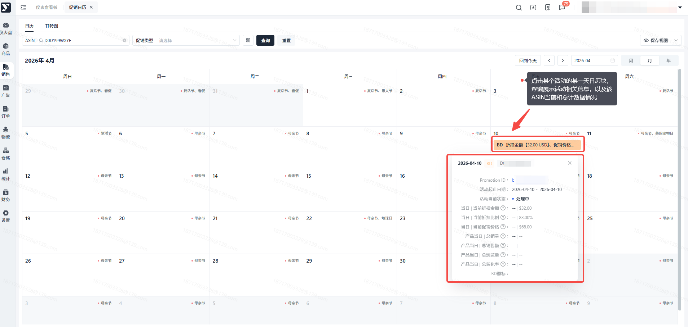

#### ③年

以**全年日历**为视图，重点标注**亚马逊全球/站点级别固定的大型促销节日（Prime Day, Black Friday, Cyber Monday等）**，以及战略层计划的关键促销周期。

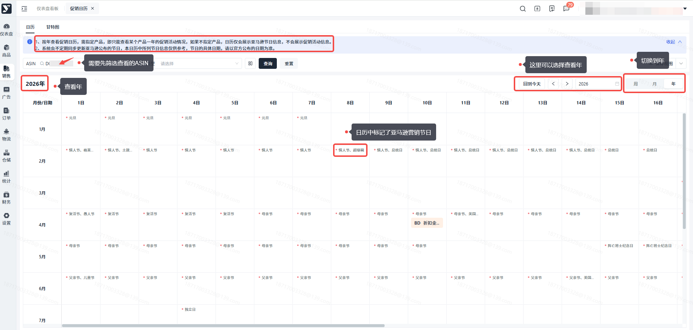

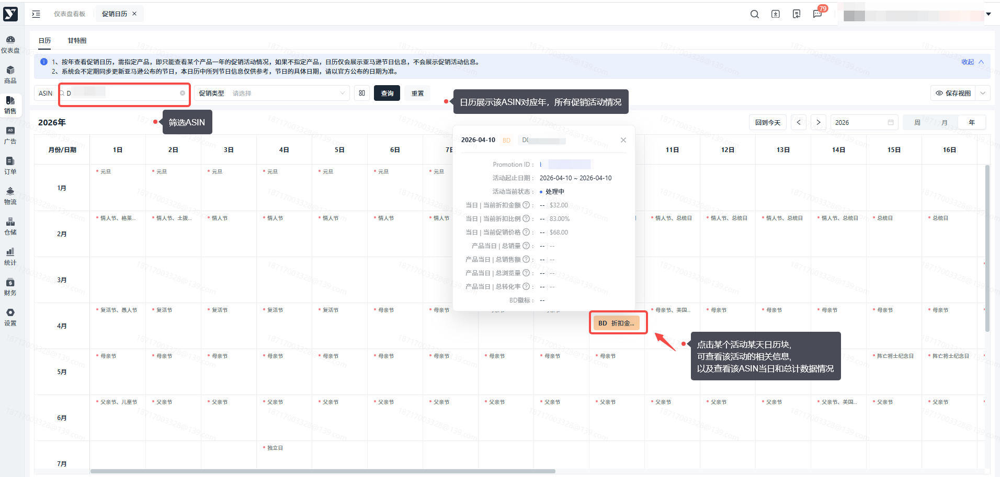

### 3.2 甘特图模式

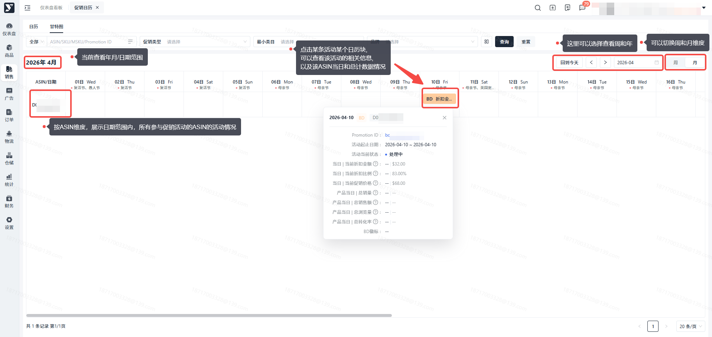

## 常见问题

### Q1：同一个时间段，只展示了2个促销活动，少展示了其他参与的促销，这是为什么？

A1：这是因为同一时间段，系统内最多呈现2个促销活动。

### Q2：为什么25年8月份之前没有Coupon当日领取数、兑换数？

A2：这是因为系统未记录历史Coupon每日数据，8月7日之后参加的Coupon，可查看到每日数据。

### Q3：为什么25年6月份之前没有BD/PD/LD的每日销量、转化率、徽标的数据？

A3：这是因为系统未记录6月份之前的每日数据，6月25日之后参与的BD/PD/LD，可查看到每日数据。

### Q4：即将开始标记是什么意思？

A4：活动开始前3天，系统内会对活动进行标记，提醒您活动即将开始，检查活动折扣情况。
