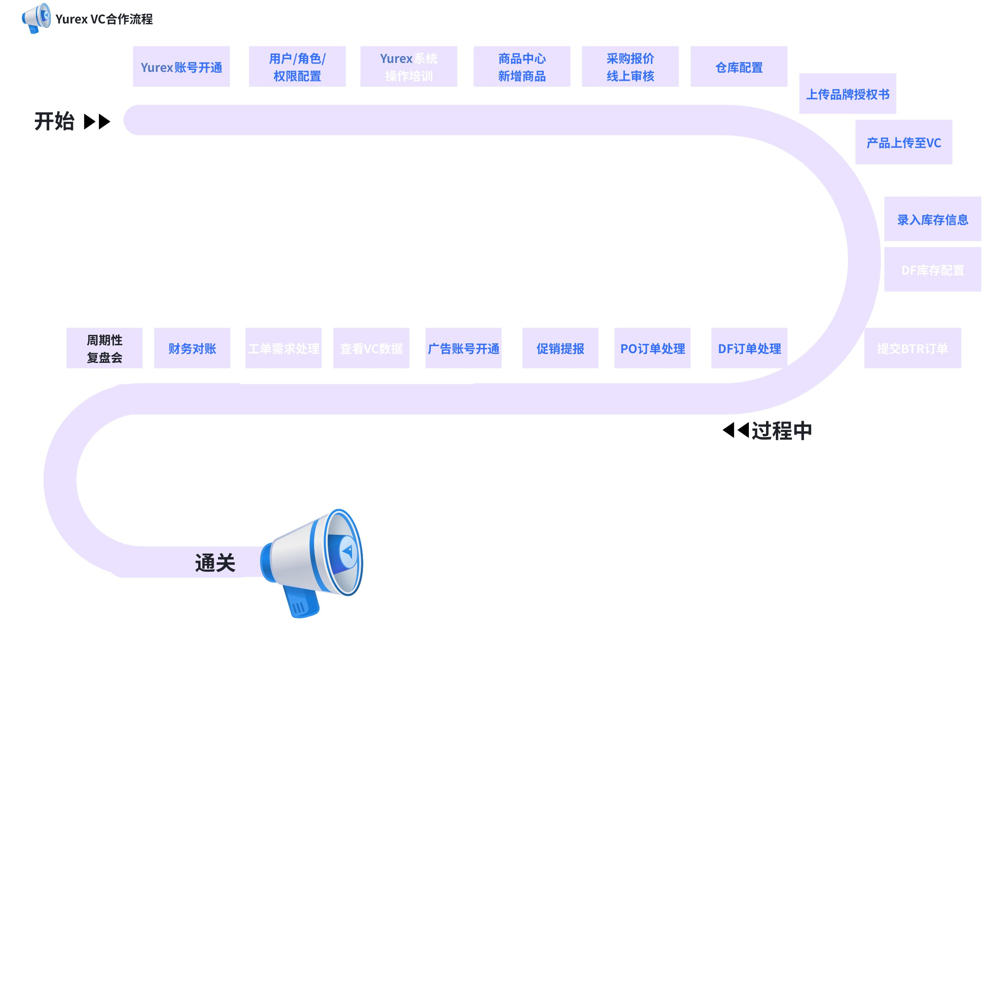

# 飞书文档：Yurex业务流程

## 文档信息

| 项 | 内容 |
| --- | --- |
| 远程文档 | https://q1njej8cpab.feishu.cn/wiki/QypLw7LW3ivy4kkcJ3jcnmnKnVb |
| 图片处理 | 本地下载（assets/images） |
| 快照时间 | 2026-08-06 |
| 来源命令 | `lark-cli docs +fetch --as user --doc "<remote>" --jq ".data.markdown"` |
| 格式处理 | fd-doc-markdown-sync/scripts/normalize-feishu-doc-markdown.mjs |

---

Yurex业务流程

**为了帮助您快速上手，我们梳理了入驻VC 的全链路流程，建议您在操作前先行预览。既可纵览合作全貌，点击具体环节又能查看详细教程。如有疑问，欢迎随时联系您的运营负责人。**
**登录入口（推荐谷歌浏览器）：**[**https://user.yurexcc.com**](https://user.yurexcc.com/)

## 业务主流程

**点击具体模块，可跳转操作文档SOP。**

> 画板来源：token=`HaTQwxWYNheFX4bE5WIc1vmanwd`
