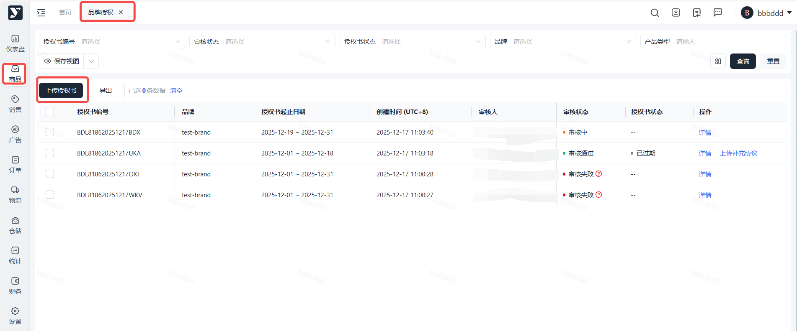
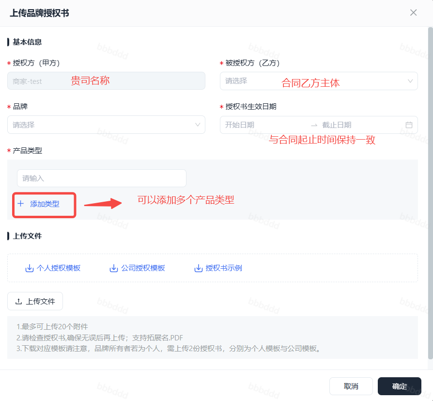
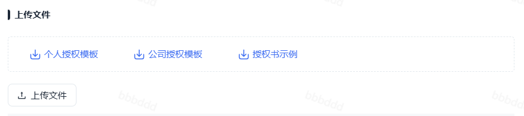
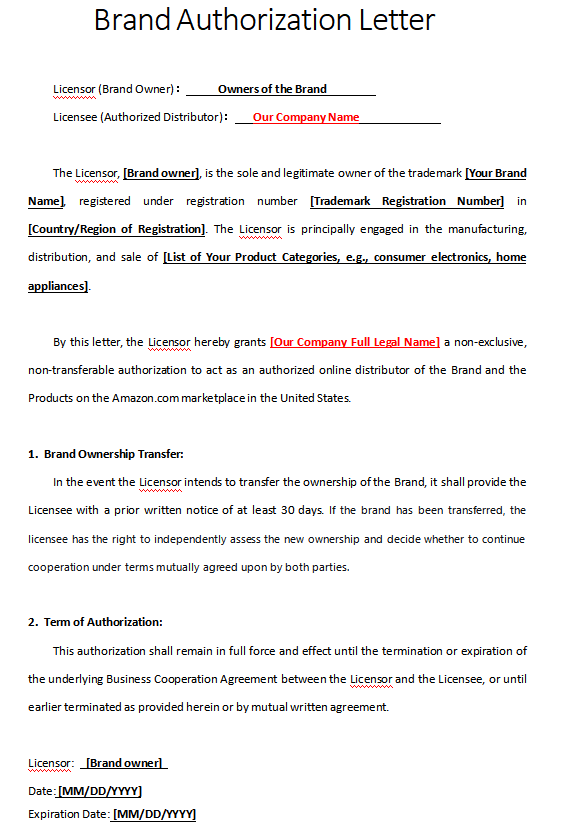
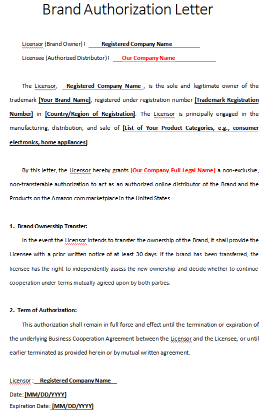
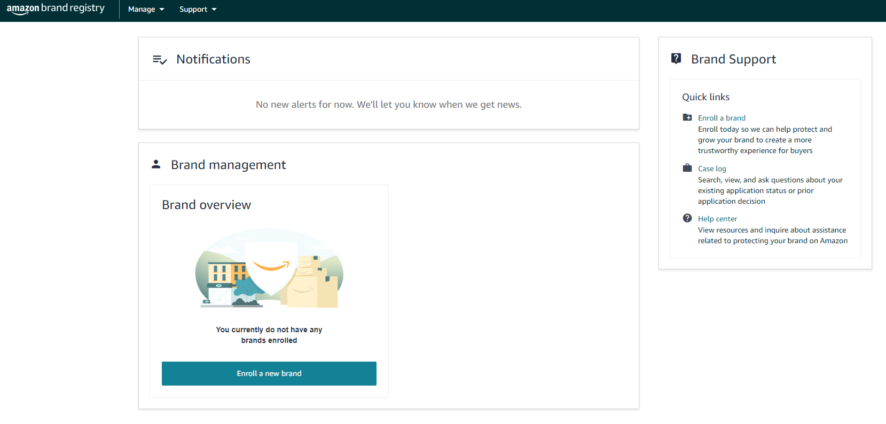
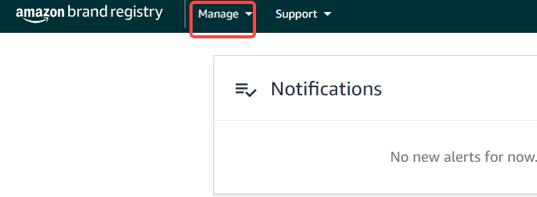

# 飞书文档：品牌授权指南

## 前提

为保证双方合作的合规性，我司要求客户在合作初期**将需要入驻的VC品牌对我司美国公司主体进行品牌授权**。如果后续需要增加其他品牌或者原品牌下其他品类产品（原品牌授权书中不包含的品类），**需要同步签署品牌授权书的附加协议**，并上传至Yurex系统中。

## 系统操作流程

### **操作路径**

商品>品牌授权>上传授权书

### **操作步骤**

#### 进入页面

#### 按照要求填写信息

注释：
1. **授权方（甲方）**：默认不可修改
2. **选择被授权方（乙方）**：即合同签署的乙方-VC账号主体
3. 选择产品所属品牌，多个品牌需上传多份品牌授权书，一次只能选择一个品牌，多个品牌需上传多次
4. 选择授权书生效日期，与合同起止日期保持一致
5. 输入产品类型，可添加多个品类，单次最多20个产品类型

#### 下载授权书模板和授权书示例

- **品牌所有者若为个人，使用个人模板，然后签名+手印；若为公司，使用公司模板，并盖公章。**
- 品牌所有者若为**香港/境外主体公司**，需在**公章旁补充法人签名（全名）。**
- **注意：**若商标为TM标，需将模板中的注册号（registration number）改为序列号（serial number）填写

#### 填写授权书模板并上传，**需打印盖章后扫描为PDF文件上传**

1. **个人模板**Licensor：**授权人，填写品牌拥有者的全名，且和USPTO官网当前的Current Owners一致**Licensee：被授权人, Yurex ChainTech Inc. （我司名称） 授权方**[品牌所有者]**是商标**[您的品牌名称]**的唯一合法所有者，该商标已在**[注册国家/地区]**注册，注册号为**[商标注册号]**。授权方主要从事**[您的产品类别列表，例如：消费电子产品、家用电器]**的制造、分销和销售。通过本函件，授权方在此授予Yurex ChainTech Inc.一项非排他性、不可转让的授权，允许其在美国（[Amazon.com](https://amazon.com/)）平台上作为品牌及产品的授权在线经销商。1. 品牌所有权转让：
若授权方拟转让品牌所有权，应至少提前30天向被授权方发出书面通知。若品牌已完成转让，被授权方有权独立评估新所有权方，并决定是否在双方共同商定的条款下继续合作。2. 授权期限：
本授权将持续完全有效，直至授权方与被授权方之间的《合作协议》终止或到期，或根据本授权书规定或双方书面协议提前终止。Licensor：授权人**（签名+手印）**Date：授权日期**（合同开始日期 ）**

 

 Expiration Date：截止日期**（合同结束日期 ）**

 个人模板中的Licensor，若[**Uspto官网**](https://www.uspto.gov/)中查询到Current Owner**（**商标证书所列的当前持有人）与当前实际持有人不一致，需下载USPTO官网中的assignment转让授权文件，填写并提交到我司。

2. **公司模板**Licensor：**授权人，注册公司名称，填写公司英文名字（品牌拥有者的注册公司！！）**Licensee：被授权人: Yurex ChainTech Inc. （我司名称）授权方**[注册公司名称]**是商标**[您的品牌名称]**的唯一合法所有者，该商标已在**[注册国家/地区]**注册，注册号为**[商标注册号]**。授权方主要从事**[您的产品类别列表，例如：消费电子产品、家用电器]**的制造、分销和销售。通过本函件，授权方在此授予Yurex ChainTech Inc.一项非排他性、不可转让的授权，允许其在美国（[Amazon.com](https://amazon.com/)）平台上作为品牌及产品的授权在线经销商。1. 品牌所有权转让：
若授权方拟转让品牌所有权，应至少提前30天向被授权方发出书面通知。若品牌已完成转让，被授权方有权独立评估新所有权方，并决定是否在双方共同商定的条款下继续合作。 2. 授权期限：
 本授权将持续完全有效，直至授权方与被授权方之间的《合作协议》终止或到期，或根据本授权书规定或双方书面协议提前终止。Licensor：授权方**（注册公司名称+公章）**Date：授权日期**（合同开始日期 ）**

 

 Expiration Date：截止日期**（合同结束日期 ）**

 **Yurex ChainTech Inc. 是授权时我司名称，签约客户必须有合约和保密意识！！！**

#### 上传完品牌授权书附件，提交给Yurex审核。

#### 后续请关注审核状态; 如被驳回，可询问我司运营具体原因，修改并重新提交。

## 了解品牌授权角色与权益

### 品牌注册的角色定义

1. **Protection Roles 保护角色：**如果您作为品牌注册的申请人，**提交了商标并成功完成品牌注册**，您的品牌注册账户将**自动成为“权利所有者+管理员”**。作为管理员，您拥有账户管理权限，可添加其他用户并为其分配1-2个账户角色。**仅管理员拥有为其他用户分配账户角色的权限。**

 - Administrator（管理员/品牌所有者）: 拥有添加、移出用户的权限，可为其他用户分配角色。
 - Rights Owner（权利所有者）: 指商标所有者或其属下有权举报违规行为的员工。 权利所有者有权使用“举报违规行为”工具。
 - Registered Agent（注册代理）: 指经权利所有者授权的第三方， 可以使用“举报违规行为”工具
2. **Selling Roles 销售角色：**

 - VC分销模式下，需要被SC品牌持有者备案店铺授权至以下角色之一，品牌方可视自身品牌规划需要选择对应的角色授权
 - **Brand Representative（品牌代表）:** 直接受雇于您品牌的销售合作伙伴【推荐>VC可获取所有品牌卖家权益，包括virtual bunddle】
 - **Reseller（分销商）:** 在亚马逊商店销售您品牌产品的外部第三方销售合作伙伴【不太推荐，品牌权限受限、无法使用更多品牌分析和引流工具】

### 品牌注册后能够使用的权益

## 申请品牌授权流程

### 第一步：联系您的平台主运营，申请获取“Vendor Account ID”

### 第二步：我们将以站内信形式将信息告知给您

### 第三步：请品牌方严格按照下文操作，完成品牌授权

#### 操作步骤详情

1. 打开Amazon Brand Registry网址：https://brandregistry.amazon.com/

 
2. 点击页面上方**「Manage」**→**「Manage selling roles」**

 
3. 点击 **「Connect a selling partner account」**
4. 选择**「Seller Central accounts」**or **「Vendor Central accounts」**，在这里我们选择VC账户。
5. 选择想要分配的销售角色至VC账户，**「Brand Representative」**or**「Reseller」**，您可以根据目标授权的权利范围选择对应角色授权，推荐**Brand Representative**
6. 授权至VC账号，需要被授权VC账号的**「Account ID」**

 1. 请联系您的平台运营经理申请获取**Vendor Account ID**（我们会以站内信通知形式告知您）
 2. 注意：账户ID始终以“**amzn1.pa.o**”开头。
7. 选择您需要授权的品牌
8. 点击**「Connect selling account」**，告知被授权品牌的账号

我们会随后收到一封邮件，在SC后台或者VC后台通过指示说明接受品牌邀请。当我们作为销售伙伴选择接受品牌邀请，销售角色将会以**“active”**的状态显示在客户账号的**brand registry**顶部**tab**里的**「Connected 」**中的**「Manage selling roles」**

#### 操作视频演示

## SC品牌注册指南

**请查阅：**[**2025最新亚马逊品牌注册流程手册（源自 亚马逊全球开店）**](https://mp.weixin.qq.com/s/jXsZl0WeLI37TLXD6bVXng)
