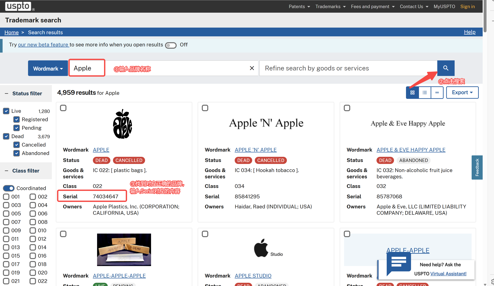
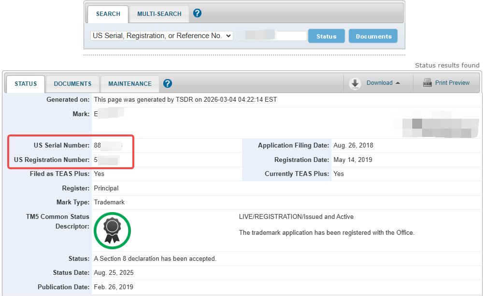
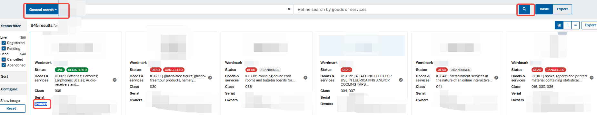
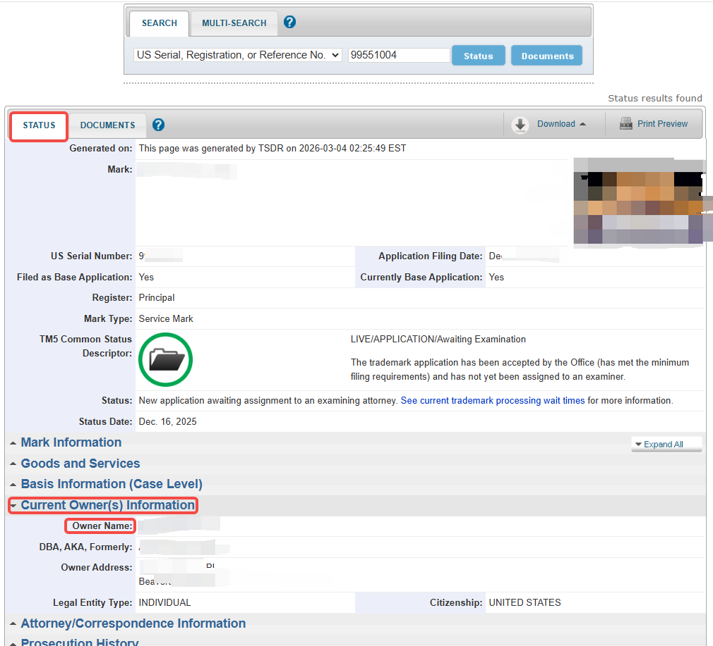
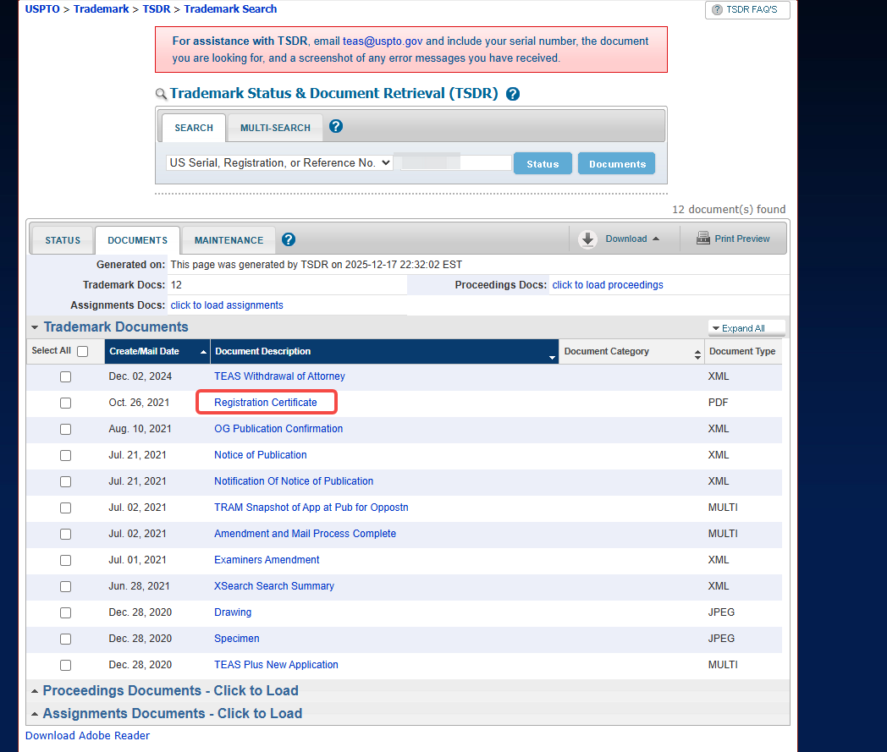
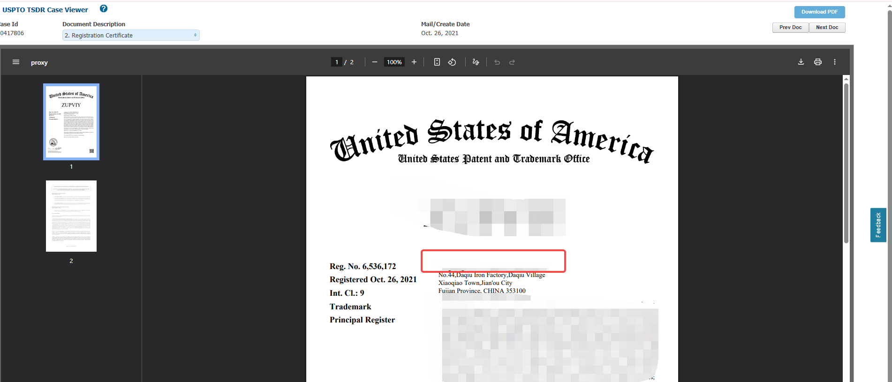
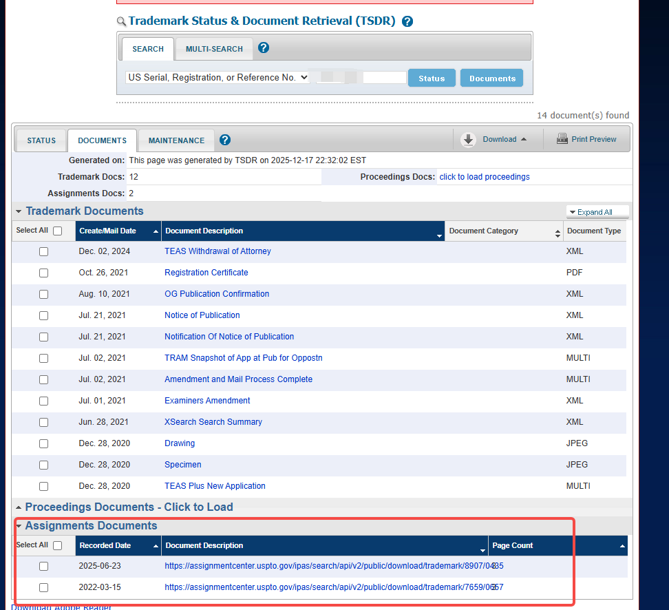
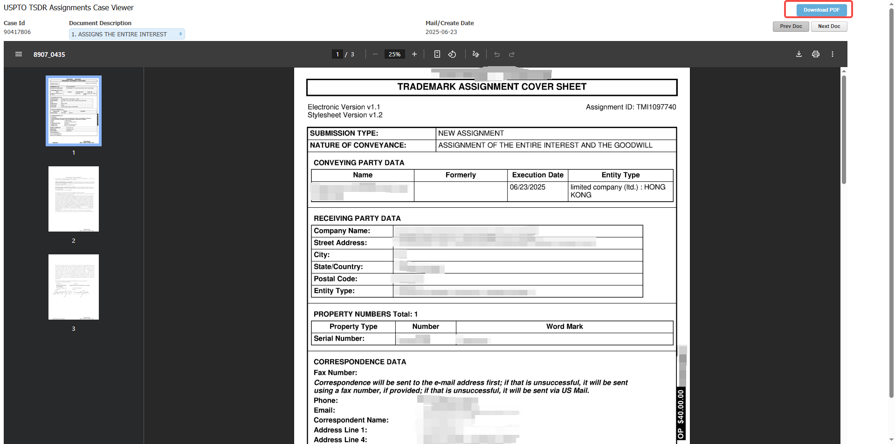
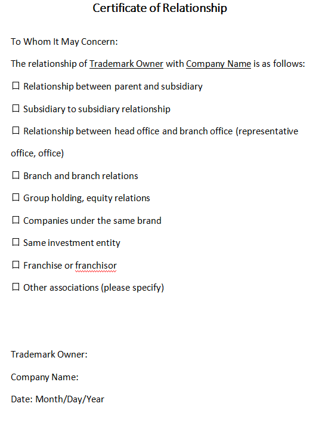

# 飞书文档：商标信息确认

**您可以点击下方目录，快捷跳转对应操作指引。**

## 一、如何查询商标序列号及注册号？

1. 请点击链接，进入对应网址：https://tmsearch.uspto.gov/search/search-information
2. 输入品牌名称点击查询，可直接查看对应品牌信息下的商标序列号

1. 点击上图**【Wordmark】**对应的品牌名称，等待跳转到下图页面可在**【STATUS】**页面查看序列号（US Serial Number）、注册号（US Registration Number）

注意：T标无注册号填写序列号即可

## 二、如何查询商标所有者及下载商标证书？

**确认当前持有人和商标注册人是否一致，确认持有人**

1. 进入网址：https://tmsearch.uspto.gov/search/search-information

**【General search】或【Wordmark】**搜索框搜索自己的品牌名称，一般跳转出来的前几个即为对应的品牌。查看对应字段【**Owners**】即为**当前的持有人**是谁

1. 点击上图**【Wordmark】**那里对应的品牌名称，等待跳转到下图页面
2. **【STATUS】**页面点开**【Current Owners Information】**，能够看到**当前的持有人**信息

1. 点击**【DOCUMENTS】**按钮，等待跳转到对应的文件下载页面；点击**【Registration Certificate】**按钮，将会跳转到后面的商标证书下载界面

1. 确认注册人，红框中会显示对应的注册人是谁；点击右上角蓝色方框的**【Download PDF】，即可下载商标证书，下载完成后上传系统即可**

**证书示例：**

比对红框中的注册人和【**Owners**】部分显示的持有人是否一致，不一致即存在商标转让，需要查询并下载商标转让文件进行上传

## 三、如何查询和下载商标转让文件？

1. 点击**【Assignments Documents】**，点开**【Document Description】**下的链接，将会跳转到后面的转让授权证书下载界面

1. 跳转后，点击右上角蓝色方框的**【Download PDF】，即可下载商标转让文件，下载完成后上传系统即可。若如上图所示总共转让了两次，则2份文件都需要下载上传**

**证书示例:**

**常见FAQ**
1. **Q:为什么【Assignments Documents】处没有对应的文件，但是当前持有人和注册人不一致?**
A:可以检查一下转让时间，如果是在近期转让的对应的文件显示需要1-2两个月，建议定期刷新查看
及时提交资料
1. **Q:为什么我商标转让已经很久了，但是【Assignments Documents】处转让证明文件一直加载不**
**出来?**
A:建议检查网络，关闭VPN重新尝试
1. **Q:同一个商标我注册了很多大类，我应该选择哪个大类进行提交?**
A:要选择商标涵盖了入驻我司产品类目的那一个，如果后续新增了其它类目，需要补充提交对应其他的
资料
1. **Q:同一个商标我转让了3次，这个是否有风险呢?**
A:我司不接受商标转让记录超过3次的商标，若前一个持有者有违规行为(刷单、侵权、多账户关联被
封)，亚马逊可能会暂停注册品牌的权限
1. **Q:在USPTO中查不到我的商标，怎么办?**
A:请确认:

1. 商标是否已在美国注册(而非仅提交申请)
2. 搜索时是否使用了正确的拼写或基础单词
3. 如果确认已注册但无法查到，可能涉及信息更新延迟或法律状态异常，建议联系您的美国商标律师
或原代理机构核实

## 四、商标所有者与合同主体不一致模板填写规则

点击下载模板保存至本地：

关系证明模板

关系证明（需打印盖章扫描为无其他水印的PDF上传）
致相关人士：
商标所有者与乙方主体的关系如下：
—母公司与子公司的关系
—子公司与子公司的关系
—总公司与分公司（代表处、办事处）的关系
—分公司与分公司的关系
—集团控股、股权关系
—同一品牌下的公司
—同一投资实体
—特许经营或特许人
—其他关联关系（请注明）
（勾选其中一种关系，其他关系请自行描述）
商标所有者: 商标所有者公司名称+盖章/商标所属个人签名+手印
公司名称: 乙方主体+盖章
日期: 合同开始日期
