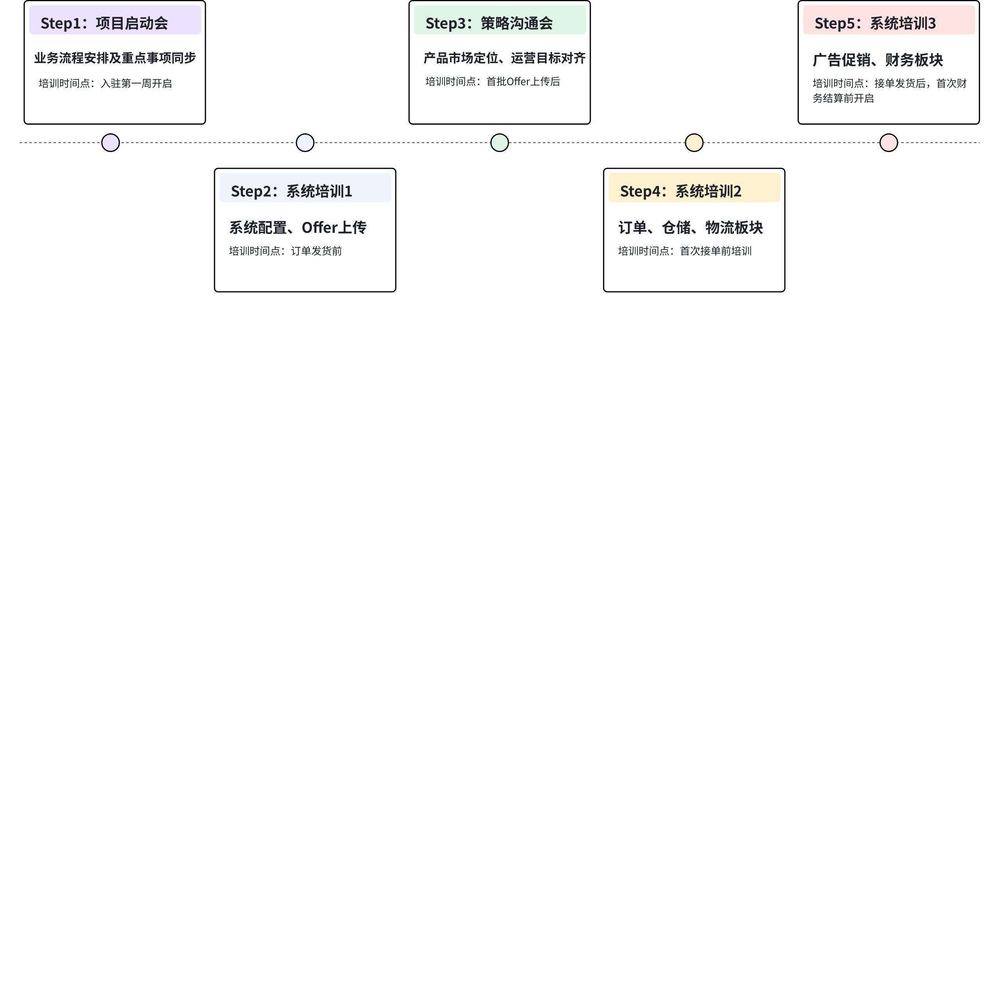
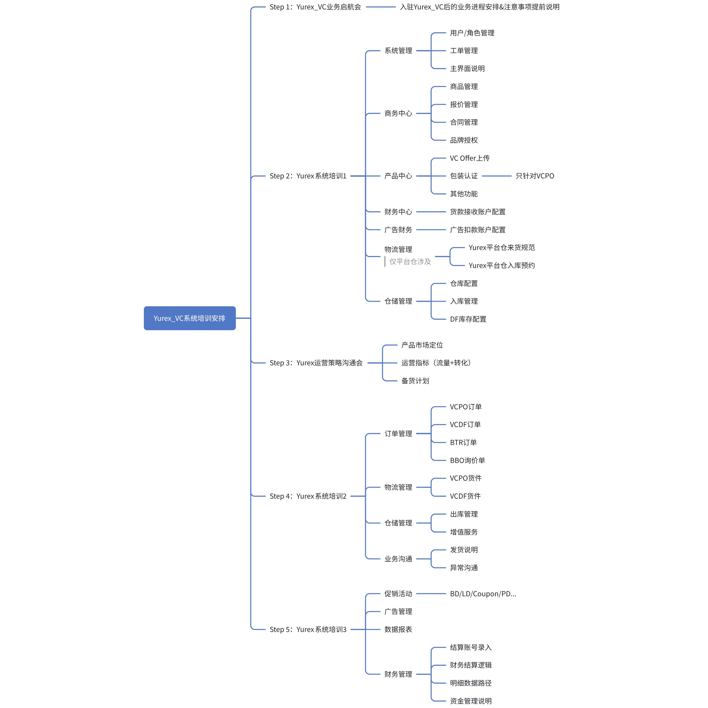

# 飞书文档：系统培训安排

## 文档信息

| 项 | 内容 |
| --- | --- |
| 远程文档 | https://q1njej8cpab.feishu.cn/wiki/UcPmw2Cbci5mYqkpkxBcYp3Enrb |
| 图片处理 | 本地下载（assets/images） |
| 快照时间 | 2026-08-06 |
| 来源命令 | `lark-cli docs +fetch --as user --doc "<remote>" --jq ".data.markdown"` |
| 格式处理 | fd-doc-markdown-sync/scripts/normalize-feishu-doc-markdown.mjs |

---

## 系统培训安排

### 总体培训流程

> 画板来源：token=`FCGdwRDOUhrvAIbjRr1cTvTSn2c`

### 具体培训计划

> 画板来源：token=`EJygwV8C7h1UcUbWDUpcHy9Mnyb`
