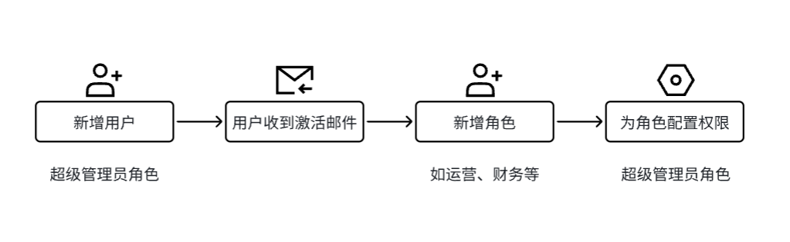
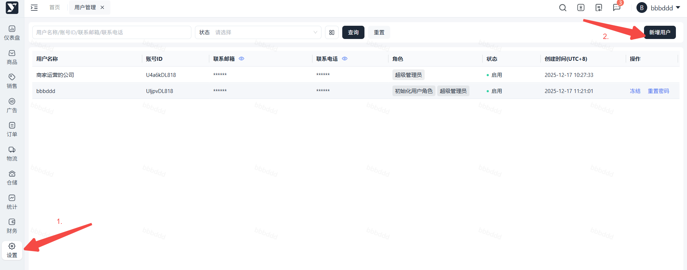
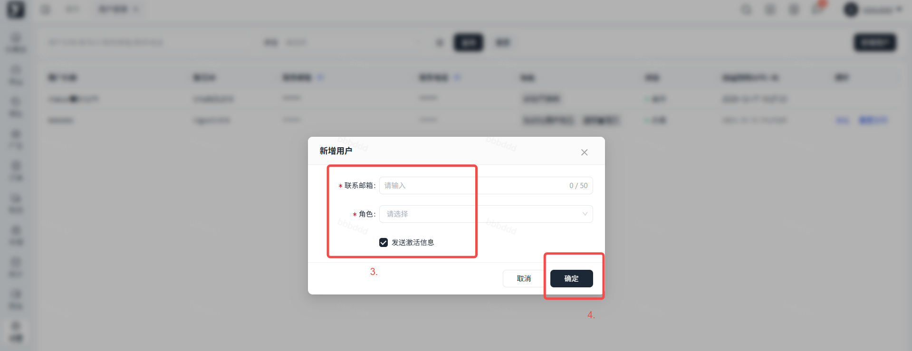
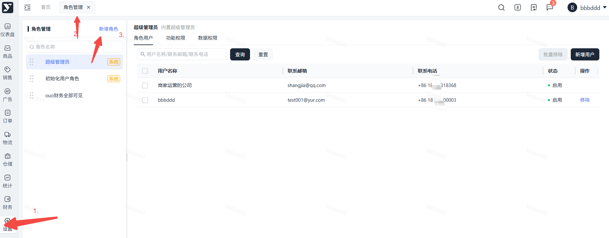
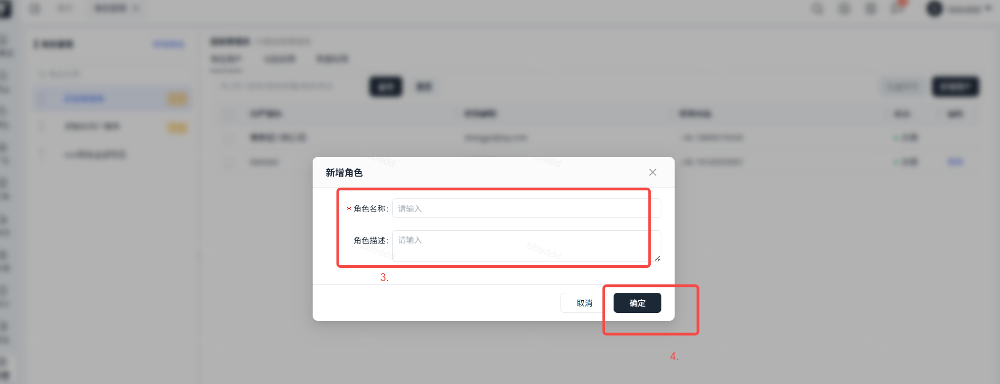
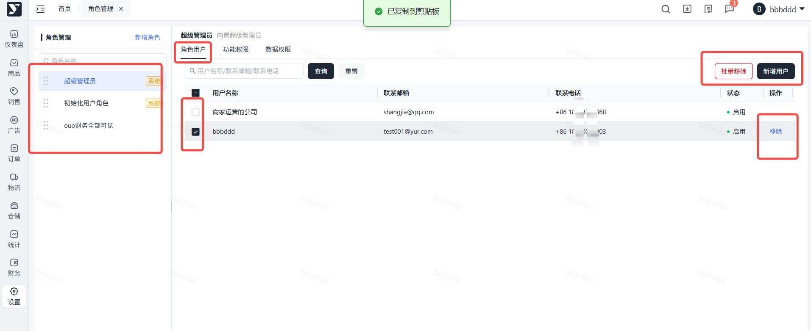
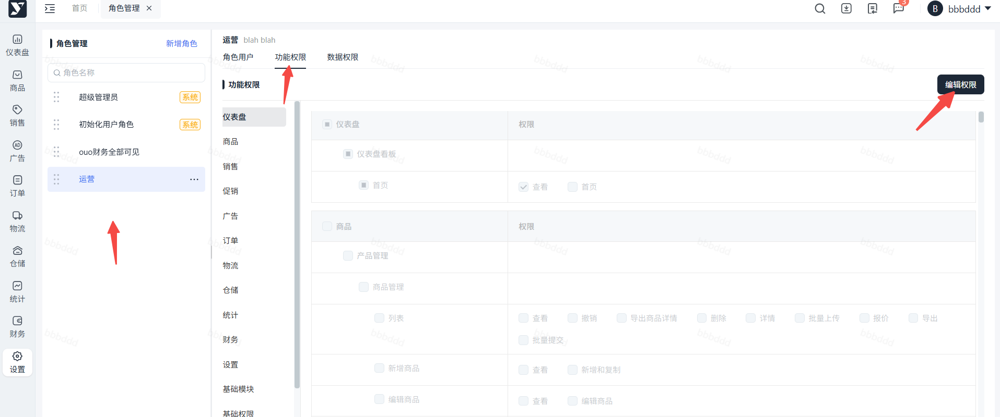
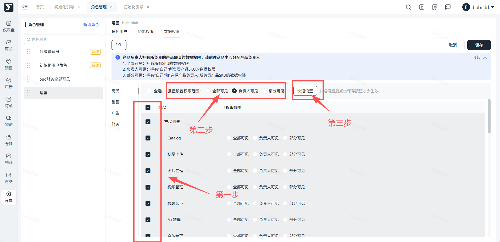

# 飞书文档：账号开通 & 权限设置

账号开通 & 权限设置

## 一、账号开通

### 如何开通?

**品牌方提供公司名&超管邮箱 → 查收邮件并激活 → 登录验证。**

**注：若未收到邮件，请联系对应运营经理重发。**

### 信息要求

1. **品牌方公司名称：**须与双方签署的合作协议上的乙方名称一致。
2. **联系邮箱：**仅作Yurex用户登录用，与亚马逊无任何关联。

## 二、功能权限设置

### 概念说明

**用户：** 对应品牌方公司员工，按照内部需求对应开设员工登录账号。

**角色：** 对应品牌方员工角色（如运营、财务、物流等）。权限依附于角色，超管可以进行自定义配置。

**权限：** 指模块的操作/查看权。

**超级管理员：** 激活系统的默认账号，拥有所有权限。

**初始用户角色：** 系统自带的空白角色，默认无任何权限。

### 如何新增用户

1. 路径：【设置】-【用户管理】-【新增用户】
2. 操作步骤：

### 如何新增角色/编辑角色/配置角色权限

###

1. 路径：【设置】-【角色管理】
2. 操作步骤：选中左侧角色，进入角色用户，勾选后进行移除/新增操作。

 1. 进入角色管理页面，点击 【新增角色】

 

 1. 输入角色名称和角色描述（选填），点击确认

 

 ###

 

###

选中左侧角色，进入功能权限，根据业务情况勾选需要分配给此角色的权限，勾选完成后保存即可生效。

###

选中左侧角色，进入数据权限，根据菜单勾选需要分配给此角色的数据权限。

数据权限是基于产品SKU进行配置，可至商品中心分配产品负责人。

可选配置项：

1. 全部可见：拥有所有SKU的数据权限
2. 负责人可见：拥有“自己”所负责产品SKU的数据权限
3. 部分可见：拥有“自己”和“选择产品负责人”所负责产品SKU的数据权限

快速设置：

1. 第一步：页面支持多选快速配置，勾选需要配置的菜单，在上方选择批量设置的权限范围。
2. 第二步：点击快速设置按钮，则被勾选的菜单，全部配置为所选权限范围。
3. 第三步：点击页面右上角保存按钮，完成配置。

