# 飞书文档：产品Listing上传至VC

SC老产品转移至VC销售的**本质是跟卖（即创建VC offer）**，即使用同一条链接进行销售，只不过多了一个VC卖家进行供货。
由于VC的特殊性，**我们常规使用DF和PO两种模式的情况下，每一个产品都需要具备DF和PO模式下的2个offer，**Yurex系统创建VC offer的前提是该**产品已经完成系统采购报价流程。**
为满足客户快速进行VC offer创建的需求，现系统支持**单个上传和批量上传**两种方式进行操作。

## 一、操作流程：单个新增

- **操作路径：商品>Catalog>新增产品>单个新增**
- **操作步骤：**

 1. 进入单个新增功能页面

 

 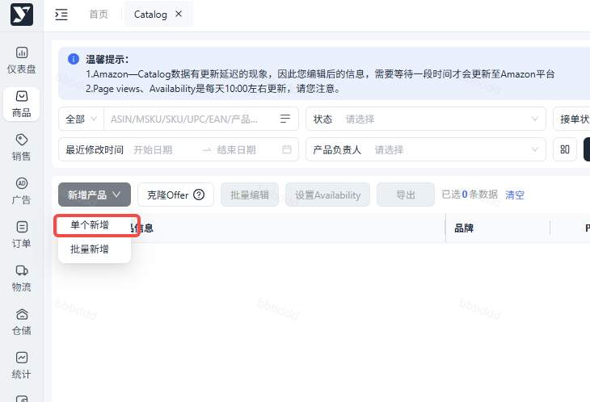

 1. 点击单个新增，填写产品信息

 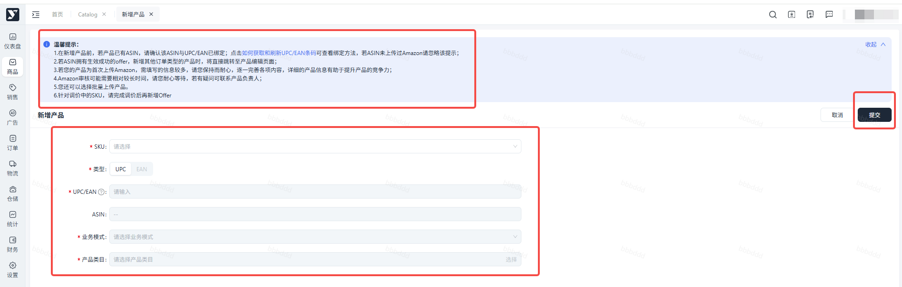

 **填写字段详解：**
 1. SKU：已完成采购报价的产品，系统自动生成的字段，用于系统管理产品，可进行搜索并选中。
 2. 条码类型：需与采购报价里填写的条码类型一致。
 3. UPC/EAN: 系统自动拉取采购报价里填的UPC/EAN
 4. ASIN：系统自动拉取，默认不可修改（请保证ASIN与UPC已成功绑定）
 5. 业务模式：若2个模式都需要做的情况下，优先选择PO（DF Offer可通过系统克隆功能快速创建）

 > \***多包裹**发货的产品目前只支持上传**DF Offer**，不支持做PO模式，如有多包裹产品请提前告知平台运营经理做好准备工作。
 6. 产品类目：选择产品的最小类目

 > \*如果选不到准确的最小类目，选一个相近类目也可以，可以让VC offer释放后联系平台运营经理修改。

 1. 点击提交，基本信息校验通过后 ，将拉取对应的offer模板；**拉取成功后，该条数据流转为“待填写详细信息”，点击【编辑】**
 2. 填写产品相关的详细信息

 注意：产品详细信息尽可能填写准确，不清楚的地方请查看。
 3. 填写完后，**点击提交后由亚马逊进行审核**，会出现几种状态需要您关注并操作

 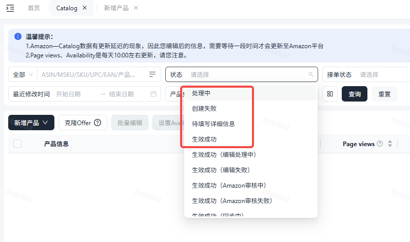

 - 生效成功-无需操作
 - 异常情况及处理方法：**必填项未填写：红色感叹号提示！，提示该项未填写，需再次填写后提交创建失败：点击编辑，根据报错原因填写对应信息后，再次点击提交**

## 二、操作流程：批量新增

- **操作路径：商品>Catalog>新增产品>批量新增**
- **操作步骤：**

 1. 进入批量新增功能页面

 

 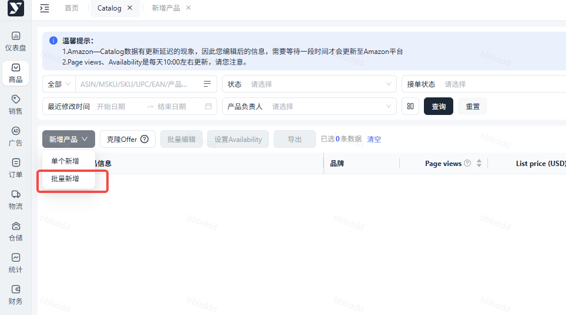

 1. 选择上传方式 - 通过**ASIN**或**类目**进行批量上传

 - 方式1：通过ASIN进行批量上传：产品曾在Amazon进行销售，已成功绑定UPC/EAN
 - 方式2：通过类目进行批量上传：产品从未在Amazon上销售过

 **方式1操作详解：**
 1. 选择通过ASIN进行批量上传
 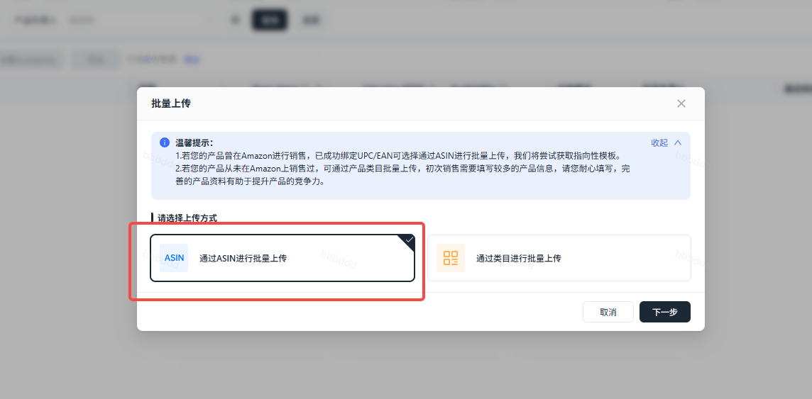
 1. 选择需要上传的ASIN，点击下载模板

 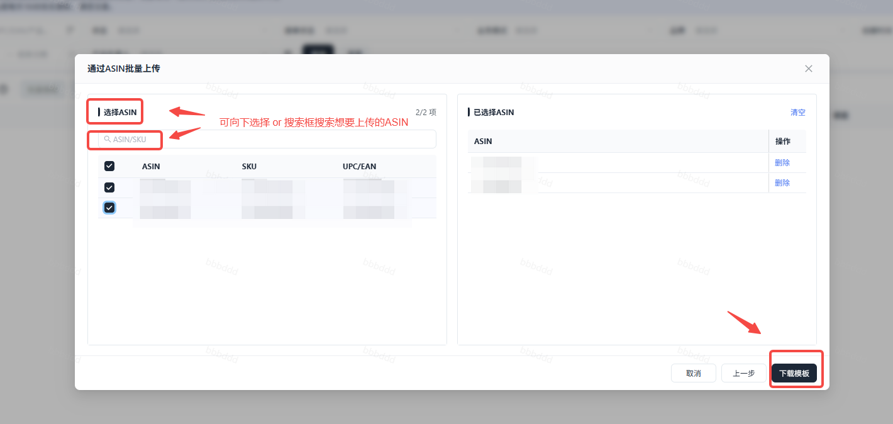

 1. 自动跳转到【批量上传】，待此条数据流传为下载成功时，点击获取模板（可点击查询刷新数据状态）
 2. 下载失败，可点击问号查看具体原因，根据具体原因进行处理后，再重新下载模板
 2. 在下载的模板里填写产品相关信息
 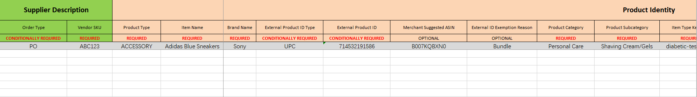
 1. 上传模板：商品>批量上传>上传Offer

 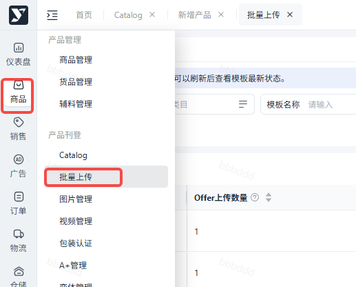

 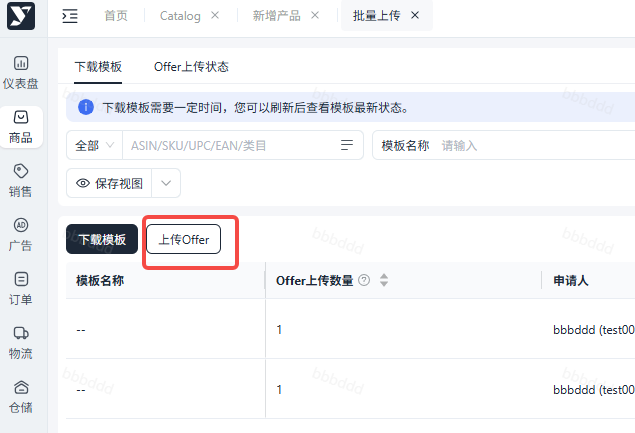

 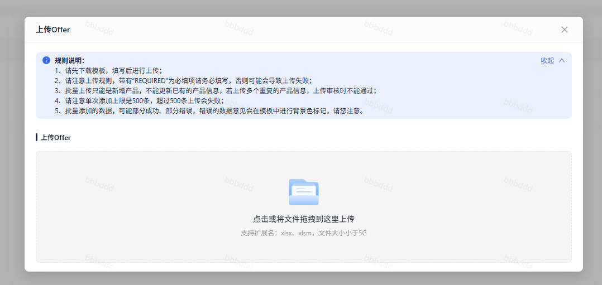

 1. 正常情况：状态为生效成功
 2. 异常情况：点击获取错误模板，根据表格里的报错信息修改，再重新上传

 **方式2操作详解：**
 1. 选择通过类目进行批量上传
 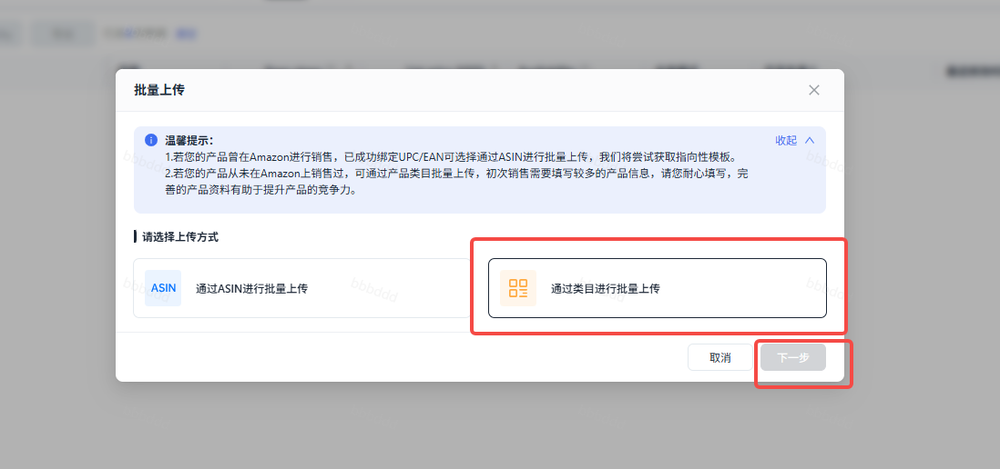
 1. 选择产品的最小类目，点击下载模板

 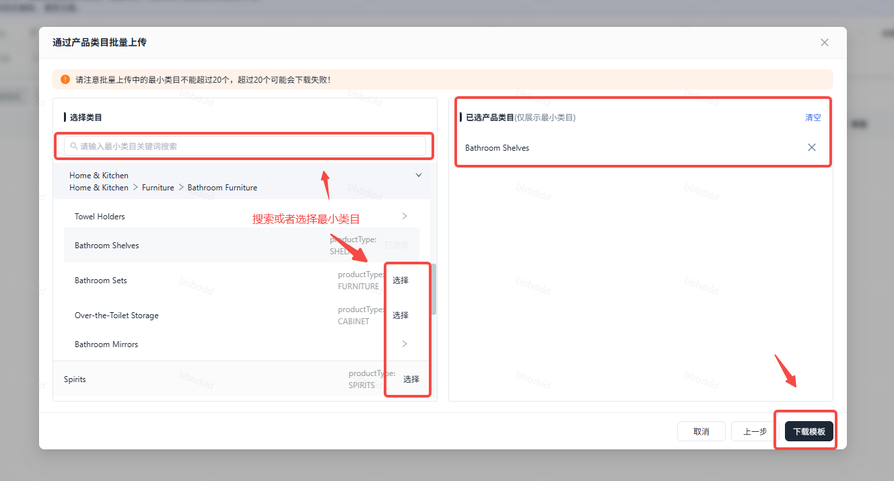

 1. 自动跳转到【批量上传】，待此条数据流传为下载成功时，点击获取模板（可点击查询刷新数据状态）
 2. 下载失败，可点击问号查看具体原因，根据具体原因进行处理后，再重新下载模板
 2. 在下载的模板里填写产品相关信息
 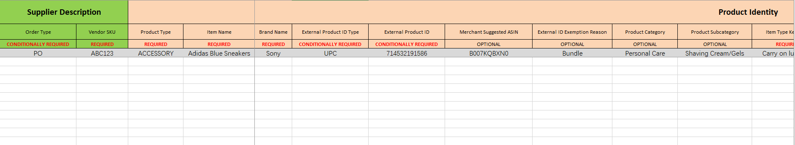
 1. 上传模板：商务>批量上传>上传Offer

 

 

 

 1. 正常情况：状态为生效成功
 2. 异常情况：点击获取错误模板，根据表格里的报错信息修改，再重新上传

## 三、克隆Offer

> **注意：当PO offer状态为“生效成功”时，才可通过克隆PO offer生成DF offer**

- **操作路径：商品>Catalog>克隆offer**
- 操作步骤：

 1. 进入功能页面

 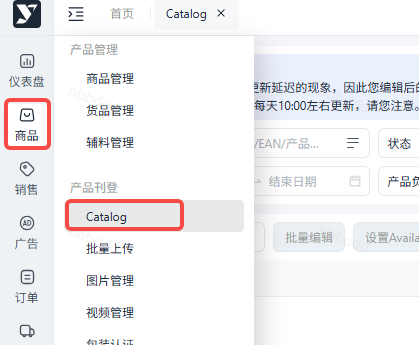

 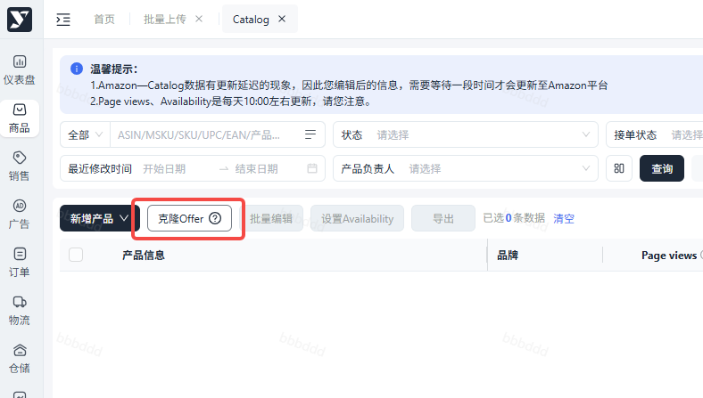

 1. 选择需要上传DF Offer的产品，点击确定

 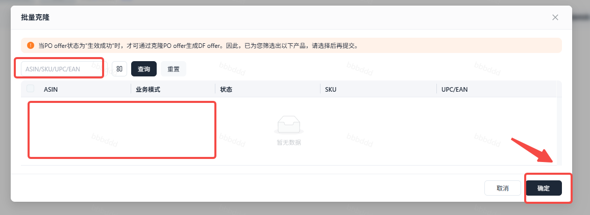

 1. 提交后亚马逊会进行审核，需要您关注状态并及时操作

 - 正常情况：模式显示：DF；状态显示：生效成功

 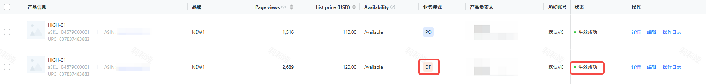

 - 异常情况：创建失败，必填项未填写，需点击编辑，填写完必填项后，点击提交
