# 飞书文档：产品包装认证说明

## SIPP(Ships in Product Packaging)

——自有包装发货计划

- **Tier 1: FFP（Frustration-Free Packaging）**：亚马逊简约包装认证，FFP要求满足SIOC的所有标准。要求包装商品必须通过ISTA6-Amazon.com-SIOC 规定的实验项目，且所用包装材料100%为无污染可回收利用材料，外包装需便于开启，亚马逊定义为在 120 秒内可以将外包装开启且内部商品可以取出
- **Tier 2: SIOC（Ships in Own Container）**：亚马逊自带集装箱运输包裹认证。指商品在已有的包装内发货销售且损坏程度极小，亚马逊无需额外的预处理或再次包装。所有参加SIPP的商品，其包装都必须通过**自检(重量在50 lbs以下)**或国际安全运输协会 (ISTA) 6 实验室测试的物理性能测试(重量大于50 lbs)，其包装测试的目的是确保品牌方产品在不使用亚马逊提供的额外包装的情况下，产品仍然可以完好地抵达消费者手中
- 请重点查看【5.认证流程】

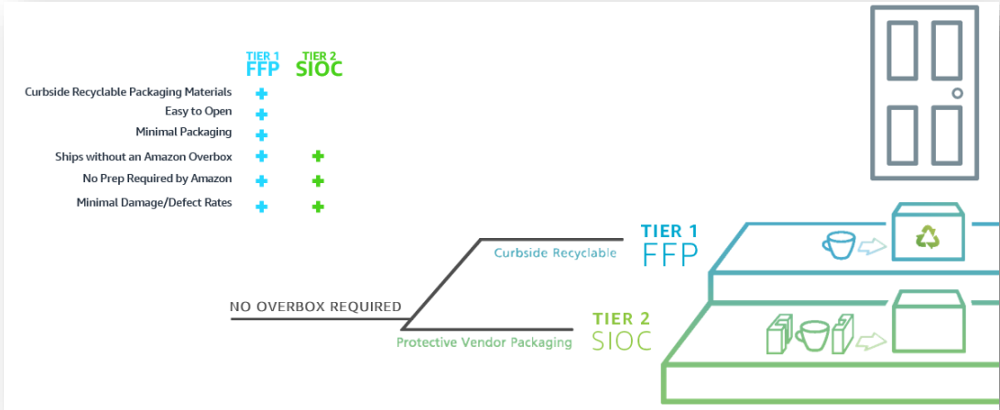

包装尺寸> 18 英寸 x 14 英寸 x 8 英寸或重量超过 20 磅但不属于排除分类的商品必须获得 SIPP认证。
对于未获得认证的商品，基于商品发货重量的可变费率，范围为 1.99 美元至 4.84 美元
排除分类的商品：
- 有任何危险品分类和运输规定的 ASIN（例如，包含锂离子电池的ASIN）
- Prime Pantry、Amazon Fresh 或 Media 中的 ASIN
- 已存在至少 24 个月，且在过去 12 个月中向亚马逊发货少于 100 件的 ASIN
- ASIN在向亚马逊发货时的包装方式是将单个销售单元嵌套或锁定，以最大限度地提高货运效率，例如将垃圾桶嵌套在一起

| **产品发货重量** | **按运送至亚马逊的**  **每件商品进行罚款** |
|-|-|
| 10磅以下 | 1.99美元 |
| 10-20磅（

1. 产品发货重量：指用于确定尺寸分段的商品重量或体积重量中的较大值。体积重量等于商品体积(长×宽×高)除以139
2. 重量≥50磅(实际重量或发货重量)的商品不在此罚款范围内

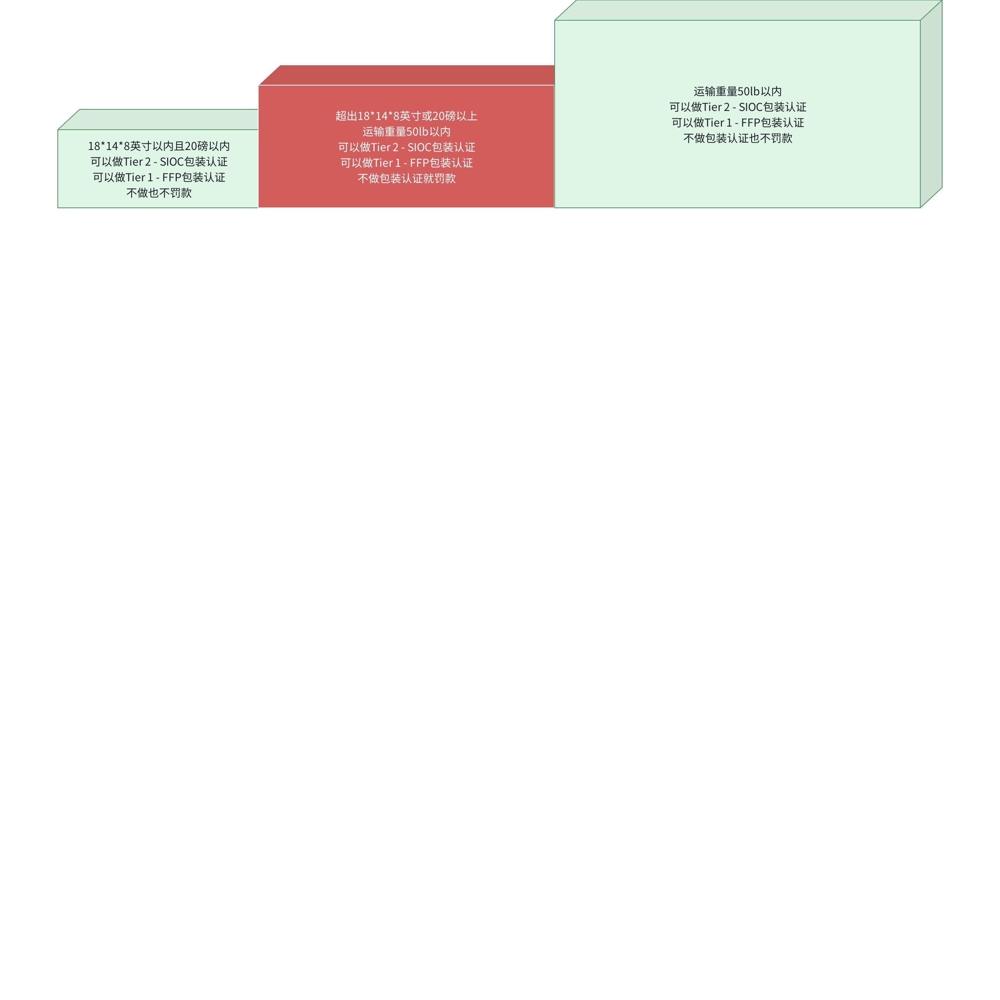

## 产品认证类型选择

| | 产品类型 | 重量要求 | AND/OR | 尺寸要求 | 测试报告 | 测试样品数量要求 |
| --- | --- | --- | --- | --- | --- | --- |
| 硬包装 | 不易碎 | 6.0” x 4.0” x 0.375” 或 ≥ 15.24 cm x 10.16 cm x 0.95 cm (最长尺寸不能超过108” 或 274 cm) | 刚性包装跌落测试或ISTA 6-Amazon.com (SIOC) Type A √可以提供自测报告 | 1 |
| 硬包装 | 易碎 | 6” x 4” x 0.375” or 15.24 cm x 10.16 cm x 0.95 cm 北美： ≤ 18.0” x 14.0” x 6.0” 或45.7 cm x 40.64 cm x 15.24 cm 长 + 高≤ 21” (53.24 cm), 宽 + 高 ≤ 23.6” (60 cm) 欧盟： ≤ 17.91” x 13.38” x 9.25” 或45.5 cm x 34 cm x 23.5 cm 长 + 高 ≤ 23.6” (60 cm), 宽 + 高t ≤ 18.9” (48 cm) | 柔性包装跌落测试和危险箱跌落测试 √可以提供自测报告 | 1 |
| 重货/大货 | / | > 50 磅或23千克 | OR | 任一边 ≥ 108” (27.4 cm) 或 围长> 165” (419 cm) | ISTA 6-Amazon.com (SIOC) Type B -Type F ×不能提供自测报告 | 不易碎: 1 易碎：5 |
| 电视&显示器 | / | 150磅 或 68千克 | OR | 围长> 165” (419 cm) | ISTA 6-Amazon.com (SIOC) Type H ×不能提供自测报告 | 1 |

- *围长= 长 + 2\*高 + 2\*宽*

易碎品和液体产品：**×不能提供自测报告**
1. 玻璃、陶瓷、瓷器或粘土
2. 液体/半液体，在配送周期内的温度下(70°F至140°F或21.1°C至60°C)可变为液体的固体
产品含有上述任何材料，该产品将被视为易碎品，需要5个完整样品才能通过ISTA6-A测试

## SIOC测试类型

- ISTA Project 6-Amazon.com-SIOC 测试系列包含 6 种测试类型，根据产品规格划分为 Type A-Type F

- 测试项目：包含跌落，危险物冲击，压力，随机振动 - 美国国内运输，随机振动 - 国际运输等。通过这些测试可以确保产品和包装在实际运输过程中的可靠性和安全性，提前发现可能出现的问题并加以改进

## 实验室/认证机构

| 列1 | 列2 | 列3 | 列4 |
| --- | --- | --- | --- |
| 1. Aptar Group：https://www.aptar.com/en-us 中国负责人：Weida Zhang 邮箱：weida.zhang@aptar.com 电话：+86 512 6260 2577 | 1. L&E International, Ltd.：http://www.le-intl.com/ 中国负责人：Tim Allen 邮箱：tim.allen@le-intl.com 电话：516-741-5300 | 1. Voion Packaging Technology, Ltd.：www.voion.com ; www.voionusa.com 中国负责人：James Cheung – Account Dir. 邮箱：james@voion.com 电话：86 18613190122 | 1. Intertek：http://www.intertek.com/packaging/testing/ 中国-香港负责人：Cecilia Ng 邮箱：Cecilia.ng@intertek.com 电话：+852 21738766 中国-深圳负责人：Zoe Xu 邮箱：zoe.xh.xu@intertek.com 电话：+86 755 26020362 中国-广州负责人：Vivian Peng 邮箱：vivian.peng@intertek.com 电话：+86 20 82139769 中国-广州负责人：Sunny Wu 邮箱：Sunny.j.wu@intertek.com 电话：+86 20-82139968 中国-上海负责人：Bonnie Chen 邮箱：bonnie.chen@intertek.com 电话：+86 21 5339 6213 中国-上海负责人：Fanny Sun 邮箱：fanny.sun@intertek.com 电话：+86 21 60917549 中国-杭州负责人：Lina Wang 邮箱：lina.wang@intertek.com 电话：+86 571 89979524 中国-天津负责人：Cissy Fan 邮箱：cissy.fan@intertek.com 电话：+86 21 5339 6213 中国-台湾负责人：Demi Lin 邮箱：demi.lin@intertek.com 电话：+886 2 66022285 中国-台湾负责人：Joanne Chen 邮箱：Joanne.ze.chen@intertek.com 电话：+886 2 6602 2888x281 |
| 1. AVC Corporation：www.avccorp.com 中国负责人：Grace Xiao 邮箱：grace@avccorp.com 电话：139 2968 5366 | 1. Modern Testing Services Packaging Performance Lab (MTS)：www.mts-global.com 中国-东莞负责人：Mike Chen 邮箱：mchen@mts-china.com 电话：(86) 769-8112 0818 Ext. 717 中国-上海负责人：Wilson Yin 邮箱：wyin@mts-global.com 电话： (86) 021-23509681; (86)18502127237 | 1. Veritiv Corporation (Global Design, Testing, Sourcing & Logistics Services)：www.veritivcorp.com 中国-上海负责人：Jeff Zhan 邮箱：Jeff.Zhan@veritivcorp.com 电话：+86 18621226866 | 1. Intertek：http://www.intertek.com/packaging/testing/ 中国-香港负责人：Cecilia Ng 邮箱：Cecilia.ng@intertek.com 电话：+852 21738766 中国-深圳负责人：Zoe Xu 邮箱：zoe.xh.xu@intertek.com 电话：+86 755 26020362 中国-广州负责人：Vivian Peng 邮箱：vivian.peng@intertek.com 电话：+86 20 82139769 中国-广州负责人：Sunny Wu 邮箱：Sunny.j.wu@intertek.com 电话：+86 20-82139968 中国-上海负责人：Bonnie Chen 邮箱：bonnie.chen@intertek.com 电话：+86 21 5339 6213 中国-上海负责人：Fanny Sun 邮箱：fanny.sun@intertek.com 电话：+86 21 60917549 中国-杭州负责人：Lina Wang 邮箱：lina.wang@intertek.com 电话：+86 571 89979524 中国-天津负责人：Cissy Fan 邮箱：cissy.fan@intertek.com 电话：+86 21 5339 6213 中国-台湾负责人：Demi Lin 邮箱：demi.lin@intertek.com 电话：+886 2 66022285 中国-台湾负责人：Joanne Chen 邮箱：Joanne.ze.chen@intertek.com 电话：+886 2 6602 2888x281 |
| 1. Bay Area Compliance Lab Corp (BACL)：www.baclcorp.com.cn 深圳：Jeanne Han 邮箱：Jeanne.han@baclcorp.com 电话：+86 755 33320018 分机号：8201 135 9026 7970 东莞：Lola Wang 邮箱：Lola.wang@baclcorp.com 电话：+86 769 86858888 分机号：5009 186 8879 9312 | 1. More From Less (DS Smith’s Global Consultancy/Designer) (NA, ASIA Tester, Designer & Consultant)：http://www.morefromlessglobal.com/ 中国负责人：Robert Wrightham 邮箱：ukat@dssmith.com 电话：+44 1455 892890 | 1. UL 中国-上海负责人：Justin Zhou 邮箱：AsiaEnquiry@ul.com 电话：+86 21 24228229 中国-南沙负责人：Aileen Xing 邮箱：GUV.RetailerCSTeam@ul.com 电话：+86 2022639525 | 1. Intertek：http://www.intertek.com/packaging/testing/ 中国-香港负责人：Cecilia Ng 邮箱：Cecilia.ng@intertek.com 电话：+852 21738766 中国-深圳负责人：Zoe Xu 邮箱：zoe.xh.xu@intertek.com 电话：+86 755 26020362 中国-广州负责人：Vivian Peng 邮箱：vivian.peng@intertek.com 电话：+86 20 82139769 中国-广州负责人：Sunny Wu 邮箱：Sunny.j.wu@intertek.com 电话：+86 20-82139968 中国-上海负责人：Bonnie Chen 邮箱：bonnie.chen@intertek.com 电话：+86 21 5339 6213 中国-上海负责人：Fanny Sun 邮箱：fanny.sun@intertek.com 电话：+86 21 60917549 中国-杭州负责人：Lina Wang 邮箱：lina.wang@intertek.com 电话：+86 571 89979524 中国-天津负责人：Cissy Fan 邮箱：cissy.fan@intertek.com 电话：+86 21 5339 6213 中国-台湾负责人：Demi Lin 邮箱：demi.lin@intertek.com 电话：+886 2 66022285 中国-台湾负责人：Joanne Chen 邮箱：Joanne.ze.chen@intertek.com 电话：+886 2 6602 2888x281 |
| 1. BillerudKorsnäs：https://www.billerudkorsnas.com/managed-packaging/resource-center 中国负责人：Ray Chen 邮箱：ray.chen@billerudkorsnas.com | 1. Nefab 中国负责人：Zhenli Wang 邮箱：Zhenli.Wang@nefab.com 电话：+86 2132516909 | 1. TÜV SÜD：https://www.tuv-sud-psb.sg 中国负责人：Eric Liu 邮箱：houjun.liu@tuvsud.com 电话：(+86 ) 21 6037 9101 中国负责人：Teresa Pan 邮箱：Mingyu.Pan@tuv-sud.cn 电话：(+86) 21 6142 4487 | 1. Intertek：http://www.intertek.com/packaging/testing/ 中国-香港负责人：Cecilia Ng 邮箱：Cecilia.ng@intertek.com 电话：+852 21738766 中国-深圳负责人：Zoe Xu 邮箱：zoe.xh.xu@intertek.com 电话：+86 755 26020362 中国-广州负责人：Vivian Peng 邮箱：vivian.peng@intertek.com 电话：+86 20 82139769 中国-广州负责人：Sunny Wu 邮箱：Sunny.j.wu@intertek.com 电话：+86 20-82139968 中国-上海负责人：Bonnie Chen 邮箱：bonnie.chen@intertek.com 电话：+86 21 5339 6213 中国-上海负责人：Fanny Sun 邮箱：fanny.sun@intertek.com 电话：+86 21 60917549 中国-杭州负责人：Lina Wang 邮箱：lina.wang@intertek.com 电话：+86 571 89979524 中国-天津负责人：Cissy Fan 邮箱：cissy.fan@intertek.com 电话：+86 21 5339 6213 中国-台湾负责人：Demi Lin 邮箱：demi.lin@intertek.com 电话：+886 2 66022285 中国-台湾负责人：Joanne Chen 邮箱：Joanne.ze.chen@intertek.com 电话：+886 2 6602 2888x281 |
| 1. 必维国际检验集团 Bureau Veritas Consumer Products Services：https://www.cps.bureauveritas.com/newsroom/bureaiu-veritas-buffalo-ista-transit-testing-accreditation-renevwed 深圳：Keith Wang 邮箱：Keith.wang@bureauveritas.com 电话：+(86) 755 3298 0234 上海：Rita Jin 邮箱：Rita.jin@bureauveritas.com 电话：+(86) 021 2416 6765 | 1. RAINBOW SMART INDUSTRIAL LTD. 中国负责人：Tina Chen 邮箱：apass@rainbowsmart.net 电话：+86 (755) 2518 3325 | 1. TÜV Rheinland：https://www.tuv.com/world/en/ista-packaging-testing.html 中国-广州负责人：Paul Y. M. Yang 邮箱：PaulYM.Yang@tuv.com 电话：+86 (0) 20 2839 1597 | |
| 1. The CSA Shanghai Laboratory：https://www.csagroup.org 中国负责人：Mike Chen 邮箱：Mike.Chen@csagroup.org 电话：(86)21 80522878*823 Jay Min 邮箱：Jay.Min@csagroup.org 电话：(86)21 80522878*826 | 1. SGS Global Testing Service：https://www.sgs.com/ 中国-台湾负责人：Lisa Kao 邮箱：Lisa.Kao@sgs.com 电话：+886 2 2299 3279 中国-顺德负责人：Vickey Gong 邮箱：vickey.gong@sgs.com 电话：+86 755 25328647 中国-上海负责人：Vincent Zhai 邮箱：vincent.zhai@sgs.com 电话：+86 21 61152493 | 1. HQTS Group Ltd. ：www.hqts-qai.com 中国-杭州负责人：Joanne Jiang 邮箱：iTest@hqts-qai.com 电话：+86 571 8890 7069 | |
| 1. H.B. Fuller：https://www.hbfuller.com/en/north-america/products-and-technologies/markets-and-applications/packaging/closingand-ecommerce 中国负责人：Clint Zhang 邮箱：Clint.Zhang@hbfuller.com 电话：+86 13570003951 | 1. Shanghai Kui En Technical Testing Service Co., LTD.：http://www.kuien.com.cn 中国-上海负责人：Grace Zhu 邮箱：grace.zhu@kuien.com.cn 电话：Office: +86-21-57863965；Mobile: +86-13661817008 | | |

## 认证流程

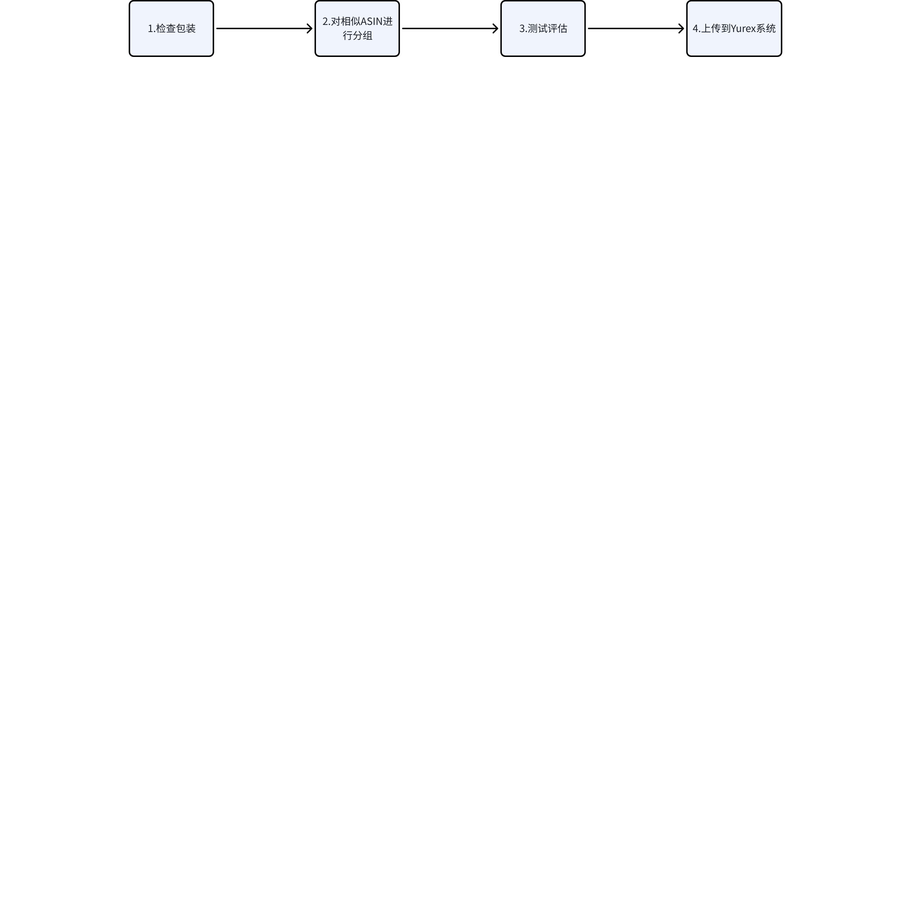

### 审查和设计

#### 软质自有包装发货 (SIPP)

- 软质 SIPP 商品采用软质外包装，例如袋子、立式袋、填充邮袋和信封，包装材料的厚度至少为 2 毫米。
- 软质包装要求：

1. 包装尺寸

- 可接受的最小包装尺寸：大于6x4x0.375英寸或152.4x101.6x95毫米；
- 可接受的最大包裹尺寸：小于18x14x6英寸或457x406.4x152.4毫米；长度+高度2毫米低密度聚乙烯（LDPE）或根据 ASTM D1922 证明最小撕裂强度大于或等于 130 克（0.3 磅）。

1. 密封/封闭

- 使用热密封、胶带或胶粘剂固定所有开放型边缘；
- 根据 ASTM F88-15 尾部固定方法 A，基于粘合剂的密封件强度必须>5.7磅/英寸(1N/mm)；
- 对于可重复密封封口（如滑动拉链），需要进行安全密封，以便在拉链破损时提供破损证据。这种密封称为防篡改密封。

1. 标签

- 包装标记和标签必须标明内容物。泳装、内衣、健康和保健产品、医疗产品和成人产品等敏感物品要隐秘标记或贴标，避免消费者体验不佳。对于正常的分拣和分销情况，外包装上必须粘贴运输标签等粘性标签。外部可扫描标签必须符合产品标签指南。

1. 建议

- 外包装不透明或遮盖包装内容物，以改善客户体验

1. 软质包装例外情况

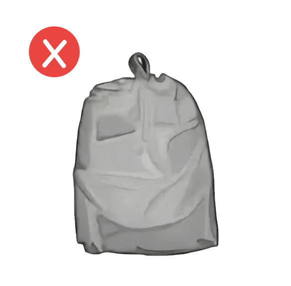
有带子的袋子

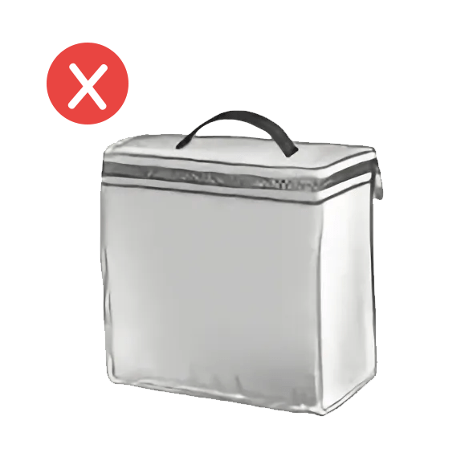
带提手的袋子

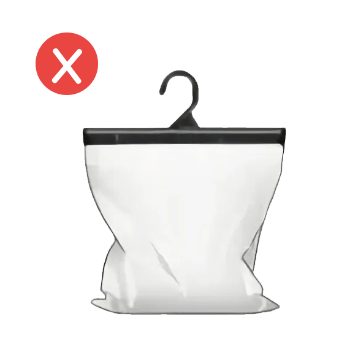
突起衣架

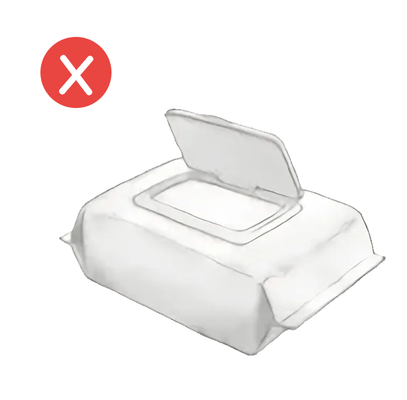
塑料开口

- 危险物品或磁铁
- 带滑动拉链、无防篡改密封件的物品
- 突起物，如衣架、提手、结头、带状物或切口
- 直径

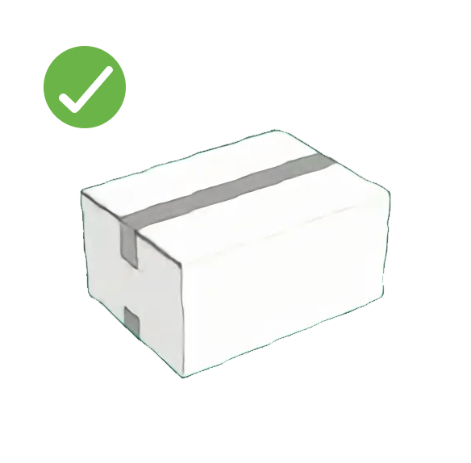
标准开缝箱

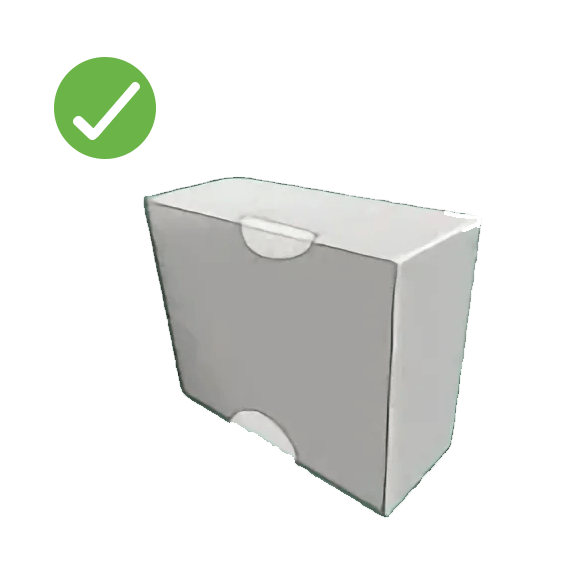
抽取式盒

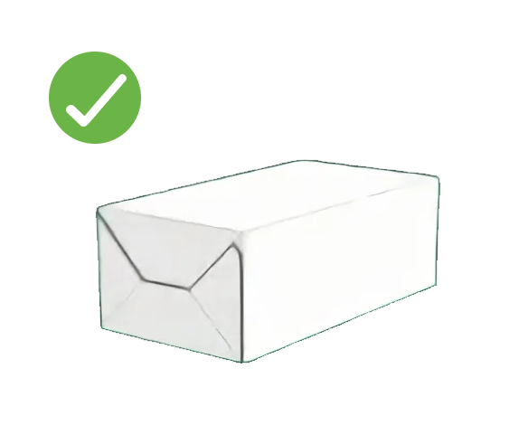
自动封底箱

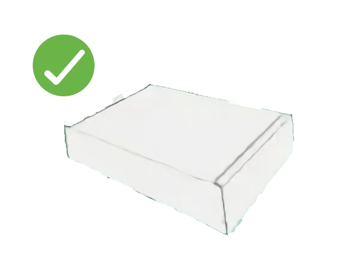
TUCK-前箱

1. 重量

- 无重量限制

1. 材料结构

- 硬质六面体形状，应为长方体，非圆柱形或球形;
- 它必须能够在装有液体的混装拖车上堆叠。允许带有检修孔或手孔，但尺寸不能超过 3.5 英寸 x 1.0 英寸（8.89 厘米 x 2.54 厘米）。

1. 密封/封闭

- 必须有防篡改机制，以确保任何篡改的痕迹都清晰可见。
- 所有开口边缘（包括锁片）必须使用胶带或粘合剂充分密封。
- 不能将订书钉作为主要密封手段，但可以用于加固。

1. 标签

- 包装标记和标签必须标明内容物。泳装、内衣、健康和保健产品、医疗产品和成人产品等敏感物品要隐秘标记成贴标，避免消费者体验不佳。对于正常的分拣和分年情况，外包装上必须粘贴运输标签等粘性标签。外部可扫描标签必须符合产品标签指南。

1. 建议

- 外包装不透明或遮盖包装内容物，以改善客户体验

1. 硬质包装例外情况：这些物品不符合条件

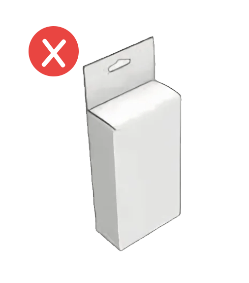
突起物:吊牌

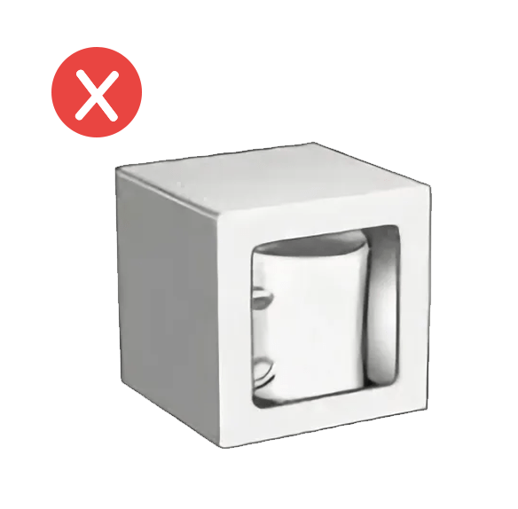
切口

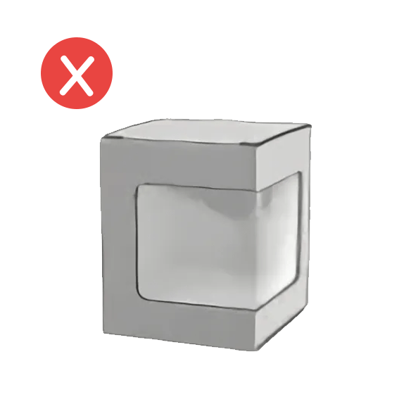
窗口

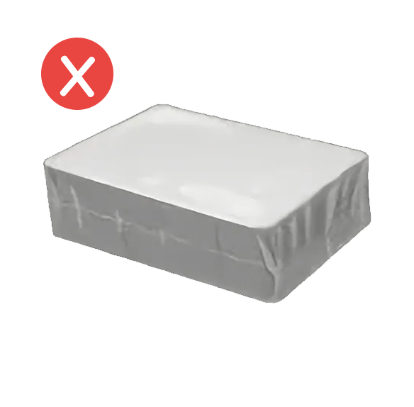
收缩包装

- 危险物品
- 带有非手孔的窗口或切口的物品
- 不属于封装构造的孔眼

### 对相似的ASIN进行分组

- 一份测试报告可以认证类似的几个ASIN，因此卖家可以将ASIN归类分组。除特殊情况外，根据尺寸、重量、材质、包装、产品与包装的比例、包装数量对符合条件的商品进行分组

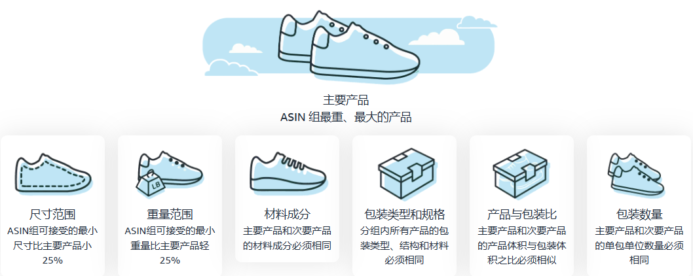

### 测试和评估

- 要注册商品并满足 SIPP 计划的条件，所有包装都必须以跌落自测或国际安全运输协会 (ISTA) 6 实验室测试的形式，通过物理性能测试。对包装进行更新以满足 SIPP 的要求后，**对该商品组中最大/最重的 ASIN 进行测试。**

#### 实验室检测

- 如果商品为易碎品，或者含有尖锐物体，或者含有液体，则**无法进行自测**。您需要提交亚马逊 APASS 网络中一家 ISTA-6A 实验室出具的 ISTA-6 实验室报告，以获得认证
- 第三方实验室测试和包装设计在世界各地有多个第三方实验室，可以帮助测试包装是否符合亚马逊的“自有包装发货”。提交 ISTA-6A 实验室报告以进行认证

 - [Sustainability in United States of America](https://sellercentral.amazon.com/gspn/searchpage/Sustainability?ref_=sc_gspn_hp_suslst&sellFrom=US&sellIn=US&Programs=Ships%20in%20Product%20Packaging&localeSelection=en_US&initialSessionID=000-6219526-6247802&ld=NSBaidu)亚马逊可持续发展服务提供商网络（SPN）
 - [Log in to Member Area](https://ista.org/find_a_lab_or_services.php?initialSessionID=000-6219526-6247802&ld=NSBaidu)

#### 自我检测

1. 检测范围：如果商品不易碎，不含液体或尖锐物品，且并非直径小于 1 英寸（约 2.5 厘米） 的颗粒状物品，则适用于自测。
2. 检测说明：完成自测有两个主要步骤。（对于软质包装，还有一个额外的步骤，以确保包装的材料强度。）硬质包装和软质包装都需要包装和商品的测试前和测试后照片。（步骤：材料强度测试 提供了有关照片要求的进一步说明。）
3. 检测步骤

 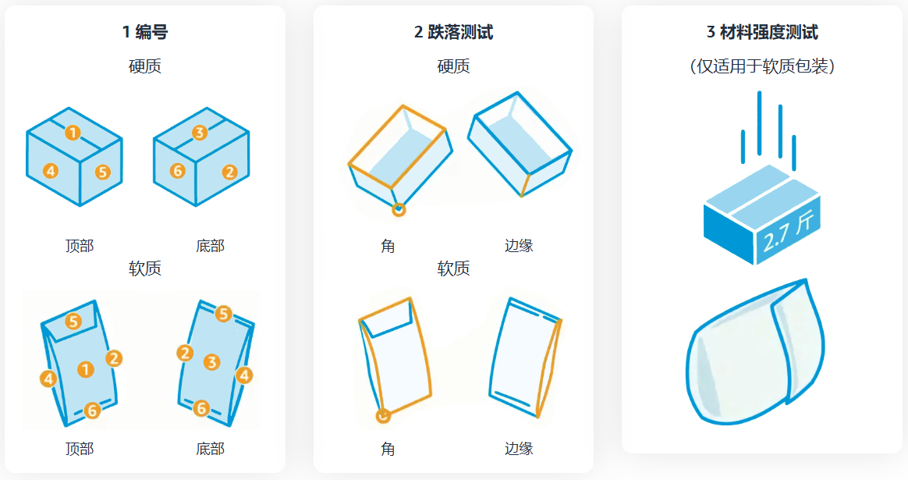

 1. 编号

 - 从盒子/包装袋的最大一侧开始编号，然后向右继续编号。其余表面为5、6号
 - 确保在测试过程中及时拍照记录包装是否损坏
 - 保证在测试过程中使用相同的测试样本
 2. 跌落测试

 - 在桌子或墙上分别标出46厘米和92厘米的高度，按照下表中的顺序，从该高度将样品投掷到面、边或角上17次

 3. 材料强度测试：

 - 将有2千克的沙袋装入新的纸箱（23\*16\*8cm）中，从92厘米的高度直接扔到软质包装袋上，要求无包装袋损坏或物品损坏。
 4. 记录自测结果

 - 跌落测试和评估完成后，记录测试后的图像。硬质包装需要五张照片，软质包装需要六张照片，如下所示：
 - 拍照要求

 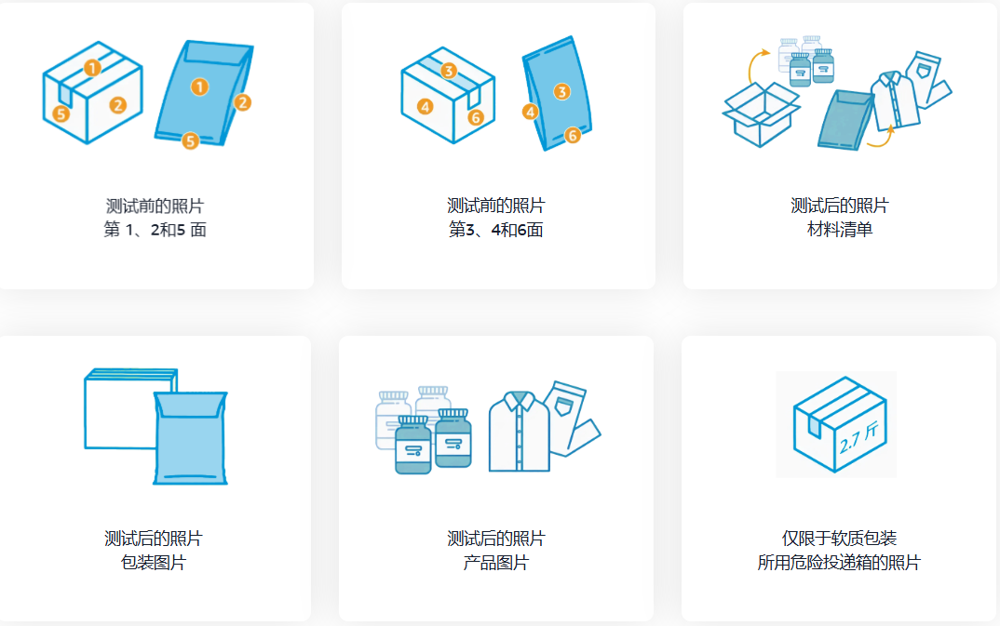
4. 柔性包装自测

 - 要对柔性包装进行自我检测，请观看此分步视频，了解如何测试和评估您的软包装产品

1. 硬性包装自测

 - 要对硬性包装进行自我检测，请观看此分步视频，了解如何测试和评估您的硬性包装产品

1. 自测模板填写

- 柔性包装填写内容

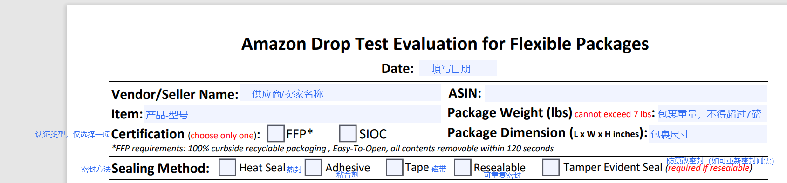

![图片展示的是产品包装认证中自我检测的测试和评估标准。左侧包含“Slack is less than 2 inches”等项目，其中“Exempt from

- Slack is less than 2 inches：松弛度小于2英寸
- Exempt from

- Material Thickness ≥ 2 mils LDPE or minimum tear strength of ≥ 130 gram：材料厚度≥2毫米LDPE或最小撕裂度≥130克
- Seal strength of ≥ 5.7lb/in (1 N/mm) (Adhesive Sealing Only) ：密封强度≥ 5.7 lb/in（1 N/mm）（仅粘合剂密封）
- No holes larger than 0.25” (6.4mm)：没有大于0.25英寸的孔洞
- No cosmetic or functional damage to product after testing：测试后产品无外观或者功能损坏

- 硬性包装填写

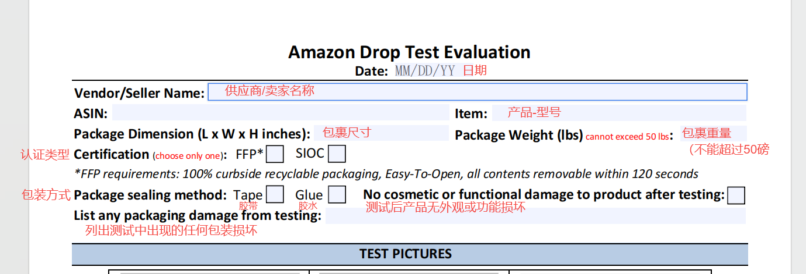

TEST PICTURES
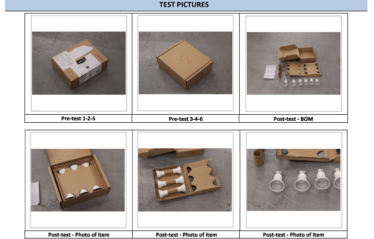

参照 d. 记录自测结果-拍照要求
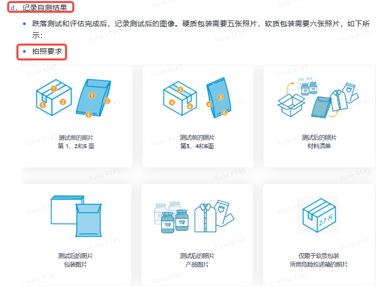

### 上传到Yurex

1. 路径：商品>包装认证

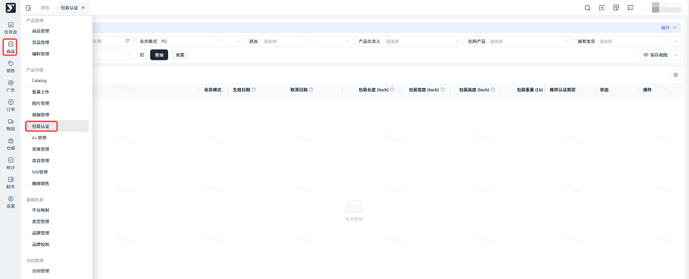

1. 系统根据填写在【Catalog】里【Shipping】填写的Item Package的尺寸自动识别是否需要进行包装认证并且推荐认证类型，需要进行认证的产品状态为待认证
2. 点击发起认证，选择对应认证等级，上传文件，点击提交。副ASIN的选择可参考【5.2对相似的ASIN进行分组】中的信息进行填写
3. 可在状态栏查看审核进度

- 无需认证：代表产品无需进行包装认证也可发往亚马逊仓库且不会产生罚款
- 认证取消：点击？即可查看取消原因，代表产品被亚马逊取消了产品包装认证，需要结合实际情况自行判断是否需要重新申请包装认证
- 认证成功：代表产品的包装认证已通过亚马逊审核
- 审核中：代表产品的包装认证正在审核
- 认证失败：代表产品包装认证失败，点击详情，查看失败的具体原因，根据错误提示修改后，点击申请包装认证，可再次申请

1. 注意事项：

 1. DF的offer无需进行包装认证
 2. 允许自测：代表产品允许用柔性/刚性自测模板申请包装认证
 3. 易碎品不能自测
 4. 危险品属于排除类别，无需进行包装认证
 5. 修改了产品包装尺寸需要重新评估是否需要申请包装认证
