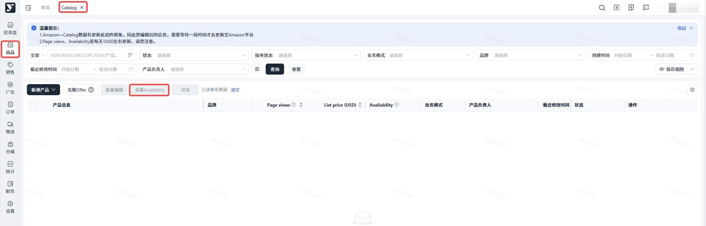

# 飞书文档：设置Availability

## 文档信息

| 项 | 内容 |
| --- | --- |
| 远程文档 | https://q1njej8cpab.feishu.cn/wiki/Yotyw9QXyiW59ekgxHucgdiJnLo |
| 图片处理 | 本地下载（assets/images） |
| 快照时间 | 2026-08-06 |
| 来源命令 | `lark-cli docs +fetch --api-version v2 --doc https://q1njej8cpab.feishu.cn/wiki/Yotyw9QXyiW59ekgxHucgdiJnLo --doc-format markdown --as user --format json --jq .data.document.content` |
| 格式处理 | fd-doc-markdown-sync/scripts/normalize-feishu-doc-markdown.mjs |

---

## 设置Availability

1. 操作步骤：【商品】-【Catalog】-勾选对应ASIN-点击设置Availability

1. Availability状态解释：

 1. Available：可正常接PO单
 2. Temporarily unavailable：暂时不接PO单，可设置不可用开始日期和下一个可用日期，注意：到了下一个可用日期时间，系统不会自动更新状态为Available，需手动设置状态为Available
 3. Permanently unavailable：永不接PO单
2. **注意事项：**

 1. PO单只与PO offer的接单状态有关，只需设置PO offer的接单状态；如果想关闭DF，只需在【DF可售库存】把库存设置为0
 2. 系统不会自动恢复为接单状态，需手动设置状态为Available
 3. Temporarily unavailable也可能会来单，如果想确保不来单，最好是将PO的offer状态设置为Permanently unavailable
