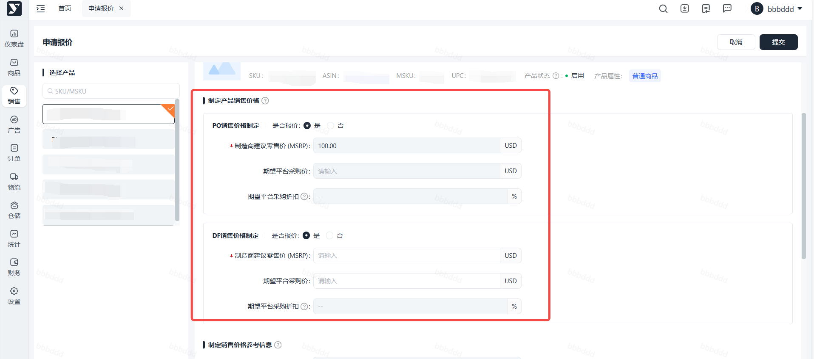

# 飞书文档：商品采购报价

**在Yurex系统中申请并且接受Yurex反馈的采购报价的商品，才能进行listing上传。**
> 注: 即使在入驻系统前双方已经沟通过报价，仍需要走系统流程存档数据，便于后续业务开展。
系统为便于客户快速完成报价流程，**现支持三种提交方式：“商品中心提交”、“单个ASIN提交”、“批量通过表格提交”。**

## 方式一：商品中心提交

1. 【商品-商品管理-新增产品】填写的采购报价，会自动生成一条数据在采购报价模块，无需二次填写

1. PO/DF需分别进行报价，输入【MSRP】后，点击提交会进行必填项的校验，若仅提交了其中一个业务模式的报价，仅成功提交一个，余下业务模式报价需单独申请；

1. 若您未填写任何【报价信息】中的任何数据，需待商品审核通过后，回到【商品-商品管理】里，状态为已生效的产品，可点击【报价】，进行采购报价；或者通过下述方式二【销售-采购报价】单独申请报价；

## 方式二：单个ASIN提交报价

1. 操作路径：【销售】>【采购报价】>【申请报价】>【添加报价】
2. 操作步骤：

 1. 进入单个添加页面

 

 1. 文本框输入/列表选择对应产品数据，支持通过SKU/MSKU进行搜索后，需分别对PO/DF模式进行报价。

 > 【PO/DF销售价格制定】下“是否报价”选择说明：
 >
 > 1. 选择“开启”表示对该业务模式进行报价；
 > 2. 选择“关闭”表示暂不对该业务模式进行报价，未报价的情况下，无法进行VC listing跟卖操作；
 >
 > 

 1. 填写制定销售价格参考信息

 
3. 填写注意事项：

 1. **制造商建议零售价（MSRP）**：表示该产品将在亚马逊listing页面进行售卖的价格；
 2. **期望平台采购价**：指您希望我们以什么样的价格采购您的产品；
 3. **渠道站点**：表示该报价单是针对具体的某一个渠道站点进行的报价；
 4. **是否SC销售**：

 1. 是：表示该产品曾在亚马逊进行过售卖，需要您输入相关的信息；
 2. 否：表示该产品未曾在亚马逊进行过售卖；
 5. **SC Referral Fee Rate**：品牌佣金费率，请您根据产品实际情况填写，该费率将作为我们制定采购价格参考标准之一；
 6. **SC Fulfillment Fee**：物流配送费，请您根据产品实际情况填写，该费用将作为我们制定采购价格参考标准之一；
 7. **退货率**：请您根据产品实际情况填写，该费率将作为我们制定采购价格参考标准之一；
 8. **目标销量（月）/目标GMV（月）：**入驻后您每月目标销量/目标GMV，为预估值；
 9. **过去一年销售额/过去一年平均售价**：请您根据产品实际情况填写，该内容将作为我们制定采购价格参考标准之一。
4. 信息填写完成后点击提交，Yurex平台运营经理会尽快完成审核，请注意查看该条记录状态。报价审核完成后需要您操作点击**“接受报价”、“拒绝报价”或“重新报价”**。您点击接受报价后，该产品的报价流程完结。

## 方式三：批量提交报价

1. 路径：【销售】>【采购报价】>【申请报价】>【批量报价】
2. 操作步骤：

 1. 进入功能页面

 

 1. 下载模板

 

 1. 在模板里填写产品销售情况

 

 1. 上传模板

 

 1. 信息填写完成后点击提交，Yurex平台运营经理会尽快完成审核，请注意查看该条记录状态。报价审核完成后需要您操作点击**“接受报价”、“拒绝报价”或“重新报价”**。您点击接受报价后，该产品的报价流程完结。
