# 飞书文档：新增商品至Yurex系统

**需要开展VC业务的商品，必须在Yurex系统中进行商品新增**
商品类型说明：
1. 普通商品：指一个包裹发货且单独售卖的ASIN
2. 组合商品：指多个ASIN放在一个包裹里售卖，如键鼠套装
3. 多包裹商品：指一个ASIN需要多个包裹，如大件家具拆成不同部分装在多个包裹里
系统为便于您快速完成流程，**现支持2种提交方式“单个ASIN提交”以及“批量通过表格提交”。**

## 通过系统单个增加商品

### 新增商品

1. 操作路径：【商品】>【商品管理】>【新增产品】
2. 操作步骤：

 1. 进入单个添加页面

 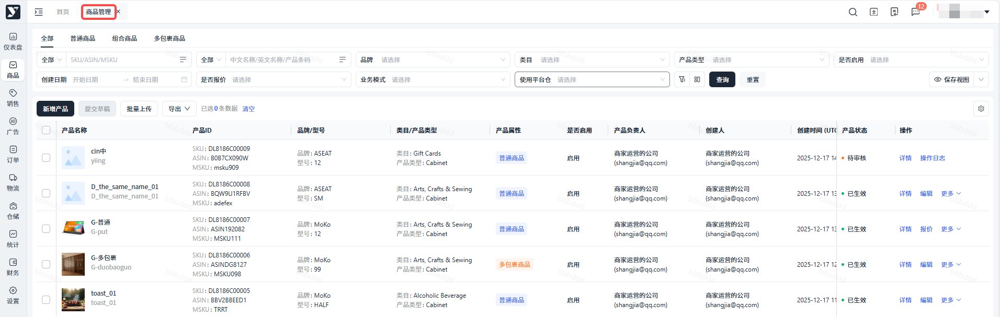

 1. 选择产品属性，输入中文和英文名称

 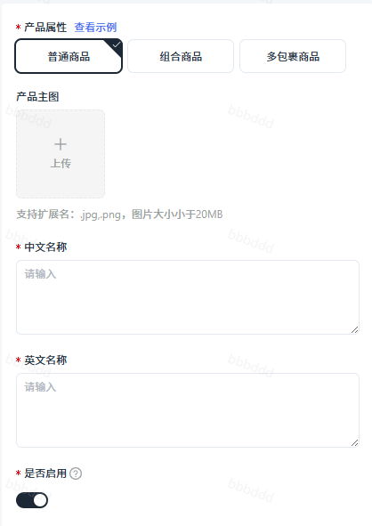

 1. 普通商品：指一个包裹发货且单独售卖的ASIN
 2. 组合商品：指多个ASIN放在一个包裹里售卖和发货，如键鼠套装
 3. 多包裹商品：指一个ASIN需要多个包裹发货，如大件家具拆成不同部分装在多个包裹里
 4. 产品状态：默认开启，表示产品状态为启用；关闭，代表禁用，禁用后，该产品将不能预约入库，已在库的产品可正常销售
 注意事项：
 1. 若使用Yurex平台仓，则商品中英文名称前不添加品牌信息
 2. 新增组合商品前，需添加已生效的商品
 3. 新增多包裹商品前，需添加已生效的货品，此货品需在【货品管理】新增，或在【包裹信息】里新增货品

 1. 填写产品基础信息

条码：可选择UPC/EAN/GTIN/其他，如果您的条码为淘宝或其它第三方平台购买，请到GS1官网查证后再进行商品新增。详情请查看MSKU：如需通过MSKU（供应商自己的merchant sku）来进行产品信息、库存等数据核对，请务必填写。Yurex系统会为每一个进行报价的产品生成一个专属的SKU，用于系统管理品牌：下拉选择对应品牌或点击设置，新增一个品牌类目：选择产品所属的大类产品类型：是根据产品的性质、用途、功能或形态等特征进行划分的一种类别标识；下拉选择对应产品类型或点击设置，新增一个产品类型型号：输入产品型号产品负责人：选择该产品的运营负责人使用平台仓：指货物将会存储于本平台的海外仓，即Yurex平台仓，如您确认使用Yurex平台仓，可联系运营经理了解Yurex平台仓报价是否嵌套发货：指在向亚马逊发货时，将单个销售单元以嵌套或锁定的方式包装; 如将垃圾桶嵌套在一起，以提高货运效率是否易碎：指在运输过程中容易受到损坏的物品，例如:玻璃制品、陶瓷制品、电子产品、镜子或其他特殊材质物品业务模式：指该产品开展的业务模式，默认选择全部是否按效期管理：效期产品是指具有有效期限的产品，即能够保持其质量和安全性的时间范围。超过这个期限，产品可能会变质、失效或安全性降低。针对有效期商品按先到期先出库原则，避免出现效期时间短的还遗留在库，效期时间长的先出库了，导致因过期而造成的损失。针对使用Yurex平台仓, 有效期管理性属于有偿服务, 仅针对效期产品开放, 建议您慎重选择有需要了解细节可先咨询平台运营经理。是否危险品：SC之前做了危险品豁免，请选否产品运输属性：下拉选择对应产品运输属性选择超标说明功率大于100wh，会走危险品渠道，请勿填写错误。纯电池：功率小于等于100wh的纯电池；含电池：功率小于等于100wh的内置电池或包裹中含设备及电池，但电池不在设备内；超标纯电池：功率大于100wh的纯电池；超标含电池：功率大于100wh的内置电池或包裹中含设备及电池，但电池不在设备内；

 1. 填写规格信息：

 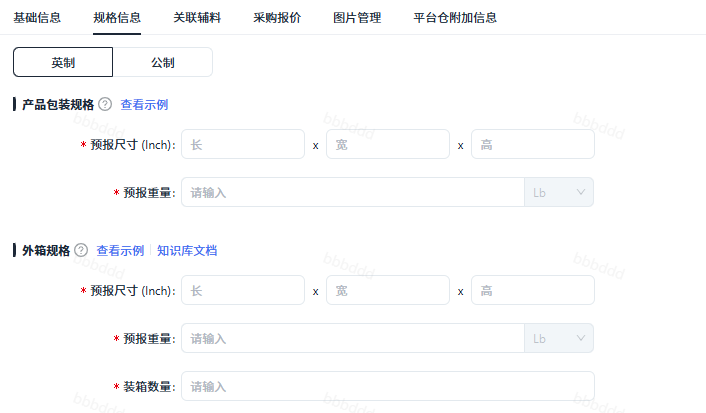

 1. 选择英制或公制
 2. 产品包装规格：指单个产品彩盒的尺寸、重量
 3. 外箱规格: 装箱数量不能超过250，因为无法成功上传VC Offer的
 A. 预报尺寸：指产品外箱的长宽高的尺寸,外箱是您产品整箱(同一个整箱内装的是同一个产品,即SKU相同，至少装1个，也可能装多个)
 B. 预报重量：产品外箱盒子+箱内产品(1pcs/多pcs-取决于装箱数量)的**总**重量
 C. 装箱数量：针对Single SKU的外箱，一个外箱里面装的同一个产品(SKU相同)的数量

 1. 填写采购报价：建议在新增产品时，填写报价信息，可减少操作，避免在采购报价里二次填写

 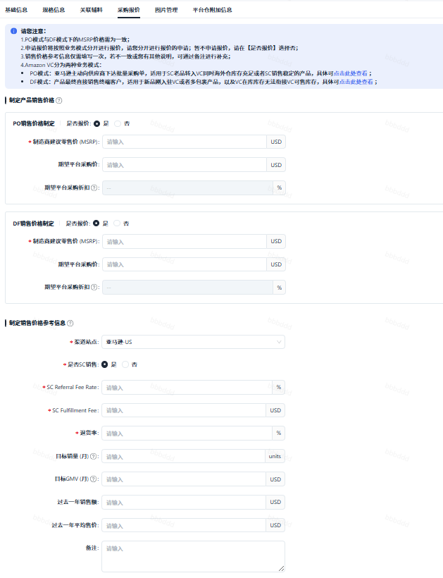

 > **制定产品销售价格：建议PO和DF都一起填写，除非您确定产品只做PO/DF，则只需填写一个**
 1. 制造商建议零售价（MSRP）：您想要的前台售价，同SC的Your price，区别在于VC的MSRP一旦制定，比较难调整，所需的时间往往较长。VC MSRP也会受到SC list price设置的影响。
 2. 期望平台采购价：您的期望到手价，会作为一定参考
 3. 期望平台采购折扣：期望平台采购折扣＝期望平台采购价/MSRP
 > **制定销售价格参考信息**
 1. 渠道站点：默认亚马逊-US，不可选择
 2. 是否SC销售：勾选了是，需必填下方圈出来的所有信息；勾选了否，则只需填写退货率
 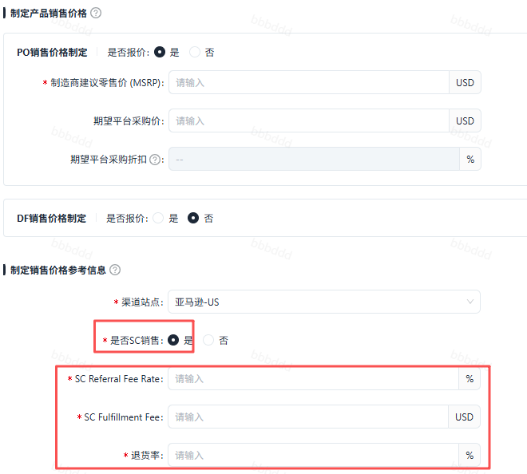
 1. SC Referral Fee Rate：SC平台佣金费率
 2. SC Fulfillment Fee：亚马逊尾程配送费
 3. 退货率：产品最近1月/3月的平均退货率

 1. 若使用平台仓选择了是，需填写平台仓附加信息

 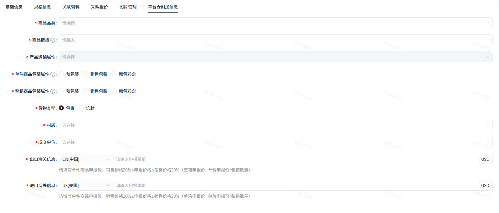

 1. 商品品类：选择对应商品品类
 2. 商品链接：链接仅供平台仓了解产品品类及外观
 3. 单件商品包装属性：选择单件对应商品包装属性
 - 预包装：商品已有中性无logo的物流包装，可直接出库；支持全货型。
 - 原包彩盒：商品自有带logo的纸箱包装，符合物流运输要求，可直接出库；支持全货型。
 - 销售包装：商品无牢固物流包装，类似裸包，需仓库二次包装方可出库商品；只支持M及以下货型。
 1. 整箱商品包装属性：选择对应整箱商品包装属性
 2. 货物类型：选择包裹/信封
 3. 材质：下拉选择对应产品材质
 4. 成交单位：选择对应成交单位
 5. 出口海关信息：默认中国，不可修改；填写单件商品申报价，销售价格20%≤申报价格≤销售价格30%（整箱申报价=单价申报价\*装箱数量）
 6. 进口海关信息：默认美国，不可修改

 1. 信息填写完成后点击提交，平台运营经理会尽快完成审核，请注意查看该条记录状态

 1. 审核完成状态即为已生效
 2. 审核未通过，需要根据报错原因修改后提交，也可以点击删除后，重新新增商品

 ## 新增组合商品

 1. 首先需要维护商品信息，才能添加组合商品
 2. 【规格信息】：预报重量——系统自动拉取所组合的商品的单个重量相加自定义——您可自行填写组合商品的重量

 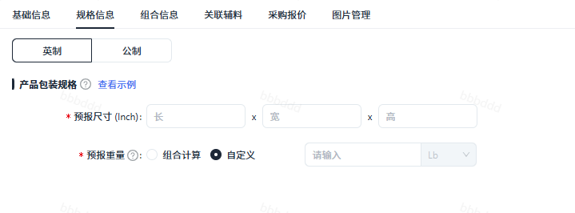
 3. 在【组合信息】里新增添加的商品，需是商品管理中状态为已生效的产品才可添加

 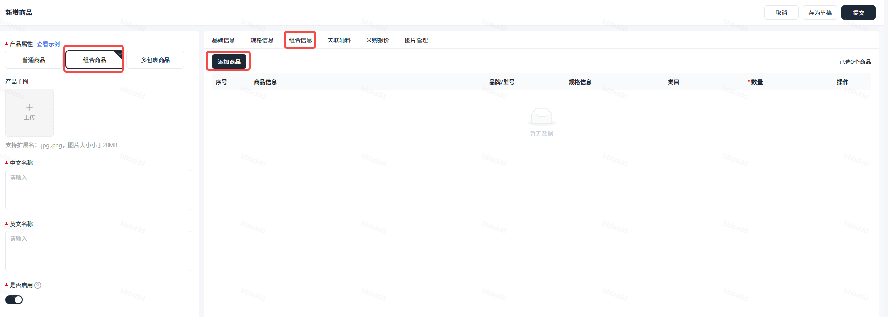

 ## 新增多包裹商品

 1. 首先需要维护货品信息，即包裹产品【货品管理】>【新增产品】

 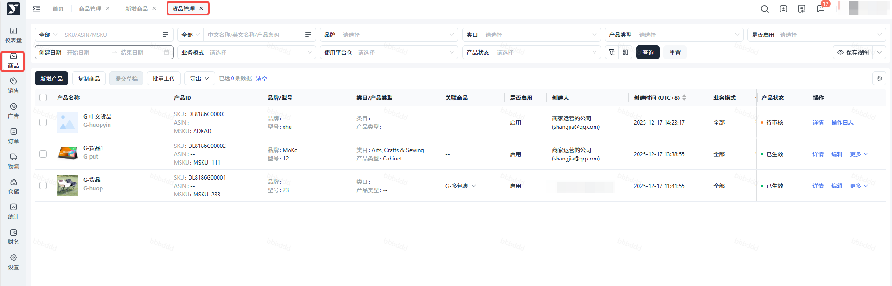
 2. 货品信息维护完成后，在商品管理---新增产品（选择产品属性=多包裹商品），添加包裹信息填写包裹的数量、尺寸和重量（指：单个包裹完成产品打包后、尺寸、重量），点击添加包裹，可在打包方式1里再添加一个包裹

 1. 点击添加货品，点击确定，需在货品管理里状态为已生效的货品才可添加，也可点击快速添加货品，跳转至增加货品界面，勾选的1个产品即为1个包裹，需点击添加包裹，才可添加第2个包裹（货品一样但是有多个包裹的，只需维护1个货品信息）

 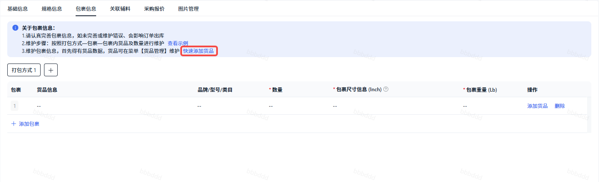

 1. 填写包裹信息

 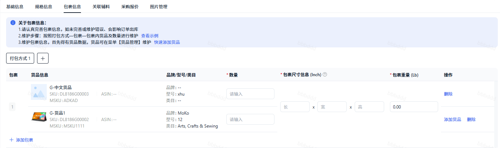

 > 添加打包方式：产品A可能在B仓库需要2个包裹发，在仓库C需要3个包裹发货，可灵活的添加不同的包裹数量，每种打包方式包裹数量不能一样！

## 通过表格批量上传商品

1. 操作路径：【商品】-【商品管理】
2. 注意事项：批量上传时，如果品牌管理和类型管理里无对应数据，上传时会报错，请先分别在品牌管理和类型管理里新增产品品牌和新增产品类型
3. 操作步骤：【规则说明】里有详细解释，填之前，请先阅读规则说明 请在【添加商品】里填写商品/货品信息

 1. 进入批量上传界面，点击下载模板

 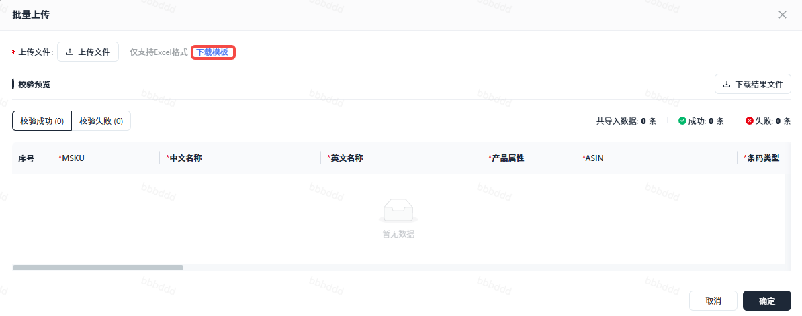

 1. 填写表格，上传文件

 1. 查看校验结果

 1. 校验失败的，可在校验失败处查看失败原因或点击下载结果文件，查看失败原因，修改后重新上传
 2. 校验成功的需点击确定，才会上传至系统
 3. 注意事项：如共上传了4条数据，2条失败，2条成功，需点击确定，才会上传2条成功的数据至系统
 4. 校验成功的数据，返回至商品管理后，状态为草稿，需点击提交

 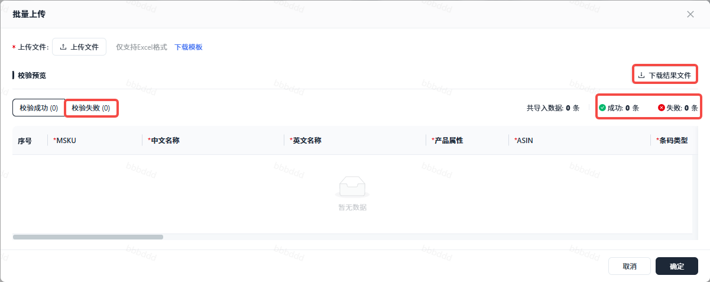
 2. 点击提交后，平台运营经理会尽快完成审核，请注意查看该条记录状态

 1. 审核完成状态即为已生效
 2. 审核未通过，需要根据报错原因修改后提交，也可以点击删除后，重新新增商品

## 注意事项：

1. 商品管理中状态为已生效的产品，点击编辑只可以修改基础信息和规格信息，部分修改平台仓附加信息，不可修改采购报价信息！
2. 再次修改采购报价只能在【销售】-【报价管理】-【采购报价】中修改
