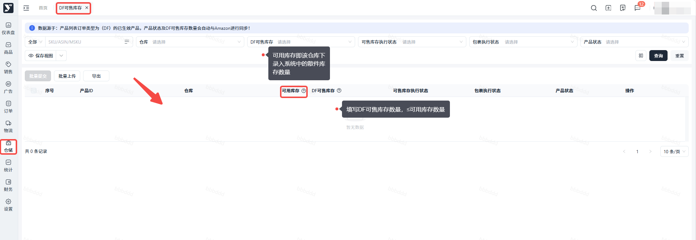

# 飞书文档：DF可售库存配置

## 一、DF流程

DF配送是指 --- 货物直接从商家仓交给亚马逊承运人送到C端顾客手中。

在进行DF销售前，请务必完成以下步骤：

1. 创建DF Offer（可直接克隆PO Offer，若已有）
2. 配置DF发货仓库（请确保信息准确无误！！）
3. 在系统中给对应DF发货仓库，录入对应产品的【散件库存】
4. 为需要进行DF销售的产品，在对应的DF发货仓库配置【DF可售库存】

完成设置后，如无特殊问题，该产品即可在前台显示VC offer处于可售状态。

## 二、如何配置产品的DF可售库存

- 路径：【仓储】>【DF可售库存】
- 操作步骤：建议：1. 如有100库存，仅设置90 2. 每天更新DF可售库存，特别是海外仓供多个渠道直发的卖家

 

## 三、销售多包裹产品

多包裹产品：指单SKU用一个外箱装不下，需要使用多个纸箱来包装及发货。

- 针对多包裹类型产品我司暂不支持做PO模式，仅支持做DF模式！
- 若您产品是多包裹产品，请在报价之前同步给我司平台运营经理！
