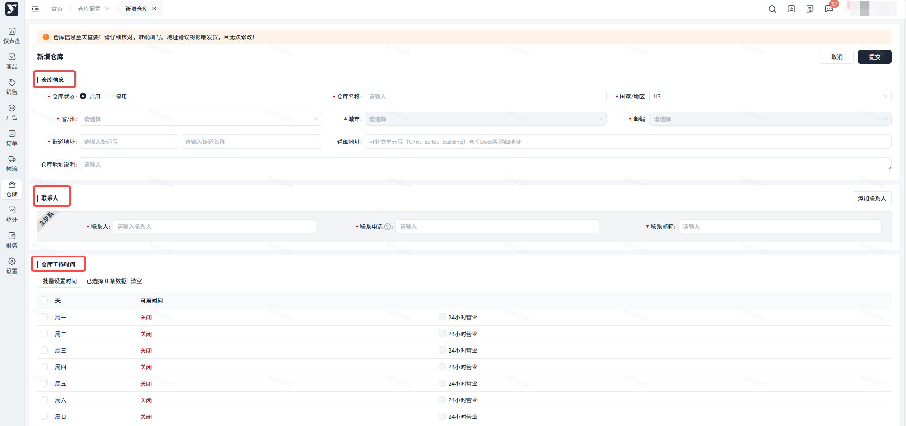
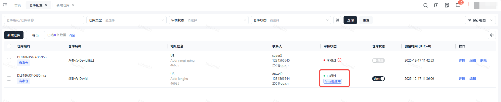
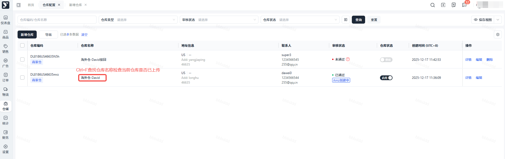
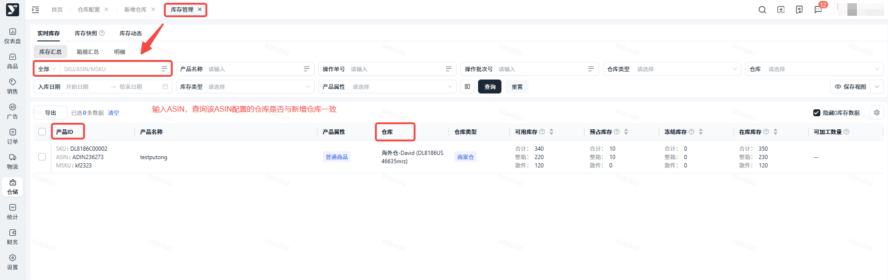

# 飞书文档：仓库信息配置

## 文档信息

| 项 | 内容 |
| --- | --- |
| 远程文档 | https://q1njej8cpab.feishu.cn/wiki/OWW5wZ93titS7wk0n5bcDdXknZf |
| 图片处理 | 本地下载（assets/images） |
| 快照时间 | 2026-08-06 |
| 来源命令 | `lark-cli docs +fetch --api-version v2 --doc https://q1njej8cpab.feishu.cn/wiki/OWW5wZ93titS7wk0n5bcDdXknZf --doc-format markdown --as user --format json --jq .data.document.content` |
| 格式处理 | fd-doc-markdown-sync/scripts/normalize-feishu-doc-markdown.mjs |

---

仓库信息配置

## 一、仓库说明

1. 仓库类型说明：

 - 平台仓、自营仓：Yurex提供的海外仓
 - 商家仓：品牌方合作的第三方海外仓
2. 仓库配置是前期极为重要的一步，品牌方将仓库提交到系统后，亚马逊需要**3-5天**时间来进行仓库审核，通过后才能使用该仓库进行出入库管理。

 - 亚马逊是分开管理DF和PO的发货仓库。

## 二、操作流程

- **页面路径：【仓储】>【仓库配置】>【新增仓库】**
- 操作流程：

1. **新增仓库：**点击“新增仓库”，填写仓库基础信息（仓库信息、联系人、仓库工作时间）并点击“提交”

1. **等待审核：**物流经理推送亚马逊VC，等待仓库完成审核，审核状态变为“已通过”

1. **已配置仓库查重：**检查贵司是否已完成仓库配置，**避免重复添加仓库**、延长亚马逊审核时间

 - 方法一：仓储>仓库配置，检查列表中的仓库信息，本次需要入库的ASIN、其对应的仓库信息是否在贵司已添加的仓库中

 

 - 方法二：仓储>库存管理，按ASIN搜索，查看是否已经有对应的仓库和库存信息

 

## 三、常见问题

#### Q：仓库审核未通过，能进行修改吗？

A：仓库审核未通过，目前不能对未通过的仓库信息进行修改。请根据未通过的原因，进行【新增仓库】操作，重新提交并审核。

#### Q：仓库状态怎么修改？

A：可点击“仓库状态”栏按钮，切换当前仓库状态“启用/停用”，停用仓库后，接单时无法选择该仓库。

#### Q：仓库的审核时长是多久？

A：PO仓库：24h；DF仓库：3-5个工作日。

## **注意：**

- 请统一好商家仓名称，同一个地址的商家仓不能重复添加。
- **不支持商家使用合作“大健云仓”！！！**
