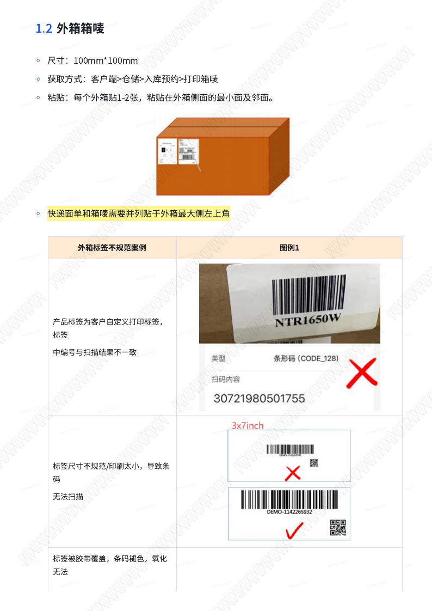
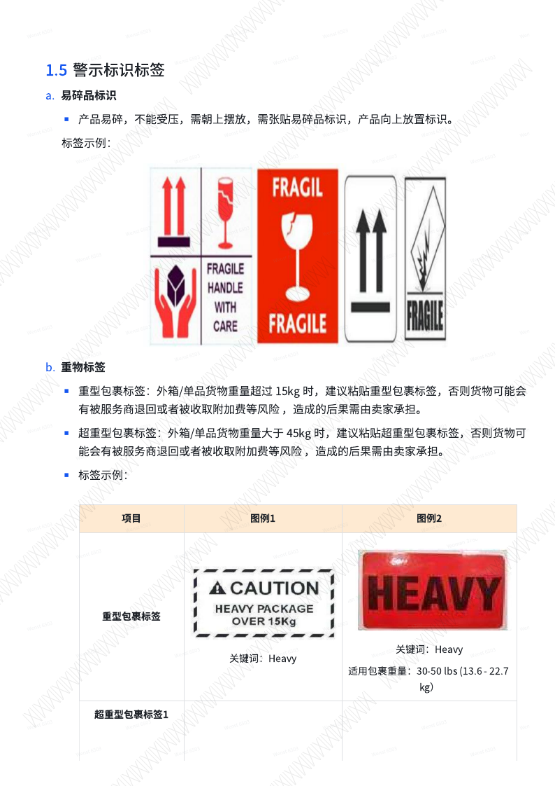
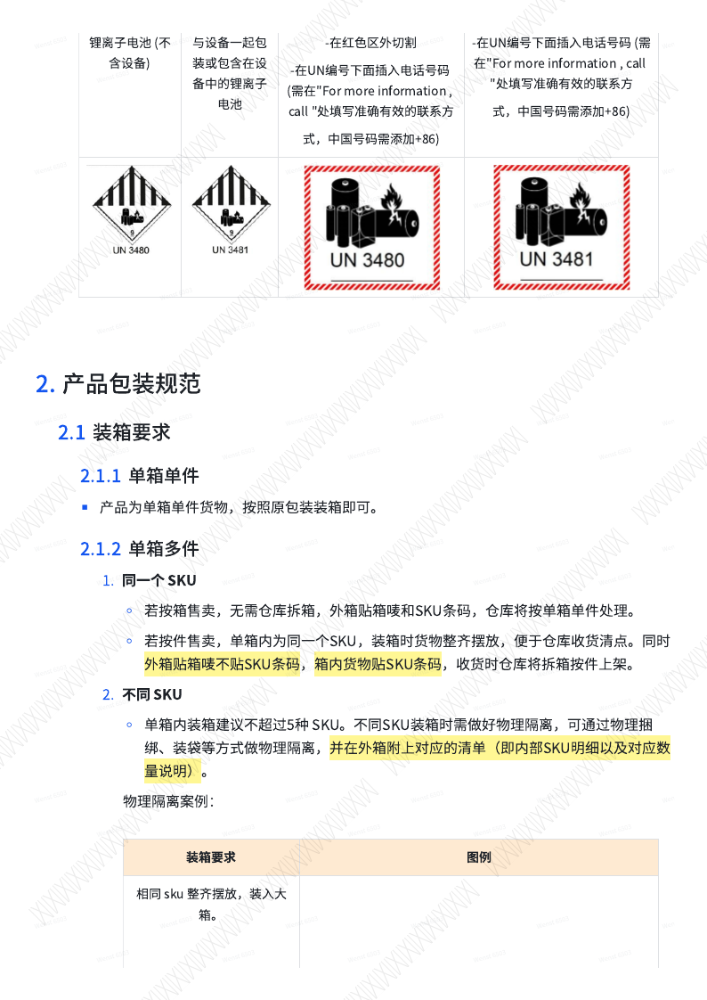
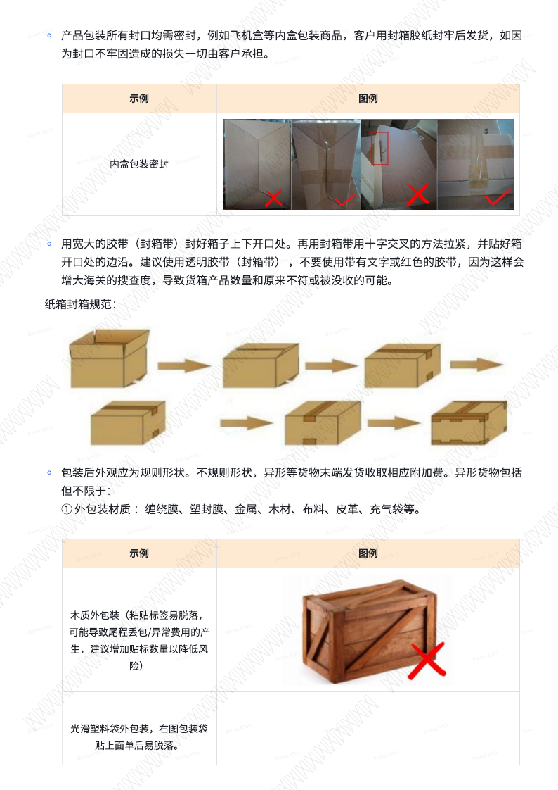
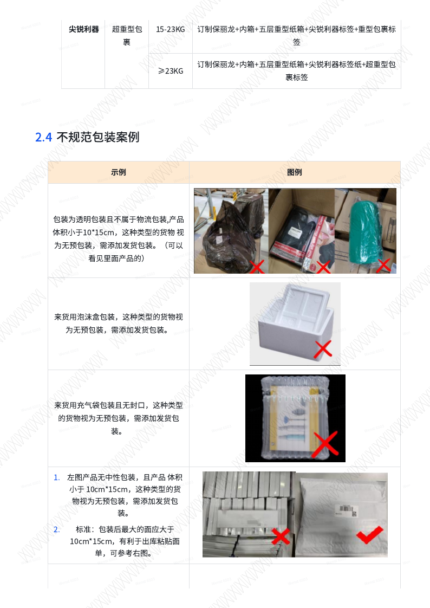
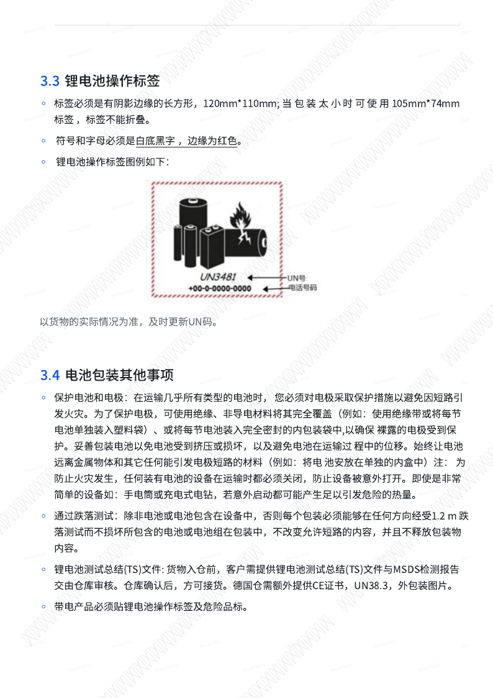
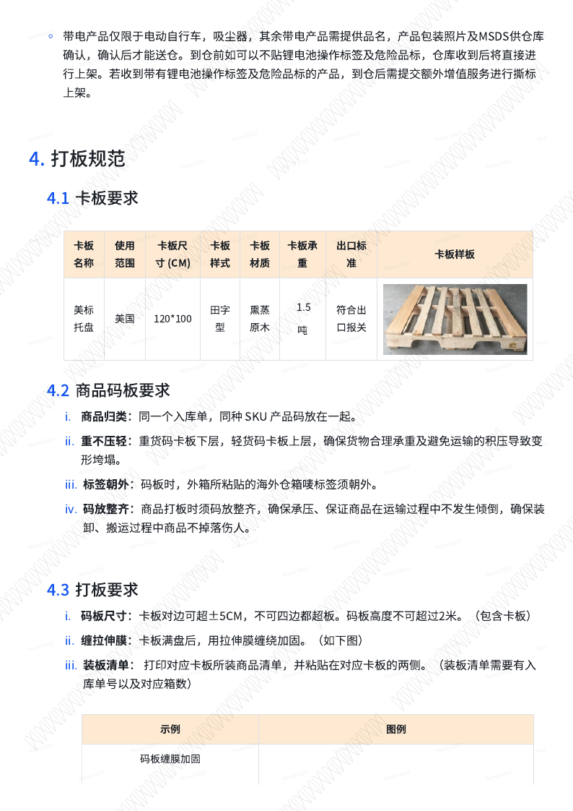
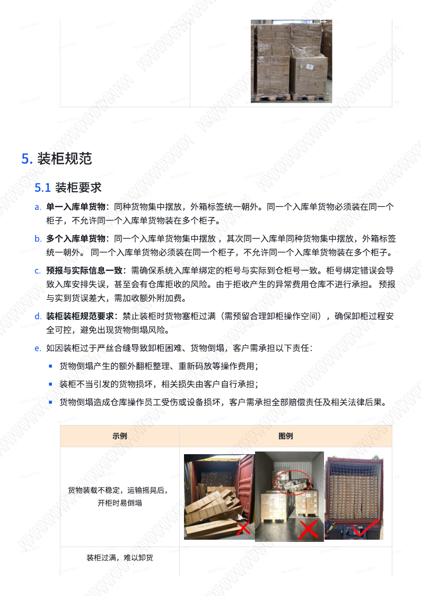

# Yurex平台仓来货规范 Ver.20260401

## 1. 来货标签规范

### 1.1 库内 SKU 标签

库内 SKU 标签用于仓储物流管理的库存单位。

- 最小尺寸：70mm * 30mm
- 获取方式：客户端 > 仓储 > 入库预约 > 打印 SKU 标签
- 整箱入库适用场景：VCPO 模式、FBA 发货
- 散件入库适用场景：VCDF 模式、一件代发

#### 整箱入库粘贴要求

- 每个外箱贴 1-2 张 SKU 标签。
- 一箱一件产品时，外箱贴 1-2 张，贴在最小面及邻面。
- 若最小面及邻面最小边长大于 10cm，箱唛及 SKU 条码可各贴 1 张，贴在最小面及邻面。
- 若最小面及邻面边长小于 10cm，无法贴下箱唛时，需要贴 2 张 SKU 条码（最小面及邻面）及 1 张箱唛（最大面）。

#### 散件入库粘贴要求

- 一箱多件产品时，每个产品彩盒上贴 2 张 SKU 标签。
- 标签贴在最小面及邻面。

### 1.2 外箱箱唛

- 尺寸：100mm * 100mm
- 获取方式：客户端 > 仓储 > 入库预约 > 打印箱唛
- 粘贴：每个外箱贴 1-2 张，粘贴在外箱侧面的最小面及邻面。
- 快递面单和箱唛需要并列贴于外箱最大侧左上角。

#### 外箱标签不规范案例

以下情况会导致扫描失败、无法识别、无法上架或影响后续拆箱：

- 产品标签为客户自定义打印标签，标签中编号与扫描结果不一致。
- 标签尺寸不规范或印刷太小，导致条码无法扫描。
- 标签被胶带覆盖，条码褪色、氧化，无法识别。
- 标签打印不完整、锯齿状，导致无法扫描。
- 标签贴于接缝处，拆箱易被破坏。
- 同一产品粘贴不同 SKU 条码，或箱件 SKU 不一致。
- 胶带覆盖外箱标签，导致外箱标签信息模糊无法识别、条码无法扫描。
- 来货无海外仓外箱标签，无法获取具体入库单及装箱信息，无法上架。
- 标签粘贴不平整。
- 来货外箱粘贴大量非正确外箱标签，无法上架。
- 多 SKU 混装货物没有货物清单。

### 1.3 产品标

每件产品可以根据售卖平台需求粘贴 UPC、EAN、透明标签等。多装箱数量产品需要在每个单件产品上粘贴产品标；单箱单件货物需要在外箱上粘贴产品标。

### 1.4 注意事项

- 凡是需要入库的货物均需贴平台仓可识别扫描的产品标签。
- 非单箱单件产品外箱上请勿粘贴产品标签，否则会有发错货风险，后果需客户自行承担。
- 产品标签不可粘贴在缠膜或外包装薄膜上；缠膜或薄膜脱落时标签容易丢失。
- 请勿用胶带覆盖产品标签，以免标签被氧化或反光，导致仓库无法扫描及识别。
- SKU 标签是产品唯一辨认码，如因条码贴错造成后果，应由客户承担。

### 1.5 警示标识标签

#### 易碎品标识

产品易碎、不能受压、需朝上摆放时，需要张贴易碎品标识和产品向上放置标识。

#### 重物标签

| 标签类型 | 适用条件 | 风险说明 |
| --- | --- | --- |
| 重型包裹标签 | 外箱/单品货物重量超过 15kg；常见区间为 30-50 lbs（13.6-22.7kg） | 未贴可能被服务商退回或收取附加费，后果由卖家承担。 |
| 超重型包裹标签 1 | 50-100 lbs（22.7-45.4kg），关键词 Team Lift | 未贴可能被服务商退回或收取附加费，后果由卖家承担。 |
| 超重型包裹标签 2 | ≥100 lbs（≥45.4kg），关键词 Mechanical Lift | 未贴可能被服务商退回或收取附加费，后果由卖家承担。 |

#### 尖锐物品包裹标签

产品属于尖锐物品时需张贴尖锐物品包裹标签，否则货物可能被服务商退回或收取附加费，尖锐物品也可能伤害操作人员。相关后果由卖家承担。

#### 危险品标签

以货物实际情况为准，及时更新 UN 码。

| UN 编码 | 适用对象 | 标识要求 |
| --- | --- | --- |
| UN 3480 | 锂离子电池，不含设备 | 在红色区外切割；在 UN 编号下面插入电话号码。 |
| UN 3481 | 与设备一起包装或包含在设备中的锂离子电池 | 在红色区外切割；在 UN 编号下面插入电话号码。 |

联系电话需填写准确有效的联系方式，中国号码需添加 `+86`。

## 2. 产品包装规范

### 2.1 装箱要求

#### 2.1.1 单箱单件

产品为单箱单件货物时，按照原包装装箱即可。

#### 2.1.2 单箱多件

同一 SKU：

- 若按箱售卖，无需仓库拆箱，外箱贴箱唛和 SKU 条码，仓库将按单箱单件处理。
- 若按件售卖，单箱内为同一 SKU，装箱时货物整齐摆放，便于仓库收货清点；外箱贴箱唛不贴 SKU 条码，箱内货物贴 SKU 条码，收货时仓库将拆箱按件上架。

不同 SKU：

- 单箱内装箱建议不超过 5 种 SKU。
- 不同 SKU 装箱时需做好物理隔离，可通过物理捆绑、装袋等方式隔离。
- 外箱需附上对应清单，即内部 SKU 明细及对应数量说明。

| 物理隔离方式 | 要求 |
| --- | --- |
| 相同 SKU 整齐摆放 | 相同 SKU 整齐摆放后装入大箱。 |
| 捆绑隔离 | 需达到货物不散落；可使用绳索、缠膜捆绑；不可使用胶带捆绑，胶带容易使标签氧化。 |
| 装袋隔离 | 包装袋需为透明塑料袋，外部可辨识 SKU 条码；塑料袋不能粘贴任何标签，可用马克笔备注数量。 |

#### 2.1.3 特殊产品

易碎物品、尖锐物品、电池等产品装箱时，箱内请用填充物填充，做好缓冲防撞层，防止货物受损。特殊产品需贴相应标签。

### 2.2 包装要求

- 产品包装所有封口均需密封，例如飞机盒等内盒包装商品，客户需用封箱胶纸封牢后发货；如因封口不牢固造成损失，由客户承担。
- 用宽大胶带（封箱带）封好箱子上下开口处，再用封箱带以十字交叉方式拉紧，并贴好箱开口处边沿。
- 建议使用透明胶带，不要使用带文字或红色的胶带，以免增大海关搜查度，导致货箱产品数量与原来不符或被没收。
- 包装后外观应为规则形状。不规则形状、异形等货物末端发货会收取相应附加费。

#### 异形货物示例

| 类型 | 示例 | 风险/要求 |
| --- | --- | --- |
| 外包装材质异常 | 缠绕膜、塑封膜、金属、木材、布料、皮革、充气袋等 | 标签易脱落，可能导致尾程丢包或异常费用。 |
| 形状异常 | 梯形、不规则多边体、圆锥体、桶装、罐装、管状、轮胎等 | 属于不规则外包装或圆柱体包装。 |
| 软包装袋 | 快递袋、塑料袋等 | 需符合渠道对包装袋尺寸与面单粘贴要求。 |
| 包装异常 | 海运挤压变形、破损、胶带/打包带捆绑组合包装、外包装未完全包住产品、带轮子/把手/挂钩等 | 可能产生附加费或拒收风险。 |

### 2.3 产品包装材料

- 每件产品需有独立密封的发货包装。
- 编织袋、蛇皮袋、黑色塑料袋、文件袋、气泡袋、气泡膜、塑封膜、木箱、彩盒（外盒带 LOGO、货物信息等）等，不可作为发货包装。
- 建议使用规则纸箱、物流袋等中性不透明发货包装。
- 若产品无预包装，或使用塑封膜、透明袋外包装等不满足发货规定，将由仓库增加预包装。
- 不可堆叠货物，如包装较软的产品，需提前告知。
- 其他特殊包装材料，如木箱，仓库有权拒绝收货；若入库上架后末端发货，将收取附加费。

#### 不同商品类型建议纸箱标准

| 商品分类 | 重量段 | 纸箱标准 |
| --- | --- | --- |
| 普通商品 - 轻型包裹 | <15KG | 三层普通纸箱 |
| 普通商品 - 重型包裹 | 15-23KG | 三层/五层重型纸箱 + 重型包裹标签 |
| 普通商品 - 超重型包裹 | ≥23KG | 五层重型纸箱 + 超重型包裹标签 |
| 尖锐利器 - 重型包裹 | 15-23KG | 定制保丽龙 + 内箱 + 五层重型纸箱 + 尖锐利器标签 + 重型包裹标签 |
| 尖锐利器 - 超重型包裹 | ≥23KG | 定制保丽龙 + 内箱 + 五层重型纸箱 + 尖锐利器标签纸 + 超重型包裹标签 |

### 2.4 不规范包装案例

| 不规范场景 | 标准/处理要求 |
| --- | --- |
| 透明包装且不属于物流包装，产品体积小于 10cm * 15cm | 视为无预包装，需添加发货包装。 |
| 泡沫盒包装 | 视为无预包装，需添加发货包装。 |
| 充气袋包装且无封口 | 视为无预包装，需添加发货包装。 |
| 产品无中性包装且体积小于 10cm * 15cm | 需添加发货包装；包装后最大面应大于 10cm * 15cm，便于出库粘贴面单。 |
| 彩色纸盒并带 LOGO 的包装盒 | 运输途中有丢失风险；标准做法是使用中性快递袋包装，并用胶带贴好 4 个角。 |
| 同一 SKU 来货多种尺寸 | 入库将视为多种 SKU，需更换标签或按最大尺寸上架；建议创建多个 SKU。 |

### 2.5 箱内产品标签摆放

箱内产品标签需统一朝外箱箱口，便于后续操作。

## 3. 锂电池包装要求

### 3.1 锂离子电池（可充电）

| 包装要求 | UN 编码 | 限制 | 包装说明 | 标签要求 |
| --- | --- | --- | --- | --- |
| PI965，纯锂离子电池 | UN 3480 | 电池芯 ≤20Wh，电池 ≤100Wh | 电池或电芯必须装入完全封装的小包装后再装进坚固外包装；不同型号纯电池不能混装在一个箱子。 | 每个包装件外部必须贴锂电池操作标签；合成包装件（overpack）上应贴锂电池操作标签。 |
| PI966，锂离子电池与设备包装在一起 | UN 3481 | 电池芯 ≤20Wh，电池 ≤100Wh | 电池或电芯必须装入完全封装的小包装后再装进坚固外包装。 | 每个包装件外部必须贴锂电池操作标签；合成包装件（overpack）上应贴锂电池操作标签。 |
| PI967，锂离子电池安装在设备中 | UN 3481 | 电池芯 ≤20Wh，电池 ≤100Wh | 设备必须包装在用合适材料做成的坚固包装中，设备做好防意外启动措施。 | 每一票货物超过 2 个包装件，且每个包装件内含超过 2 块电池或 4 块电芯时，必须贴锂电池操作标签，否则可不贴；合成包装件（overpack）上应贴锂电池操作标签。 |

### 3.2 锂金属电池（不可充电）

| 包装要求 | UN 编码 | 限制 | 包装说明 | 标签要求 |
| --- | --- | --- | --- | --- |
| PI968，纯锂金属电池 | UN 3090 | 电池芯 ≤1g，电池 ≤2g | 电池或电芯必须装入完全封装的小包装后再装进坚固外包装；不同型号纯电池不能混装在一个箱子。 | 每个包装件外部必须贴锂电池操作标签；合成包装件（overpack）上应贴锂电池操作标签。 |
| PI969，锂金属电池与设备包装在一起 | UN 3091 | 电池芯 ≤1g，电池 ≤2g | 电池或电芯必须装入完全封装的小包装后再装进坚固外包装。 | 每个包装件外部必须贴锂电池操作标签；合成包装件（overpack）上应贴锂电池操作标签。 |
| PI970，锂金属电池安装在设备中 | UN 3091 | 电池芯 ≤1g，电池 ≤2g | 设备必须包装在用合适材料做成的坚固包装中，设备做好防意外启动措施。 | 每一票货物超过 2 个包装件，且每个包装件内含超过 2 块电池或 4 块电芯时，必须贴锂电池操作标签，否则可不贴；合成包装件（overpack）上应贴锂电池操作标签。 |

### 3.3 锂电池操作标签

- 标签必须是有阴影边缘的长方形，120mm * 110mm；当包装太小时可使用 105mm * 74mm 标签，标签不能折叠。
- 符号和字母必须是白底黑字，边缘为红色。
- 以货物实际情况为准，及时更新 UN 码。

### 3.4 电池包装其他事项

- 保护电池和电极：运输几乎所有类型的电池时，必须对电极采取保护措施以避免短路引发火灾。
- 可使用绝缘、非导电材料完全覆盖电极，例如绝缘带，或将每节电池单独装入塑料袋。
- 妥善包装电池，避免受到挤压或损坏，避免运输过程中位移。
- 电池应远离金属物体和任何可能引发电极短路的材料。
- 装有电池的设备运输时必须关闭，防止设备被意外打开。
- 除非电池或电池包含在设备中，否则每个包装必须能够经受任意方向 1.2m 跌落测试，且不损坏电池或电池组、不改变允许短路的内容、不释放包装物内容。
- 货物入仓前，客户需提供锂电池测试总结（TS）文件与 MSDS 检测报告交由仓库审核，仓库确认后方可接货。
- 德国仓需额外提供 CE 证书、UN38.3、外包装图片。
- 带电产品必须贴锂电池操作标签及危险品标。
- 带电产品仅限于电动自行车、吸尘器；其余带电产品需提供品名、产品包装照片及 MSDS 供仓库确认，确认后才能送仓。
- 到仓前如可以不贴锂电池操作标签及危险品标，仓库收到后将直接上架；若收到已贴锂电池操作标签及危险品标的产品，到仓后需提交额外增值服务进行撕标上架。

## 4. 打板规范

### 4.1 卡板要求

| 卡板名称 | 使用范围 | 卡板尺寸（CM） | 卡板样式 | 卡板材质 | 卡板承重 | 出口标准 |
| --- | --- | --- | --- | --- | --- | --- |
| 美标托盘 | 美国 | 120 * 100 | 田字型 | 熏蒸原木 | 1.5 吨 | 符合出口报关 |

### 4.2 商品码板要求

1. 商品归类：同一个入库单、同种 SKU 产品码放在一起。
2. 重不压轻：重货码卡板下层，轻货码卡板上层，确保货物合理承重，避免运输积压导致变形垮塌。
3. 标签朝外：码板时，外箱所粘贴的海外仓箱唛标签须朝外。
4. 码放整齐：商品打板时须码放整齐，确保承压，保证运输过程中不倾倒，装卸、搬运过程中不掉落伤人。

### 4.3 打板要求

1. 码板尺寸：卡板对边可超 ±5CM，不可四边都超板。码板高度不可超过 2 米（包含卡板）。
2. 缠拉伸膜：卡板满盘后，用拉伸膜缠绕加固。
3. 装板清单：打印对应卡板所装商品清单，并粘贴在对应卡板两侧。装板清单需要有入库单号以及对应箱数。

## 5. 装柜规范

### 5.1 装柜要求

- 单一入库单货物：同种货物集中摆放，外箱标签统一朝外。同一个入库单货物必须装在同一个柜子，不允许同一个入库单货物装在多个柜子。
- 多个入库单货物：同一入库单货物集中摆放，其次同一入库单同种货物集中摆放，外箱标签统一朝外。同一个入库单货物必须装在同一个柜子。
- 预报与实际信息一致：需确保系统入库单绑定的柜号与实际到仓柜号一致。柜号绑定错误会导致入库安排失误，甚至有仓库拒收风险。由于拒收产生的异常费用仓库不承担。预报与实到货误差大时，需加收额外附加费。
- 禁止装柜时货物塞柜过满，需预留合理卸柜操作空间，确保卸柜过程安全可控，避免货物倒塌风险。

如因装柜过于严丝合缝导致卸柜困难、货物倒塌，客户需承担以下责任：

- 货物倒塌产生的额外翻柜整理、重新码放等操作费用。
- 装柜不当引发的货物损坏，相关损失由客户自行承担。
- 货物倒塌造成仓库操作员受伤或设备损坏，客户需承担全部赔偿责任及相关法律后果。

### 5.2 整柜/托盘预约（仅客户自发头程）

- 整柜/托盘送仓时需至少提前 2-3 个工作日发送邮件预约申请。
- 仓库基于预约整体情况，会通过、调整或驳回预约，具体以预约回执邮件为准。
- 未提前预约送仓的整柜，仓库按实际情况安排加班卸柜并收取相应费用；如无法安排则会拒收。
- 同一预约入库单货物只能预约一次，请勿将同一入库单货物分批次、分不同入库方式送仓，否则会收取额外罚款。

### 5.3 整柜送仓注意事项

- 整柜需在预约时间段准时送仓，超出预约时间 ±2 小时将收取罚款。
- 以仓库签收单时间为准，货柜未在仓库接柜时间内的预约时段到仓视为迟到。
- 如整柜未在当天仓库下班前送达仓库，按整柜爽约处理。
- 整柜送仓迟到、爽约、未预约送仓，会产生异常送仓费用。仓库根据实际情况安排是否卸柜；如果仓库可以安排卸柜，不保证入库时效；如无法安排则会拒收。
- 因客户货代原因导致平台仓物资损坏（包含但不限于车辆撞损库门、设备等），产生的损失需客户承担。
- 如需取消预约或改约，需要至少提前所预约送仓日前 2 个工作日中午 12 时之前告知，否则仓库会收取相应费用。
