# 飞书文档：平台仓自发头程入库预约

## 该流程为使用Yurex平台仓用户操作

## 注意事项

Yurex入库预约单审核时长约为3个工作日，请在国内头程发出前至少提前3天创建入库预约单，以便平台仓审核商品是否可接收如需分批发货，请创建不同的预约入库单，请勿使用同一个预约入库单处理分批发货的货物，避免因操作不及时导致入库异常或产生到货异常处理费同一预约入库单货物请勿分多批次送仓、请勿分不同运输方式送仓，否则会有额外罚款如您的产品参与了透明计划，请贴透明计划二维码，此为AMZ要求海运散货/整柜到港后，根据情况预约送仓：地面运输方式=快递，不需要预约送仓时间，您的货代直接按原计划时间送对应仓即可地面运输方式=卡车， 您的货代可直接预约，SOP见；如有疑问，请与平台仓物流经理沟通，由其协助贵司预约送仓建议不要使用快递模式送仓，因为US送仓库的快递包裹丢件率/送错率高开始发货前，请贵司务必仔细查阅, 按要求准备货物哦为避免额外罚款或被拒收，请与货代确认好发货/送仓模式，预约⼊库单审核通过后将⽆法修改

## 操作流程

 前期准备
- 国内发货前：产品需先在悦来ERP的商品-商品管理-新增产品，有基础信息才能做入库预约。
- 针对PO模式：需确认是否需要包装认证（路径：商品-产品刊登-包装认证），建议提前准备。

- **预约操作路径：仓储-入库管理-入库预约-新增入库预约**
- **入库预约SOP概览（简化版）**

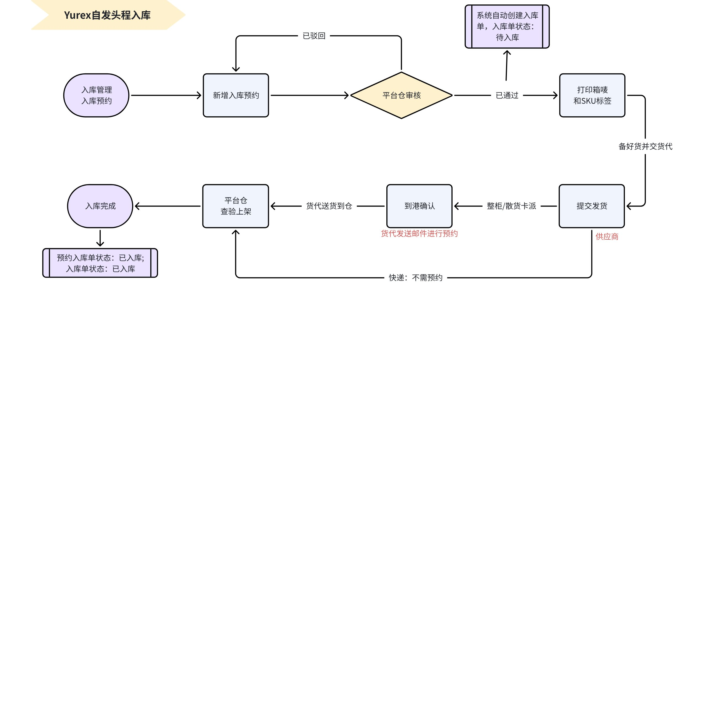

- **入库预约SOP概览（详细版）**

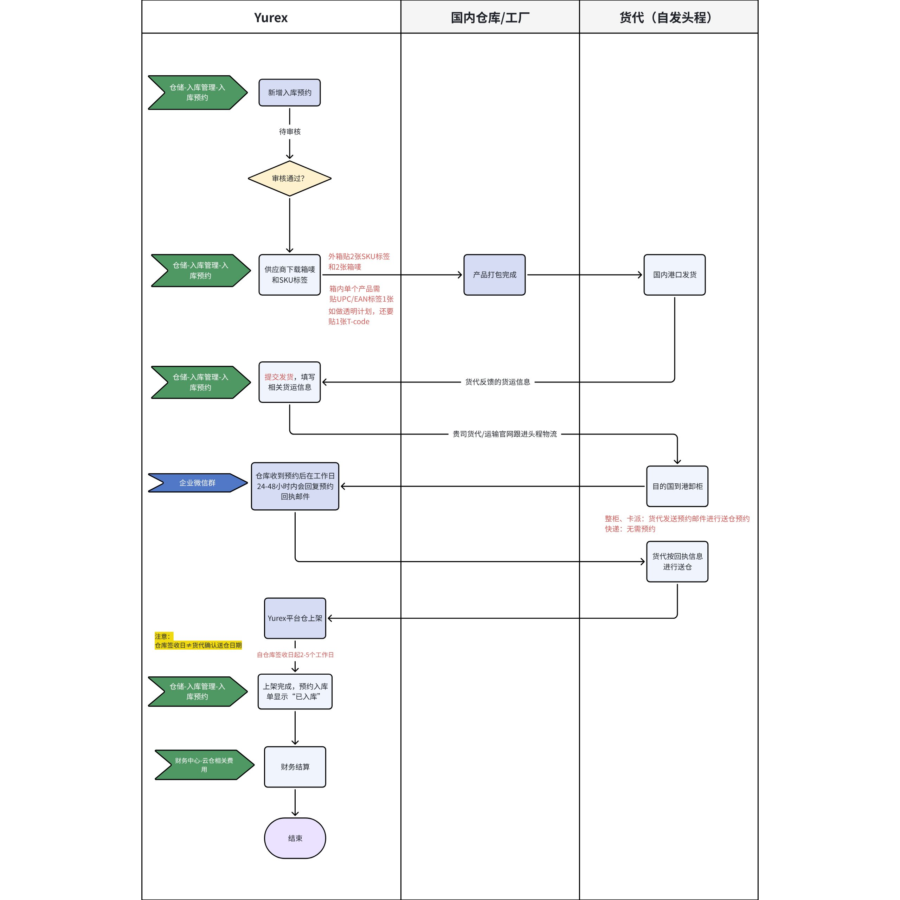

### 入库预约

#### 点击新增预约入库

注意：如需分批发货，请创建不同的入库单

例如：商品A计划2025/5/10发货，商品B计划2025/5/15发货，需要创建2个不同的【预约入库单】，避免预约入库处理不及时，导致后续收货上架环节出现异常

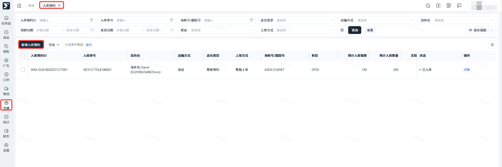

#### 填写到仓信息

#### 注意：不建议用快递方式送仓。如确有快递送仓的紧急需求，请及时通过企微群联系Yurex平台物流经理。

带 \* 为必填项

**\*⽬的仓：**选择货物实际送往的平台仓。

**\*送仓⽅式：**

1. 快递：使⽤快递包裹⽅式送仓。
2. 卡派：货物打托后卡⻋送仓，卡派模式货物必须打托。
3. 整柜：集装箱整柜送仓。如果选择整柜模式，需要进⼀步填写柜型&装载⽅式。

 - 地推：所有货物不打托，直接将货物放在集装箱。
 - 托盘：所有货物打托后，再装⼊集装箱内。
 - 混装：集装箱内既有打托货物，也有未打托的货物。

**\*预计发货时间：**填写预计时间即可。

**\*预计到仓时间：**填写预测时间即可。

**\*上架⽅式：**

- 整箱：⼊库单上架后将增加整箱库存。
- 散件：当货物为⼀箱多件时，平台仓将做拆箱，⼊库单上架后将增加散件库存。

**\*到港后送仓⽅式：**

- 快递：国内通过空运到⽬的港后采⽤快递模式送仓；货物海运到⽬的港后采⽤快递模式送仓；国内直接使⽤快递模式发货到悦来平台仓。
- 卡派：货物到达⽬的港后进⾏打托，使⽤卡派模式送仓。

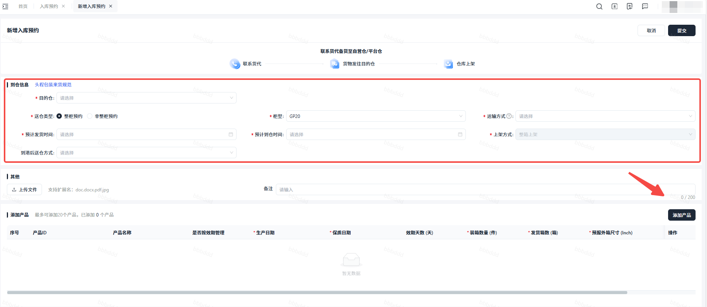

#### 添加产品

\*添加产品：添加需要送仓的货物SKU和对应的数量。

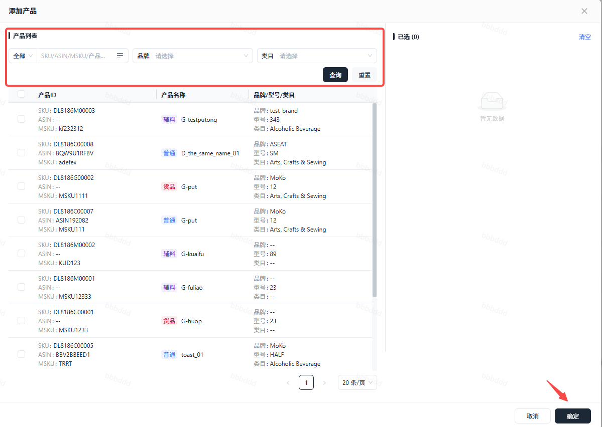

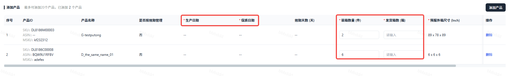

#### 点击提交

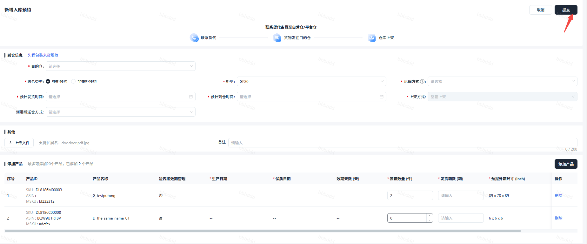

#### 查看状态

可在入库预约处查看入库预约单状态
- 点击详情可查看入库预约单详情
- 当状态显示为**已通过**时，点击更多即可打印箱唛和SKU标签（预约单审核时间为约3个工作日）
- 独立产品包装上贴1个UPC标签，发货外箱上贴1个SKU标签+2张Yurex箱唛
- 如有做透明计划，记得贴1个T-code在彩盒上

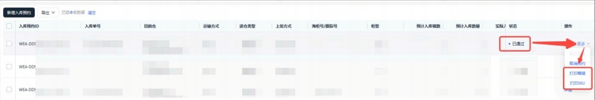

#### 提交发货

当您的货物已发出后，请点击【提交发货】
- 您需补充：海柜号、跟踪单号、货代公司、运输公司、货代联系人等信息（带 \* 号为必填项）
- 请核对每项细节！如有错误，支持在提交前修改，请确认所有内容无误后，再进行提交
- 填写完成后，点击提交，提交后状态变更为”已发货“
- **注意：必须在实际到港时间之前完成提交发货，否则可能无法顺利送仓；如果在实际到仓后才点击提交发货，属未按照约定时间确认入库信息，供应商可能需承担相关的入库异常罚款费用**

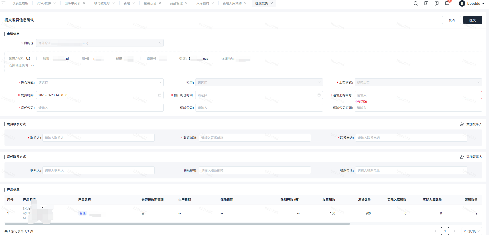

**详细填写说明：**

1. **申请信息**

送仓⽅式：填写规则如上“创建预约⼊库单”

柜型：填写规则如上“创建预约⼊库单”

发货时间：货物发出时间。

预计到港时间：填写预计时间即可。

预计到仓时间：填写预计时间即可。

海柜号：如送仓⽅式为整柜，则需填写海柜号。请正确填写海柜号，填写错误可能有拒收⻛险。

追踪单号：如快递送仓需要填写快递单号(运输⽅式选择快递)；如散货卡派打托送仓可以随意填写。

货代公司：填写头程货物公司。

运输公司：⾮必填项。

运输公司官⽹：⾮必填项⽬。

1. **发货联系⽅式**

联系⼈：填写发货⼈联系名称。

联系邮箱：填写发货⼈的邮箱，⽤于接收货物异常核实邮件。

联系电话：填写发货⼈联系电话。

1. **货代联系⽅式**

联系⼈：⾮必填项。

联系邮箱：⾮必填项。

联系电话：⾮必填项。

#### 操作到港

- 头程运输方式为空运或者国际快递的，不需要操作到港；
- 头程运输方式为海运或者铁运的，需要操作到港，以便我司Yurex物流经理为您确认可送仓日期。
- 操作路径：“仓储” - “⼊库预约”，选择需要操作到港的预约⼊库单，点击"更多"-"确认到港"
- 操作到港需填写：到港时间、预计到仓时间、到港后送仓方式，确认无误后，点击确认按钮。

 - 预计到仓时间不得早于到港时间，且不得选择周末或美国当地节假日
 - 到港后送仓方式通常分为：卡派，快递——请与您的货代负责人确认
- 操作到港后，预约入库单状态变更为“到港待送仓”，此状态不再支持编辑到港信息

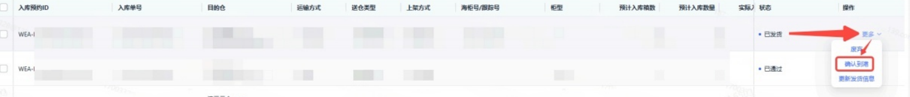

带 \* 为必填项

1. 到港时间：填写整柜，拼柜货物到达⽬的港时间。
2. 预计到仓时间：填写预计时间即可，实际送仓时间以邮件预约为准。
3. 到港后送仓⽅式⽆法修改。
4. 如需修改到港信息：

 确认到港信息后，可在操作栏的“编辑到港信息”修改到港时间和预计到仓时间。到港后送仓⽅式不⽀持需改。

#### 入库

- 操作到港以后，您只需等待货代按时送仓，我司平台仓工作人员会接收货物并处理上架
- 当入库单的首个货物开始接收上架时，入库预约单状态将变更为“入库中”；当所有货物上架完成，则入库预约单状态将变更为“已入库”
- 如仓库仅收到部分货物完成上架，且在未来10天内没有收到剩余货物，则入库预约单状态变更为“部分入库”，提前完结该入库单据；如后续收到货物，再补充上架的收货单
- 每一批次上架的货物，在【仓储】-【入库管理】-【收货单列表】，都能看到对应的收货单号；入库单列表中，也能查看到对应预约入库单号的入库单状态和详情

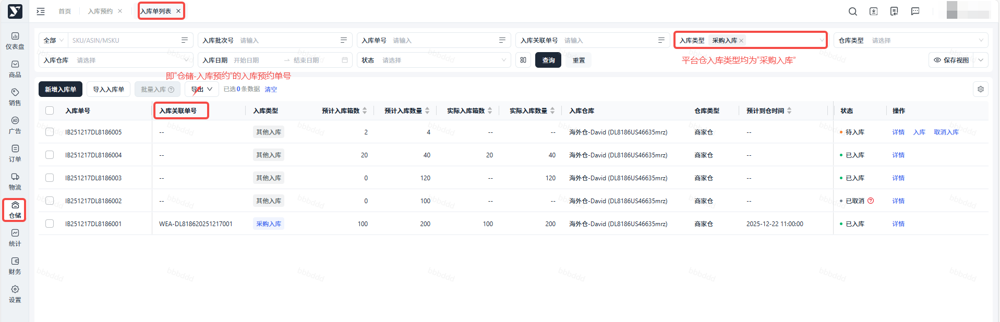

#### 取消预约

如您想取消入库预约单，请先与您的Yurex物流负责人沟通，确认取消后，点击更多，填写取消原因，点击确定即可。
说明：当您的入库预约单处于“待审核、已发货、已入库”状态时，无法取消预约。如要取消预约，请联系您的Yurex物流负责人。

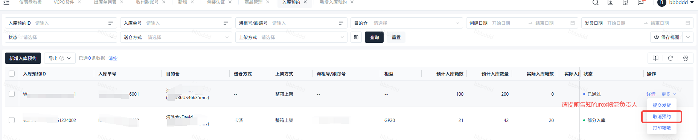

#### 废弃

如您想要撤回已发货的预约单，点击废弃，填写废弃原因，点击确定即可
注意：点击废弃，撤回发货后，系统内您此入库预约单对应的箱唛将不再有效！请谨慎操作

## QA

### 目前有哪些Yurex平台仓仓库可以开放使用？

以报价表为准，因为大促前后或旺季，有些仓库会爆仓

### Yurex平台仓支持接收FBA移仓的货物吗？

由于FBA移仓货物没有贴平台仓标签，FBA移仓的货物暂时无法接收

### 从亚马逊退回来重新换标之后再发到Yurex平台仓的产品，如外箱与装箱数量不一致，会产生什么额外的费用？

如果使用整箱模式入库，仓库不会检查内件数量，后续发往亚马逊可能会出现问题导致罚款。建议海外仓统一箱规后再发往平台仓。否则只能在平台仓使用散件上架模式，让仓库拆开外箱，按件上架。确认实际件数后，再申请库内服务做商品合箱。

### 选择Yurex平台仓，有没有什么来货的规范标准？

请查看

### 为什么不建议用快递送仓？

建议不要使用快递模式送仓，因为US送仓库的快递包裹丢件率，送错率高。
即使POD显示已经派送了，实际上快递包裹也可能被忘在快递站了实际未派送，仓库地址的包裹基本也是物流商系统机签的，不是仓库实际收货人签收的。
另外因为US城市行政规划，可能POD显示的城市和实际仓库的城市不一致，所以实际上派送到哪里了我们也不能确定。
POD不能作为货物已经投递到仓的证明，仓库只能按照实际收货数量尽量上架，如果有差件的情况，仓库也不会做出任何赔偿。
