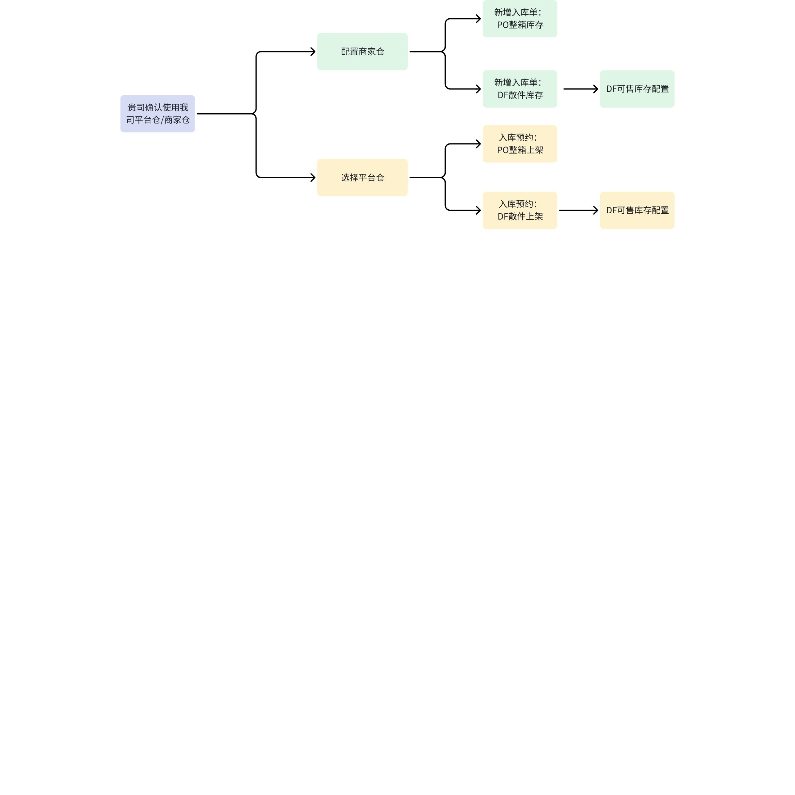
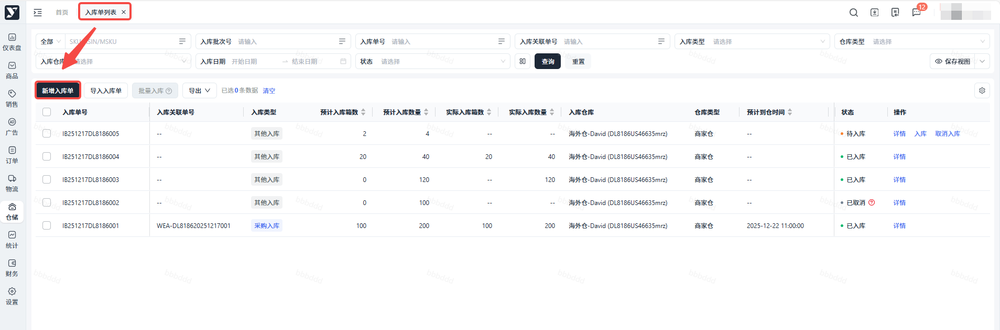
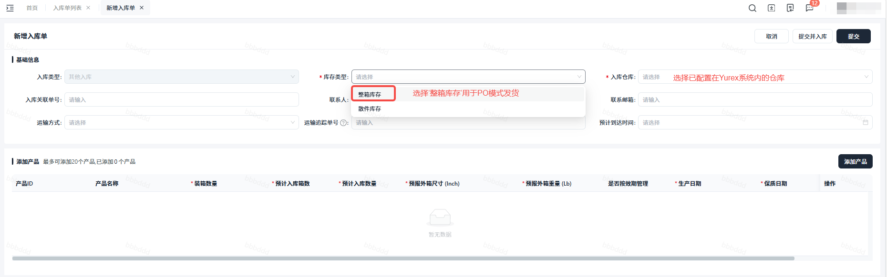
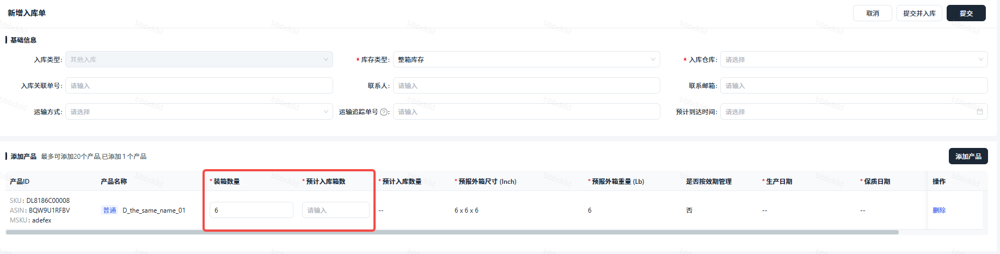
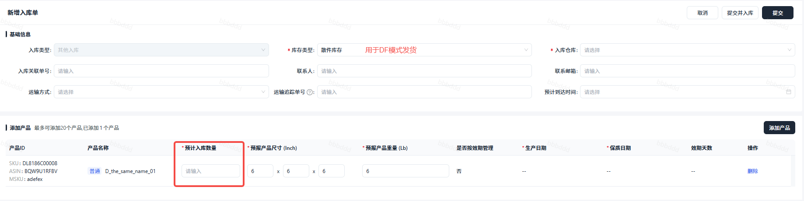

# 飞书文档：库存信息录入

## 一、库存说明

1. 整箱库存：用于PO模式发货的商家仓可用库存；亚马逊下PO订单都是按照整箱下，发货也是按照整箱出。
2. 散件库存：用于DF模式发货的商家仓可用库存；DF一般都是散货，直接发给C端顾客。

## 二、仓库流程

## 三、操作流程

### PO Offer的库存设置

- **操作步骤：**步骤一：【仓储】＞【入库单列表】＞【新增入库单】步骤二：入库类型默认为“其他入库”，库存类型选择“整箱库存”步骤四：查看库存【库存管理】

 - 如果贵司使用的是**商家仓**：

 

 

 步骤三：点击“添加产品”，填写装箱数量和预计入库箱数，点击“提交并入库”即可

 

 - 如果贵司使用的是**平台仓**：

 1. 新增入库需要通过**头程预约**，路径为“仓储>入库预约>新增入库预约”，上架方式选择整箱上架。入库预约界面生成数据，审核通过后状态变为“已通过”。
 2. 入库预约完成后，在“仓储管理>入库管理>入库单列表”生成入库数据，入库类型为“采购入库”。

 入库单列表数据状态显示为“已入库”，此时可在“仓储>库存管理”按ASIN搜索，查看当前产品的可用库存。

### DF Offer的库存设置

- **操作步骤：**步骤一：【仓储】＞【入库单列表】＞【新增入库单】步骤二：库存管理步骤三：设置DF可售库存

 - 如果贵司使用的是**商家仓**：路径为“仓储>入库单列表>新增入库单”，入库类型默认为“其他入库”，库存类型选择“散件库存”

 

 - 如果贵司使用的是**平台仓**：新增入库需要通过**头程预约**，路径为“仓储>入库预约>新增入库预约”，上架方式选择散件上架。

 入库单列表数据状态显示为“已入库”，此时可在“仓储管理>库存管理”按ASIN搜索，查看当前产品的可售库存。

## 注意：

- 入库类型需区分整箱和散件，“整箱库存”用于PO订单发货，“散件库存”用于DF订单发货
- 请于每周五检查Yurex系统可用库存与商家仓实际可用库存数量是否匹配，系统内为虚拟库存数据，并不代表商家仓实际库存情况。此举是为了避免由于信息不匹配导致PO订单接单后无货可发**产生罚款**。
