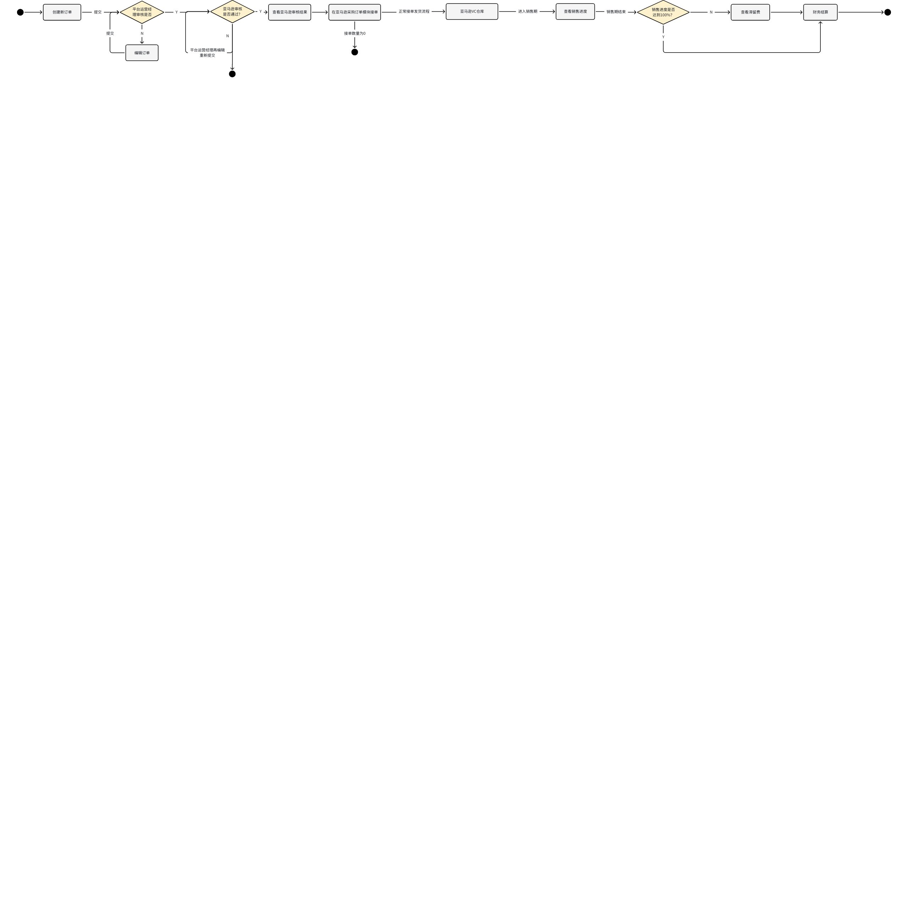
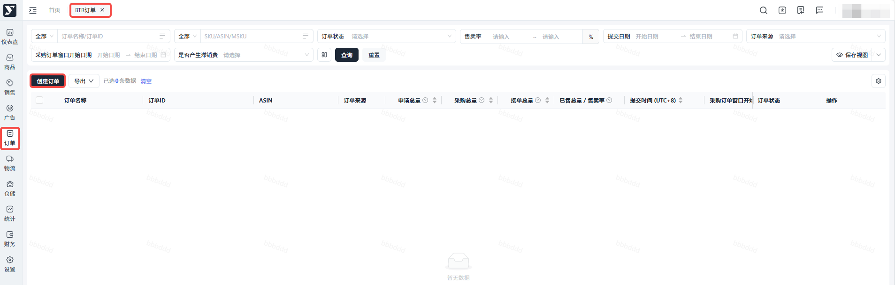
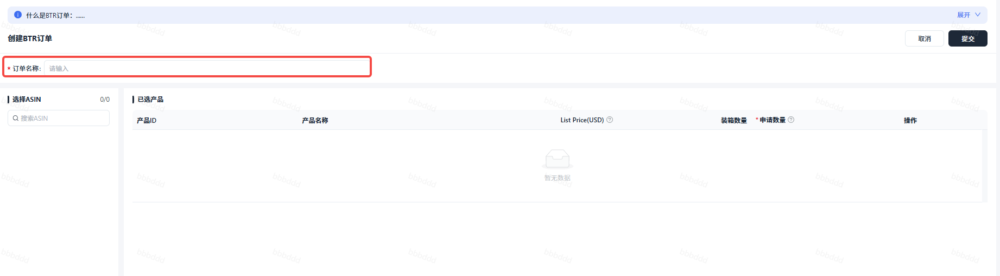
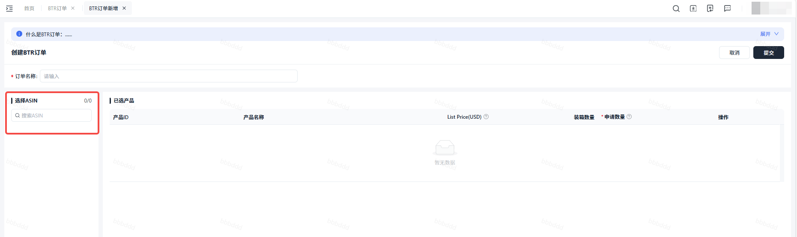
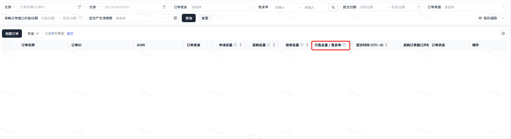

# 飞书文档：BTR订单处理

BTR订单处理

## 关键节点

> 画板来源：token=`Cb4QwDPhqhDpwDbA5YNcwz2Knhh`

## 操作说明

### 创建新订单

【页面路径】：订单--BTR订单

【操作说明】：

1. 点击BTR订单页面的【创建订单】按钮

1. 进入到BTR订单新增页面，填写订单名称

1. 选择想要申请的ASIN

1. 选中ASIN后，已经选中的产品数据会出现在右侧列表中
2. 填写ASIN的申请数量，申请数量必须为装箱数量的整数倍。
3. 点击【提交】，成功创建一笔新订单，点击【详情】可以查看该笔订单的详情页，在收到审核结果前，订单状态都为【处理中】

### 编辑订单

【页面路径】：订单--编辑BTR订单

【业务场景】：若订单提交给平台运营经理初审被驳回，用户可以再编辑订单重新提交

【操作说明】：

1. 点击【编辑】，进入编辑页面，编辑【修改后申请数量】，点击【提交】，重新提交给平台运营经理审核

### 查看亚马逊审核结果

【页面路径】：订单--BTR订单

【操作说明】：可以点击【详情】去查看订单详情信息

1. 若亚马逊审核通过，订单状态会从【处理中】变为【进行中】
2. 若亚马逊审核不通过，订单状态会从【处理中】变为【申请失败】

### 在VCPO订单模块接单

【页面路径】：订单--VCPO订单

【操作说明】：用户可以根据供货能力和售卖率评估应该接多少单**，也可以选择不接单（尽量避免提交BTR但来单后又不接单的情况）**

**注**：未全量接单会有相应罚款

### 查看销售进度

【页面路径】：订单--BTR订单

【操作说明】：对应的PO订单，在首次送达亚马逊VC仓库的第7天起，进入销售期，可以在列表和详情页面查看销售进度

### 查看滞留费

【页面路径】：订单--BTR订单

【业务场景】：若销售期结束时，销售数量未达到100%，则会产生滞留费

【操作说明】：点击【滞留费】，可以查看滞留费详情

## 常见问题

#### 为什么有些ASIN在创建订单时找不到？

答：可申请BTR订单的数据为生效成功的产品，请检查此ASIN在Catalog模块的状态是否为生效成功，若已经为生效成功状态但申请时仍然找不到此ASIN，则表示此ASIN不符合亚马逊的申请要求，请寻求平台运营经理的帮助。

#### 为什么提交BTR总是亚马逊审核失败？

答：亚马逊对于BTR申请的审核比较严格，产品对于亚马逊而言利润率太低、目前销售水平过低、VC库存水位较高，都会导致BTR提交失败。
