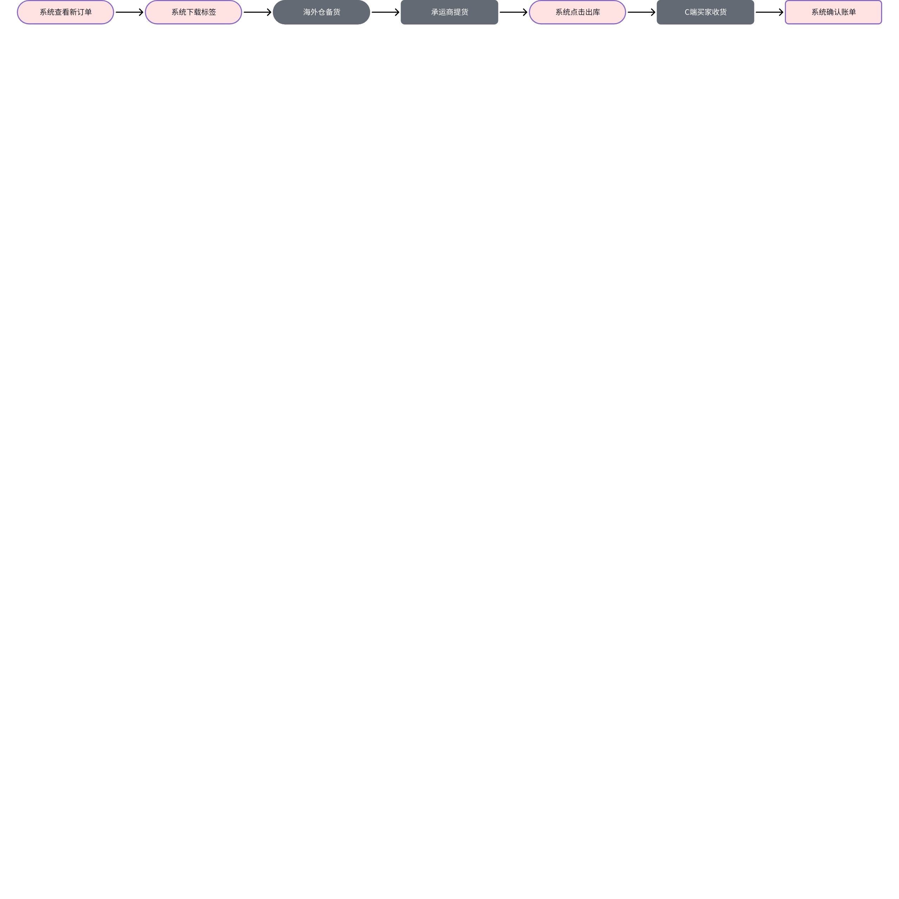
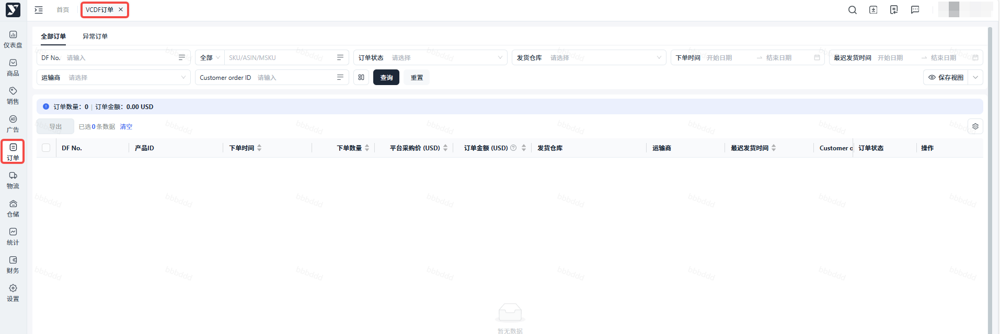
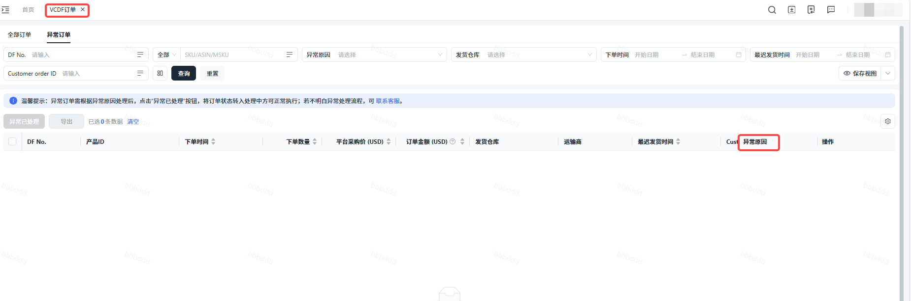
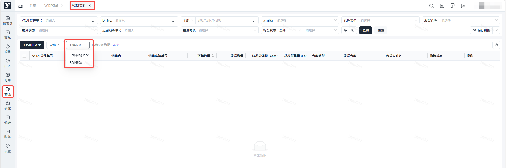
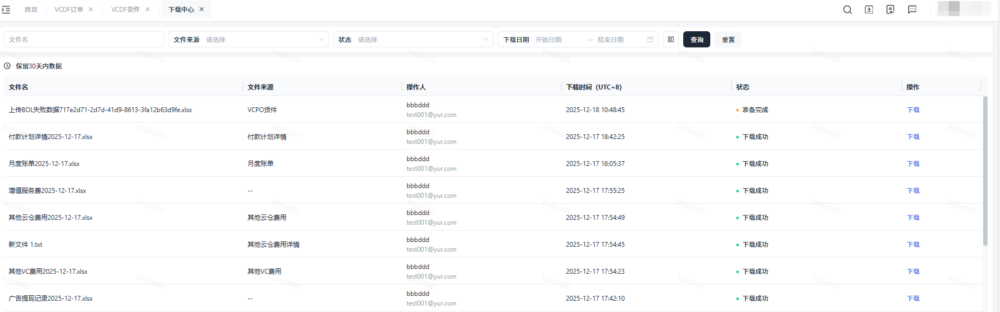
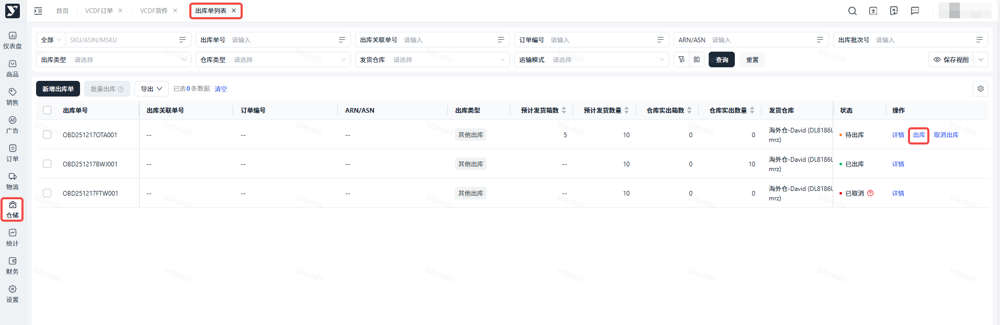
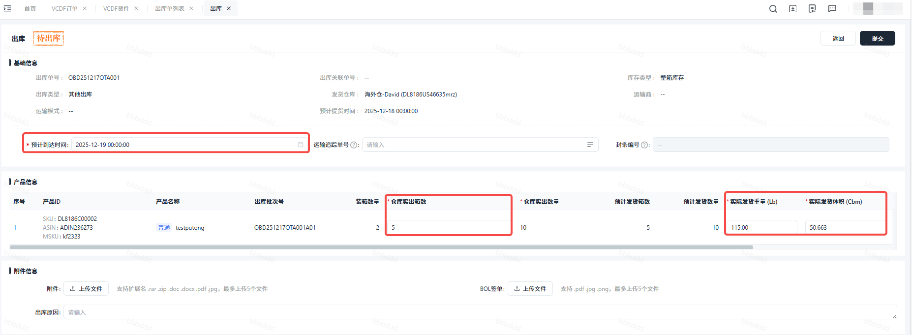
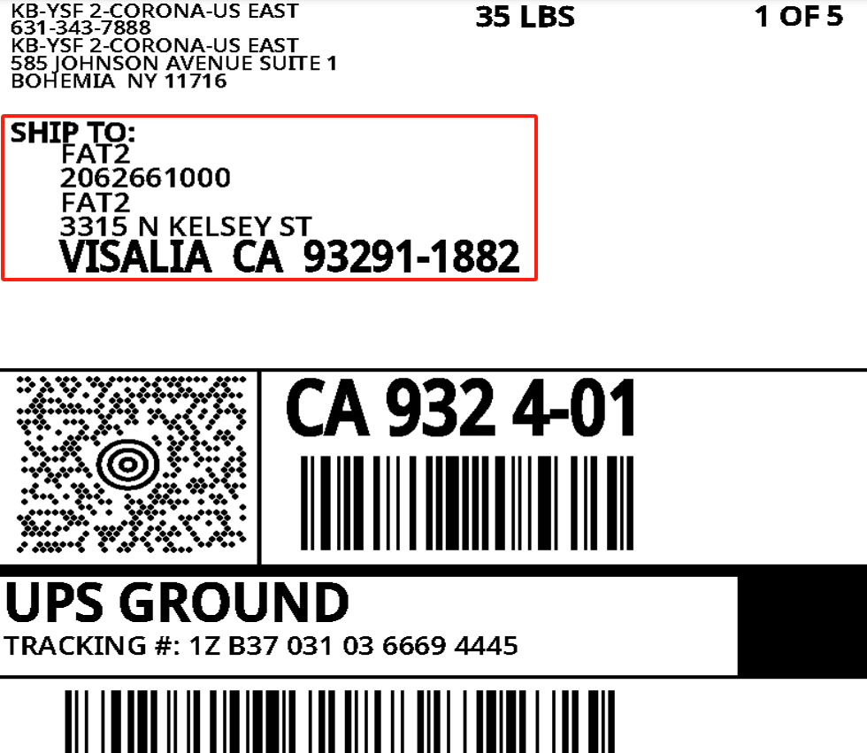

# 飞书文档：DF订单处理

## DF订单处理

**请注意：供应商可取消DF订单时间限在平台最迟发货时间前3小时！！**

**请注意：供应商可取消DF订单时间限在平台最迟发货时间前3小时！！**

**请注意：供应商可取消DF订单时间限在平台最迟发货时间前3小时！！**

### 关键节点

### 操作指南

#### DF新订单

【页面路径】：订单--VCDF订单

【操作步骤】：

1. 登录Yurex系统后，点击【订单】菜单，再点击【VCDF订单】菜单，默认进入【全部订单】tab页
2. 订单列表按DF No.+产品ID铺平展示，当相同DF No.有多个产品ID时，会显示多条数据

 1. 可以按订单状态、发货仓库、下单时间、最迟发货时间、DF No、产品ID、运输商筛选订单

 
3. 可以切换至【异常订单】tab页查看异常订单和异常原因，并进行异常处理后，点击异常已处理后，订单状态从“异常”变为“处理中”，订单自动从【异常订单】页流转至【全部订单】页

 

#### 下载标签

【页面路径】：物流--VCDF货件

【功能说明】：货件单状态为“待提货/运输中/已到达”时（即货件单状态不为“已取消”），且货件单标签状态为“待下载/已下载”时（即货件单标签状态不为“待生成”时），可下载标签

【操作步骤】：

1. 选中需下载标签的货件单，点击【下载标签】按钮

 
2. 下载成功，自动跳转到【下载中心】界面，文件状态为【准备完成】，点击【下载】按钮，标签文件自动下载至本地

 
3. 也可进入货件单详情界面，在附件信息栏位点击文件名，直接下载标签到本地

#### 系统出库

【页面路径】：仓储--出库管理--出库单列表

【功能说明】：商家仓确认货物已提走后，在系统操作出库。可针对单个出库单操作出库，也可选中多个出库单批量出库。

【操作步骤】：

1. 点击【出库】按钮

 
2. 进入出库单详情界面，维护【预计到达时间】、【仓库实出箱数】、【实际发货重量】、【实际发货体积】、【出库原因】（选填）、【上传附件】（选填）

 
3. 提交成功，出库单状态由【待出库】更新为【已出库】

 说明：出库成功，出库单对应的货件单状态会从【待提货】更新为【运输中】

#### 确认账单

### 常见问题

#### 3.1 是否可查看DF订单详细收货地址？是否支持导出DF订单详细收货地址？

因DF订单均为亚马逊提货，故**亚马逊隐藏**了DF订单的详细收货地址，您可同商家仓商议，是否可以填写虚拟地址。可在DF物流详情页---附件信息，点击下载Shipping label，查看Shipping label附件上的详细收货地址信息。
注：当前，我司支持系统付费解析DF订单地址，解析\$0.05/单，如需，可自行开通。

#### 3.2 实际DF发货多个包裹，但是为什么DF货件面单只有一张？应该如何处理？

1.货件面单数量与实际发货包裹数量不一致原因：在亚马逊初始设置的产品包裹数量和实际发货包裹数量不一致，如：在AMZ初始设置产品A在仓库A设置的包裹数量为1，则DF订单产生时，亚马逊默认该订单的包裹数量为1，则仅创建一个货件面单。
2.处理方式：联系我司平台运营经理，由我司平台运营经理手动修改DF订单的包裹信息并更新货件面单。

#### 3.3 什么时候可以取消DF订单？为什么部分“配货中”订单可取消DF订单，部分“配货中”订单不能取消DF订单？

1.状态为“处理中”的订单可取消订单；状态为“配货中”的部分订单可取消订单。
2.订单状态为“配货中”，但是已在关联的出库单操作了出库，则不能取消订单；未操作出库可取消订单。
3.取消订单会产生罚款（取消一次罚款金额为100美元），请谨慎操作！

#### 3.4 DF订单超过最迟发货时间，仍未操作出库，是否影响DF业务？

会，请准时在货交承运商后立即操作DF出库，否则会产生DF订单迟发罚款，影响DF绩效指标！

#### 3.5 DF订单下单时间是美国时间还是中国时间？

美国时间。

#### 3.6 DF订单常见异常如何处理？

常见异常：库存不足、仓库停用。
1.库存不足：在系统操作散件入库，设置DF可售库存。
2.仓库停用：确认信息无误后，在系统操作启用仓库。

#### 3.7 DF订单下单数量为2，发货可以只发1个？即实际发货数量少于下单数量？

系统现操作出库数量默认为下单数量，不支持操作少发！

#### 3.8 DF订单亚马逊自己去仓库提货有没有快递费？

无需承担尾程配送费，由AMZ承担。

#### 3.9 1大件产品分配了CEVA承运商也需要打托出货？DF承运商是否可以修改？

1. 是的。
2. DF承运商由AMZ自动分配，不支持修改！

#### 3.10 DF的发货，如果系统里面显示仓库C出库，我可以选择仓库D发货吗？

不支持，因亚马逊仅从仓库C提货。
