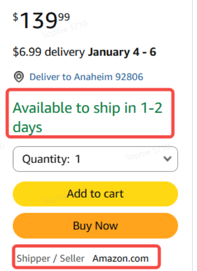
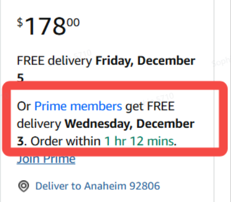

# 飞书文档：供应商DF绩效指标指南

## 文档信息

| 项 | 内容 |
| --- | --- |
| 远程文档 | https://q1njej8cpab.feishu.cn/wiki/NDkDw0d7uiTHfLkvMjec6Lr6nSM |
| 图片处理 | 本地下载（assets/images） |
| 快照时间 | 2026-08-06 |
| 来源命令 | `lark-cli docs +fetch --as user --doc "<remote>" --jq ".data.markdown"` |
| 格式处理 | fd-doc-markdown-sync/scripts/normalize-feishu-doc-markdown.mjs |

---

供应商DF绩效指标指南

#### **VCDF指标说明：**

- 只针对商家仓，但如取消率这类仍属供应商自身责任。
- 不达标将可能导致关仓/ASIN抑制，具体逻辑查请看正文。
- 亚马逊数据有延迟，最新数据截止为上上周数据。
- 新人保护期：默认DF订单首单的下单时间为业务开始日期，其所在周即为考核第一周。前4个自然周为新人保护期(包含首单时间所在周)，期间绩效不达标不纳入考核，也不会生成DF指标相关罚款记录。
- 供应商VCDF绩效看板上线系统前，平台方会线下记录供应商DF仓库的履约情况，若未达标，将按照相关罚款规则对供应商征收相应罚款。说明：2026.06.25 绩效监控功能已正式上线。
- 看板上线后请供应商安排专人定期查看平台看板指标表现及站内信。
- 若此指标指南存在的罚款与【VC常见罚款准则】重叠，同一周期只计一次罚款。

## DF名词解释

## DF指标说明

### 仓库考核指标

#### Unp.DEA-%

##### （1）指标定义

- **定义：**过去四周，供应商真实交付全流程指标出现异常（ Unp.DEA：在未添加缓冲时间的前提下，于承诺送达日期当天或之前送达的DF订单占总DF订单的比例。
- **影响：**

 - 罚款：异常仓库数量\*\$100。平台仓罚款豁免。

 - 按照自然月进行统计，一个自然月内第一周产生了本类型罚款后，第二周若也满足罚款条件，则不再生成罚款，直至下一个自然月。
 - 考核周存在跨月情况时，按周结束日期所在月份计入；如1.29-2.4这种情况，即算为2月份首周而非1月份末周。
 - 警告：系统会持续监控指标，并下发通知供应商指标表现。若一直不达标，最终将导致问题仓库停用。

##### （3）如何规避

- 供应商应当根据亚马逊的 最迟发货时间（RSD/ExSD） 优先处理 DF 订单，而非DF下单时间。
- 供应商内部单据及时同步：注意：在下载DF标签时，请务必检查标签信息，类型及数量是否正确，避免因为信息错误来回拉扯，从而浪费了宝贵的备货时间。

 - UPS：及时检查DF订单面单更新情况，获得DF面单后，第一时间将DF订单信息及其标签（shipping lable）给到对应发货的三方海外仓，保证海外仓有充足时间备货。
 - CEVA：请询问我司物流负责人，催促给到CEVA准确标签（shipping lable+BOL）后，及时给到对应发货的三方海外仓，保证海外仓有充足时间备货。
- 承运人提货后，请及时操作DF订单系统出库。**温馨提示：亚马逊期望卖家最晚在“最迟发货时间”（RSD/ExSD）当天发货，并要求在订单发货时提交 ASN（即最好在承运人取件后的 30 分钟内操作出库）。供应商在处理DF订单期间、打印DF标签时或其他在DF承运人取件之前的环节，严禁虚假操作出库！**

 - 未即时操作出库：供应商须真实交货给承运商后，自行在系统操作出库!
 - 未操作出库：请供应商制定合理的监控机制，以便内部员工各司其职，避免出现分工不明。
 - 提前操作出库：在承运商未提走货物时，因害怕超过最迟发货日期而提前虚假出库，也会被亚马逊抓到。 从而影响交付稳定度，故需在货物实际被承运商提走后及时操作出库。按要求发货日期/ExSD(Required Ship Date/Expected Ship Date)发货 DF 订单——不能提前发！

#### 仓库关停逻辑

供应商A已渡过4周新手期，正式纳入监控预警范围。如过去4周有3次不达标，DF仓库则会被停用。示例：

结果: 过去4周内有3周Unp.DEA指标

##### （3）申诉流程

供应商提交申诉材料给对应平台主运营，我司将会尽快审核。

##### （4）申诉结果

平台主运营将在审核结束后，第一时间同步结果给供应商。

1. 失败：请考虑我司平台仓/其它三方海外仓；
2. 成功：为供应商重开原关停的DF仓库，供应商运营重新设置DF可售库存后，继续销售。

### ASIN考核指标

#### DF取消率预警-%

##### （1）指标定义

- **定义：**过去四周，因供应商自身原因导致DF订单被取消的比例。

##### （2）指标要求及影响

- **要求：**供应商维度，一周内DF取消率≥0.8%算一次异常 。

 > DF订单取消率：按下单时间维度，时间范围内的取消DF订单数量/总DF订单数量。
- **影响：**

 - 罚款：\$100/1pcs。平台仓罚款不豁免。
 - 警告：系统会持续监控指标，并下发通知供应商指标表现。若一直不达标，最终将导致问题ASIN抑制。

##### （3）如何规避

- 请自行排查所有因自身原因取消的DF订单，并相应整改。

 - DF可售库存设置过满？如：某DF仓库可售库存有100units，官方建议只设置90units。即留有余量设置DF可售库存。
 - DF可售库存统计错误？优化供应商内部统计流程，譬如“定期盘点真正可用于VCDF销售的库存”，以保证数据准确性。
 - 每个独立商品在平台系统的【商品】与【Listing】模块下，供应商是否录入了正确的包裹尺寸+重量+装箱数信息？务必保证录入信息的准确性。
 - 供应商运营须明确每个框需要填写何种数据，从源头上避免信息录入错误的问题。若中途发现数据填写错误，请务必及时主动更新。
 - 产品质量问题导致无法发货：有问题产品在库存盘点时及时剔除，不可纳入用于VCDF销售的可售库存。

#### DF退换货率预警-%

##### （1）指标定义

- **定义：**过去四周，供应商DF订单产生退货或换货的比例。

##### （2）指标要求及影响

- **要求：**供应商维度，一周内DF退换货≥0.64%算一次异常。

 > 退换货率：按照下单时间维度，退换货的DF订单数量/总DF发货数量。
- **影响：**

 - 罚款：10USD/次。平台仓罚款不豁免。
 - 警告：系统会持续监控指标，并下发通知供应商指标表现。若一直不达标，最终将导致问题ASIN抑制。

##### （3）如何规避

- 请自行排查listing与包装问题，并相应优化。

 - 商品问题：

 - 分析产品退换货原因，更新迭代产品以满足市场需求，避免高退换货带来的业务损失。
 - 页面描述错误导致，请及时更新产品详情页信息，真实准确地描述产品以避免错误。
 - 商品运输破损：强化/更新产品包装，避免运输破损。

#### DF发货方式不匹配率预警-%

##### （1）指标定义

- **定义：**过去四周，供应商实际发货方式与亚马逊指定发货方式不一致的包裹比例。

##### （2）指标要求及影响

- **要求：**供应商维度，一周内发货方式不匹配率≥0.08%算一次异常。

 > 发货方式不匹配率：按照下单时间维度，不匹配的DF货件单数/总DF发货的货件单数。
- **影响：**

 - 罚款：\$10/周。平台仓罚款豁免。

 - 供应商每周考核一次，如不达标则生成一条罚款。即同一供应商每周最多产生一条本类罚款数据。
 - 警告：系统会持续监控指标，并下发通知供应商指标表现。若一直不达标，最终将导致问题ASIN抑制。

##### （3）如何规避

- 请供应商自行排查仓库流程问题，并相应整改。

 - 贴标错误导致:

 - 仓库贴错标签：优化仓库操作流程，避免二次出现。
 - 供应商运营提供错误标签：发标签时请反复核对信息后，再提供给仓库。
 - 承运商交付错误:

 - 在上门取货的时候，误将承运商A的包裹给了承运商B，请务必核对承运商信息后再交付包裹。

#### 超期订单预警-个

**温馨提示：亚马逊期望卖家至少在“要求发货日期/预计发货日期”（RSD/ExSD）当天发货，并要求在订单发货后及时提交 ASN（务必在承运人取件后的 30 分钟内操作出库）。供应商在DF承运人取件之前的环节，严禁虚假操作出库！**

##### （1）指标定义

- **定义：**过去四周，供应商已超过最迟发货日期才提交出库的DF订单总数。

##### （2）指标要求及影响

- **要求：**在亚马逊要求最迟发货时间外才发货的DF订单总数。超期订单＞0则为异常。
- **影响：注意： 当运输模式为卡派，承运商为CEVA时， 如因司机未按时上门提货导致出库时间晚于最晚发货时间，可进行申诉。**注：下载面单时间来源于上游DF订单模块，需判断执行成功的状态；操作日志记录的时区为UTC+8，需要换成LA时区再进行判断。**我司平台有及时提供面单的情况下，如供应商海外仓无法履约，是无法针对此进行豁免的。**

 - 罚款：

 - 超过最迟发货时间0-4小时：生成罚款数据，应付金额为0
 - 超过最迟发货时间4-12小时：15USD\*下单数量
 - 超过最迟发货时间12-20小时：30USD\*下单数量
 - 超过最迟发货时间20小时以上：50USD\*下单数量
 - 注：以上最迟发货时间是指加上系统豁免时间后的最迟发货时间。
 - 平台仓罚款豁免

 - 其余豁免条件：

 1. 下载面单时间距离最迟发货时间不足48小时，额外增加豁免时间到48小时。

 > 示例：下载面单时间为28日8：00，最迟发货时间为28时16：00，操作时间为8小时，需额外新增40个小时到30日的8：00。若供应商在30日8：00前发货，则不生成罚款。

 1. 下载面单时间到最迟发货时间中间隔了美国公休日和节假日时，则排除掉非工作日的时间，再判断剩余工作日时间是否满足48小时，若不满足，额外增加豁免时间到48小时。

 > 示例：下载面单时间为30日8：00(周五)，最迟发货时间为02日8：00(周一)，排除处于周末的48小时，可操作时间为24小时，需额外新增24小时到03日8：00，若供应商在03日8：00前发货则不生成罚款。

 - 警告：

 - 1. 超期处理DF订单，影响ExSD、CFS、EDD等指标，进而影响Unp. DEA%指标，导致DF仓库被关。
 - 2. 系统会持续监控指标，并下发通知供应商指标表现。若一直不达标，最终将导致问题ASIN抑制。

##### （3）如何规避

- 请供应商自行查看具体是哪个环节出问题，以便优化。

 - 备货环节（订单处理速度异常）：

 - 备货顺序不合理： 请按最迟发货时间来备DF订单的货，而非DF来单时间。
 - 标签流转不及时：我司系统实时与VC后台同步标签，请供应商运营/物流部门及时下载标签，并同步给三方海外仓。
 - 备货速度太慢： 请自行自行与三方海外仓协调备货节奏。
 - 揽件环节（首扫异常）：

 - UPS未准时上门：需三方海外仓与当地UPS网点维护关系，保证UPS准时上门揽件。
 - CEVA未准时上门：请与我司物流负责人实时沟通，并提供有效证明，以便我司向CEVA反馈问题。
 - 未即时操作出库：供应商须在真实交付给正确承运商后，自行在系统操作DF订单出库。
 - 未操作出库：请自行制定合理的监控机制，以便内部员工各司其职，避免出现分工不明。
 - 标签扫描不到：请自行反查三方海外仓使用的标签是否准确/清晰。
 - 其它原因：譬如遇恶劣天气等不可控因素。

#### ASIN抑制逻辑

供应商A已经度过4周新手期，正式纳入监控预警范围。如过去4周，以上2.2.1-2.2.4这4个指标中，任意1个指标有3次不达标，我们将在异常指标下拉取出所有异常ASIN。分为两种情况，如下：

- 情况1：所有异常DF订单都为同一个ASIN，直接抑制。示例如下：

结果：所有异常DF订单都属于ASIN1，ASIN1被抑制。

- 情况2：存在多个异常ASIN，单ASIN异常率=ASIN异常DF订单数/ASIN总DF订单数\*100%，异常率≥10%的ASIN被抑制DF offer。示例如下：

假设：该供应商在W5-W9共出了100个DF订单，由于在W8周的时候，超期订单异常达到3周，需要抑制ASIN。其中ASIN1出了30个DF订单，异常订单数8个；ASIN2出了70个DF订单，异常订单数5个。

计算： ASIN1的异常率：8/30=26.67% ；ASIN2的异常率：5/70=7.14%

结果：ASIN1异常率=26.67%＞10%，ASIN2异常率=7.14%＜10%；ASIN1被抑制，ASIN2不被抑制。

##### （1）总结

1. 异常指标里的DF订单只包含1个ASIN，此独立ASIN将被抑制。
2. 异常指标里的DF订单包含多个ASIN，将取异常率≥10%的ASIN(s)进行抑制。

##### （2）影响

1. 供应商将会于周三收到ASIN抑制的站内信，请及时查收站内信内容。
2. 供应商被抑制ASIN，所有DF可售库存将会被平台方调0，客户端在申诉成功前无权操作DF可售库存，涉及到DF offer在亚马逊前台均不可见。
3. 供应商DF offer被抑制后，不影响处理中的DF订单，仍然可正常发货及出库。

#### ASIN申诉说明

##### （1）申诉机会

详情请与平台运营进行沟通。

##### （2）申诉材料

1\*申诉文档，WORD格式；模板：

##### （3）申诉流程

供应商提交申诉材料给对应平台主运营，平台主运营补充VC端信息再提交上级审核。

##### （4）申诉结果

平台主运营将在审核结束后，第一时间同步结果给供应商。

1. 失败：此ASIN将无法在平台VC继续DF销售了，建议在SC/其它电商渠道分销；
2. 成功：为供应商恢复ASIN在所有DF仓库的可售库存编辑权限，供应商运营重新设置DF可售库存后，继续销售。

## DF指标激励说明

### 规则

1. 豁免金额：供应商在连续3个月的考核周期内，所有DF指标均无异常，则享有最高2000美金的罚款豁免额度。用于前3个月内产生的实际罚款，在2000美金以内的予以免除；超出2000美金的部分，由供应商自行承担。
2. 抵扣顺序：对已生成罚款，按时间由近及远自动匹配。
3. 限制条件：供应商不可自选罚款项；不可留作未来抵扣。
4. 豁免范围：给予指标考核期间产生的指定罚款豁免。指定罚款：DF取消订单/DF订单超期发货

### 示例

供应商A履行DF订单很厉害，自2026年3月起，连续9个月所有指标均正常。

将分三次触发罚款豁免：

## DF Offer前台显示

DF 常见前台示例： DF Guranteed Delivery状态示例：

