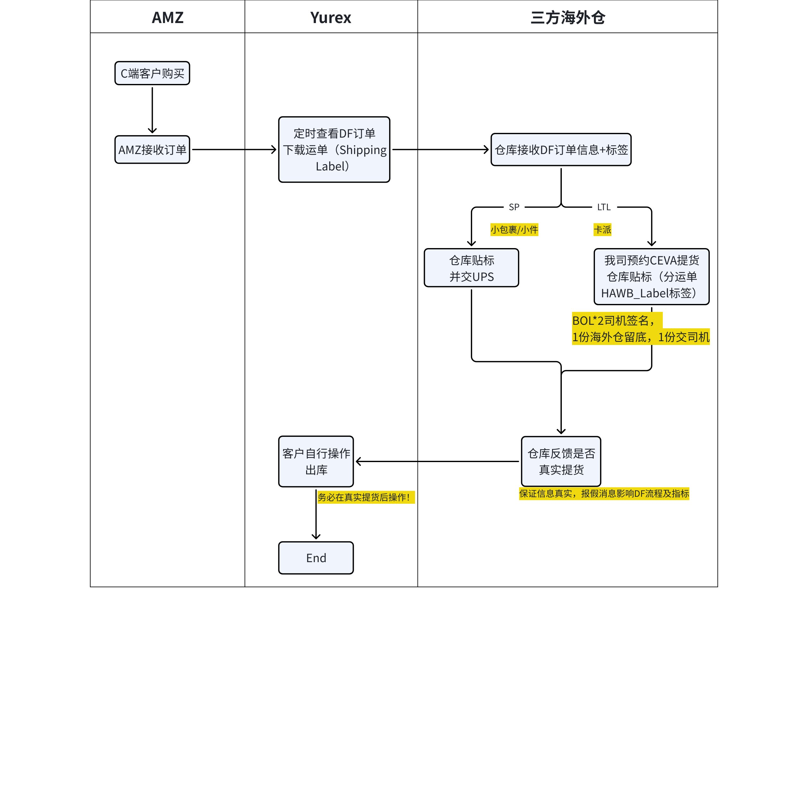
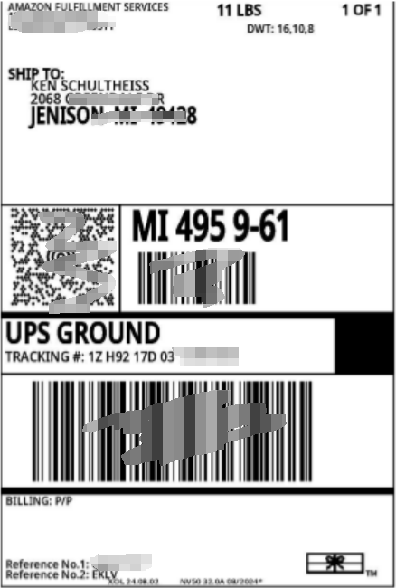
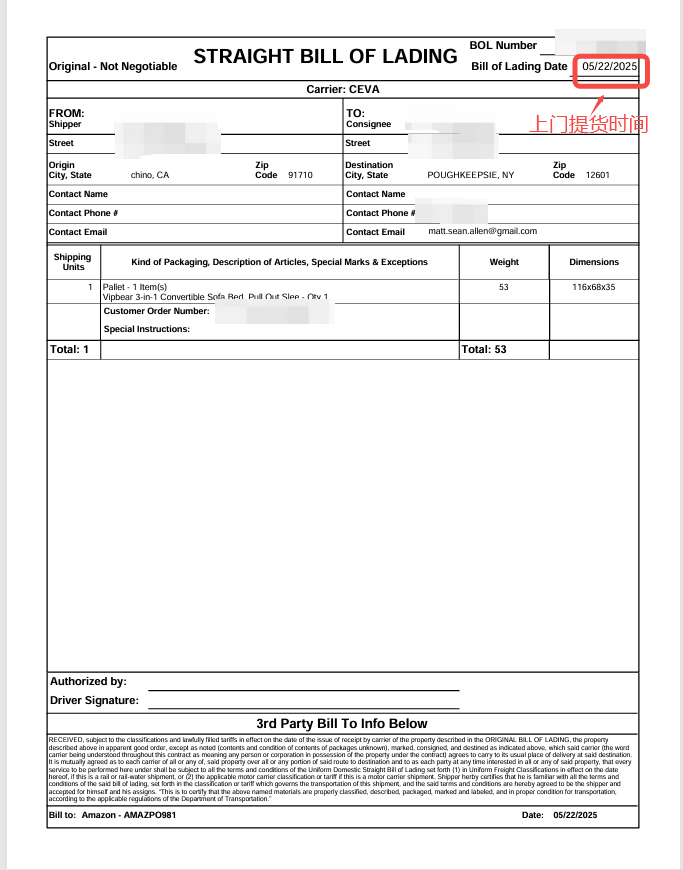

# 飞书文档：发货流程及注意事项

## 文档信息

| 项 | 内容 |
| --- | --- |
| 远程文档 | https://q1njej8cpab.feishu.cn/wiki/SaSnwSASti75BPkwhFEclVtsndh |
| 图片处理 | 本地下载（assets/images） |
| 快照时间 | 2026-08-06 |
| 来源命令 | `lark-cli docs +fetch --as user --doc "<remote>" --jq ".data.markdown"` |
| 格式处理 | fd-doc-markdown-sync/scripts/normalize-feishu-doc-markdown.mjs |

---

## 发货流程及注意事项

### 1、DF订单发货流程图

> 画板来源：token=`Qg3MwJhv2hFl3NbvYDpcqj5vnne`

注意：
三方海外仓处理DF订单的时效，会直接影响到前台的Lead time（Usually shipped within 2-3 days）。若DF订单未在Expected Ship Date/Required Ship Date按时交承运商（UPS/CEVA），会导致前台的LT(Lead Time)变长（如：变5-6 days），最终影响ASIN转化。

### 2、海外仓需处理标签

#### SP小包裹/小件：

通常海外仓每天都有合作的UPS上门揽件；三方海外仓自行预约

1\*Shipping Label（UPSN/UPS，一个意思）

> DF订单的UPS标签由AMZ提供，即尾程由AMZ负责。

**贴标要求：**

1. Shipping Label一个外箱贴1张
2. 贴好运单标签后，请在在发货截止时间前完成发货交付，并反馈准确交货信息给供应商自己的运营端，以便他们在Yurex系统操作出库
3. UPS shipping lable参考：

#### LTL

一般是大件/多外箱产品，亚马逊会分配卡车上门揽件。Yurex物流部门会与CEVA预约提货时间，BOL & HAWB_Label（ 分运单标签）将由Yurex物流部门同步给供应商

 1\*HAWB_Label，1\*签名BOL（CEVA）

> DF订单的HAWB_Label标签由CEVA邮件提供，即尾程由AMZ负责。

**贴标要求：**

1. HAWB_Label一个外箱贴1张
2. BOL一式2份，司机签名后，1份海外仓留底， 1份司机带走
3. 贴好运单标签后，等待CEVA上门提货。要求必须在发货截止时间前完成发货交付，并反馈准确交货信息给供应商自己的运营端，以便他们在Yurex系统操作出库。若未被成功提走，企微联系Yurex物流负责人重新预约提货时间
4. HAWB_Label参考：

1. BOL参考：标红部分为carrier上门提货时间

注意：CEVA提货时，不强制要求所有货件打托。物品比较小时，可直接交CEVA司机；若货物单件≥50kg或总体积≥2m³时，打托。

### DF 发货注意事项

#### 运营篇

1. 请给商品&Offer录入正确的包裹尺寸+重量+装箱数信息，避免导致后续标签错误。
2. 请务必准确设置DF可售库存，倒推 --- 即海外仓统计数据不能有误。
3. 请勿设置过满DF可售库存，官方建议设置的DF可售库存< 总DF可售库存。如：某DF仓库可售库存总共有100units，只设置90units。
4. 请及时把对应正确的UPS运单标签同步给海外仓；若是CEVA，催我司物流负责人提供运单标签+空白BOL。

#### 仓库篇

1. 请按最近的"最迟发货时间"处理DF订单，而非DF来单时间。
2. 亚马逊期望卖家至少在“要求发货日期/预计发货日期”（RSD/ExSD）当天发货，并要求在订单发货后及时提交 ASN（务必在承运人取件后的 30 分钟内操作出库）。供应商在DF承运人取件之前的环节严禁虚假操作出库！
3. 请勿使用其它承运商或运单标签。AMZ分配什么承运商，给的什么标签，就用什么。
4. 与当地承运商（主要是UPS）维护好联系，以便其准时来海外仓揽件。
