# 飞书文档：PO订单处理

## 一、关键节点

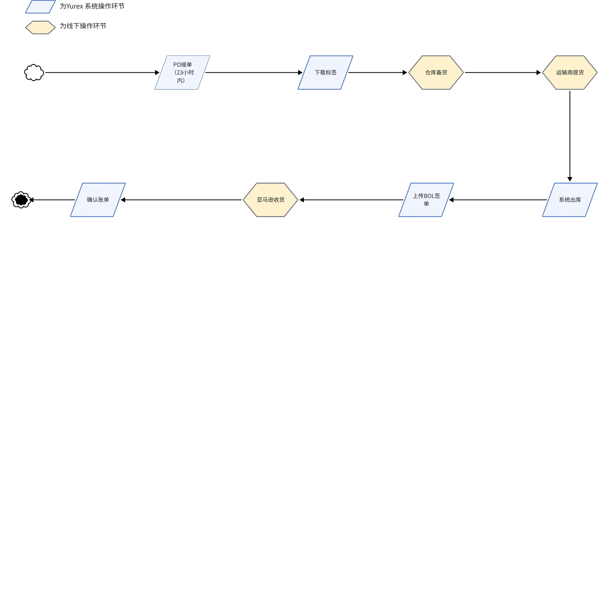

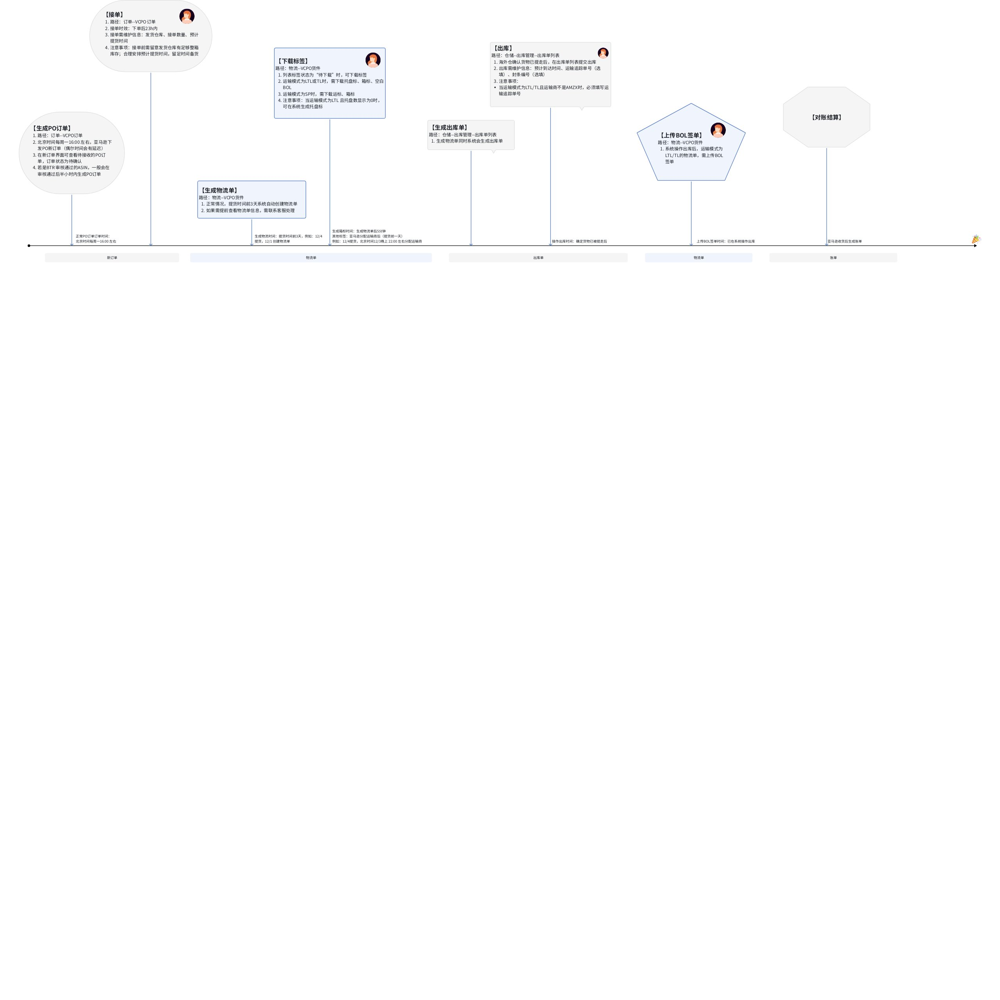

## 二、操作流程

### 查看新订单

【页面路径】：订单--VCPO订单

【功能说明】：亚马逊下发的新订单会站内信通知，消息通知可在Yurex 首页查看，也可直接进入**新订单页面**直接查看订单明细

**新订单下发时间节点：**

1. **正常PO订单：正常PO订单亚马逊会在北京时间每周一16:00 左右下发**
2. **BTR-PO订单：审核通过的ASIN，大概会在审核通过的半小时内下发**

【操作步骤】：

1. 登录Yurex 系统后，点击【订单】菜单，默认进入【VCPO订单】菜单--【新订单】tab 页

 说明：无新订单时，新订单数量显示0，订单列表显示没有数据

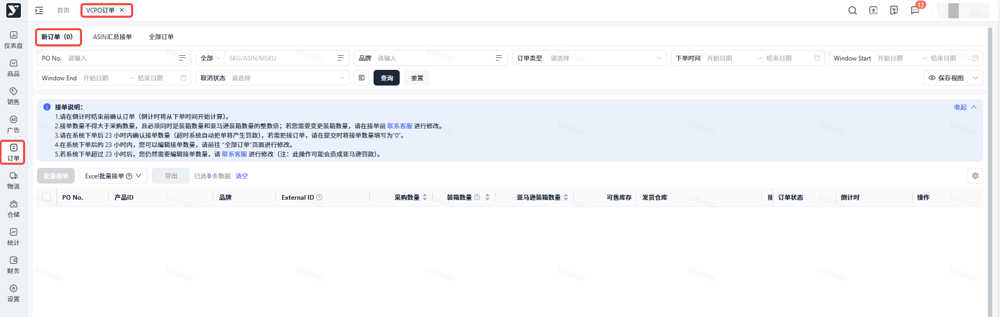

1. 订单列表按PO No.+产品ID铺平显示，**当相同PO No. 有多个产品ID时，会显示多条数据**
2. 也可在【全部订单】tab 页，查看所有PO 订单，此界面包含【未接单】、【已接单】、【已拒单】的所有PO No.

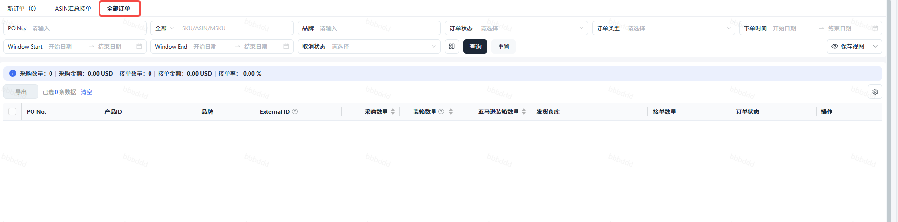

### 接单

【页面路径】：订单--VCPO订单

【功能说明】：【待确认】的新订单需在**来单后23h内完成接单**，接单需维护信息：**发货仓库、接单数量、预计提货时间**

注意事项：发货仓库：海外发货仓库，接单前需保证仓库有足够的整箱库存接单数量：商家仓可接单的数量，不能大于采购数量，且需是装箱数量的整倍（整箱出货）预计提货时间：预约运输商去商家仓提货的时间，需选择窗期内且不是周六、周天的时间说明：亚马逊根据运力分配运输商后，有可能会更改预计提货时间，不会按原定时间来提货重要：1、如果您的产品需要做包装认证，请在PO发货到达VC前向VC提交产品的包装认证。关于包装认证的说明请查看2、如果您的产品商家仓库存不足，为避免PO来单后无库存接单，需要您手动去设置产品的接单状态，详细的操作请查看

【操作步骤】：

#### 单个接单

1. 在新订单界面，维护【发货仓库】、【接单数量】、【预计提货时间】，点击提交按钮

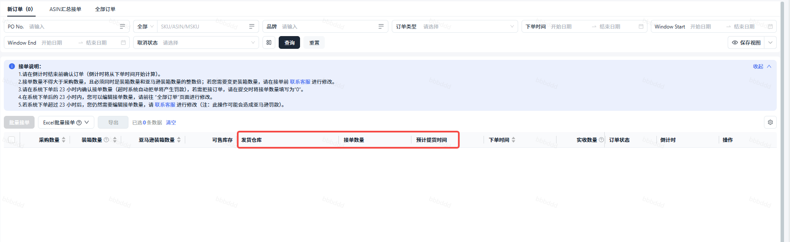

1. 提交成功，PO No.+产品ID 从【新订单】界面移除，转入【全部订单】界面，订单状态由【待确认】更新为【已确认-处理中】
2. 接单数据同步亚马逊成功后，订单状态由【已确认-处理中】更新为【已确认】
3. 亚马逊仓库收货后，订单状态由【已确认】更新为【已完成】，且【实收数量】栏位显示亚马逊实际收到的数量（更新周期会比较长）

说明：若拒单，订单状态也会更新为【已完成】，且【实收数量】为0

#### 批量接单

1. 在新订单界面，维护多行【发货仓库】、【接单数量】、【预计提货时间】，批量勾选需接单的PO No. + 产品ID，点击【批量接单】按钮或Excel批量接单 说明：只支持在【新订单】tab 页批量接单

 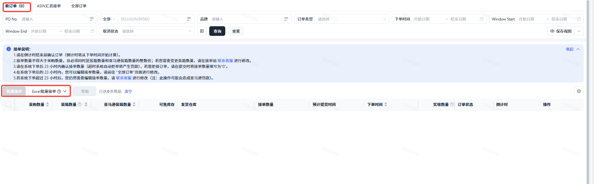

#### 多仓发货

业务场景：货物需要从多个不同仓库发货；或发货仓库相同，但由于备货进度致提货时间不一样，需要分批发出

1. 在新订单或全部订单界面，找到需从多仓发货的PO No.+产品ID，点击【编辑更多】按钮
2. 进入编辑更多界面，点击【添加接单信息】按钮，插入新的一组接单栏位
3. 分别维护【发货仓库】、【接单数量】、【预计提货时间】，点击【确认】按钮

 说明：多仓发货，总接单数量不能大于采购数量

### 下载标签

【页面路径】：物流--VCPO货件

【功能说明】：货件单标签状态为【待下载】时，可下载标签

亚马逊下发标签时间说明：
1. 箱标：系统创建物流之后稍等几分钟即可进行下发
2. 运输标签/托盘标/空白BOL：亚马逊目前分配以上标签都是在填写的预计提货时间前一天下发

1. 运输模式为LTL或TL时，需下载托盘标、箱标、空白BOL

 1. 注意：当运输模式为LTL，指定承运人(运输商)为AMZX，且货物有打托（打托数≠0）时，还需要张贴PRO label（运输标签）
2. 运输模式为SP时，需下载运输标签、箱标
3. 注意事项：当运输模式为LTL 且托盘数显示为0时，需手动生成托盘标，系统无法下载

 1. 通常当运输模式为TL/LTL，分配的运输商为：AACT CTII EXLA TFIN ABFS CNWY XJLW 等时，可能不会自动生成托盘标，需通过系统手动生成托盘标。

 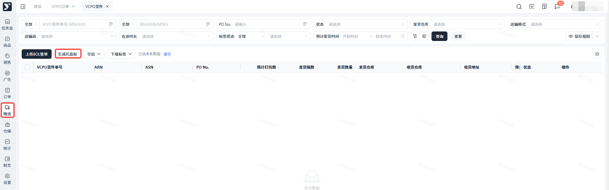

【操作步骤】：

1. 选中需下载标签的货件单，鼠标悬浮【下载标签】按钮上，点击需要下载的标签类型

 1. 所有标签：下载勾选货件单的所有标签
 2. Carton label：下载勾选货件单的箱标签
 3. Shipping/Pallet label：下载勾选货件单的运输标签/托盘标签
 4. 空白BOL：下载勾选货件单的空白BOL

 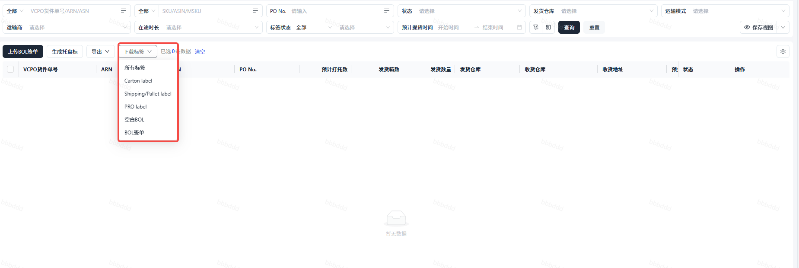
2. 下载成功，自动跳转到【下载中心】界面，文件状态为【准备完成】，点击【下载】按钮，标签文件自动下载到本地

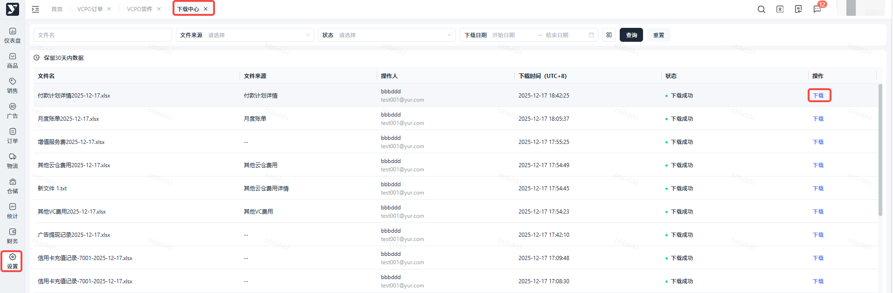

1. 也可进入货件单详情界面，在附件信息栏位点击文件名，直接下载标签到本地

### 提前拣货

1. 对于VCPO订单，无论SP还是LTL，在分配承运人前48小时进行提前拣货操作

 1. 目的：为了在分配出承运人之后能够在24小时之内完成打托，确保准时发货，避免申请延迟提货
2. 具体操作：

 - **关于 提前拣货**
 - **解释**：提前将货物拣出（建议预计提货时间前48小时内），贴好carton label，按票货集中存放于指定备货区（建议采用**单票货物集中堆放**的存储方式），承运商分配（预计提货时间前24小时内完成）后，按运输模式执行以下差异化操作：
 SP模式（小包裹）---补充粘贴运输标签（shipping label）后即可直接发运；
 LTL模式（卡派）--完成以下步骤后即可等待上门提货
 a) 将每票货物进行托盘化装载
 b) 完成缠膜固定
 c) 规范粘贴托盘标签（pallet label）并提前下载好BOL文件
 1. 请仓库提前打印两份BOL（提单）备用；
 2. 当carrier上门提货时：

 - 将其中一份交给carrier；
 - 另一份由仓库留存，并在提交出库时作为随货文件附上。
 虽然通常情况下carrier会自带BOL上门提货，但为避免因carrier遗忘携带而导致提货延误，建议仓库始终提前备好两份BOL。这样可以确保货物能够及时被提走，避免不必要的延误。
 注：若货件单分配运输模式为 AMZX，亚马逊将实时生成所有运输文件（carton label、shipping label、pro label 及 BOL），请及时安排备货与出运。
 - **目的**：为了在分配出承运人之后能够在24小时之内完成打托，避免申请延迟提货

 不能准时发货可能导致的后果：罚款，参考-提货准确性或跑空罚款等PO来单量下降甚至暂停亚马逊暂停该仓库的 VCPO 业务承运人（运输商）将该商家仓列入黑名单，不再上门提货

### 系统出库

【页面路径】：仓储--出库管理--出库单列表

【功能说明】：**商家仓确认货物已提走后，在系统操作出库**

1. 运输模式为LTL或TL时，只能单个出库单操作出库
2. 运输模式为SP时，可多个出库单批量出库

【操作步骤】：

1. 运输模式为LTL或TL时，点击【出库】按钮
2. 进入出库单详情界面，维护【预计到达时间】、【运输追踪单号】（选填）、【封条编号】（选填）后，点击【提交】按钮

 1. 运输模式为LTL， 且运输商为AMZX，只需维护【预计到达时间】
 2. 运输模式为LTL， 且运输商**不是**AMZX，需维护【预计到达时间】、【运输追踪单号】
 3. 运输模式为TL，需维护【预计到达时间】、【运输追踪单号】、【封条编号】
 4. 提交成功，出库单状态由【待出库】更新为【已出库】说明：出库成功，出库单对应的货件单状态会更新为【运输中】

### 上传BOL签单

【页面路径】：物流---VCPO货件

【功能说明】：**运输模式为LTL/TL，需上传BOL签单才能成功提交出库**

1. 货件单状态为【运输中】或【已到达】，都可上传BOL签单
2. BOL签单文件需按ARN单号命名，否则会上传失败

【操作步骤】：

1. 点击【上传BOL签单】按钮，显示上传BOL签单弹框

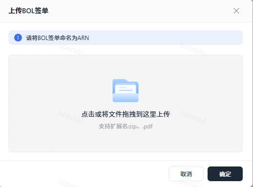

1. 点击灰色区域选择本地文件，或将本地文件拖拽至灰色区域，点击【确定】按钮

 说明：上传的BOL签单文件格式需是zip、pdf

1. 显示上传结果弹框，上传失败的会返回具体的失败原因，根据原因调整后可再次上传

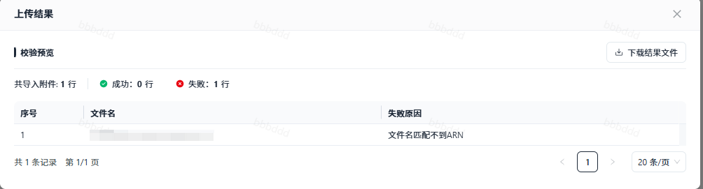

## 三、常见问题

### 接完单后发现商家仓实际没有足量的整箱库存可以进行发货怎么办?

接单的时候一定要确认商家仓是否有对应数量/装箱规格的库存，再进行接单。如果实在是出现上述情况，可以部分发货，亚马逊最后会按照实际接收的数量开短缺索赔发票过来，客户这边承担少发的货物数量即可。

### 我的产品做了透明计划在发PO订单的时候需要注意什么？

做了透明计划的产品，PO发货的时候需要贴上T-code，否则亚马逊收到货后可能会认为非正规货品，直接拒绝上架，变成不可售库存。

### 海外从准备备货发货的时候发现装箱数量和系统里面不一样怎么办？

亚马逊PO来单都是按照产品列表里维护的产品装箱数量（Items per inner pack）的整数倍进行下来，即发货也是要按照整箱发货，所以一定要维护正确。如果出现这种情况，要么取消物流拒单，要么商家仓进行箱规调整，按照亚马逊下单的装箱数量进行重新装箱发货。

### 为什么在新订单界面，有些订单的发货仓库、接单数量是默认有，有些是空的？

系统会根据ASIN可售库存，推荐可接单的发货仓库、接单数量，用户确认推荐无误后，可直接提交接单数量，免去人工维护；目前系统只支持ASIN 在一个仓库有库存时作推荐，因此会看到部分订单无数据。未来会陆续支持多仓的推荐。

### 接单以后怎么修改发货仓库、接单数量、预计提货时间？

在系统下单后的23小时内，可以前往【全部订单】-【编辑】修改接单信息。请注意：修改后的接单数量不得大于原接单数量；若订单已创建货件单，需联系平台运营经理进行修改。

### 上传BOL签单失败，如何处理？

依次检查：货件单状态需为【运输中】【已到达】；上传的附件格式需为zip/pdf；pdf文件需按照ARN命名。若如上三点都确认无误还是上传失败，请联系平台运营经理。

### 怎么查看货件单包裹有没被签收？

前往【VCPO货件】-【VCPO货件详情】-【产品信息】点击运输追踪单号可查看详情物流轨迹。
