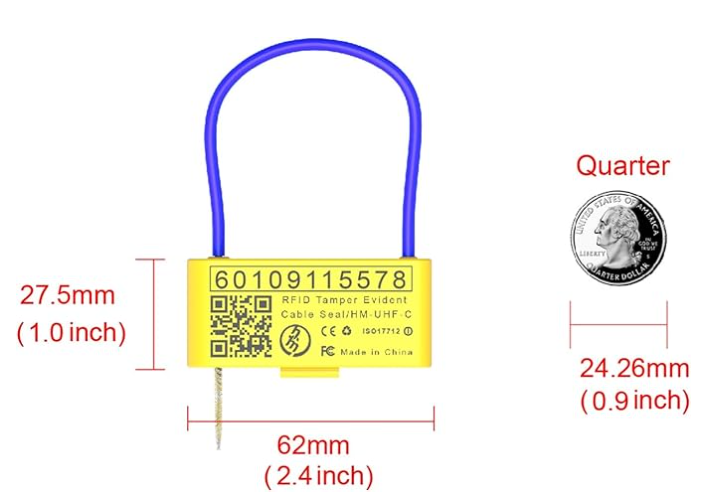

# 飞书文档：Trailer seal requirements for full truckload (FTL)

## Trailer seal requirements for full truckload (FTL)

Effective September 1, 2024, vendors must seal full truckload (FTL) and intermodal shipments with ISO 17712-compliant, Amazon-approved RFID seals at the point of pickup. Less than truckload (LTL) and small parcel carriers will apply seals at the carrier consolidation terminal before the shipment arrives at an Amazon facility.

**Note:** For reference, FTL or intermodal shipments in the Collect program sent to our fulfillment centers prior to September 1, 2024 required an ISO-17712-compliant metal, plastic, or wire seal on the trailer door prior to the shipment leaving the facility.

自 2024 年 9 月 1 日起，供应商必须在提货时，对整车运输（FTL）及多式联运的货物使用符合 ISO 17712 标准、经亚马逊批准的 RFID 封条。零担运输（LTL）及小包裹运输的货物，将**由承运人**在其集散中心、于货物送达亚马逊运营中心之前完成封条操作。

注意：作为参考，在 2024 年 9 月 1 日之前，对于加入“Collect”计划、发往我们运营中心的 FTL 或多式联运货物，同样要求在货物离开设施前，在拖车门上使用符合 ISO 17712 标准的金属、塑料或钢丝封条。

As a reminder, vendors must comply with our seal policy for FTL Collect shipments. To meet the requirements, take the following steps:

1. Ensure that the trailer's door has an ISO 17712-compliant Amazon-approved RFID seal applied before the shipment leaves your facility.
2. Print or note the seal number on the bill of lading.
3. Submit the seal number immediately in the system once the shipment picked up by the carrier.

再次提醒，供应商必须遵守我们对 FTL Collect 货物的封条政策。为满足要求，请执行以下步骤：

1. 在货物离开您的设施前，确保拖车门已安装符合 ISO 17712 标准的、经亚马逊批准的 RFID 封条。
2. 将封条号码打印或手写在提单（BOL）上。
3. 承运人提货后，立即在系统中提交封条号码。

If you are sending an FTL shipment, you must, once the trailer is loaded and the carrier has had the opportunity to inspect it, seal the lock on the trailer. All FTL shipments must have metal, plastic, or wire seals that meet the following criteria:

• International Organization for Standardization (ISO) 17712 compliant Amazon approved RFID seal

• Easy to apply and seal

• Strong and durable against weather, chemical action, and undetectable tampering

• Permanently and uniquely marked/numbered

• Marked with an easily identifiable manufacturer’s logo

If you, the vendor/shipper, have loaded and sealed the trailer before the carrier has had the opportunity to count and inspect the freight, you must print Shipper Load and Count (SLC) on the BOL.

如果您发运的是 FTL 货物，在拖车装载完毕且承运人完成检查后，您必须锁上拖车封条。所有 FTL 货物使用的金属、塑料或钢丝封条必须满足以下标准：

- 符合国际标准化组织（ISO）17712 标准、经亚马逊批准的 RFID 封条
- 易于施加和封上
- 坚固耐用，能够抵御天气、化学品作用，且无法在不被察觉的情况下篡改
- 具有永久且唯一的标识/编号
- 标有易于识别的制造商标志

如果您（供应商/发货人）在承运人有机会清点和检查货物之前就已装载并封上拖车，则必须在提单（BOL）上注明“发货人装载与清点”（Shipper Load and Count，简称 SLC）。

Order the seals from the AMZ store:

可从亚马逊店铺订购封条：

https://www.amazon.com/dp/B0CZPQ3QVZ?ref=myi_title_dp

[https://shop.guiseal.com/](https://shop.guiseal.com/) （**Authorization Code：Vmn3Ap**）
