# 飞书文档：发货流程及注意事项

## 发货流程及注意事项

### PO发货流程

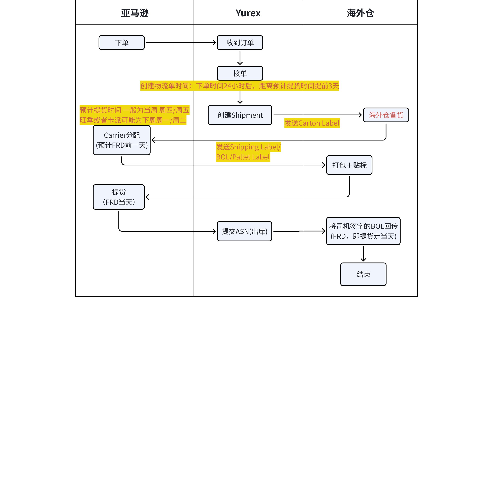

> 画板来源：token=`BeKQw9GlrhlJENb0WqIcNKMKnad`

### 海外仓需处理的标签

> **产品标签**：所有发往亚马逊仓库的产品，都需要在彩盒上贴上产品标签，美国站一般使用**UPC/EAN标签**。
>
> **在 FRD 前一天根据亚马逊的安排提供发运材料，每个ARN 都是独立的一单。发运方式会是以下其中一种：Small Parcel, LTL/TL**
>
> **Small Parcel**：仓库需要处理的标签素材为**Carton Label和Shipping Label**；
>
> **LTL**：仓库需要安排打托，同时需求处理的标签素材为:**Carton Label、Pallet Label和BOL(签字提单回传)**

#### **1）产品标签**

数量：每个商品外包装都要贴一张产品标签。
作用：用于识别是什么商品。
规格：5\*3cm
注意：美国站一般是用UPC/EAN标签。
**建议：商品从国内发往海外仓前，工厂可以在国内安排贴上产品标签，这种情况下海外仓无需重复贴标。**

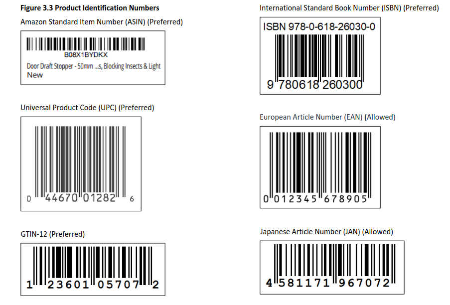

#### 2）**Carton Label**

> 标签默认命名方式：cartonLabels_ASN Number

1. 亚马逊订单下单后根据接受的PO订单信息，对应下载carton label箱标素材和拣货清单；
2. 箱标素材和拣货清单下载后需要发送给您的海外仓仓库负责人；
3. **海外仓根据拣货清单拣货备货**，打印carton label，并将对应的carton label贴至产品外箱非箱子接缝或开口处的中央。每箱只有一个箱标。
4. 完成拣货和粘贴carton label后等待FRD前一天亚马逊分配物流商；
5. 如果打包装箱数与箱标上的信息不相符，请及时反馈；
6. 托盘要求:
- 托盘类型: B 级，4 WAY(4个方向都有孔)，40"\*48"
- 托盘高度: 小于 90 英寸
- 托盘重量:小于 1500 磅
- 托盘悬垂: 每边小于 2 英寸
1. 如果 ARN 的打板托盘数超过 1，请在完成准备时告知实际的托盘数量

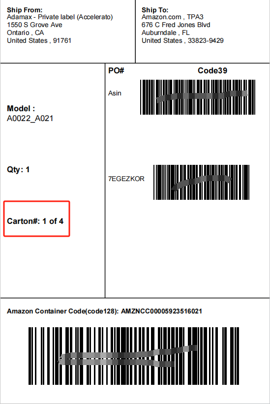

#### 3）Shipping Label

> Shipping method = Small Parcel, 发运方式为小包裹。
>
> 标签默认命名方式：ARN Number_smallParcelLabel.

1. 将Shipping Label即发运标签，贴在产品外箱非箱子接缝或开口处的中央;每箱只有一个发运标签；
2. 每个发运标签的**序列号与箱标的序列号相对应**。请参见右图的示例；
3. **请严格按照标签序列号贴标**，以避免发运问题。
4. 请在收到发运标签后的安排仓库人员进行贴标，确保能于约定的FRD时间交付，并反馈交付情况；
5. 小包裹的承运商多为**UPS或ONTRAC(EMSY)**，UPS提货请仓库自行预约；**ONTRAC(EMSY)由我司统一安排预约(若ONTRAC上门提货，海外仓需要额外的提货凭证，请及时反馈)**

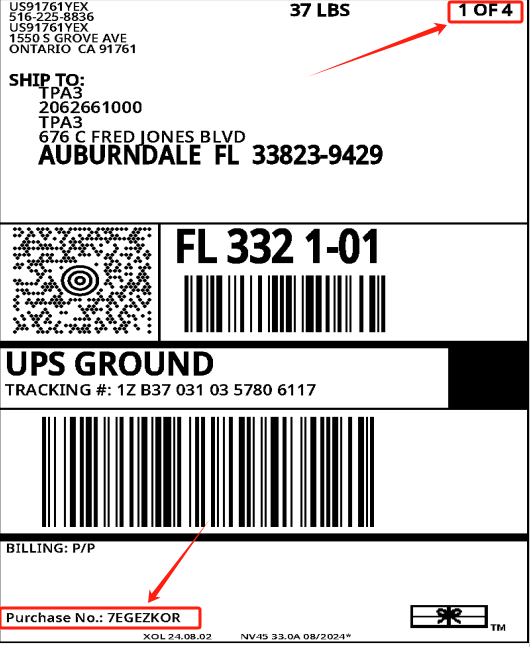

#### 4）Pallet Label(托盘标签)

作用：用于托盘运输。
规格：10\*15cm（4 X 6 inches）
注意：
1. 托盘尺寸一般为 40\*48 inches
2. **分配的承运人为AMZX时，除了Pallet Label，还需要额外粘贴一张PRO Label**；

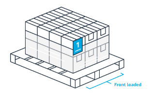

**Pallet Label模板**：

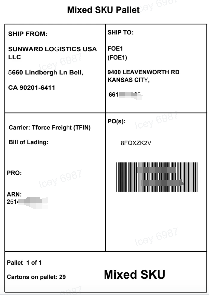

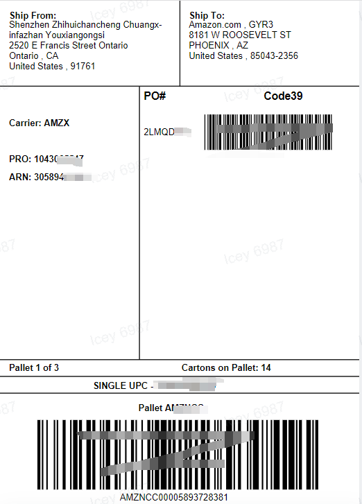

LTL托盘标注意要点：
1. 针对承运人 AMZX

 - 若仓库实际打托数大于系统显示的预计托盘数，请务必及时反馈我司物流人员，以便更新托盘数量。
 - 在我司物流人员修改成功后，请在系统内下载新的 **Pro Label** 标签并通过系统生成对应差额的托盘标。
2. 针对其他承运人

 - 实际托盘数与预计托盘数误差在 1～2托范围内属于正常情况，可自行按以下方式处理：

 - 实际托盘数多于预计数：通过系统生成对应差额的托盘标或重新生成全部托盘标。
 - 实际托盘数少于预计数：多余的托盘标直接废弃即可。
 - 若误差超过 2托（即差距过大），请及时反馈我司物流人员协助解决。

#### 5）**PRO Label**

1. 作用：当承运人为 AMZX 时，用于运输追踪
2. 规格：10\*15cm（4 X 6 inches）
3. 注意事项：

 1. 当且仅当承运人为AMZX时，才需要贴Pro Label
 2. 一托至少贴1张，贴在托盘平面，清晰可见处
 3. Pro Label为必须标签，缺少可能导致亚马逊拒收，面临罚款
 4. PRO label 必须贴在每个托盘前装货侧左上角
 5. 标签要求：

 - 必须放置在托盘顶部附近清晰可见的平面上
 - 如果无法将标签贴在前装货侧，请将其粘贴到货盘顶部附近清晰可见的平面上
 6. 对于LTL(AMZX)，每个托盘上必须贴有 PRO 标签

#### 6）BOL(Bill of Lading)

1. Shipping method = LTL/TL, 即卡车发运;
2. 请将货物先打托，每个ARN为独立的一单，同个ARN下不同ASIN可以混在一个托盘上，但是不同ARN不可以混排在同一个托盘上。
3. 请按照要求贴Pallet Label(托盘标)：托盘标签要求贴在每个托盘的中央无遮挡位置，每个托盘需要四面各贴一张;
4. 请打印两份BOL，提货司机都签名后一份仓库留底一份给提货司机;
5. 请在任何情况下都不要拆分同一ARN下的货物，同一单ARN的货物需要一起安排发运
**注意：品牌方当天提交出库时需上传完成提货的签名版BOL，以避免亚马逊罚金，文件以ARN单号命名，可以是扫描件或清晰图片。**

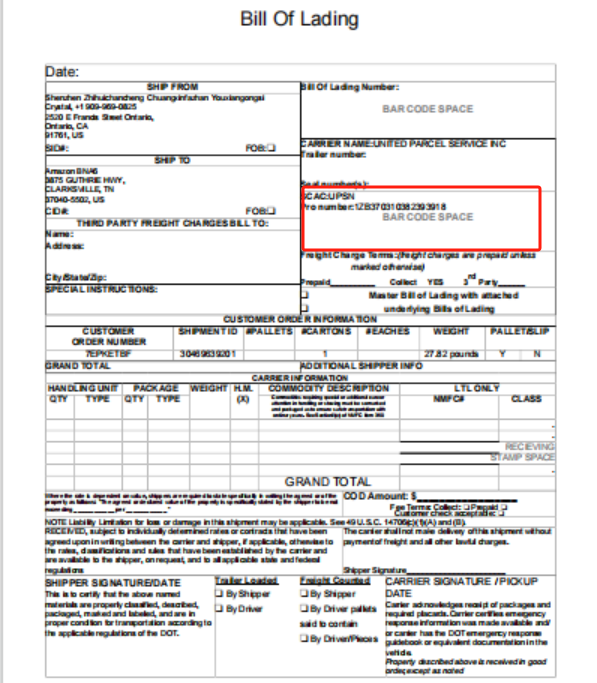

### 备货时效

由于VC模式的物流运输由亚马逊负责计划与安排并承担物流费用，亚马逊深切关注各个仓库的备货和提货问题。
提升仓库的备货效率与交付准时性有利于亚马逊和物流商的提货效率。

1. 海外仓需要保证在FRD前完成备货，在FRD当天等待物流商上门提货，海外仓需要在司机到达仓库30分钟内完成装载。
2. 如果无法在FRD前完成备货，需要提前一个工作日（美国当地时间）告知Yurex履约中心需要重新延后提货时间。如果延后的提货时间超过了发货窗口，亚马逊可能会收取相应的罚款，需要自行承担。
3. 如果物流商有去某海外仓**提货跑空的情况，后续预约提货的难度可能增加**，部分卡车司机可能不愿意再去海外仓提货。请确保备货的准时性。
4. VC业务物流由亚马逊负责安排，并非协商时间提货机制，需要确保FRD前完成备货，延时提货会降低海外仓的绩效，导致无法预约物流商提货，司机拒绝前往海外仓提货，来单量被抑制等后果。

### 司机未准时提货

1. 要求客户通过 **物流-约车管理-约车单管理-待约车列表** 的路径补充约车信息，填写时请务必确保信息真实、准确、完整。如因信息填写错误、遗漏或不实而造成的任何损失，将由客户自行承担。

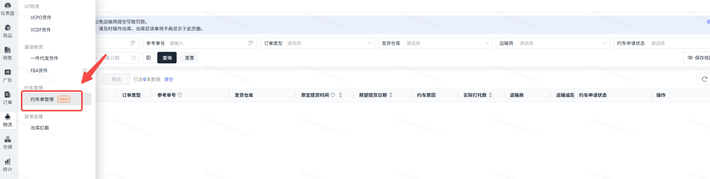

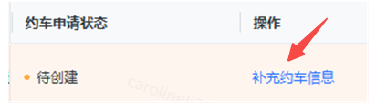

1. 在完成约车信息补充后（请注意，在系统自动创建约车单之前，您可**多次补充**或修改信息），系统将定时自动创建约车单。创建完成后，您可前往【约车单列表】查看，此时约车单状态将更新为“**待预约**”。至此，您无需再进行任何操作。

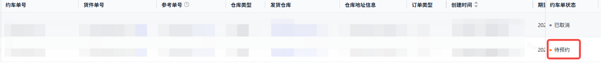

1. 我司物流人员将根据约车单信息重新预约上门提货。预约成功后，客户端会收到【已预约】的系统通知，您也可在【**约车单列表**】中查看详情。请在收到通知后及时告知您的仓库工作人员。

温馨提示：由于国内外存在时差，系统通知可能会有延迟。因此，我司将按提货时间正常进行预约。请您同步提醒仓库工作人员密切关注司机上门情况，如有紧急情况，请及时在企业微信群中沟通。

### LTL/TL运输注意事项及铅封说明

（1）LTL与FTL的区别

> 关键区别：LTL会经中转仓分拨，时效较慢、破损风险略高；FTL为点对点直达，更安全高效，但对准时提货要求更高，**须严格按约定时间交付司机。若因发货方原因导致司机跑空，将产生500美元/车的爽约费**。PO发货多为LTL，需额外关注铅封管理。

（2）什么是铅封（Seal）

- 铅封是一次性锁扣装置，安装在卡车车门或集装箱门锁扣上。**FTL（整车）发货时必须按要求施加合规铅封。**
- 目的：防止货物在运输途中被私自打开或调换。
- 提货时：司机与仓库人员需共同核对铅封号及是否完好。
- 送达后：收货方会检查铅封是否完整且与单据一致。

> ⚠️ 注意事项：
>
> - 货物交由司机后，铅封号(seal number)须同时完成两项操作——1）准确登记在BOL提单上；2）提交出库时在系统中如实填写。
> - 如铅封损坏或号码不一致，亚马逊有权拒收

详细知识请参考文档：

### 提交出库

必须于提货完成当天在Yurex端提交出库，以避免延迟ASN处罚。

如果 **VCPO单（Vendor Compliance Purchase Order）** 对应的 **ASN（Advanced Shipping Notice）未及时提交**，可能会导致一系列供应链和财务问题，影响供应商绩效，甚至触发罚款或终止合作。
