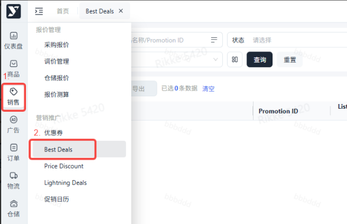
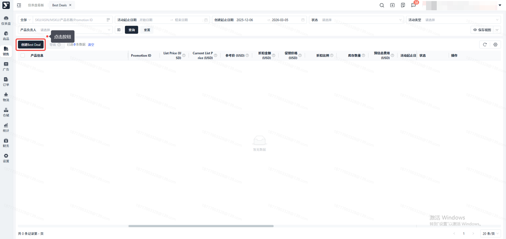
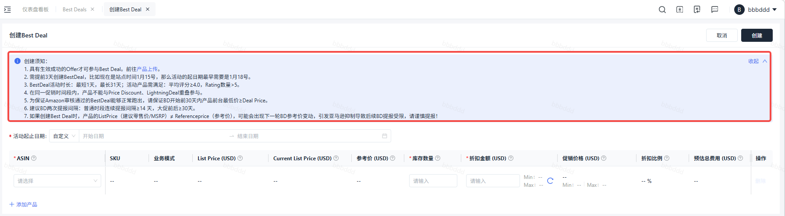
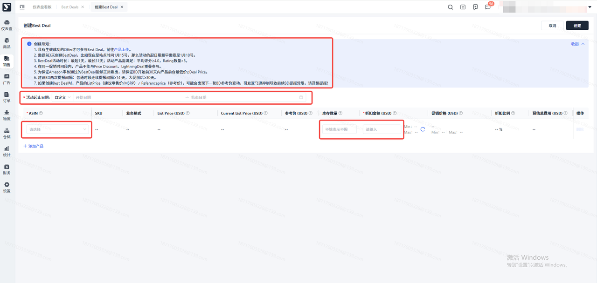
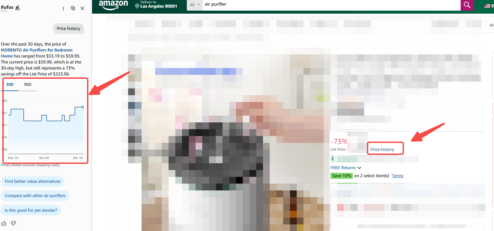
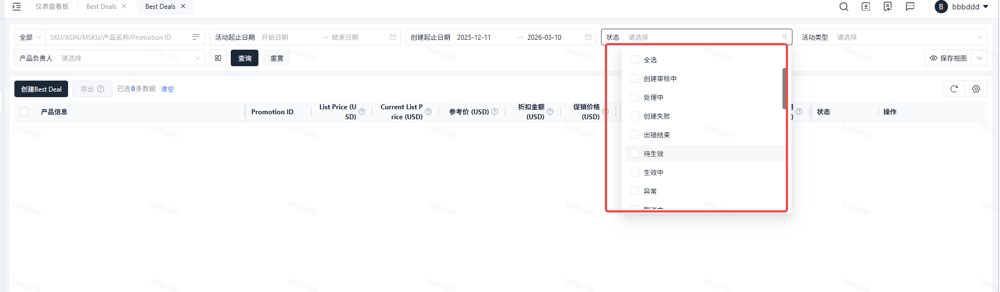
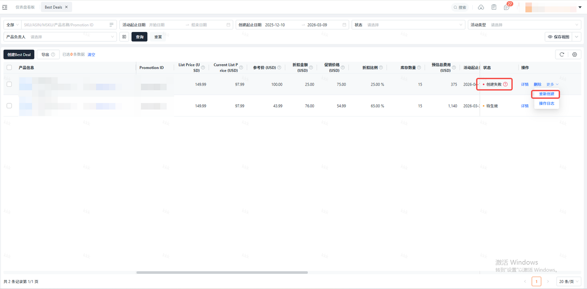

# 飞书文档：Best Deal

## 文档信息

| 项 | 内容 |
| --- | --- |
| 远程文档 | https://q1njej8cpab.feishu.cn/wiki/M83Fw09eYiVpF8kSBZRc8XYPnCg |
| 图片处理 | 本地下载（assets/images） |
| 快照时间 | 2026-08-06 |
| 来源命令 | `lark-cli docs +fetch --api-version v2 --doc https://q1njej8cpab.feishu.cn/wiki/M83Fw09eYiVpF8kSBZRc8XYPnCg --doc-format markdown --as user --format json --jq .data.document.content` |
| 格式处理 | fd-doc-markdown-sync/scripts/normalize-feishu-doc-markdown.mjs |

---

## Best Deal

### 操作路径：销售→营销推广→Best Deals→点击“创建Best Deal”

### BD创建全流程指南

#### 提报条件知悉

> - 参与门槛：
>
> 1. 仅状态为 “生效成功 Offer” 的产品可提报（可跳转至 “Catalog” 核查状态）
> 2. 在同一促销时间段内，产品不能与Price Discount、LightningDeal重叠参与
> - 提报时效：需在活动开始日期前3天完成提报
> - 活动时长：最短1天，最长31天
> - 间隔时长：建议普通时段连续提报时间间隔≥14天，大促前后≥30天
> - 折扣要求：常规时段折扣比例≥10%，特殊促销节点需≥20%，或较过去 30 天最低价再优惠 5%
> - 变更限制：活动创建成功后不可自行编辑或取消，特殊情况需联系平台运营经理处理

#### 配置BD活动信息

| 配置项 | 操作说明 |
|-|-|
| 选择活动产品 | 选择提报ASIN，点击+添加产品，支持添加多个ASIN批量提报（最多可添加20个ASIN） |
| 选择活动时间 | 选择活动开始与结束日期，活动时长灵活可控（最短1天，最长31天） |
| 设置折扣规则 | 输入折扣金额（需保证在 min-max 折扣金额之间） |
| 设置库存数量 | 输入参加活动的ASIN的库存数量（数量售罄后BD自动结束） |

#### 提报注意事项及规则详解

BD具体规则及注意事项请参考：创建活动时，当亚马逊返回的min funding+最大deal price ≠ 最高 funding +最低deal price时，只能按min funding 创建，不支持输入折扣金额保证BD开始前30天内产品前台最低价≥提报的Deal Price，30D最低价查看方法参考如下：

> 

#### 促销状态解读

| 状态项 | 说明 |
|-|-|
| 创建审核中 | 创建提交成功后此条数据状态，待亚马逊审核通过 |
| 创建失败 | 产品不符合条件，可查看具体报错原因，支持重新创建 |
| 出错结束 | 产品不符合条件，可查看具体报错原因，支持重新创建 |
| 待生效/生效中 | 成功参与BD活动，支持编辑 |
| 已取消 | 表示活动已取消（只有联系您的平台运营经理帮忙取消的活动，才会显示原因） |
| 处理中 | 表示活动信息修改后，重新提交创建请求到亚马逊进行审核 |
| 异常 | 生效中的活动出现的状态，会展示具体的报错信息，支持编辑 |
| 结束 | 表示活动正常结束 |

#### 重新创建Best Deal

> - 创建失败/出错结束状态的活动，支持重新创建，自动填充之前活动的相关信息
> - 进入重新创建页面，系统默认填充上次活动相关信息，并会展示相关报错信息
>
> - 上次活动的开始日期大于当前+3天时，才默认填充活动起止日期
> - 活动信息重新设置好后，点击创建按钮，提交创建请求到亚马逊审核
