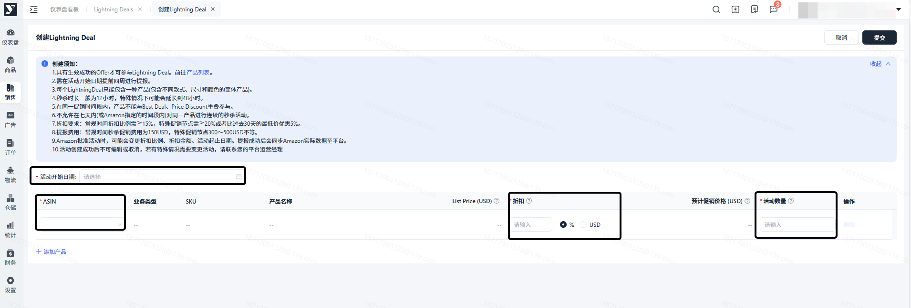

# 飞书文档：Lightning Deal

## 文档信息

| 项 | 内容 |
| --- | --- |
| 远程文档 | https://q1njej8cpab.feishu.cn/wiki/Th86wzG4tiacX1kMcgycDpV9nFb |
| 图片处理 | 本地下载（assets/images） |
| 快照时间 | 2026-08-06 |
| 来源命令 | `lark-cli docs +fetch --api-version v2 --doc https://q1njej8cpab.feishu.cn/wiki/Th86wzG4tiacX1kMcgycDpV9nFb --doc-format markdown --as user --format json --jq .data.document.content` |
| 格式处理 | fd-doc-markdown-sync/scripts/normalize-feishu-doc-markdown.mjs |

---

## Lightning Deal

### 操作路径：销售 → 营销推广 → Lightning Deal → 点击 “创建 Lightning Deal” 按钮

### 秒杀活动全流程指南

#### 前期准备：明确活动规则

点击创建后，首先展示活动创建须知，核心规则提炼如下，助力快速掌握关键要求：

> - 参与门槛：仅状态为 “生效成功 Offer” 的产品可提报（可跳转至 “Catalog” 核查状态）
> - 提报时效：需在活动开始日期前2天完成提报
> - 产品限制：每个秒杀活动仅可包含一类产品（支持同一变体下的多款式、多尺寸、多颜色 ASIN）
> - 活动时长：常规秒杀时长为 12 小时，特殊场景（如大促节点）可能延长至 48 小时
> - 折扣要求：常规时段折扣比例≥15%，特殊促销节点需≥20%，或较过去 30 天最低价再优惠 5%
> - 变更限制：活动创建成功后不可自行编辑或取消，特殊情况需联系平台运营经理处理

#### 配置活动核心信息

1. 选择活动开始日期：最早可选择当前洛杉矶时间2天后
2. 挑选秒杀产品：支持选择同一变体关系下的多个 ASIN，精准匹配 “同类产品集中秒杀” 需求
3. 设定折扣与库存：

 1. 折扣设置：可按比例或金额指定折扣，系统将基于当前 MSRP 自动计算预计折后价（仅作参考，非最终成交价）
 2. 活动数量：填写本次秒杀允许售卖的最大数量，需结合当前库存情况合理预估，避免秒杀期间断货影响活动效果
4. 确认提交：核对所有配置信息无误后，点击 “提交”，活动将进入 Amazon 审核阶段

#### 活动状态跟踪与管理：

- 审核中：提交后活动状态为 “审核中”，耐心等待 Amazon 平台审核结果
- 待生效：审核通过后，状态更新为 “待生效”，界面将展示 promotion ID、促销费等关键信息，秒杀具体时段将在活动开始前 1-2 周公布
- 秒杀中：到达指定开始时间后，自动转为 “秒杀中”，每 30 分钟更新一次销售数据与进度，实时掌握秒杀效果
- 已结束：秒杀时长结束或活动产品售罄后，活动状态转为 “已结束”，可在历史记录中查看完整活动数据，为后续秒杀策略优化提供参考
