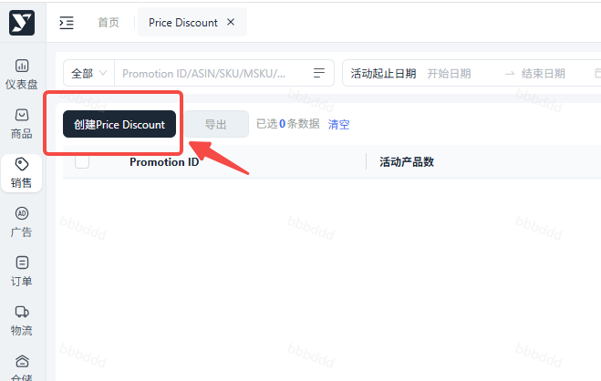

# 飞书文档：Price Discount

## Price Discount

### 创建 Price Discount

操作路径：销售模块 → Price Discount → 点击 “创建 Price Discount” 按钮

### 详细操作指南：

#### 发起创建

> 进入 Price Discount 页面后，界面将展示过往活动列表，包含Promotion ID、活动产品数、活动起止日期及状态等核心数据，支持搜索、筛选和导出功能，方便快速查询历史活动记录。点击 “创建 Price Discount”，进入活动配置环节。

#### 填写活动核心信息

| 配置项 | 操作说明 |
|-|-|
| 活动组促销起止日期 | 自主选择活动开始与结束日期，活动时长灵活可控，最短 2 天、最长可达 31 天 |
| 选择活动产品 | 挑选状态为 “生效成功” Offer 的 ASIN 参与活动，支持点击 “+ 新增一行” 批量添加，单次最多可纳入 20 个 ASIN |
| 设置折扣规则 | 可自由选择按比例或按金额设置折扣，无需受固定区间限制，灵活匹配不同促销策略（如清仓折扣、新品让利等） |

#### 关键提报要求：

- 提报时效：需提前 48 小时完成活动创建，预留充足审核与配置时间
- 账号适配规则：若添加的 ASIN 归属同一 AVC 账号，创建成功后直接返回活动列表页；若涉及多个 AVC 账号，提交后将跳转至 “确认 Price Discount 活动组” 页面，完成确认

#### 提交与状态管理：

- 正常状态：提交后若信息无误，活动将进入 “待生效” 状态，到指定时间自动转为 “生效成功”，开始执行折扣策略
- 异常处理：

 - 创建失败：点击 “详情” 查看具体原因（如 ASIN 状态异常、信息填写不全等），修改后可重新提交
 - Amazon 审核失败：通过 “详情” 获取失败说明，可选择调整信息后重新提交，或直接取消活动另行创建

 - 生效后的活动组，可在详情页实时查看活动数据，支持按需编辑折扣力度或直接取消活动，灵活应对市场变化
 - 即使活动状态为 “已取消”，仍可在详情页追溯活动全程信息，便于后续数据分析与策略优化
