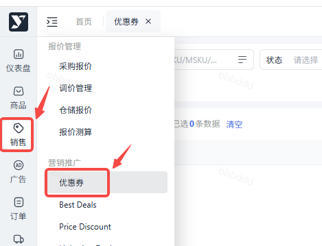
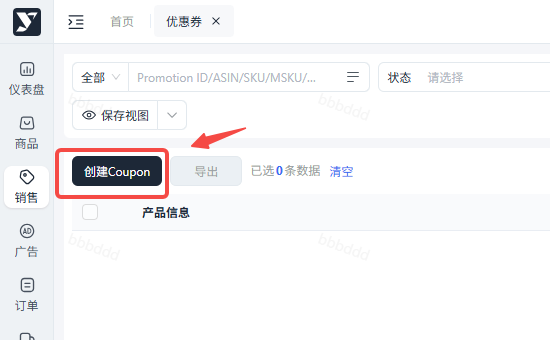
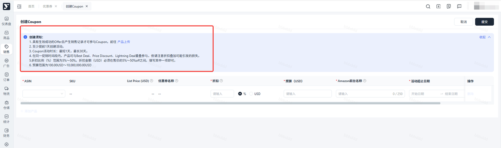
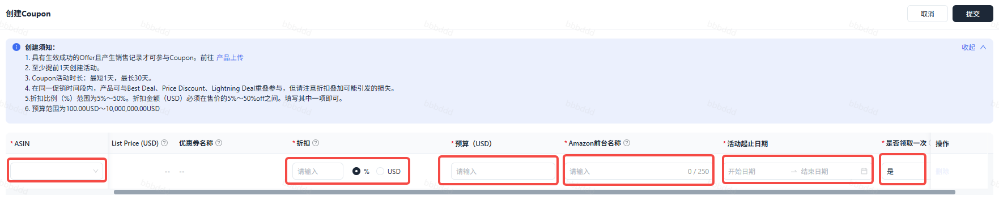
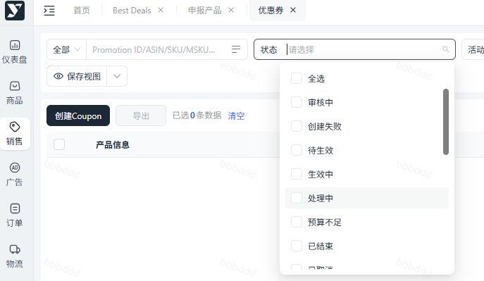
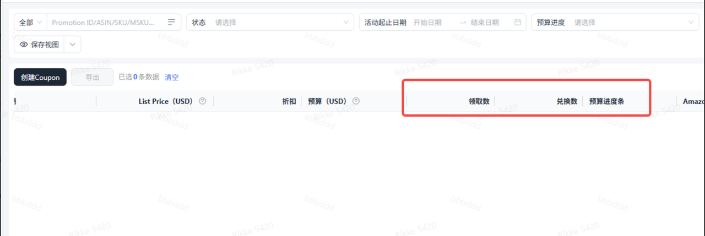

# 飞书文档：优惠券

## 优惠券

### 提报路径：销售→营销推广→优惠券

### 详细操作指南

#### 提报条件知悉

> - 参与门槛：仅状态为 “生效成功 Offer” 的产品可提报（可跳转至 “Catalog” 核查状态）
> - 提报时效：Coupon需在太平洋时间提前1天创建
> - 活动时长：最短1天，最长30天（每个ASIN在同一个时间段内只能存在一个活动组，请注意优惠券的活动起止时间）
> - 变更限制：活动创建成功后可自行编辑或取消，特殊情况需联系平台运营经理处理

#### 配置Coupon活动信息

| 配置项 | 操作说明 |
|-|-|
| 选择活动产品 | 选择提报ASIN，点击+添加产品，支持添加多个ASIN批量提报（最多可添加20个ASIN） |
| 设置折扣规则 | 输入折扣比例（%）或折扣金额（USD）：折扣比例 % 范围为5%～50%，折扣金额 USD 必须在当前前台售价的5%～50% off之间 |
| 设置预算 | 输入预算：范围为100.00USD～10,000,000.00USD |
| Amazon前台名称 | 优惠券在Amazon前台页面展示的名称 |
| 选择活动时间 | 自主选择活动开始与结束日期，最短1天，最长30天（每个ASIN在同一个时间段内只能存在一个活动组，请注意优惠券的活动起止时间） |
| 设置领取限制 | 一个客户是否只能领取并兑换一次 |

#### 提报注意事项

1. 折扣叠加：在同一促销时间段内，Coupon活动可与Best Deal、Price Discount、Lightning Deal重叠参与，请注意折扣叠加可能引发的利润损失
2. 处于待生效/生效中/预算不足状态的Coupon，可编辑预算、取消Coupon

#### 促销状态解读&进度查看

| 状态项 | 说明 |
|-|-|
| 审核中 | 提报后此条数据状态 |
| 创建失败 | 点击？可查看失败的具体原因，点击编辑重新修改后提交或点击删除重新创建 |
| 待生效/生效中 | 审核完成后流转此状态，可编辑，取消 |
| 处理中 | 操作“编辑”，流转此状态 |
| 预算不足 | 可编辑预算、取消 |
| 已取消 | 活动已取消 |
| 已结束 | 活动已结束 |

- 列表页可查看Coupon使用情况：当Coupon预算使用率≥80%，系统自动发送站内通知
