# 飞书文档：促销提报指南

## 一、Best Deal

### 提报路径：销售>营销推广>Beat Deals>申报产品

### 操作流程：

#### 销售>营销推广>Beat Deals>申报产品

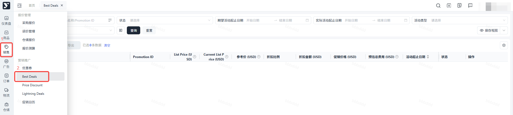

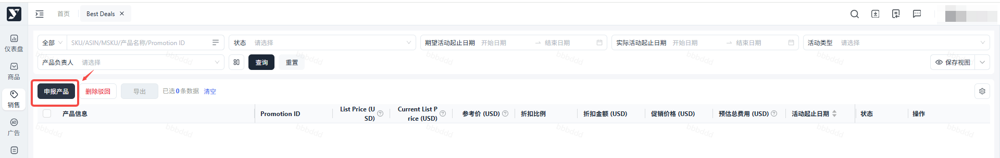

#### 填写BD相关信息

选择想要提报BD的ASIN（在产品列表状态为生效成功的Offer），可点击+添加产品，添加多个ASIN（最多可添加20个ASIN）选择想要参加活动的ASIN的库存数量（数量售罄后BD自动结束）输入折扣金额（需保证在 min-max 折扣金额之间）选择期望活动截止日期（最短1天，最长30天）Amazon审核时间较长，需提前7天申报活动在同一促销时间段内，产品不能与Price Discount、LightningDeal重叠参与为保证Amazon审核通过的Best Deal能够正常跑出，请保证BD开始前30天内产品前台最低价≥提报的Deal Price30D最低价查看方法

Amazon批准活动时，可能会变更折扣比例、折扣金额、活动起止日期。提报成功后会同步Amazon实际数据至系统申报成功后，我们将会在3个工作日内完成审核，如有疑问，请联系平台运营经理；BD具体规则及注意事项请参考：

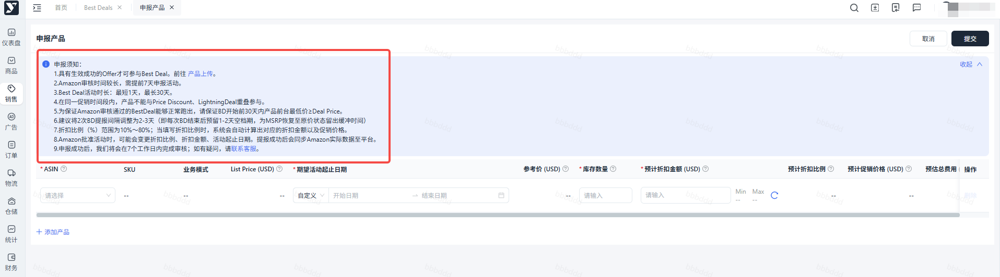

##### 批量申报限制

支持批量申报，但限制20个产品点击提交

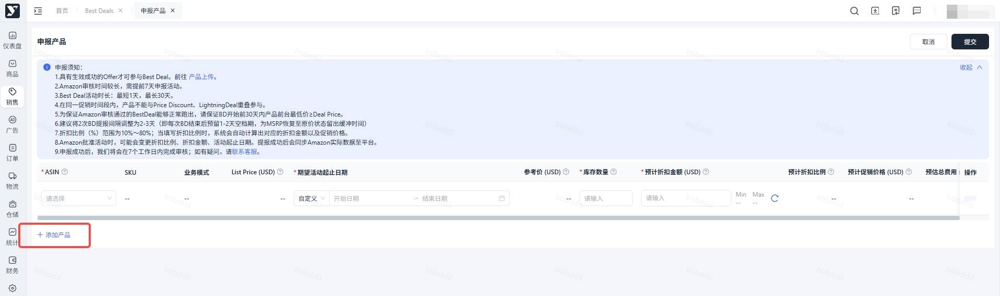

##### 促销状态解读

> - 提报后此条数据状态流转为“申报中”，支持删除
> - “待生效/生效中”表示成功参与BD活动
> - “驳回”表示产品不符合条件
> - “价格异常”需恢复产品前台价格后重新提交
> - “已结束”表示活动正常结束

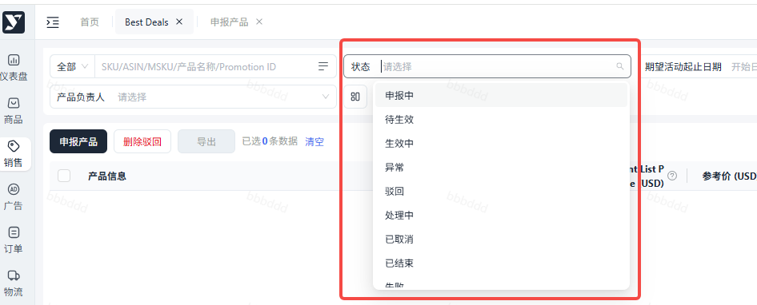

## 二、Coupon

### 提报路径：销售>营销推广>优惠券

### 操作流程：

#### 优惠券>创建Coupon

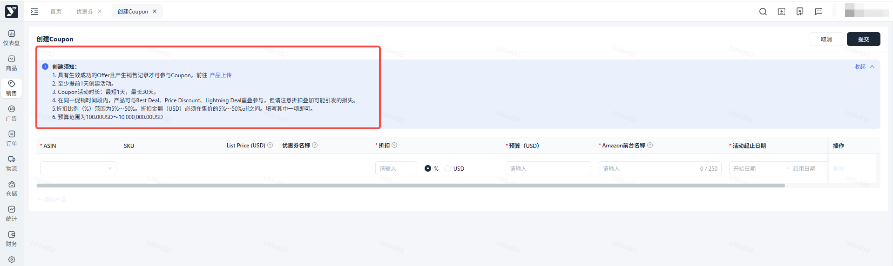

#### 填写Coupon相关信息

> 1. 选择想要创建Coupon的ASIN（具有生效成功的Offer且产生销售记录），可点击+添加产品，添加多个ASIN（最多可添加20个ASIN）
> 2. 输入折扣比例或折扣金额（折扣比例 % 范围为5%～50%，折扣金额 USD 必须在当前前台售价的5%～50% off之间）
> 3. 输入预算（预算范围为100.00USD～10,000,000.00USD）
> 4. Amazon前台名称：优惠券在Amazon前台页面展示的名称
> 5. 选择活动起止日期，最短1天，最长30天（每个ASIN在同一个时间段内只能存在一个活动组，请注意优惠券的活动起止时间）
> 6. 是否领取一次：一个客户是否只能领取并兑换一次

1. 创建时间：Coupon创建需在太平洋时间提前1天创建
2. 折扣叠加：在同一促销时间段内，Coupon活动可与Best Deal、Price Discount、Lightning Deal重叠参与，请注意折扣叠加可能引发的利润损失

#### 提交并查看 Coupon 状态

点击提交，查看Coupon状态

- 正常：状态为待生效（未到开始时间）
- 异常：创建失败，点击？可查看失败的具体原因，点击编辑重新修改后提交或点击删除重新创建

#### 注意事项：

- 处于待生效/生效中/预算不足状态的Coupon，可编辑预算、取消Coupon
- 列表页可查看Coupon使用情况

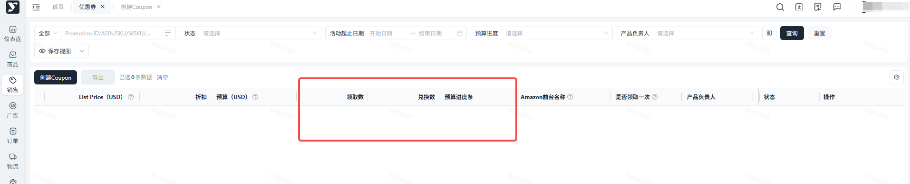

- 当Coupon预算使用率≥80%，系统自动发送站内通知

## 三、Price Discount

### 创建 Price Discount

提报路径：销售>营销推广>Price Discount>创建Price Discount

### 操作流程：

#### 创建 Price Discount

销售>营销推广>Price Discount >创建Price Discount

#### 填写PD相关信息

> 1. 选择活动组起止日期（最短1天，最长31天）
> 2. 选择想要提报PD的ASIN（在产品列表状态为生效成功的Offer），可点击+添加产品，添加多个ASIN（最多可添加20个ASIN）
> 3. 输入折扣比例或折扣金额

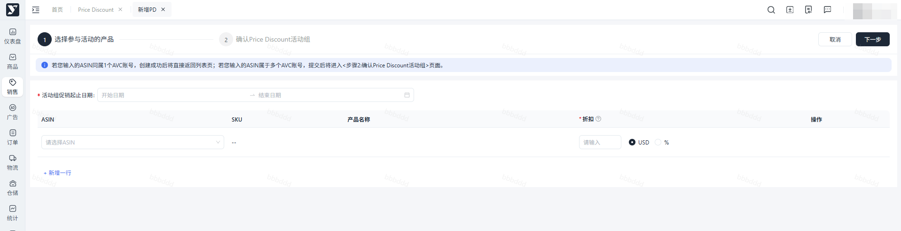

1. 需提前48小时提报
2. 若输入的ASIN同属1个VC账号主体，创建成功后将直接返回列表页；若输入的ASIN属于多个VC账号主体，提交后将进入【②确认Price Discount活动组】页面

#### 下一步/提交

- 正常：待生效/生效成功
- 异常：

 - 创建失败：点击详情，查看失败原因，修改后重新提交
 - Amazon审核失败：点击详情，查看失败原因，修改后重新提交或取消后重新创建

#### 注意事项：

- 生效成功的活动组详情页中，可查看具体活动信息，也可编辑折扣、取消活动组
- 状态为【已取消】时也可在详情页查看具体活动信息

## 四、Lightning Deal

### 创建 Lightning Deal

路径：销售>营销推广>Lightning Deal>创建Lightning Deal

### 操作流程

#### 创建 Lightning Deal

销售>营销推广>Lightning Deal>创建Lightning Deal

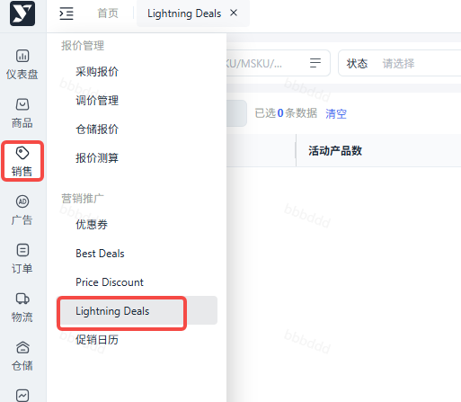

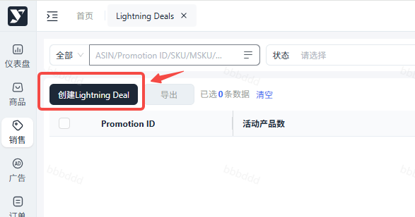

> 1. 请仔细阅读创建须知，了解秒杀活动的限制项。
> 2. 选择活动开始时间，LD与其他促销不同，卖家仅可指定活动开始的日期，秒杀开始的具体时段由亚马逊在秒杀正式开始前1-2周给出。注：最早可选时间为当前洛杉矶时间的一个月后，最晚可选时间为当前洛杉矶时间的四个月后。
> 3. 选择参与秒杀的ASIN，可选**同一变体关系**下的多个ASIN。

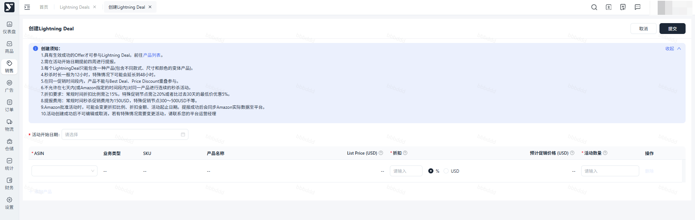

1. 为选择的ASIN指定折扣和活动数量。

 1. 支持按照比例或金额指定折扣，LD要求最低折扣比例达到15%，特殊大促期间可能会要求到20%以上。
 2. 填写折扣后系统会自动计算出该产品的预计折后价，此价格基于当前的MSRP计算得出，并不表示最终用户的成交价。
 3. 活动数量是指在本次秒杀中允许售卖的最大数量，**请评估当前的库存后再填写活动数量，避免出现秒杀中断货的情况。**
2. 确认无误后点击提交，LD会进入审核中。
3. 若活动审核通过，状态会变更为【待生效】，同时会显示【promotion ID】【促销费】字段，【秒杀时段】会在正式开始前1-2周展示。
4. 到达秒杀开始时间后，活动状态会自动流转为【秒杀中】，并在秒杀期间持续更新销售数据及销售进度，**更新频率为30分钟一次。**
5. 秒杀结束后，或组内产品售完时，活动组状态会自动流转为【已结束】。
