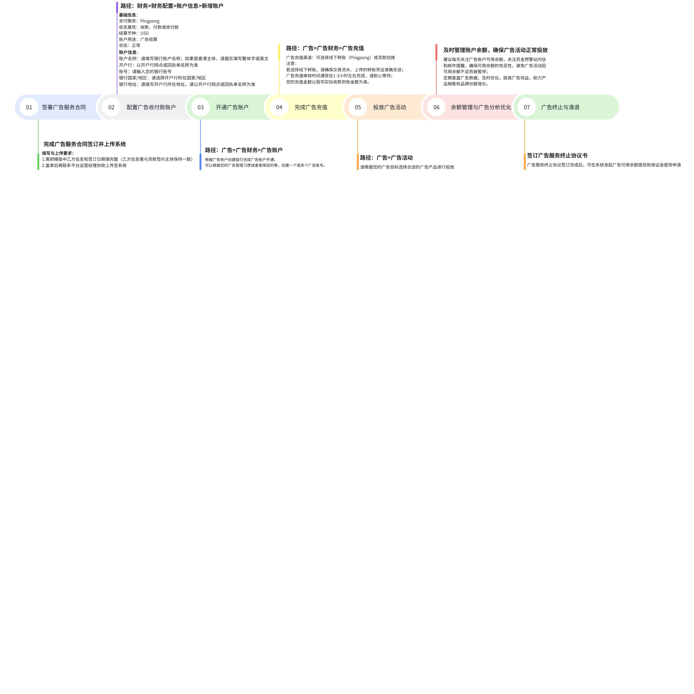

# 飞书文档：广告功能开通

广告功能开通

## Yurex广告系统使用流程

> 画板来源：token=`W4f8wE2wOhDZL0b9jhfcGTjHnYf`

## 准备工作

### 签署并上传广告服务合同

开启广告活动之前需要签署好Yurex广告服务合同联系平台运营经理协助上传至系统。

- **Yurex查看路径**：商品>合同管理-合同详情>合同与协议信息-广告服务合同协议

### 配置广告收付款信息

您需要提前准备Pingpong作为广告结算账户，用于对接Yurex广告费用充值。

- **Yurex配置路径：**财务>财务配置>账户信息>新增账户，账户用途必须勾选“**广告结算**”，需要支持USD美元结算。

### 开通广告账户

Yurex支持创建**单个广告账户**或**多个广告账户**。您可以根据广告业务线、产品线、负责人等多个维度考虑是否需要创建多个广告账户，通常来讲一个广告账户即可满足您的所有广告投放需求。

- **Yurex操作路径：**广告>广告财务>广告账户，请确认创建指引页面上的收付款方信息，并仔细阅读页面上的，均无误后即可点击右上角”**创建账号**“。

##### 广告账户说明：

- **单广告账户：**

 - 适用对象：适用于大多数广告主，例如对产品分账号打广告的需求不高的广告主。
- **多广告账户：**

 - 适用对象：适用于旗下有多家子公司，需要根据子公司分产品做广告的广告主；也适用于需要根据广告业务需求等场景分账号管理的需求。
 - 注意事项：

 - 每个广告账户都需要满足保证金=1000 USD，且可用余额>0，才能开展广告业务；
 - 多账户之间可以实现可用余额互转、但保证金1000 USD不可以互转；
 - 创建新的广告账户时，您需要自定义广告账户名称；
 - 多广告账户可以共用1个广告收付款账户信息，也可以在**财务-账户信息**配置使用多个广告收付款账户信息。

### 完成广告充值

Yurex广告采用的是**预充值扣款**形式，需要您通过第三方支付平台向我司Yurex广告收款账户转账，后续所有的广告支出都是从您充值的广告可用余额进行划扣支付。

**（1）Yurex广告资金构成：**

- **账户总额**：账户总额=可用余额+保证金，指的是您查看当天所展示的账户资金总额。
- **可用余额**：可用余额指的是当前可用于支付广告花费的金额，因充值金额与到账金额可能存在差异，该金额以我司实际到账金额为准。
- **保证金**：固定为1000 USD，指的是您在使用Yurex广告功能期间被冻结的信用担保资金，主要用途是规避潜在的支付风险，以及警示广告主合规投放亚马逊广告，该资金在广告投放期间不会用于广告费用结算，只在您决定终止使用Yurex广告系统后才做最终的清算和退还。您进行广告充值的时候，会优先划扣1000 USD到保证金，如有剩余才会流转到可用余额。
- **预到账金额**：指的是您已在第三方平台进行转账，并且在系统记录了充值，但我司还未收到的广告充值金额。
- **冻结金额**：指的是申请提现、但还未完成提现操作，被暂时冻结的金额，该部分金额冻结期间不再用于广告费的支付，需等我司财务审核后根据审核结果进行提现扣款或者做冻结释放，根据您撤销提现做冻结返还。

**（2）由于Yurex实际上不提供金融业务，您的广告费用是通过第三方渠道向我司账户进行打款的，请您在实际操作转账后，在Yurex发起充值，记录交易流水和上传转账凭证，以便我司财务确认到账情况。**

**充值流程：第三方平台充值→Yurex发起充值→Yurex财务审核通过→充值完成**

- 路径一：广告>广告财务>广告账户，页面右上角“+广告充值”
- 路径二：广告>广告财务>广告充值，点击“+广告充值”
- Yurex财务部门确认我司到账情况，并审核充值单据
- 审核通过，您的充值金额将优先划扣1000 USD到保证金进行冻结，如有剩余，则划至可用余额。

- **具体充值方式请查阅**
- **如果您选择Pingpong作为广告结算账户，但还未开通Pingpong，请查阅**：

### 广告资金预警功能

Yurex广告系统会参考您过去14天的广告花费数据，计算当前账户可用余额的维持天数，分别在可用余额预计可扣天数**0后，才能手动重启投放广告。

## 开展广告业务

### SP广告

#### **Yurex操作指南：**

- 在线查看路径：Yurex右上角“帮助中心”，Yurex操作手册>广告>广告活动>SP广告
- 在线快捷查看链接：系统操作手册-SP广告

### SB广告

#### Yurex操作指南

- 在线查看路径：Yurex右上角“帮助中心”，Yurex操作手册>广告>广告活动>SB广告
- 在线快捷查看链接：系统操作手册-SB广告

### SD广告

#### Yurex操作指南

- 在线查看路径：Yurex右上角“帮助中心”，Yurex操作手册>广告>广告活动>SD广告
- 在线快捷查看链接：系统操作手册-SD广告

### 广告组合

- 在线查看路径：Yurex右上角“帮助中心”，Yurex操作手册>广告>广告活动>广告组合
- 在线快捷查看链接：系统操作手册-广告组合

## 广告终止与清退

### 签署广告服务终止协议

若您想要终止使用Yurex广告系统，请联系平台运营经理获取**广告服务终止协议书**进行签署并回传。

### 可用余额提现

**Yurex操作路径：**广告>广告提现>提现-余额提现

### 保证金提现

**Yurex操作路径：**广告>广告提现>提现-保证金提现

- 提现说明：

 - （1）已签订**广告服务终止协议。**
 - （2）若账户仍然存在可用余额，请优先进行可用余额提现；当账户**保证金扣除负余额后仍有剩余**时，方可申请保证金提现。
 - （3）广告账户中不得存在处于审核中、投放中、活动未开始或超出预算状态的广告或广告组。
 - （4）提现期间广告账户将暂时冻结，期间无法创建任何广告活动，待提现成功后自动解冻。

## 常见QA

#### **Q1：不想使用Yurex广告系统，能不能给我们（您）开通VC广告子账号？**

- 目前我司统一提供Yurex广告系统给广大供应商使用，不再开通独立的VC广告子账号。Yurex广告系统在保障各位广告主业务需求的同时，还能实现广告数据的安全隔离，并且可以更高程度地方便您的广告业务管理和广告财务结算。

#### Q2：已经通过Pingpong把广告费转款给你们了，为什么系统一直显示审核中、迟迟不到账？

- 请确保您是严格按照《Pingpong转款流程》向我司转账的，尤其注意下列关键转账操作：

 - ①选择认证的服务商去打款；
 - ②您在Yurex广告充值系统录入的交易流水和转账凭证完全正确；
 - ③广告充值审核通常在2-3个小时内完成，但外汇交易最高可能存在2-4个工作日的交易延迟，我司财务确认到账后会第一时间完成审核，请您耐心等待。

#### Q3：为什么我的账户总额和我实际的充值金额不一致？（例如我向Yurex充值了2000 USD，但账户总额只有1980 USD）

- Pingpong平台对每笔转账可能收取部分手续费，您的充值金额和到账金额可能存在差异，手续费由您承担，充值金额以我司实际收到的到账金额为准；
- 该内容在《扣款授权协议》中有说明，详见《扣款授权协议》第一部分的第一段落文字描述。
