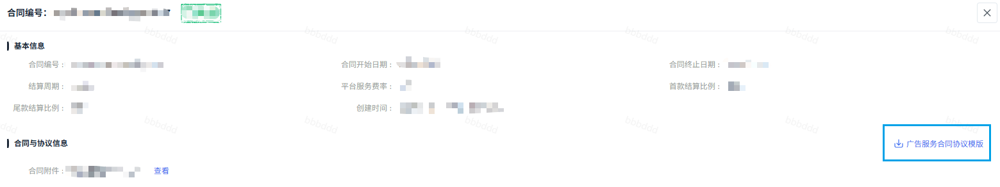
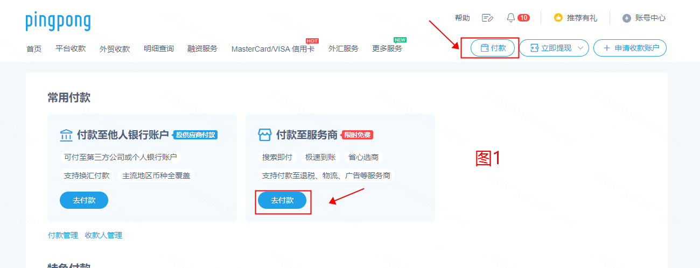
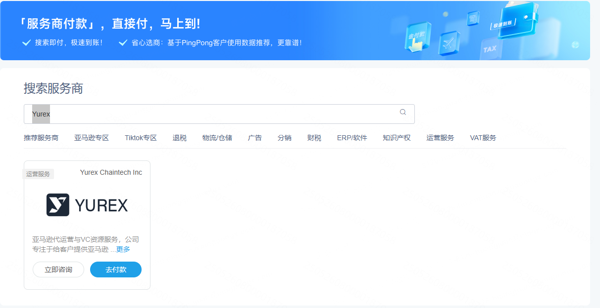
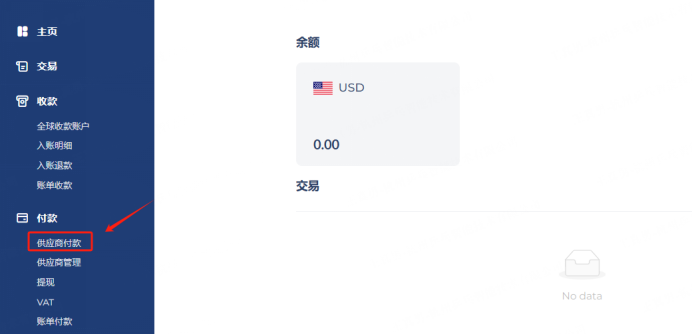
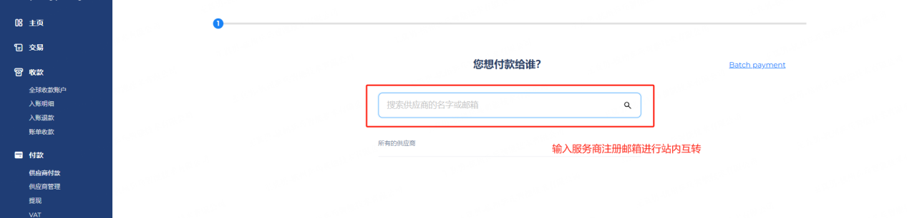
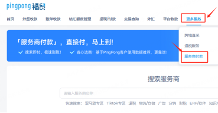
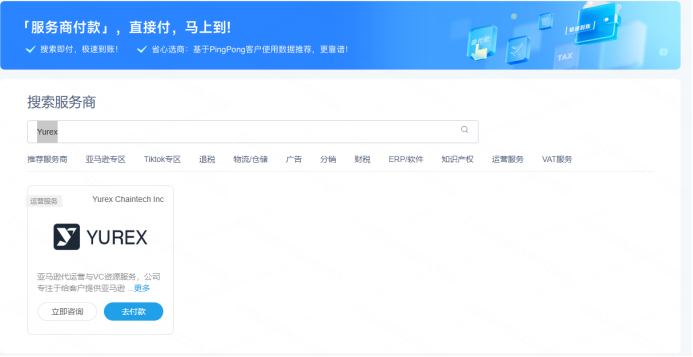
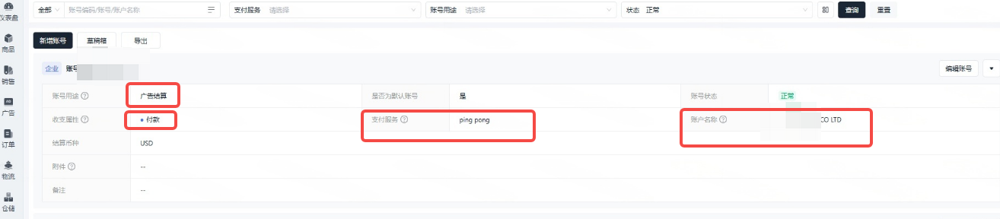
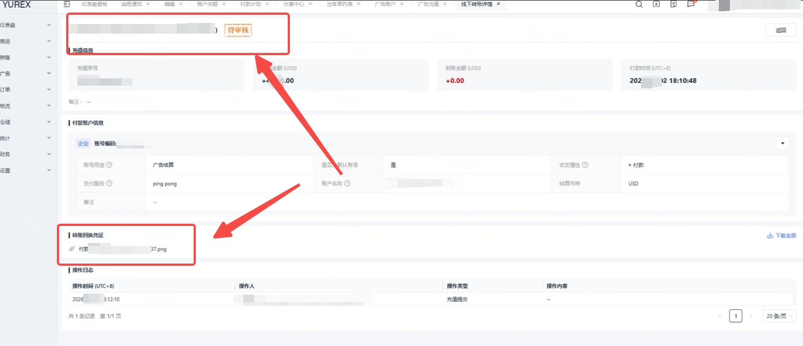

# 飞书文档：广告充值指南

**充值渠道**
1. **首选pingpong**充值
2. 如果pingpong实在充值不了，请选择第二种方式**“线下银行或其他三方平台（Pingpong除外）”**直接转银行收款账号**充值**
3. **货款划拨广告费**

## 一、充值步骤

### 签署广告服务合同

模版下载路径：商品→合同管理→详情；如下图所示，点击下载模板。

1. 填写与上传要求

 1. 需把模版中**乙方信息**和**签订日期**填完整（**乙方信息需与货款签约主体保持一致**）
 2. **盖章后**再联系平台运营经理协助上传至系统
2. 如果未上传悦来广告协议，充值时系统会有弹窗提示，需完善广告服务合同协议后方可进行充值。

### 预充值广告费

#### Pingpong充值

##### Pingpong认证服务商付款

**提示：如客户有pingpong账户，则可以通过pingpong认证服务商方式进行充值**
**到账时效：正常情况1-3小时内**

###### PingPong服务商付款 — 主站跨境电商客户付款路径**(us.pingpongx.com)**

###### 进入付款聚合页

登录PingPong后可通过右上角付款按钮进入付款聚合页：如下图1展示；

###### 进入服务商付款页

进入付款聚合页后点击“去付款按钮”即可进入服务商付款页面；

###### 主站搜索 Yurex

通过搜索“Yurex”，可以直接进行付款。

###### 主站填写付款金额

点击去付款后直接输入需付款的金额即可进行付款。无需用户提交任何认证文件。

###### PingPong供应商付款 — 海外/香港B2B客户付款路径(business.pingpongx.com)

###### 进入供应商付款

登录海外B2B/香港B2B主页，点击左侧供应商付款；

###### 账户间互转

输入服务商注册邮箱进行账户间互转；

###### 服务商注册邮箱为：airwallex@yurexcc.com

###### PingPong服务商付款 — 福贸客户付款路径(flowmore.pingpongx.com)

###### 进入服务商付款

客户登录PingPong后可通过右上角“更多服务”按钮进入服务商付款：如下图1展示；

###### 福贸搜索 Yurex

通过搜索“Yurex”，可以直接进行付款。

###### 福贸填写付款金额

点击去付款后直接输入需付款的金额进行付款。无需用户提交任何认证文件。

#### 线下转账充值

线下银行或其他三方平台充值（Pingpong除外）直接转银行收款账号

##### 使用范围

支持**线下银行、第三方支付平台（Pingpong除外）**向下方收款账户直接转账充值广告费。

注：选用此方式充值广告，ERP系统【支付服务】须选择**“Pingpong”**

示范：

**悦来收款账号：支持线下银行、第三方支付平台（Pingpong除外）**
银行名称 : DBS BANK (HONG KONG) LIMITED
银行所在地 : HONG KONG
账户名称 : Yurex ChainTech Inc
账户类型 : Current
Swift Code : DHBKHKHH
银行账号 : 7982927399
银行地址: 11th Floor, The Center, 99 Queen's Road Central, Central, Hong Kong
公司地址：1214 N Pearl St Denver CO 80203 US

#### 货款划拨广告服务

为优化广告充值体验，我司支持**“货款划拨广告费用”**功能，您可以将支持将计划付款金额的50%（最多）直接转为广告账户余额。具体说明可查看：

## 二、注意事项

1. **优先选用pingpong**进行广告费充值
2. 如果pingpong实在充值不了，请再选择第二种方式**线下银行或其他三方平台（Pingpong除外）充值**
3. **货款划拨广告费**

## 三、常见问题

**Q: 充值广告账户要手续费，有没有什么渠道不用这种收款和广告账号分离的方式？**

A: 供应商转出时银行会收手续费，入账悦来不会额外收手续费的。供应商后续可以用贷款划拨，减轻部分压力。

**Q: 你们运营说的提交充值流程，什么意思以及怎么操作？**

A: 就是转了广告费之后，需要在悦来erp提交转账证明，以便我司财务进行审核到账哦。

**Q: 我作为供应商在给广告账户充值的时候，转账是由另一个公司主体转的，可以吗？**

A: 正常来讲，只要您未转错至非悦来的账户，我司当然能收到。但因为转账主体变了，可能触发银行审核，届时供应商根据再补签一份真实转账公司与Yurex ChainTech Inc. 的新的广告协议即可，模板找对接平台运营经理获取。记得务必是真实转账主体盖章。及时提交审核资料后（即新广告协议悦来提交给银行作为证明），通常1-2个工作日能收到转账，悦来财务就能审核到账啦。

**Q: 充值转账好几天了，为什么还没有到账？**

A: 可以问下你们的银行大客户经理，你们的出账大概需要多久。

**Q: 广告充值会给开发票吗？**

A: 广告可以按月开形式发票；或一次性开几个月，充值一月开一次会有点频繁，具体需要开的时候在艾特悦来财务即可

**Q: 我方款项通过第三方平台转账，按流程需提交对应发票，请问目前能否开具？**

A: 可以开具。

麻烦您提供转账金额，并发送转账水单截图至悦来财务核对，核对无误后出纳会为您开具加盖公章的发票。

补充说明：若广告协议签约主体与实际付款转账主体不一致，需另行签订一份实际付款主体抬头的广告协议，作为配套审核材料提交。
