# Airwallex 空中云汇新用户注册指南

## 注册注意事项

1. 涉及月回款和流水部分，务必选择大于 5W 的档位，否则会被系统自动拒绝，申诉过程非常漫长。
2. 美国主体注册需要企业邮箱。
3. 需要证件：营业执照、法人实名手机号（无需接收验证码）、法人身份证件照片、股东身份证件照片。
4. 业务相关地点务必不选择制裁国家，例如俄罗斯。
5. 注册时不开 VPN，使用独立设备和独立网络注册。
6. 法人是否能人脸：大陆抬头如果无法配合人脸，请在指引中“3.9 以下哪位是您本人”选择“以上都不是”，并提交验证人的身份证件和人脸。
7. 如果是境外主体注册，法人扫码验证请使用相机扫码。

## 注册步骤

### 第一步：打开注册链接

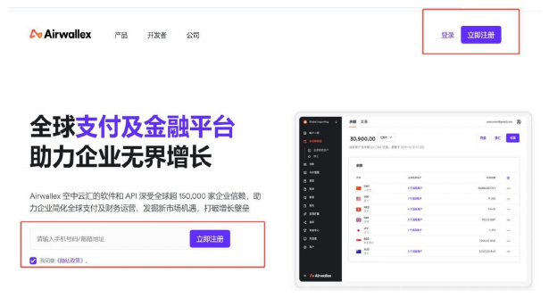

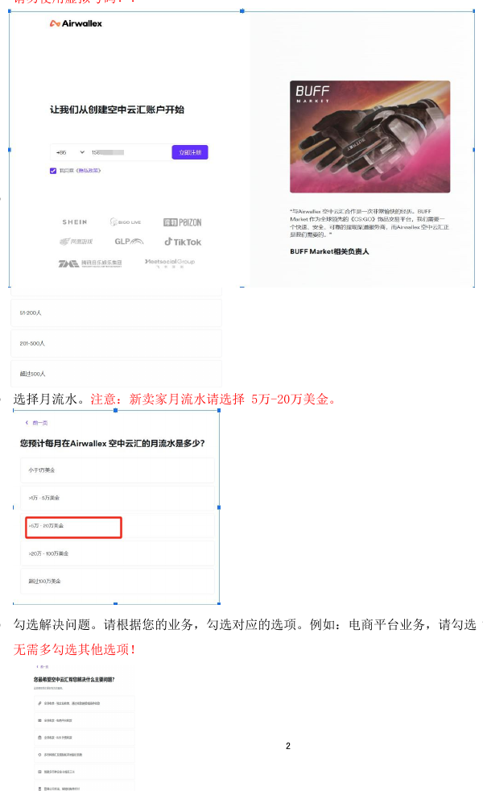

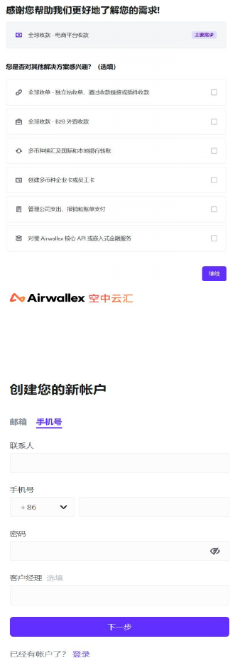

注册链接：https://www.airwallex.com/app/signup?sfcid=701Q800001G0fEMIAZ

1. 点击页面“立即注册”按钮。
2. 用真实手机号注册，点击“立即注册”按钮获取短信验证码，输入验证码完成手机号验证。请勿使用虚拟号码。
3. 选择企业员工。
4. 选择月流水。新卖家月流水请选择 `5万-20万美金`。
5. 勾选解决问题。请根据业务勾选对应选项，例如电商平台业务请选择“全球收款”，无需多勾选其他选项。
6. 勾选其它（选填）。

### 第二步：邮箱验证

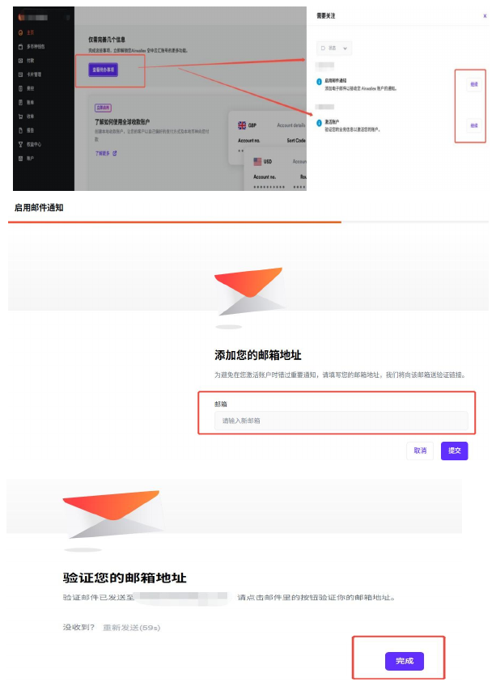

1. 成功登录账户后，找到“查看待办事项”并点击进入。
2. 启用邮箱通知，继续填写需要绑定的邮箱。
3. 系统将发送验证码到邮箱，请注意查收。
4. 若超时未收到验证邮件，可再次尝试发送验证码，并检查邮件是否进入垃圾箱或被屏蔽。

### 第三步：激活账户

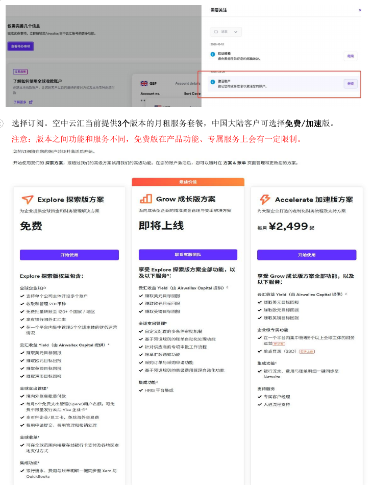

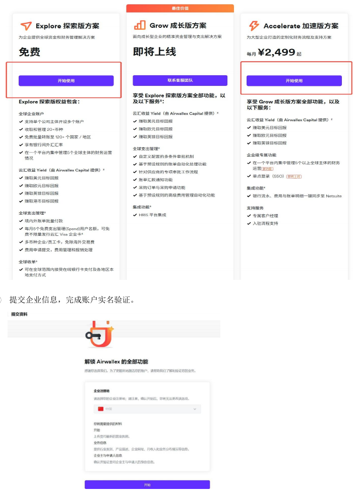

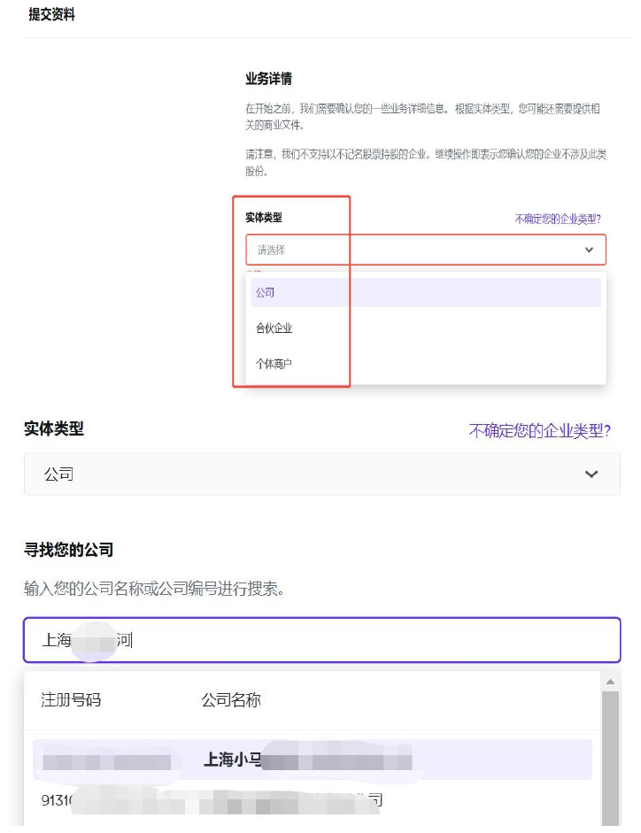

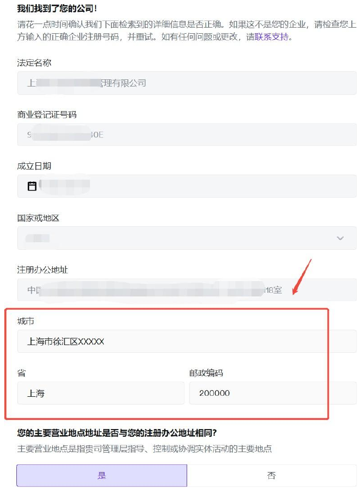

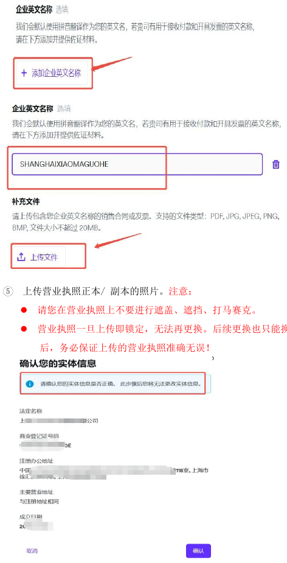

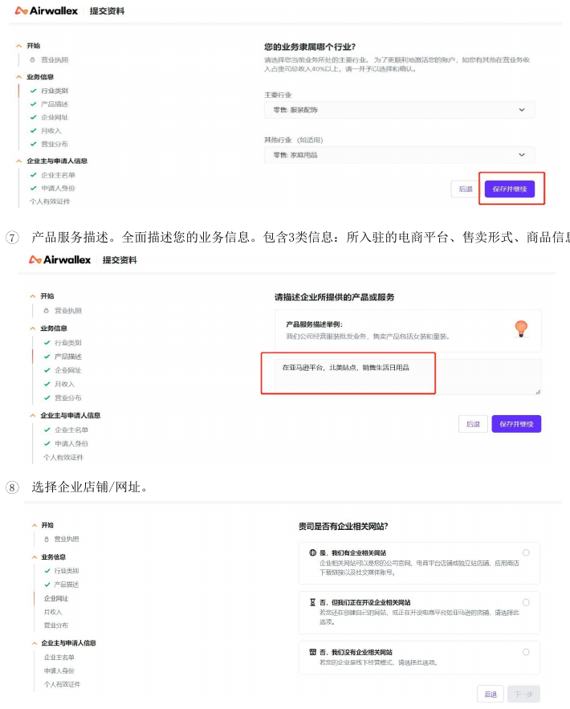

1. 点击“激活账户”。
2. 选择订阅。空中云汇当前提供 3 个版本的月租服务套餐，中国大陆客户可选择免费版/加速版。注意：版本之间功能和服务不同，免费版在产品功能、专属服务上会有一定限制。
3. 提交企业信息，完成账户实名验证。
4. 确认企业营业执照。根据企业情况选择对应实体类型；工作室请选择个体工商户。
5. 若企业有英文名称，可填写英文名称。
6. 上传营业执照正本或副本照片。注意：
   - 请勿在营业执照上遮盖、遮挡或打马赛克。
   - 营业执照一旦上传即锁定，无法再更换；后续更换只能换手机号重新注册。上传后务必保证营业执照准确无误。
7. 选择行业。请根据真实业务情况选择对应行业，例如亚马逊、独立站客户推荐选择“零售”。
8. 填写产品服务描述。全面描述业务信息，需包含入驻的电商平台、售卖形式、商品信息。
9. 选择企业店铺/网址：
   - 已有网站、网上店铺（亚马逊、独立站、ETSY、eBay）且已搭建完成，选择对应已有店铺选项。
   - 网站正在建设中，选择建设中选项。
   - 如果是亚马逊平台卖家，请提供亚马逊招商经理下发的注册邮件截图，或注册亚马逊邮箱截图给空中云汇客户经理。邮件截图需包含邮箱。
   - 从事线下业务时，上传对公账户银行账单流水文件或截图。
10. 月收入：根据店铺经营情况选择对应区间。新卖家建议选择 `50,000 CNY以上`。
11. 业务地点：请选择业务开展地点，或入驻的亚马逊站点；也可统一选择美国。注意不要选择经济制裁国家，例如伊拉克、伊朗、俄罗斯，宁可少选不要多选。
12. 确认企业主名单。确认公司董事（法人）和受益人（股东）信息；若以上均不是，请选择“在这里更新”。

### 第四步：身份验证

#### 法人本人注册

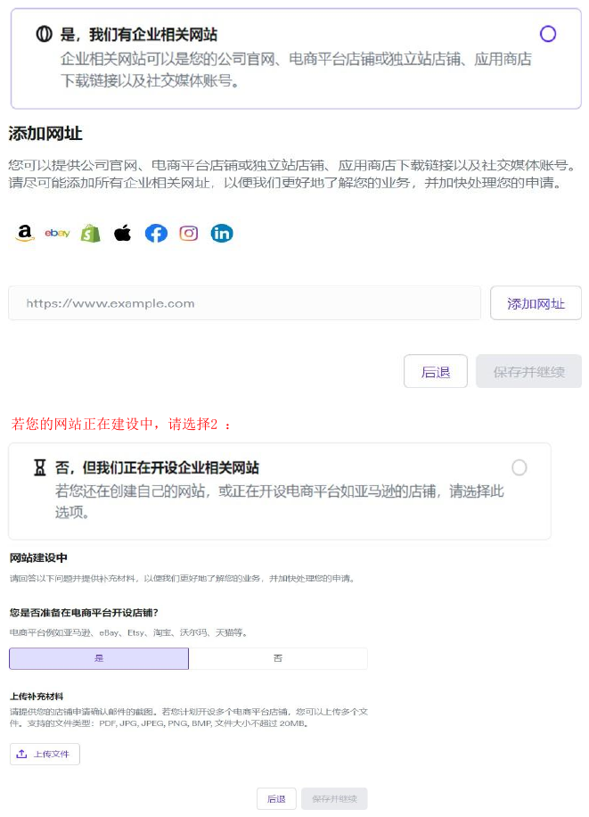

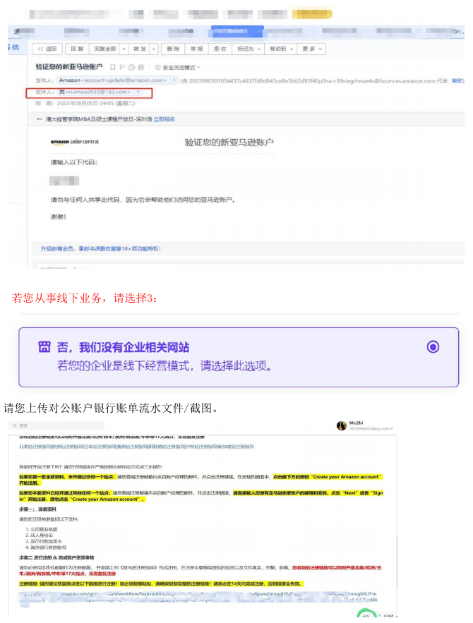

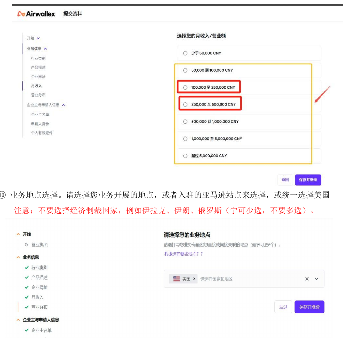

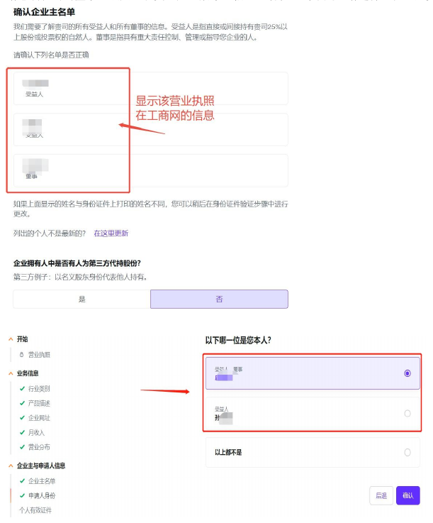

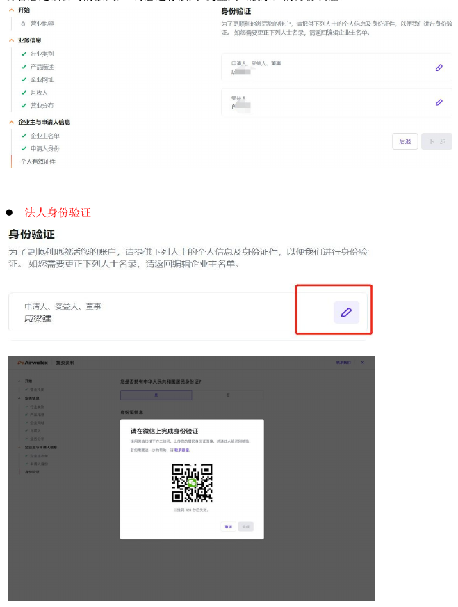

如果注册人是该公司的法人，请进行法人 + 受益人（股东）的身份认证。

- 法人身份验证：按页面要求提交法人证件及认证信息。
- 股东身份验证：上传股东身份证信息，并提供股东实名认证手机号。

#### 第三人代注册

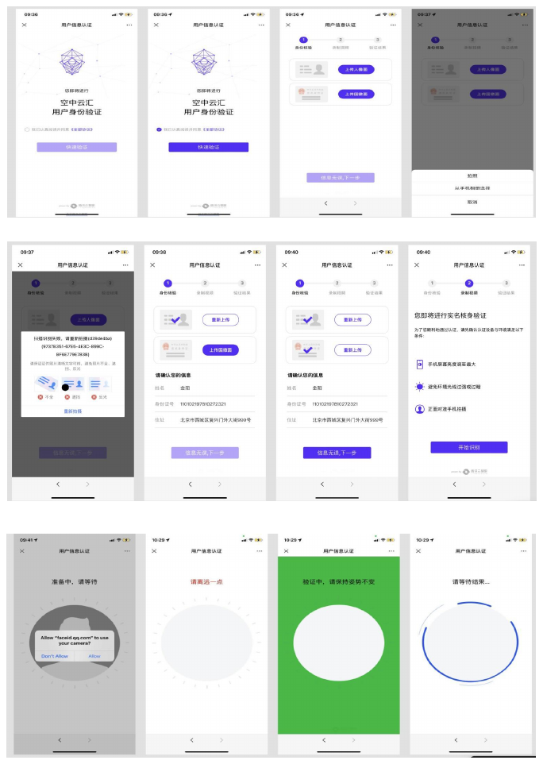

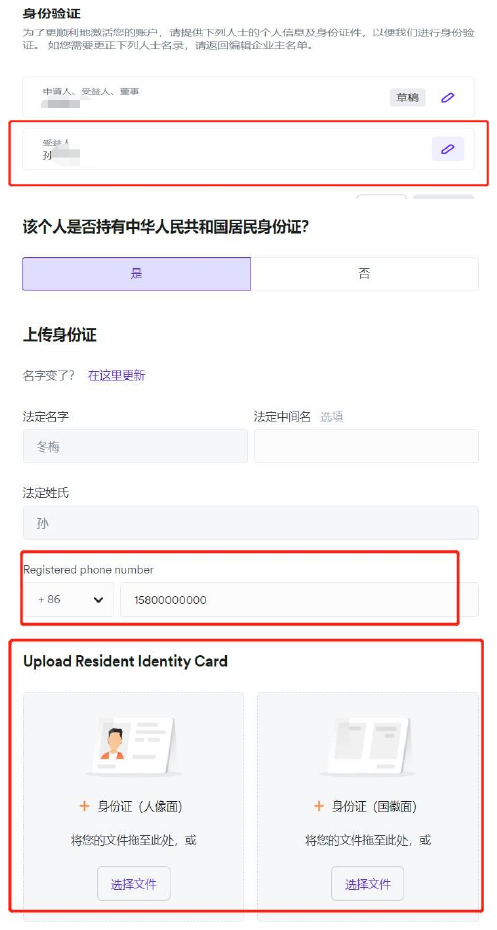

如果是公司财务、运营人员代注册账户：

- 代注册人需要进行人脸识别。
- 法人/股东需提供身份证信息和实名手机号。

### 第五步：提交资料并进入审核

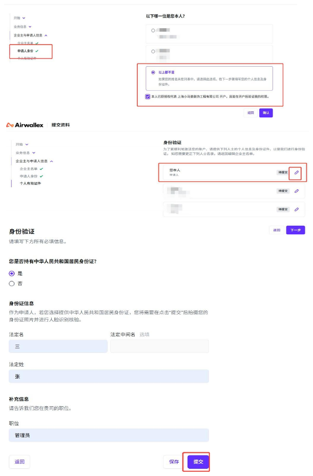

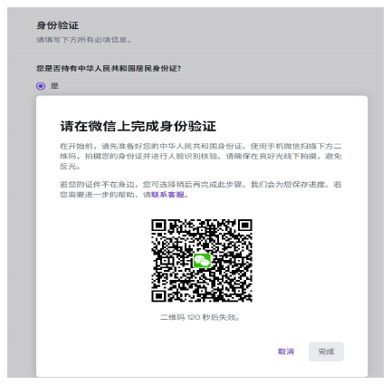

1. 以上信息填写完毕后，点击“提交”。
2. 提交信息后，账户将进入审核状态。
3. 请将注册账户的手机号和邮箱提供给空中云汇客户经理。
4. 审核预计 3-5 个工作日，请耐心等待。
