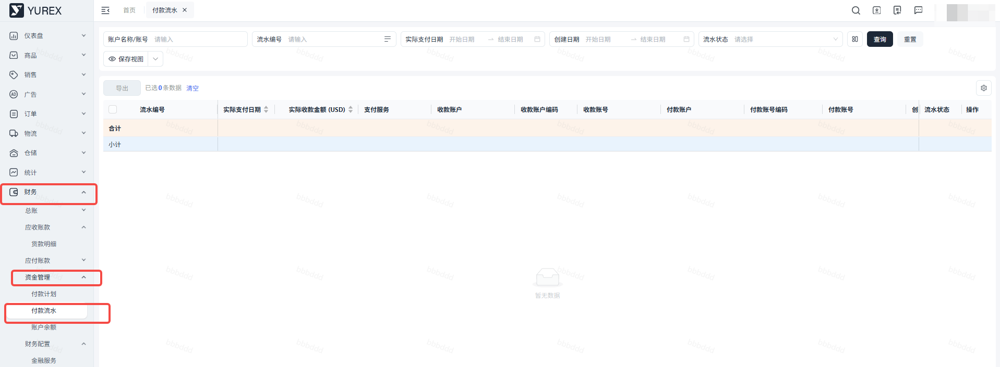
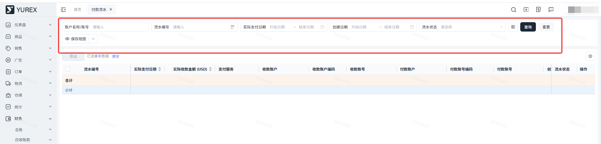

# 飞书文档：付款流水

## 文档信息

| 项 | 内容 |
| --- | --- |
| 远程文档 | https://q1njej8cpab.feishu.cn/wiki/CIHewcrx3iIHcukJhIEcPd9QnCb |
| 图片处理 | 本地下载（assets/images） |
| 快照时间 | 2026-08-06 |
| 来源命令 | `lark-cli docs +fetch --api-version v2 --doc https://q1njej8cpab.feishu.cn/wiki/CIHewcrx3iIHcukJhIEcPd9QnCb --doc-format markdown --as user --format json --jq .data.document.content` |
| 格式处理 | fd-doc-markdown-sync/scripts/normalize-feishu-doc-markdown.mjs |

---

付款流水

当前版本：v1.0.0

## 功能介绍

当付款计划进入支付流程时，就会在付款流水列表中进行展示，默认状态为待支付。在支付完成后，会进行站内信消息通知，同时也可在此模块查看对应的支付证明。

## 名词解释

| 名词 | 释义 |
|-|-|
| 实际支付日期 | 针对这笔金额实际进行支付的日期。  通常情况下会跟计划付款日期一致。特殊情况：如遇节假日或需求合并多次计划货款金额，可能会导致实际支付日期与计划付款日期不同。 |
| 实际收款金额 | 在对应日期实际收到的金额。 |
| 附件 | 在打款完成后会上传对应的付款截图。 |

## 注意事项

当您对付款流水存在疑问时，可联系对应的财务管理员。

## 操作流程

##

#### 操作路径

【财务中心】-【资金管理】-【付款流水】

#### 搜索

可对流水信息进行筛选。

##

点击相关数据可查看对应的流水详情。

- 关联计划：可查看当前付款流水关联对应的计划及月度账单编号。若存在多个则会展示多条计划。
- 收付款账号：当前付款流水对应的账号信息。
- 附件：当前付款流水对应上传的付款截图。

##

根据当前展示信息进行导出，即跟搜索条件来导出，可按需进行导出。
