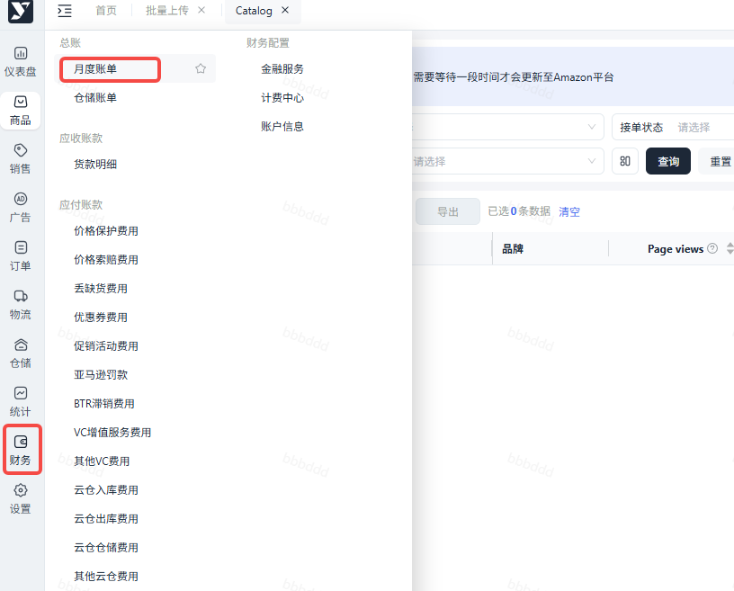
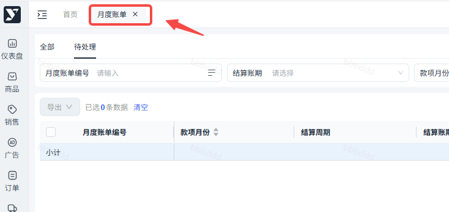
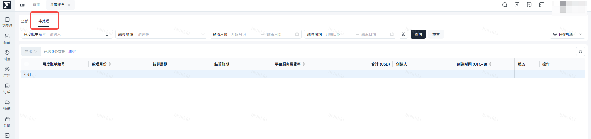

# 飞书文档：月度账单

## 功能介绍

财务会根据合同约定的结算范围的业务数据，生成对应的月度账单。供应商可对月度账单进行审核，审核通过后，则会纳入付款计划中，按照付款计划进行打款。

## 名词解释

| **名词** | **释义** |
|-|-|
| 月度账单 | 根据合同约定生成对应结算范围的月度总账。月度账单含有的款项暂为VC渠道结算单。 |
| 申诉 | 对月度账单存在异议，可提交工单进行申诉。 |

## 注意事项

1. 若对生成的月度账单存在疑问，可提交工单也可以联系对应的运营人员进行询问。

## 操作流程

### 操作路径

【财务】-【总账】-【月度账单】-【待处理】

### 展示及搜索

可根据筛选条件筛选数据，点击查询后列表展示符合条件的数据。

1. 全部：默认展示不为【已作废】的月度账单信息。
2. 待处理：展示【待审核】状态下的月度账单信息。

### 月度账单详情

不同状态下，月度账单的信息可能会有所不同。

1. 待审核：针对【待审核】的月度账单可进行【申诉】和【通过】操作。
2. 申诉中：针对【申诉中】的月度账单可进行【撤销申诉】操作。

### 审核账单

当接收到月度账单后，可对推送的月度账单进行审核（申诉或通过）。

#### 申诉

若对生成的月度账单存在异议，则可点击【申诉】，申诉将联动工单。进行申诉后，会有对应的财务人员跟进处理申诉问题，同时，月度账单的状态也会扭转为【申诉中】。

且可以在工单中查看对应的处理情况。

#### 撤销申诉

申诉后，若发现月度账单无问题，可点击【撤销申诉】，对应月度账单的状态将会扭转为【待审核】，需要您重新进行审核确认。

#### 确认

若对生成的月度账单没有异议，则可点击【确认】。

需上传对应的回执单进行确认，可下载**回执单模板**进行**参考**。

回执单：点击**导出回执单**即可下载对应的月度账单信息，**进行盖章即为回执单**。**需注意上传应为PDF格式。**

1. 可批量导出或指定数据导出，可按需进行导出。
2. 若需导出明细数据，可在列表或详情页点击【月度账单详情】-【货款明细】-【导出订单】，即可导出对应月度账单的明细数据。
3. 在月度账单详情里点击【导出回执单】，即可导出该月度账单进行盖章后上传确认。
