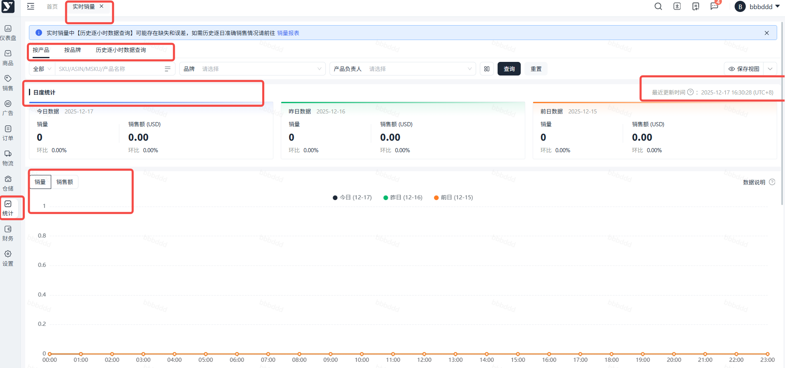

# 飞书文档：销售分析

## 操作步骤：【统计】-【销售分析】

销售分析数据源于亚马逊销售报表&品牌分析报表，Yurex将数据按不同维度拆分为以下功能模块：
1. 销量看板：销售与流量数据二合一。支持多时间维度（日/周/月等）筛选与联动分析，精准洞察销售趋势。
2. 实时销量：追踪过去 72 小时数据（小时级实时更新），帮助您快速掌握动销，敏捷调整策略。
3. 销量预测： 展示亚马逊未来 30 周预测数据。虽不等于最终 PO 单量，但为备货计划提供重要参考。
4. 库存报表：展示VC库存，细分展示可售库存、不可售库存（残损/退货）、 90 天以上滞销库存等。
5. 类目报表：展示所有Offer的类目归属及补货状态，卖家可在此监控，防止类目错误导致流量异常。
6. ABA搜索词：同步亚马逊热门搜索词数据，为Offer 优化、关键词收录、广告选词等提供官方依据。

### 销量看板

支持查看 ASIN 或品牌的历史销售趋势，可通过“添加指标”丰富图表维度。

注意：

- 历史数据会动态更新，请以当前显示为准
- PO 销量/销售额均已扣除 DF 订单，仅供参考

### 实时销量

源自亚马逊VC后台 Real time sales 报表，统计近 3 天/72h销量与销售额。

注意：

- 当天： 0点至最新1h的累计数据
- 前两天： 2\*24h=48h的完整2天数据

### 销量预测

展示亚马逊未来 30 周的销量预测数据。

注意： 预测值仅供备货参考，不代表最终 PO 采购量。

### 库存报表

VC库存概览： 含在库、在途及滞销等数据。

### 类目报表

展示各 ASIN 的类目及上线时间。

注意： 仅显示ASIN最新类目相关数据，不支持历史查询。

### ABA搜索词

展示搜索词排名（值越小热度越高）、趋势变动，以及 TOP3 商品的点击与转化份额明细。

