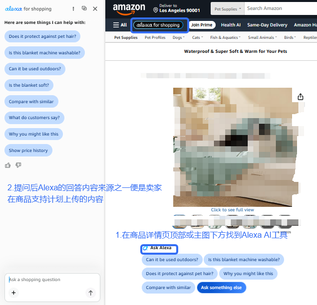
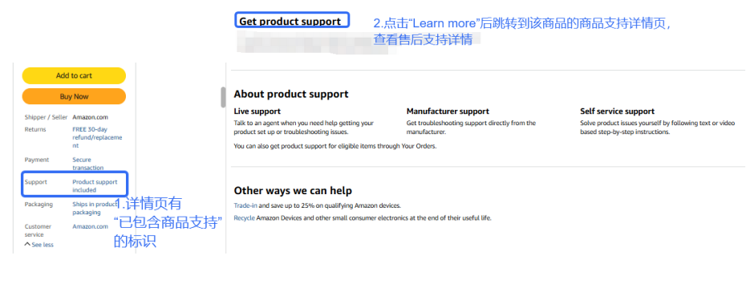
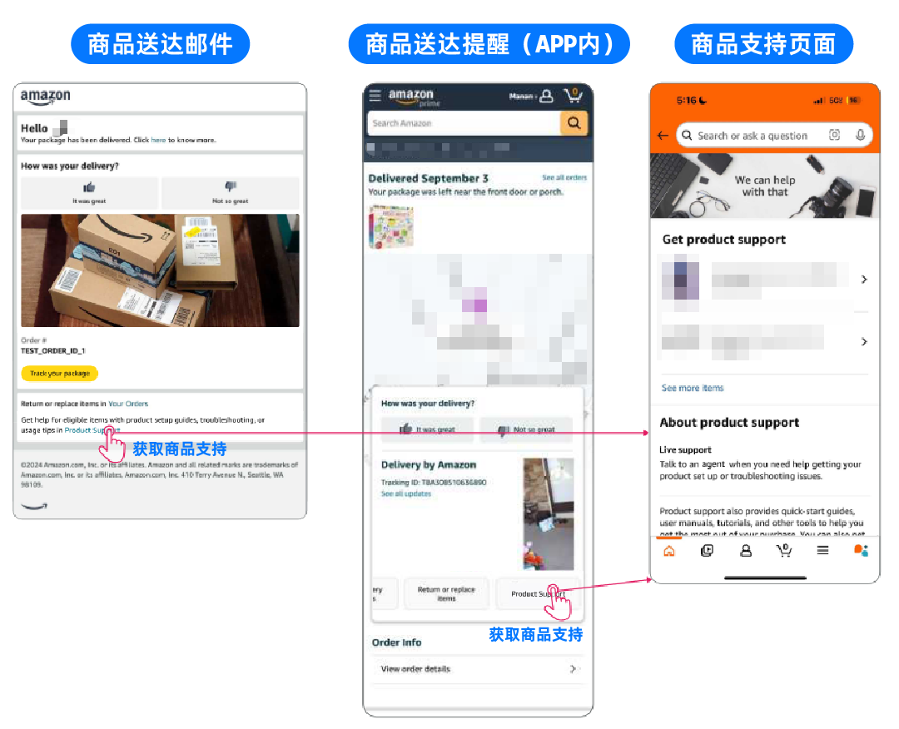
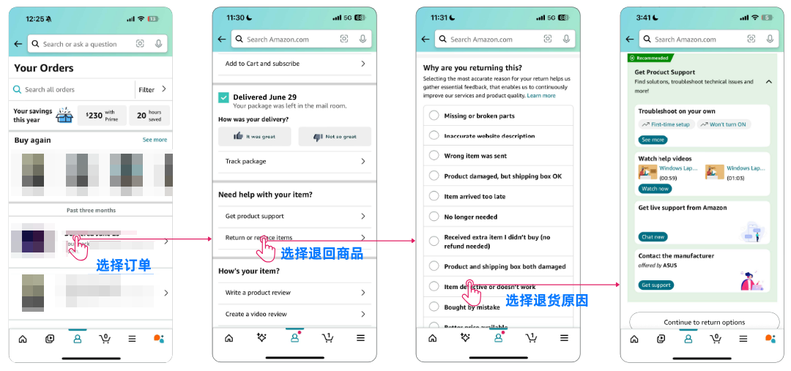
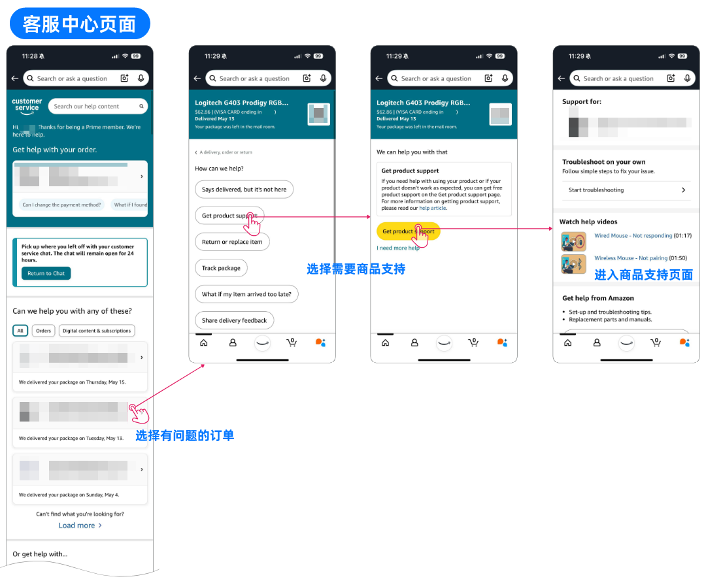
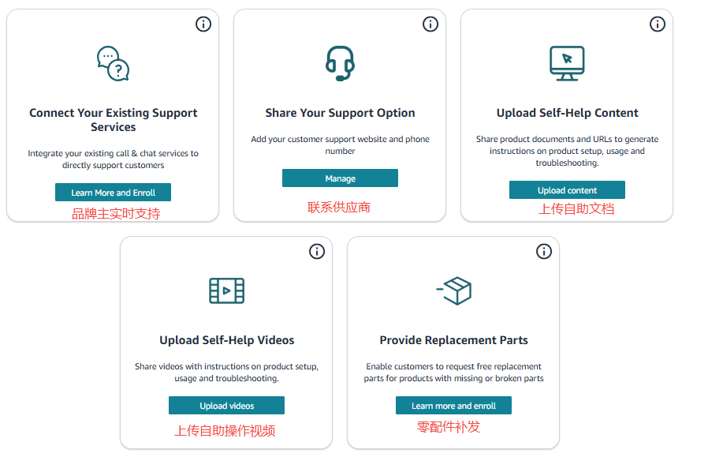
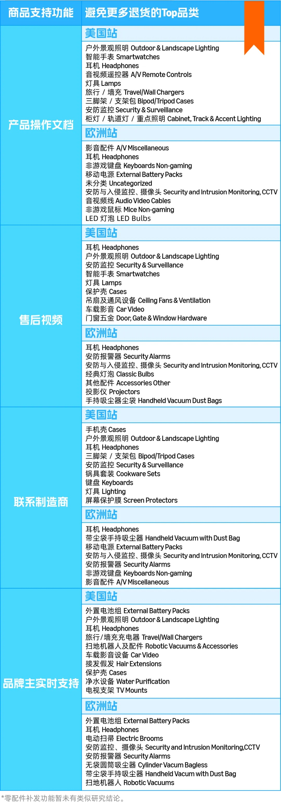

# 飞书文档：亚马逊商品支持计划

亚马逊商品支持计划

**内容概要：**
亚马逊产品支持为平台免费主动式售后工具，优势：
1. 提前化解买家使用难题，减少退货
2. 优化购物体验，降低潜在负面评价
3. 省去退货物流开销，压缩运营开支
建议卖家尽早开通，优先启用操作指南、售后视频两大基础功能，低成本易出效果。带配件类产品搭配零件补发功能，可大幅减少订单损失。

## 何为亚马逊商品支持计划？

### 定义

亚马逊商品支持（原 PLS 商品生命周期支持）是平台官方**免费**售后工具，可在买家申请退货前主动介入，以教程指导（如安装视频、操作手册）、客服对接、补发配件等方式解决使用问题，有效拦截不必要退货，助力卖家降低退货率、节约成本，提升买家好感与品牌口碑。

### 效果

以上数据为亚马逊官方公布

参考：2025年，Google 通过加入亚马逊的商品支持计划，成功避免了70%+的买家退货。

## 买家在哪里看到商品支持？

### 售前（2处）

#### **通过商品详情页的 Alexa for shopping**

消费者在商品详情页与Alexa for shopping互动时，除商品详情页与Q&A信息外，Alexa for shopping 也会学习卖家在“商品支持“上传的内容，解答消费者的问询。

#### **购物车下方Product Support Included**

开通商品支持的ASIN，会在Buybox下方显示「Support—Product Support Included」标签，向顾客传递售后保障，并支持一键跳转至商品支持详情页。

### 售后(5处）

#### **Alexa for shopping**

Alexa for shopping（ AI助手） 基于消费者已购商品的商品支持内容，提供使用指导和故障排查指南。

#### **邮件和APP提醒（仅US）**

在商品送达的邮件与APP提醒中，引导用户访问“商品支持”页面，内含“零配件补发”选项。

#### **订单页面**

在订单页面，选择对应的商品，可以直达商品支持页面，查看卖家注册了的解决方案。

#### **退货流程**

点击“退回或更换商品”后，勾选退货原因，自动弹出商品支持页面。

#### **客服中心**

顾客选择有问题的订单，选择“获取商品支持”，进入商品支持页面。

## 商品支持的5个功能项目

### 联系制造商（Share Your Support Option: Website & Phone Number）

1. 定义：为了帮助买家获得商品支持，请共享您的**支持网站和电话号码**以关联您现有的支持服务。买家可以通过此信息直接与您联系。
2. 功能描述：卖家留下售后电话或官网售后网址，让买家能直接联系品牌方寻求帮助。
3. 适用场景：需要专业售后支持的产品、技术含量较高的产品。
4. 优缺点：

 - 优点：人工介入可处理复杂问题，买家退货意图拦截效果最好。
 - 缺点：需配置外语客服团队，产生人力成本；URL 禁止指向商城主页或促销页面，仅售后联系页面。

入驻此项目的供应商需已搭建自己的专业客服团队，且需具备当地外语水平。

### 品牌主实时支持（Connect Your Existing Support Services: Call & Chat Services

1. 定义：集成您现有的**电话和在线聊天服务**，以便直接为客户提供支持
2. 功能描述：让卖家的客服团队直接为买家提供实时在线支持。
3. 适用场景：有独立客服团队的品牌卖家
4. 开通条件：

 1. 已完成品牌备案
 2. 有独立客服团队，且支持本地语言和当地时区
 3. 已开通“联系制造商”功能
5. 优缺点：

 - 优点：实时互动转化率高，对买家遇到的问题能够及时给出帮助，能有效减少退货。
 - 缺点：门槛最高，需成熟的海外客服体系。

入驻此项目的供应商须已搭建好专属客服团队，具备当地语言水平和按当地时区实时提供售后服务。

### 上传自助操作视频（Upload Self-Help Videos）

1. 定义：为您的注册商品上传操作视频，以演示故障排除步骤、安装流程或详细的商品概览。清晰的可视化操作说明有助于减少混乱，避免不必要的退货。
2. 功能描述：**上传产品安装、使用、故障排除的视频教程**，让买家自助解决问题。
3. 适用场景：安装复杂的产品、需要演示操作的产品（如健身器材、电子产品、家具组装等）。
4. 优缺点：

 - 优点：一次制作长期复用，大幅降低“不会用”导致的差评。
 - 缺点：视频制作门槛较高，欧洲站审核周期较长（约 15 天）。

### 上传自助文档（Upload Self-Help Content）

1. 定义：共享您的现有商品支持文件，帮助买家快速解决问题。亚马逊会将您为注册的商品上传的文件和 URL 转换为分步故障排除说明。这些资源不仅能够直接为买家提供支持，还有助于增强亚马逊的 AI 工具，使其在买家最需要的时候提供更准确、更及时的指导。
2. 功能描述：**上传PDF格式的说明书、操作指南**，买家可随时查阅。
3. 适用场景：所有类型的产品（作为基础售后配置）
4. 优缺点：

 - 优点：制作成本低，适合几乎所有产品。
 - 缺点：对用户阅读意愿有依赖，引导性弱于视频。

### 零配件补发（Provide Replacement Parts）

1. 定义：**为丢失或残损的零部件提供换货**。借助此选项，亚马逊买家可以直接向您申请丢失或残损的零部件，而无需支付额外费用，从而避免了退回整个商品。此解决方案可改善买家体验，并帮助您减少退货。
2. 功能描述：允许买家在退货窗口内**免费**申请缺失或损坏的配件，无需退回整件商品。
3. 适用场景：含配件的产品（如家具的螺丝、电子产品的充电线、玩具的零件等）
4. 优缺点：

 - 优点：用较低的配件成本避免更高金额的退货亏损，ROI 极高。
 - 缺点：需维护配件库存与发货，配件成本和补发运费由卖家承担，一定程度上增加了卖家成本。

### 5个项目对比

## 如何开通商品支持项目？

### 开通要求

1. **基础门槛：VC账户状态正常，商品需为VC已上架ASIN，已完成亚马逊品牌备案。**
2. 售后视频：无额外门槛。
3. 产品操作文档：无额外门槛。
4. 联系制造商（电话/网站）：需提供有效的售后网站URL和电话号码，URL不得包含购物车或促销导购元素。
5. 品牌主实时支持（电话/在线聊天）：完成品牌备案，且拥有本土客服团队。
6. 零配件补发：

 1. 零配件补发计划仅通过直接履约（DF）进行配送，所有零配件补发订单均通过 DF 工作流程处理，直接从供应商海外仓发货。即使某零配件ASIN 在亚马逊物流中心（FC）中有PO库存，零配件补发计划也不会调用。
 2. 若要参与该计划，您需要设置一个专用的虚拟仓库（命名为“Replacement Parts”），并将您的代发货库存导入其中。当消费者提交零配件补发请求时，系统将生成一个 DF 订单发送给您进行履约。一个Vendor code 仅支持设置一个零配件补发虚拟仓。
 3. 零配件补发计划所产生的费用由供应商承担。
 4. VC-DF模式的商品也可以入驻，可直接与补发零配件团队邮件联系。
 5. 参与零配件补发计划的配件商品，在创建ASIN时无需填写UPC，亚马逊会针对VC Code和品牌名称设置UPC豁免。运营在填写ASIN创建模板时，请将“外部ID豁免原因”字段设置为“Part“，以绕过UPC要求，VM将负责协调亚马逊平台端的豁免设置。
7. **所有商品支持计划项目须在SC与VC独立开通，相关文档资料不会自动同步，在SC上传后仍需在VC重新上传！**
8. 所有商品支持计划只能是在哪个账号开通，就在哪个账号申请退出。

### 开通流程

#### 快速入口

2025年10月起，亚马逊推出了统一的产品支持注册门户，卖家可在一个页面完成所有功能的注册。通过快速链接（QA有附上）进入亚马逊商品支持页面 → 选择需要开通的项目 → 按要求填写内容 → 提交审核 → 等待审核通过 → 前台listing商品详情页Buybox下方会显示Support-Product Support Included。

#### 开通方法

##### 联系制造商：品牌售后网站URL 和 电话号码

1. 开通方法：联系您的平台运营经理
2. 准备以下信息：

 - 目标 ASIN 列表
 - 客服电话（含国家区号）或品牌售后网站 URL
 - 支持语言及服务时间（如：English, 9AM-6PM PST）
3. 发送邮件至指定平台服务([YR-Service@yurexcc.com](mailto:YR-Service@yurexcc.com))，邮件主题注明“ Manufacturer Support Enrollment”。

注意：
- 电话需为真实有效的售后专线，亚马逊可能进行抽查验证。
- 售后 URL 禁止导购、促销元素。

##### 品牌主实时支持：在线聊天 或 电话联系

1. 开通方法：联系您的平台运营经理
2. 开通条件：

 1. SC已完成 Amazon Brand Registry（品牌备案），且用SC的品牌授权店铺给VC授权品牌代表角色，**VC仍需重新上传相关内容**。
 2. 拥有本土语言/时区的客服团队
 3. 已开通“联系制造商”功能

注意：
- 需确保客服团队能在承诺的服务时间内实时响应。
- 聊天工具集成由亚马逊侧完成，卖家无需技术对接。

##### 上传自助操作视频：Setup 或 Troubleshooting 类的帮助视频

1. 开通方法：联系您的平台运营经理
2. 格式要求：视频文件建议 MP4 格式，时长控制在 2 分钟以内。

注意：
- 在上传售后相关视频时，请务必在视频类型中选择 Setup或 Troubleshooting ，这样，您的视频才会被默认为当顾客申请售后视频服务时呈现的视频。
- 视频过审核后会出现在商品详情页的“Videos”区域，同时在买家订单页的“获取产品支持”中展示。

##### 上传自助文档：售后帮助文档，如操作指南、FAQ等，或文档的URL。

1. 开通方法：联系您的平台运营经理
2. 格式要求：文档类型为上传 PDF、.docx 或 .xlsx 格式的操作手册，文件大小20M以内。

注意：
- **重要提示：自助文档请提交给您的平台运营经理。**
- URL 页面仅限售后支持内容，不得包含促销/购买入口，否则将被驳回。

##### 零配件补发：免费给消费者提供缺失或损坏的零配件

1. 适用性说明：该功能对 Vendor Central 的开放程度因类目和地区而异。部分 Vendor 账户可能暂未获得直接访问权限。
2. 开通方法：联系您的平台运营经理
3. ASIN匹配模板：

 注意：
 - 为加入零配件补发计划的零配件创建了ASIN后，暂不设置可售库存，请在匹配模板中填写哪些零配件应该匹配到哪些原始商品。
 - 提交匹配模板后，亚马逊团队将隐藏零配件报价。收到亚马逊确认注册的邮件后再添加零配件可售库存。
 - **重要提示：请务必等到亚马逊PLS团队邮件通知已完成注册，再上传零部件库存，否则顾客将能够免费下单购买。**

## 给供应商伙伴的运营建议

#### 开通优先级

1. **第一优先级（必开）**

- 产品操作文档（几乎所有产品都适用）
- 售后视频（如有复杂操作）

1. **第二优先级（强烈建议）**

- 零配件补发（如产品含可替换配件）
- 联系制造商（如有专业客服能力）

1. **第三优先级（品牌进阶）**

- 品牌主实时支持（有专业客服团队的品牌卖家）

1. **不同阶段卖家选择**

- 新手卖家：从“售后视频+产品操作文档”开始，成本最低
- 品牌卖家：建议全部开通，形成完整售后闭环
- 配件类产品：优先开通“零配件补发”，效果最直接

#### 实操需注意

1. 关于URL：填写的URL严禁包含任何购物车功能或促销导购元素，必须是纯售后支持页面，否则被判定“站外导流”将导致审核失败或功能撤销，严重的甚至直接封店。
2. 关于自助视频：视频内容应聚焦常见卡点，而非完整说明书；请确保视频使用该店铺的主要语言，并包含对应的产品。
3. 关于零配件补发：建议从退货率最高的ASIN开始测试，快速看到效果；需对比配件成本+运费与整机退回的成本差异；买家订购配件后，原产品的退货期限自动延长14天。

#### 运营的行动

1. 立即自查：访问卖家平台 → 商品支持页面，查看所在类目是否已开放该功能。同时，联系您的平台运营经理确认VC是否已开通相关功能。
2. **优先覆盖高退货率ASIN：从退货报告筛选因 “不会用 ” “说明书看不懂” “安装难” “缺配件” 导致退货的ASIN，优先配置售后视频+操作文档+零配件补发。**
3. 追踪效果：关注商品退货率变化，同时需关注每月第二周收到的“Product Support Performance Report”邮件，分析各功能模块的退货拦截数据，持续优化内容配置。
4. 建立完善的售后SOP：确保售后客服团队已制定好完善的SOP，以高效处理亚马逊售后订单。

#### 利用Alexa for shopping

1. **制作“AI助手友好型”内容：**

- 15-30秒简洁且有针对性的视频，便于AI精准匹配
- 文档结构清晰，按问题类型分步编写

1. **及时更新内容：**

- 商品支持内容被纳入Alexa for shopping知识库后，内容的时效性直接决定AI回答的准确性和推荐优先级，每当产品迭代或退货原因变化时，同步更新商品支持内容，确保知识库与实际产品状态一致，否则Alexa AI 可能向买家推送过时信息，反而制造退货理由。

#### 适合开通的品类

亚马逊研究表明，最适合用亚马逊商品支持来降低退货的品类，**集中在：智能穿戴、音频影音、照明灯具、安防监控、充电/电源、数码配件、家居小家电、家居用品。**

具体清单如下，类目卖家建议优先开通使用：

## 亚马逊商品支持计划Q&A

**Q1：亚马逊商品支持计划收费吗？**

A1：完全免费。卖家仅需承担自身客服人力及补发零件的成本 。

**Q2：开通后多久生效？**

A2：售后视频/文档/制造商信息约 2-14 天；零件补发需等 PLS 团队确认后上传库存即生效 。

**Q3：顾客滥用零件补发怎么办？**

A3：亚马逊设有保护措施，会自动排除客户的可疑行为。此外，卖家可以自己控制哪些配件加入这个计划。

**Q4：开通亚马逊商品支持计划后可以退出吗？**

A4：可以。提前 15 个工作日发邮件至对应站点 PLS 团队申请退出 。**需注意，亚马逊商品支持计划的所有功能都是在哪个账号开通就在哪个账号退出，开通和退出相关功能SC和VC是独立操作的。**

**Q5：开通亚马逊商品支持计划后如何追踪退货率下降趋势效果？**

A5：有以下方式：
SC可以查看return report 和 退货洞察报告
关注每月第二周收到的“Product Support Performance Report”邮件，分析各功能模块的退货拦截数据，持续优化内容配置。商品支持报告按月反馈，报告包含一个月的数据表现，卖家收到报告的时间是在三个月后，比如2026年4月收到的2026年1月的报告，5月收到2有的报告，以此类推。

**Q6：所有类目都能开通此计划吗？**

A6：不是所有类目都能开通此项目，但除了亚马逊FBA不可配送的危险品、卫生用品、不可退货商品以外的大部分消费类目都支持，建议在SC后台具体注册门户查询，或联系您的平台运营经理。
- SC后台快速入口：https://sellercentral.amazon.com/productsupport

**Q7：卖家参与本计划将产生哪些费用？**

A7：加入亚马逊商品支持计划本身没有任何费用，但开通零配件补发项目后给消费者补发零配件的相关费用由供应商承担，如配件成本、配送费、关税等。

**Q8：零配件补发计划的订购窗口是多久?**

A8：客户可以在父ASIN的退货期内订购。客户订购零配件后系统会将原产品的退货期限延长14天。

**Q9：如果客户订购了错误的零配件怎么办？**

A9：为了避免这个情况，卖家可以提供清晰的图片和描述。另卖家还可以控制每个主商品ASIN可选的零配件选项。

**Q10：零配件补发计划有配送时效要求吗？**

A10：亚马逊强烈建议3-5个工作日内送达。如果是中国直发，最多不得超过15个工作日，否则可能导致客户不满或失去计划资格。

**Q11：创建0.02美金的零配件链接时，没有UPC怎么办？**

A11：可以去亚马逊后台申请GTIN豁免。亚马逊通常允许卖家为没有条码的配件申请豁免。
