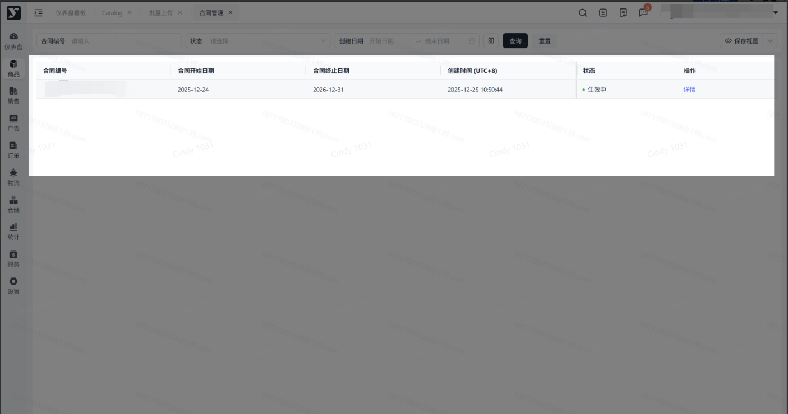
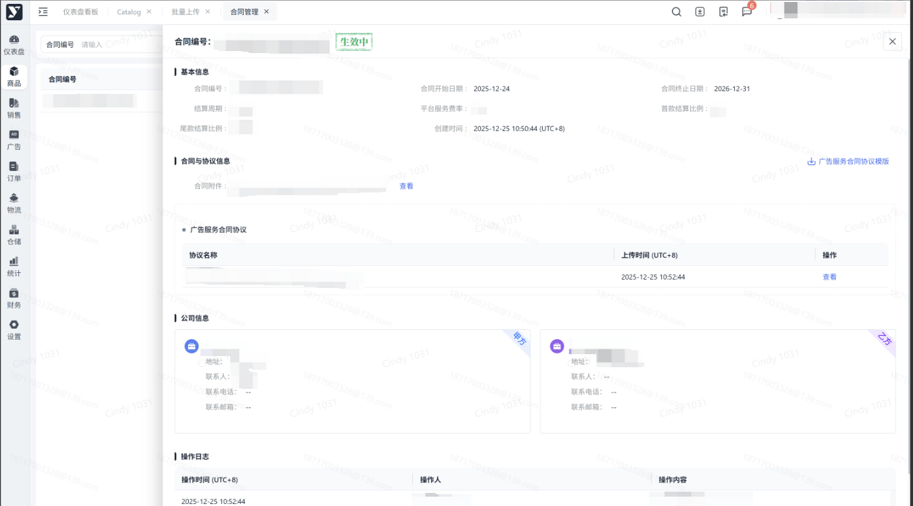

# 飞书文档：合同管理

注意：客户端被超级管理员配置了权限的内部人员才能查看/下载

## 功能介绍

合同管理有以下2点核心功能：

（1）电子合同管理。支持将纸质合同转化为电子合同，方便客户查阅和管理；

（2）合同状态管理。通过设定合同状态，提醒客户合同时间节点和到期情况；

## 注意事项

### 上传合同流程

1. 步骤1：线下与客户达成合作协议，签署纸质合同；
2. 步骤2：邀请客户入驻平台；
3. 步骤3：由运营在系统录入合同扫描件；
4. 步骤4：客户在系统查看合同详情；

## 操作流程

### 操作路径

【**商品】-【合同管理】**

### 搜索区【查询】指定合同

> 通过“合同编号”、“状态”，查询对应的合同信息；

### 列表区可查看已上传的合同数据

### 点击【查看】跳转至合同详情页

### 进入合同详情页

> 包含基本信息、合同与协议信息、公司信息、操作日志

### 点击【查看合同】下载该合同文件

## 常见问题

### 4.1

**答：**有的。合同过期前30天，列表上方会有横幅展示合同编码，点击编码跳转至合同详情页查看内容。

### 4.2

**答：**UTC+8是指国际时间八小时，东八区时间，北京时间。

### 4.3

**答：**可能由于运营上传合同时填写的基本信息有误，导致再次上传合同，而原始合同没有被覆盖，所以出现了列表中2条数据是1份合同的情况。
