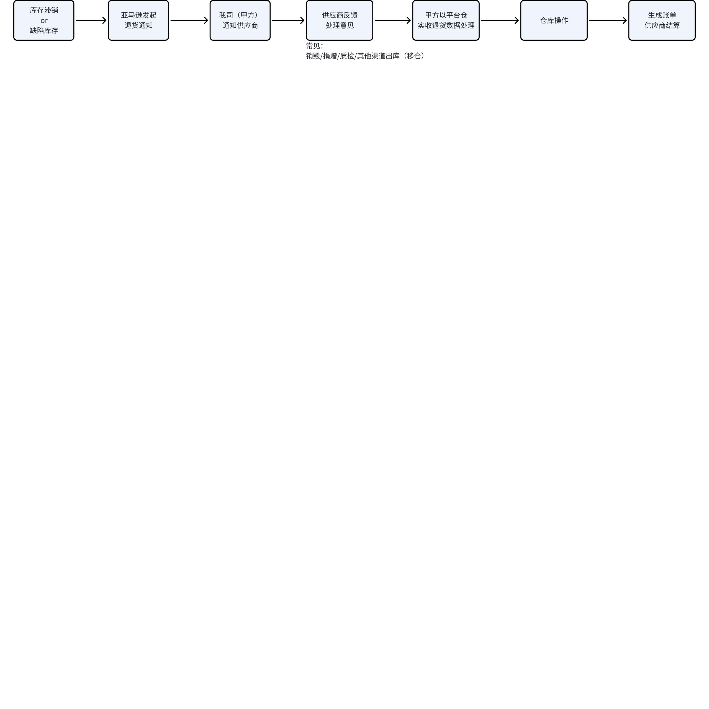
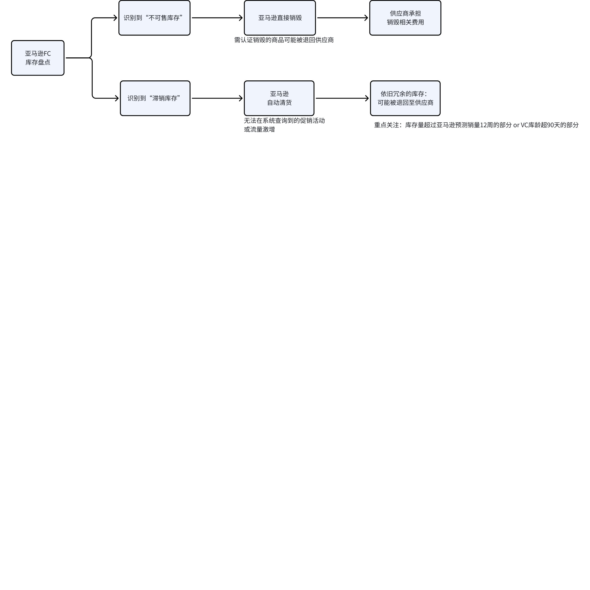
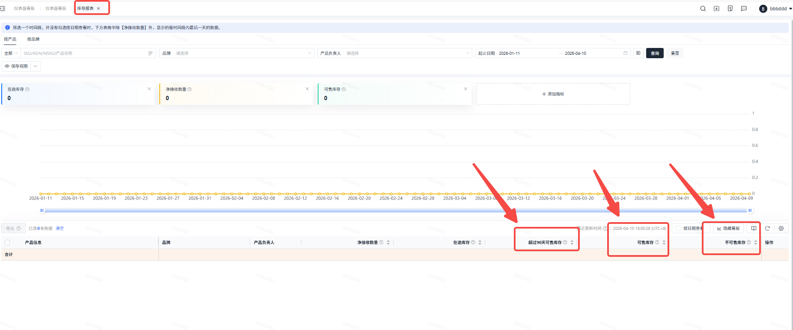
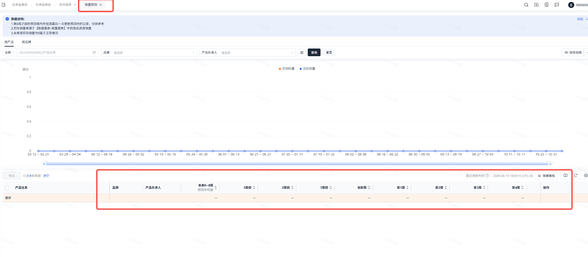

# 飞书文档：亚马逊退货指南

## 亚马逊退货指南

### 亚马逊退货定义

#### 什么是亚马逊退货

在亚马逊 VC（Vendor Central）合作模式下，亚马逊运营中心（FC）会对将商品状况为**不可售、滞销、触发风险警告的库存**进行处理，最常见的就是亚马逊退货**。**

根据亚马逊内部系统评估的库存状态、运营效率与成本核算，供应商可能面临两种处理方式：亚马逊运营中心重新质检上架销售、将退货至供应商。

#### 亚马逊退货的库存类型

1. **不可售库存退货**：因商品状态异常无法正常销售的库存，包含以下细分场景：

 1. 客户损坏（Customer damaged）：客户退回的非全新商品（含使用痕迹、包装 / 封条破损等）
 2. 承运商损坏（Carrier damaged）：配送或退货运输过程中造成损坏的商品
 3. 供应商损坏（Supplier damaged）：交付亚马逊前已存在损坏的商品（含供应商 / 供应商承运商操作导致的损坏）
 4. 缺陷品（Defective）：客户退回并反馈存在质量缺陷的商品（含缺配件、说明书、保修信息等）
 5. 仓库损坏（Warehouse damaged）：交付亚马逊后、出库前在 FC 内造成损坏的商品
 6. 过期商品（Expired）：已过保质期的产品
2. **未损坏的滞销库存退货（Overstock）**：商品状态完好、可正常销售，但因市场需求低于预期，亚马逊判定仓储持有成本高于处理成本，从而触发清理的库存。通常商品在 FC 存放**超 90 天**会被标记为积压库存，核心判定依据为亚马逊销量预测降至 0 或低于当前存放在FC的总可售库存。

### 亚马逊退货处理方式

亚马逊将根据库存状态、运营效率与成本最优原则，自主选择以下两种处理方式，**供应商无主动选择权**：

#### 方式一：退货至供应商

亚马逊通常会将**不可售商品**与**未损坏的滞销库存**直接退回甲方指定退货地址，并提供对应的退货明细（含商品数量、对应的VC订单号、对应采购价、退货产生的费用等）。

**计费逻辑**：
退货总费用 =退货采购成本+退货处理费+退货运费

 =平台采购价 × 退货数量+ MSRP× 退货数量 ×15% + 退货运费（无固定费率）

- **说明**：

 - 亚马逊退货产生的物流费、仓储费、商品成本及相关处理费用，均由供应商全额承担
 - 为处理退货商品发生的平台仓相关费用（质检、入仓、上架、移仓等）亦由乙方承担，收费标准按我司平台仓现行报价执行，收费标准参考：
 - 费用明细将在对应账期月度账单和明细账单中列示核对

#### 方式二：亚马逊处理

1. **不可售库存**：

 - 亚马逊对不可售库存（如违禁品、存在安全隐患、存在质量缺陷或已被召回的商品）会直接销毁，但如果产品需要认证销毁(如：危险品的销毁）亚马逊会退回供应商处理
 - 供应商需承担的费用为：**销毁数量\*平台采购价+销毁处理费**
 - 销毁处理费标准并未公开，但供应商可在系统财务管理中心亚马逊退货相关的财务账单中查询实际费用
2. **未损坏的滞销库存**：

 1. 此类库存通常存在转化低、质量差等问题，亚马逊通常会自动设置促销以提高库存周转，供应商无法主动取消或调整
 2. 常见的自动促销为：订购省、Price Discount、Deals等
 3. 针对此类促销，亚马逊可能收取部分资金以弥补亏损，费用标准亦未公开，供应商需以系统同步的财务账单承担

### 供应商处理流程

#### 原则遵守

供应商需严格遵循亚马逊退货处理规则，**无权自主选择退货处理方式**，需配合亚马逊与我司完成对应流程，按要求承担相关费用与责任。

#### 当亚马逊退货到供应商时

1. **流程节点**：

1. **核心要求**：

 - 供应商需在收到退货通知后**72 小时内反馈**明确的货物处理方案，逾期未反馈，我司平台仓将按管理办法对货物进行弃置或销毁，相关费用由供应商全额承担
 - 退回商品**禁止通过 VC 渠道二次销售**，仅可通过我司平台仓调拨至第三方渠道销售，或者移至第三方仓
 - 若供应商对退货责任有异议（如非质量问题、非滞销、物流 / 亚马逊操作失误导致），可在**退货通知送达之日起 30 天内**，向我司主运营提交完整佐证材料发起申诉；超期未申诉或申诉未通过，视为自愿放弃申诉权利，相关费用仍由供应商承担
2. **优化建议**：

 - 状态完好可售的商品：建议调拨至第三方海外仓或 SC FBA 渠道销售
 - 损坏商品：无品控调研等特殊需求、或属于低价值商品，建议优选在平台仓销毁，降低仓储与管理成本
 - 所有因处理退货发生的平台仓相关费用（质检、入仓、出库、仓储、销货等），统一按我司现行报价标准计费，账单随账期同步，请注意核对亚马逊退货费用与仓储费用
3. **站内信内容**：

**尊敬的合作伙伴：**
您好！
根据亚马逊VC最新政策（2026年4月1日正式生效），终端消费者退货（问题商品）及滞销超90天库存，亚马逊将直接退回至我司平台仓统一处理，不再退回至Amazon Fulfillment Center。

### 一、退货处理规则补充（依据主协议【五、2.产品退回】）

1. 我司物流部门收到亚马逊退货通知后，将第一时间同步明细至对接渠道并征询贵司处理意见。
2. 贵司需在**72小时内回复退货商品的处理方案，**逾期未回复视为自动弃货，仓库有权按规定处置。
3. 此类退货产生的物流费、仓储费、商品成本及相关处理费用，均由贵司承担。
4. 收费标准详见附件《平台仓报价表》，费用明细将在对应账期月度账单中列示核对。

### 二、申诉相关说明

若贵司认为退回商品无质量问题、非滞销库存，或退货系物流商损坏、亚马逊操作失误等非贵司责任导致，可向我司主运营提交完整佐证材料发起申诉。
1. 申诉周期为30天（自退货通知送达之日起计算）；
2. 超过30天未发起申诉或申诉未成功，视为自愿放弃申诉权利，后续无法再次申诉，相关费用仍由贵司承担。

### 三、重要事项

① 退回商品禁止通过VC渠道二次销售，可通过我司平台仓调拨至第三方渠道；非平台仓客户无需另签仓储协议，收费按现行平台仓报价执行。
② 退货入库必产生入库、拣货等基础费用，销毁/二次发货另计相关费用，以月度账单为准；账户余额不足需及时充值，保障货物正常处理。
③ **未在72小时内反馈退货处理方案**，仓库有权销毁/弃置货物，相关费用由贵司承担并计入账单。

### 【法律效力确认-仅需本次回复】

请贵司在**收到本邮件后24小时内**，直接**回复本邮件确认以下内容**：
“**已阅知并确认遵守本通知全部条款，知晓退货申诉相关规则，自愿按《合作协议》【五、2.产品退回】及本通知约定承担相应费用、责任及申诉相关权利义务**。”
1. 贵司邮件书面回复确认，即视为对本通知内容的有效认可，具备法律效力，作为履约依据。
2. 未在24小时内回复，视为已知晓并同意本通知全部内容，自愿承担相应法律后果、费用及责任。
本通知作为双方合作协议的有效补充，与主协议具有同等法律效力。
感谢您的理解与配合！
Yurex Chain Tech Inc.

#### 当亚马逊自行处理时

1. **流程节点**：亚马逊检测到异常库存→内部完成销毁 / 自动清货处理→向供应商收取对应扣款
2. **核心要求**：供应商需在对应账期核对账单时，重点关注「不可售库存处理罚款」「滞销库存罚款」扣款项，及时复盘库存管理、推广运营与品控体系，优化后续备货与销售策略，避免同类损失重复发生。

### 库存监控与预防管理

#### 不可售库存监控与预防

- **源头品控**：严格把控出厂产品质量，从源头降低客户退货率与商品损坏风险
- **包装防护**：量产前完成 1 米跌落测试，海运外箱采用五层瓦楞纸板，箱内填充紧实无松动；易碎品执行 3 层气泡膜包裹、缓冲隔离、易碎标识粘贴、单箱重量≤20kg 等专项防护标准
- **运输管控**：规范托盘码放，控制港到仓运输时效，易碎品单独码放、放置货柜中上层，海外仓备货时同步查验产品与包装状态
- **系统监控**：定期通过【统计】-【库存报表】监控不可售库存数据，出现异常波动第一时间联系运营处理

#### 滞销库存监控与预防

- **系统监控**：通过【统计】-【库存报表】监控超 90 天可售库存，结合【统计】-【销量预测】数据，以「未来 0-8 周销量预测平均值 ×8」为基准，对比可售库存规模，提前识别滞销风险

- **动销提升**：保障 VC BuyBox 占有率90%以上，加大 BD 促销力度与广告投放，优化 Listing 与定价，设置阶梯折扣、畅销品捆绑销售等，快速清理积压库存，避免亚马逊触发滞销补贴扣款

### QA

**Q1：可以查看具体商品的退货原因吗？**

A1. 可以，有两种方式：

- 我司物流工作人员反馈退货信息时的明细数据中，有标记退货原因
- 可联系您的供应商VC主运营查询
- 系统查询：预计2026年5月上线

**Q2：如果对退货有异议能不能申诉？**

A2：能，如果您认为某笔退货被错误发起，可针对具体的费用明细，在“月度账单”核对页面发起申诉，申诉周期为自供应商（乙方）收到退货通知之日起30天。

**Q3：亚马逊会提前通知退货商品明细吗？**

A3：会的，亚马逊会提前发送退货邮件通知，我司会在第一时间预通知到供应商。

**Q4：可以修改退货仓库吗？**

A4：不可以，只能退回我司平台仓。

**Q5：平台仓怎么区分退货包裹？**

A5：亚马逊的退货外箱有对应的物流单号和退货ID，只要不存在丢件或标签破损，平台仓一般能够精准识别货物。

**Q6：是否所有参与VC分销的供应商和商品都会受亚马逊最新退货政策影响，被强制退回不可售库存和滞销库存？**

A6：
不一定，需要以当期亚马逊实际的退货通知和我司平台仓收到的退货明细为准。一般是**PO缺陷商品+PO滞销库存+DF缺陷商品**，亚马逊FC经过盘点质检后认为商品状况不可售、库存冗余才会退货。
经观测，仅部分卖家受影响，常见情况为有高退货标签的商品、缺陷商品、库龄超120天的滞销库存。
供应商需时刻关注商品的退货率及动销情况。

**Q7：消费者要求换货，也需要供应商处理吗？**

A7：
一般情况下，消费者申请换货依旧由亚马逊处理，供应商不承担；
但如果消费者获取到了供应商官方售后联系方式，则需要供应商自行处理。
\*消费者如何获取供应商官方售后信息：透明计划二维码扫描获取/品牌官网等渠道

**Q8：消费者退货原因为“不喜欢这个商品”，亚马逊也会退货到供应商吗？**

A8：这需要看亚马逊如何认定商品状况，如果产品本身不存在色差、质量、功能、配件丢失、包装破损等问题，只是消费者主观上不喜欢这个产品，那么亚马逊通常还是会将被退回的商品检验后归类为可售库存；但如果明显是产品质量、功能、少件、包装破损等问题，则会被定义为缺陷商品退回给供应商。
