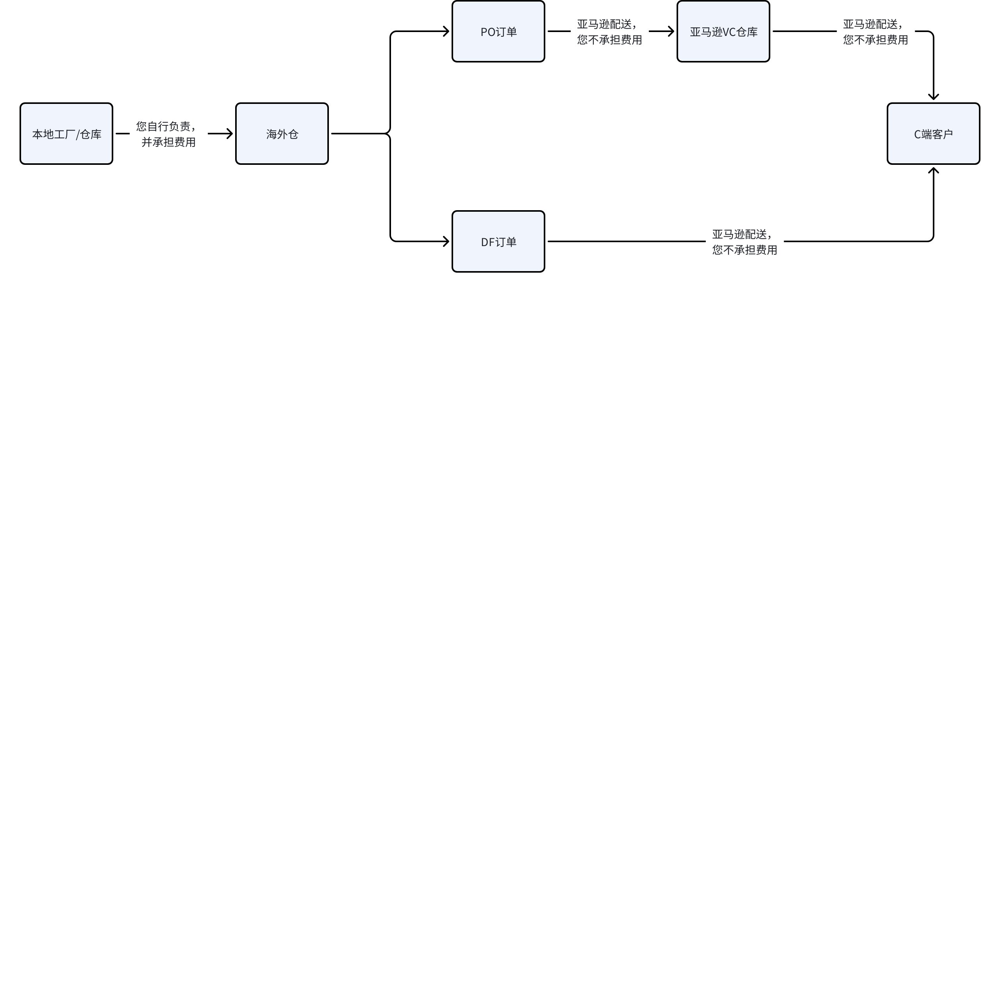

# 飞书文档：亚马逊VC合作要求

## 亚马逊VC合作要求

**VC业务模式简述**

### 一、合规要求

1. 请您确保您的产品无专利和外观侵权。如产品为专利品，您应具备相关专利证明。
2. 根据亚马逊合规运营操作规则，listing禁止刷单，产品包装内严禁放有关索评及站外引流等违规小卡片！

### 二、产品要求

1. 产品必须使用经正规渠道获取的UPC/EAN条码（需通过GS1官网验证）；
2. 若产品已加入透明计划，其包装上需贴有T-code条码；
3. 将购物车转换为VC后，请及时下架SC库存或关闭SC Offer，确保购物车能稳定在VC；

 1. **原因：**在VC账号运营过程中，若SC账号持续争夺并获取VC购物车，将直接降低VC buybox rate（购物车赢得率）。亚马逊认为其利润受损，进而可能采取限制该产品广告投放及其他推广资源的措施。
 2. **如何切换购物车：**

 1. 您必须维持SC店铺Your Price售价不低于VC售价。若SC售价更低，将直接影响VC offer价格，导致亚马逊利润受损。
 2. 为优化购物车竞争力，建议将SC的商品库存设置为“不可售”状态或预约为未来日期可售，以确保由VC能够实现比SC更快的配送时效。
4. 若产品包装任意一侧尺寸超过18''×14''×8''或重量超过20磅，且不属于排除类别的产品则须完成包装认证，否则每件运送到亚马逊的产品都会产生罚款；

 - 不受限类别：

 - 具有任何危险品分类和运输规定的 ASIN（例如，包含锂离子电池的 ASIN）
 - Prime Pantry、Amazon Fresh 或 Media 中的 ASIN
 - 最长边小于6英寸、最短边小于0.375英寸或中位数边小于4英寸的 ASIN。这些是认证为 Tier 1 - FFP 或 Tier 2 - SIOC 所需的最小尺寸。
 - 已存在至少 24 个月且在过去12个月内向亚马逊运送少于100 件商品的ASIN。
 - 为了最大限度地提高货运立方体效率，以嵌套或互锁各个销售单元的方式包装运往亚马逊的 ASIN，例如嵌套在一起的垃圾桶。
5. 产品如涉及需提交美国法律规定的相关认证，如FCC、FDA、EPA、UL等认证，请上传offer后尽快联系我司运营负责人协助上传文件。

### 三、了解MSRP

#### 什么是MSRP?

Manufacturer Suggested Retail Price，供应商建议零售价。

#### MSRP与SC Your Price的共同点和区别分别是什么？

- **共同点**：两者均会展示在亚马逊商品详情页（Listing）的价格信息区域，是面向消费者的公开价格标识。
- **区别**：

 1. MSRP为供应商建议零售价，价格需提交亚马逊审核确认，一旦确认，其修改权限实质上由亚马逊控制。如需修改，通常流程较复杂，且耗时较长。
 2. SC Your Price为卖家在SC后台自主设置的销售价格，卖家拥有完全的价格调整权限，可根据市场、竞争及库存情况灵活操作。

#### VC价格匹配

1. **VC价格机制的本质**VC是B2B模式。其核心机制是：

 - 所有权转移：供应商接受采购订单（PO）并完成发货后，商品所有权即转移至亚马逊。
 - 定价权归属：亚马逊拥有商品的**最终零售定价权**。供应商在后台填写的MSRP仅具参考性质，亚马逊可根据其策略自主进行涨价或降价。
2. **价格匹配定义与触发条件**当亚马逊系统监测到其站内或其他零售渠道（如Walmart、eBay、品牌官网等）存在相同或高度相似产品，但价格不一致时，便会启动价格匹配机制。该机制可能导致VC的零售价向其他渠道的价格靠拢，分为低价匹配与高价匹配。
3. **触发价格匹配的产品判断标准**

 1. 亚马逊主要通过以下维度判定两个产品为“相同产品”：

 - 核心标识：品牌、UPC/EAN、型号。
 - 视觉内容：商品主图与详情图片。
 - 功能特性：产品的主要功能与用途。
 - 零售价格：其他渠道的公开售价。
 2. 重要提示：

 - 即使仅存在配件差异（如附带不同数据线），或仅变更了型号与条形码，亚马逊仍可能判定为同一产品。
 - 对于多渠道运营的品牌方，价格差异可能导致亚马逊追收零售差价。
4. 价格匹配问题的处理方案：

 1. 亚马逊站内：将该SC Listing的Your Price调整为与VC的MSRP一致。
 2. 亚马逊站外（可控渠道）：沟通并调整该外部渠道的价格，确保与亚马逊VC零售价保持一致。
 3. 亚马逊站外（不可控渠道）：需品牌方自行通过知识产权投诉、渠道管控等方式处理该低价 listing，以消除价差。

#### 疑问解答

1. **在运营中若发现设定的MSRP过高，已对产品销售速度产生负面影响，可通过以下两种途径进行调整：**

 1. 开展促销活动以短期刺激销售：通过VC的站内促销活动，直接降低消费者实际支付金额，提升购买吸引力，从而促进动销，且无需立即修改MSRP本身。
 2. 申请正式下调MSRP以进行长期价格调整：向亚马逊平台提交申请，正式降低该产品的MSRP。需要注意的是，此操作通常会导致平台采购价相应降低。
 3. 不能直接降低MSRP！！！该操作会直接影响亚马逊利润，亚马逊利润受损，将会限制产品广告和促销等投放活动。
2. **在运营中若发现利润亏损，想提高MSRP，可以通过VM提交提价申请，但此流程通常耗时较长，至少1-2个月**

 1. 亚马逊不允许供应商直接单方面提高MSRP及采购价。
 2. 因此建议在产品首次转入VC前，必须确认好MSRP，避免后续反复调整价格，影响VC的运营推广。

### 四、VC促销

您可以在VC为产品设置站内促销活动，但相关促销费用需由贵方承担。费用发票将于活动发生的次月开具，我方会提供清晰的账单，列明各项推广费用的明细及总额。

以下是各类促销活动的具体规则与操作要点：

#### Coupon

- 折扣要求：5%-50%off。
- 费用构成：顾客每兑换一次Coupon，贵方需承担折扣金额及\$0.13/次的固定兑换费。
- 设置截止时间：Coupon生效时间为美国时间0:00。提交设置必须在美国时间生效日的前一天晚上12点前完成。

#### Price Discount

- 活动性质：直接降价促销。
- 折扣要求：无最低折扣力度限制。
- 排期与时长：至少提前2天，最多可以提前2个月创建，单次活动最长可持续31天。

#### Best Deal

- 折扣要求：最低折扣为10% off。
- 排期与时长：需提前7天安排活动（介于需要留给我司运营审核操作时间，因此建议您提前7天安排活动，如需加急，可联系我司运营为您最早修改到3天后开始活动），单次活动最长可持续30天。
- 关键操作规则：

 - 活动开始后无法调整开始日期，但可修改折扣力度、结束日期，或随时取消。
 - 活动提交并通过亚马逊审核后，在正式开跑前，务必确保产品前台售价不下调（包括设置新的Coupon）。价格下降可能导致不满足BD折扣要求，致使活动在开跑前报错失效。

#### Lightning Deal

- 折扣要求：最低折扣为15% off。
- 提报时间：需提前两天提报。
- 活动费用：提报需支付手续费。

 - 非大促期间：\$150（与SC收费标准一致）。
 - 大促节点期间：\$300 - \$500（根据具体活动级别而定）。

#### DOTD

- 折扣要求：最低折扣为20% off。
- 申请方式：VC后台无直接提交入口。需由我方联系亚马逊专属团队进行申请，具体资格要求与费用需在与亚马逊团队沟通后明确。

### 五、海外仓罚款

1. 若贵司使用第三方海外仓，根据实际业务场景，因海外仓操作导致罚款产生，则责任人划分为海外仓；
2. 若贵司使用Yurex海外仓，因海外仓操作导致罚款产生，则由我司承担罚款费用。

### 六、利润核算

产品利润=平台采购价-货值成本-头程运费-海外仓费用-广告费用-推广费用-罚款(隐形费用)-我司平台服务费(0%/1%/2%\*平台采购价\*采购数量)
