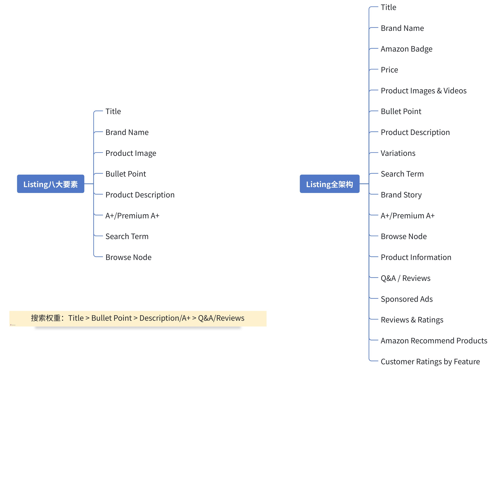

# 飞书文档：亚马逊Listing组成部分

亚马逊Listing组成部分

## Listing框架

> 画板来源：token=`OoZdwPln0hRVN4bYdyOcJtpInXg`

## Listing填写规则

**Listing页面基本要求（适用于Title/Bullet Point/Descriptions）**
1. 保持简短，但包括关键信息
2. 使用阿拉伯数字，代替英文拼写
3. 请勿使用表情符号或其他特殊字符
4. 请勿使用主观评论，例如"Hot item" or "Best seller"
5. 请勿使用保证词或变体，例如“退货以获得全额退款”或“终身保修”
6. 请勿包含“促销”、“免费送货”或“始终 9.99 美元”等定价或促销信息

### Title

1. 定义：Title是Listing的核心板块之一，是亚马逊站内外最重的搜索项，也是顾客在亚马逊上搜索产品时首先看到的东西。
2. 规则：

 - 10字符 | \* ; ^ Æ © ®；除非这些字符 !、\$、?、\_、{、}、^、¬ 和 ¦ 是品牌名称的一部分
 - 删除限制性短语（促销型），例如“ 100% Genuine” 、“ Premium Quality” 、“ Free 2>Day Shipping”
 - 添加特定信息，例如品牌、颜色和尺寸，尤其是任何子变体
 - 删除与产品无关的不必要的同义词、搜索关键字或不相关的关键字
 - 移除更适用于 BP 板块的信息，比如面料类型
 - 不要在标题中包含卖家名称
 - 不要使用主观性语言，例如：“ Hot Item” 、“ Best Seller ”
 - 预定义的标题规则： Brand name + item type name/item name + Color + Model number （品牌名称 + 项目类型名称 / 项目名称 + 颜色 + 型号）
 - 商品名称中不应当有重复字词。介词、冠词和连词除外。（自2025年1月21日起生效，此后被亚马逊识别到的不合规标题、经亚马逊提醒后需要在14天内修正）

### Bullet Points

1. 定义：产品卖点描述，顾客通过商品的Bullet Points来了解重要的商品特征。
2. 规则：

 - VC最多可写作10条，SC最多5条
 - 字符数控制在10-255个
 - 以大写字母开头，添加标题，以冒号(:)结尾
 - 使用不完整句式，句末不适用句号，单个要点中使用分号(;)间隔，各要点内容不重复
 - 使用阿拉伯数字代替英文拼写
 - 写出计量单位，在数字和测量值之间添加空格，例如60 ml(而不是60ml)
 - 文案表达清晰、自然，重点突出产品的特点、优势、如何满足的客户需求
 - 保持产品变体之间数据的一致性
 - 不转移或引用本ASIN下未包含的其他产品
 - 删除或尽量减少标题、产品描述或产品概述等属性之间的重复
 - 不使用Emojis或其他特殊字符（如™ , ®, €, ..., †, ‡, o, ¢, £, ¥, ©, ±, \~, â）
 - 不能包含ASIN编号或"not applicable", "NA", "n/a", "N/A", "not eligible", "yet to decide", "to be decided", "TBD", "COPY PENDING"
 - 禁止使用诸如 "eco-friendly", "environmentally friendly", "ecologically friendly", "anti-microbial", "anti-bacterial", "made from bamboo", "contains bamboo", "made from Soy", "contains Soy"
 - 禁止提供 "Full refund", "If not satisfied, send it back", "Unconditional guarantee with no limit"等担保信息

### Description

1. 定义：产品信息描述出现在listing详细信息页面的下部，帮助客户更多地了解产品本身，有助于提升产品转化，现在卖家更多使用A+/PA+
2. 规则：

 - 使用 100 到 200 个单词
 - 使用基本 HTML 标签，例如 
 、   、 <li> 、 <ul>
 - 使用完整句并在末尾使用句号
 - 不要使用任何丰富（ A+ ）内容的图像、链接或比较表以及其他任何网站链接
 - 使用句首字母大写：大写字母仅用于句首（首字母缩略词除外，例如 HDMI 、 BMX 或 USB ，这些字母均采用大写）
 - 避免使用不允许使用的特殊字符，例如 ™、 ® 、€、...、†、‡、 o 、 ¢ 、 £ 、 ¥ 、 © 、 ± 、 \~ 、 â
 - 请勿包含 ASIN 编号或使用 "not applicable" , "NA" , "n/a"
 - 没有任何拼写或语法错误
 - 请勿使用禁用短语，例如 eco-friendly, environmentally friendly, ecologically friendly, anti-microbial, anti-bacterial, Made from Bamboo, contains Bamboo, Made from Soy or contains Soy
 - 不包括 Amazon.com （或任何其他扩展名，如 .co.uk 或 .de ）或 Amazon
 - 不要使用禁止的担保信息，例如“ Full refund” , “If not satisfied, send it back”, “Unconditional guarantee with no limit”
 - 不要包含任何与产品成本或价格相关的信息
 - 请勿包含与供应商公司相关的任何信息
 - 请勿包含任何网站链接

### Listing Picture

1. 定义：Listing图片，拆解来看可以分为两个部分：主图Main Image和附图Sub Images。前台默认展示7张（主图1+附图6）、上传了产品视频的展示的是6图+1视频
2. 规则：

 - Main Image

 - 准确地将产品呈现为真实、专业品质的图像，而不是一个占位符。
 - 具有纯白色背景（ RGB 颜色值： 255 、 255 、 255 ）。
 - 产品占据图像的 85 ％。
 - 商品或背景上不得有文字、徽标、边框、色块、水印或其他图形覆盖。多件商品的尺寸必须相对，不得放大任何一件商品。
 - 在图片框架内展示整个产品，不要剪掉任何部分。
 - 不要展示购买时未包含的配件或任何可能会让顾客感到困惑的道具。
 - 在图像中仅展示一次产品（例如：仅显示正面，而不是正面和背面）。
 - 仅显示单件商品以及随该商品销售的任何配件。对于多件装或组合装，请参阅“商品类别”部分中的更多指导。
 - 不包括包装，除非它是重要的产品特征（例如，可能包括手提箱或礼品篮）。
 - 不显示人体模型的任何部分，无论人体模型的外观如何。这包括透明、纯色、肉色、框架或挂在衣架上。
 - Sub Images

 - 最长边为 500 像素至 10,000 像素。（图片最长边>=1,600像素可在网站上实现缩放功能）
 - JPEG （ .jpg 或 .jpeg ）、 TIFF （ .tif ）、 PNG （ .png ）或非动画 GIF （ .gif ）文件格式，但亚马逊首选 JPEG。
 - 清晰、无像素化、无锯齿边缘。
 - 准确地描述您所销售的产品。
 - 与商品标题相符。
 - 不得包含裸露或性暗示内容，包括模特和图画。
 - 不包括客户评论、五星级图像、声明（例如免费送货）或供应商特定信息。
 - 无文字或价格详情（仅色卡图片 ）。
 - 不得包含任何亚马逊徽标或商标、变体、修改或任何与亚马逊徽标和商标混淆的类似内容。这包括但不限于任何带有“ Amazon” 、“ Prime” 、“ Alexa” 或” Amazon Smile” 设计的字词或徽标。
 - 不包括亚马逊上使用的任何徽章，或变体、修改或任何与此类徽章混淆的类似内容。这包括但不限于 "Amazon's Choice," "Premium Choice," "Amazon Alexa," "Works with Amazon Alexa," "Best seller," 或 "Top seller" 。

### A+

1. 定义：亚马逊 A + 是一种为品牌卖家提供的工具，允许他们使用丰富的图片、文字描述和品牌故事等元素来增强商品详情页面的展示效果。通过 A + 页面，卖家可以更好地展示产品的特点、优势和使用场景，从而提高产品的吸引力和转化率。
2. 规则

 - **图像和文本格式**

 - 支持的图像文件类型包括：RGB 色彩空间中的 .jpg、.bmp 和 .png。不支持 CYMK 色彩空间。单个文件必须保持在 2 MB 以下。分辨率应至少为 72 dpi。禁止使用动画图像（例如.GIF）。
 - 如果提交的图片关键词不能描述图片，那将对使用屏幕阅读器应用程序的客户没有用处，这可能会导致文本内容被拒绝。
 - 图片和文字必须是 A+ 的唯一标识。避免重复使用当前在页面图片库中发布的相同图片。A+ 商品描述旨在展示商品或品牌的独特之处。
 - 仅包含一个品牌徽标和仅可帮助客户浏览文本的图标。来自合作伙伴公司的徽标和符号不需要使用，但如果合乎逻辑或有益，则可以允许使用。
 - 拼出 10 以下的所有数字，使用一致的标点符号和连续（牛津）逗号，并将标题中的每个主要单词大写。语法错误、标点符号错误、拼写错误、全大写文本字符串、滥用字体功能或不必要或重复的信息都可能导致内容被拒绝。粗体和斜体格式仅用于突出显示标题或几个选定的单词。
 - 不允许使用内容中指定的语言以外的语言（包括 HTML 标签）编写的内容，但如果它是品牌标识的一部分，则可以使用不同语言的少量文本。
 - 声明和奖项

 - 在引用奖项或背书时，应在文本中附上注释，注明获得奖项或背书的日期以及授予该奖项的组织。不要提及超过2 年的奖项。
 - 认证声明（例如：推荐、认证、测试、批准、证明、验证）和奖项必须在正文中注明认证或授奖机构、研究、出版物或其他证据以及年份。
 - 不允许在文字或图片中使用 “eco-friendly” “biodegradable” 和“compostable”等词语及其符号的环境声明。声称产品是“可回收的recyclable”或“生态的ecological”，必须通过文本中的注释和支持信息来证实，例如使用的材料或认证机构和年份。
 - 不允许发布满意度声明（例如“100% satisfaction guaranteed”）和自夸的声明，例如“#1 rated”或“top-rated”或“best-selling”。
 - 删除药品、化妆品、医疗器械、饮料、食品和保健品（包括天然保健品、维他命和补充剂）中关于治疗、减轻、治疗或预防人类或动物疾病或两者兼而有之的任何声称。 有关这类产品的其他声称以及任何一般性声称都需要在正文中加以说明，以证实这些声称。
 - 内容限制

 - 严禁出现保修或担保信息，包括提及亚马逊以外的退货或退款政策，除非产品本身就是严格意义上的保修卡。
 - 禁止任何违反亚马逊政策的行为。
 - 不得在包含任何运输细节（如 “免费送货”）、QR条形码或个人信息（如电话号码、地址或电子邮件）。
 - 不得引用或署名任何个人、消费者或其他私人数据。引用或背书最多允许4个，且只能来自知名出版物或公众人物，并必须注明作者、日期，如果引用出版物还必须注明标题。
 - 无论以何种方式提及竞争对手（例如，具体名称、描述为 “其他 ”或其他方式），都不得提及或比较竞争对手的产品。此内容旨在建立品牌和提供更多产品细节，而不是讨论竞争对手。
 - 比较图表只能与同一品牌的其他产品进行比较。针对不同类别的比较（如 LED 灯泡与卤素灯泡）是可以接受的，但不被视为竞争性呼出。
 - 不要包含定价、促销细节或折扣、促销参考（如 “affordable,” “cheap,” “bonus," “free”）或引导客户购买的语言（如"buy now", "add to cart", "get yours now" 或 "shop with us”）。
 - 不要提及时间敏感信息，如*now / new / latest / yet / on sale now / the latest product / the best yet*，或提及节假日。
 - 如果商标和版权符号（TM、®、© ）大小合理，且已包含在产品包装上或始终作为徽标的一部分显示，或两者兼而有之，则可以接受。否则绝不允许使用独立符号。任何商标或版权符号都必须从文本中删除。
 - 禁止超链接、外部网站链接或试图重定向至亚马逊内外其他网站（包括您的其他产品）的语言。
 - 禁止提及亚马逊以外的客户服务或联系信息（例如 "contact us if you have problems"、电话号码、联系电子邮件）。
 - 禁止使用试图模仿亚马逊徽标、详情页标题或详细信息的图片或文字。允许提及亚马逊支持的计划或品牌产品。
 - 不允许包含违反亚马逊成人产品政策和指南的成人产品内容，或包含任何提及犯罪活动的内容。

### Video

1. 定义：Video可以更加直观地表达图片宣传表达或未表达的内容，帮助客户理解并记忆产品的相关属性
2. 规则：以下内容严禁在视频中显示：

 - 链接：请勿包含任何网络链接、 URL 、社交媒体句柄或要求观看者在其他网站上采取行动的行动号召
 - 徽标：除非您获得书面许可并已为此目的获得权利，否则请勿包含徽标或任何其他知识产权（模型 / 图像权利、音乐），否则您将对亚马逊因此遭受的任
 - 何损失承担责任。
 - 价格和促销：视频不得包含价格、促销信息、折扣声明或时间敏感信息。
 - 不可接受的产品：视频不得包含对亚马逊上未销售的产品的提及。
 - 泄露私人信息：视频不得泄露私人信息，例如电话号码、电子邮件地址、车辆牌照，或要求观众这样做。
 - 诽谤性语言：产品评论不得包含诽谤性或贬损性内容。例如，“产品 X 比产品 Y 好得多，而产品 Y 是垃圾”是不可接受的。
 - 视频文字：视频标题、视频说明或视频中显示的文字不得包含拼写错误、语法错误等问题。
 - 色情内容：不得透过衣服看到生殖器的轮廓。视频制作者应根据产品内容适当着装。
 - 虚假医疗声明：除非根据适用法律，声明准确无误，否则请勿做出健康声明、医疗声明或提及医疗状况。请勿声称或暗示产品可以预防或治愈疾病，但可以声称产品有助于缓解疾病症状（例如“可以帮助缓解与 ADHD 相关的压力”或“可以帮助消除痤疮疤痕”）。
 - 医疗建议：请勿提供医疗建议或对专业医疗建议做出负面评价
 - 权利和侵权：请勿以侵犯他人知识产权或其他专有权利的方式发布内容。仅发布您自己的内容或您有权使用的内容。例如，除非您已获得所有相关第三方的许可，否则请勿在视频中播放音乐或包含图片、艺术作品或其他视听作品。如果您未获得品牌所有者的许可，请避免包含带有明显品牌标志的衣服、珠宝或配饰。

### Search Term

1. 定义：Search Term 是卖家在亚马逊平台上为产品设置的用于被消费者搜索到的关键词集合。当消费者在亚马逊上输入特定的词语进行搜索时，亚马逊的搜索引擎会根据这些关键词来匹配并展示相关的产品。
2. 规则：

 - 保持在 250 字节以下
 - 用空格分隔单词
 - 不需要标点符号，例如：“；”、“：”、“ -”
 - 不要使用辱骂或冒犯性的词语
 - 不要在关键词字段中重复单词
 - 不要在关键词中包含你的品牌或其他品牌名称
 - 不要在关键字中包含 ASIN
 - 无需使用“ a” 、“ an” 、“ and” 、“ by” 、“ for” 、“ of” 、“ the” 、“ with” 等停用词
 - 使用单数或复数，不需要同时使用
 - 禁止使用 “ new” or “on sale now” 等临时性表述
 - 不要使用主观说法，例如 “ best” “cheapest” “amazing”
