# 飞书文档：如何获取和刷新UPC/EAN条码

## 如何获取正规UPC/EAN条码？

1. UPC定义：

UPC是通用产品代码的缩写，其英文全称是Universal Product Code。UPC码由美国统一代码委员会(Universal Code Council)制定，目前已经在国际贸易中通行。

1. UPC条码的必要性：

亚马逊产品都需要一个UPC。亚马逊要求所有新的listing在创建时要有一个独特的产品标识码，常见的如UPC、EAN、GTIN等。针对入驻美国亚马逊市场VC渠道的产品，我们要求客户使用正规UPC条码，不推荐其他类型例如EAN、GTIN等。

1. 获取UPC的路径：

切记正规UPC请通过GS1购买，避免从其他渠道购买便宜的UPC，否则可能会出现亚马逊创建Listing时UPC不合规的情况导致无法创建Listing等情况。

### 如何获取单个UPC条码

#### 第一步：登陆GS1官方网站 https://www.gs1.org/

#### 第二步：下拉到网页底部，点击"Standards“下的"Need a barcode“

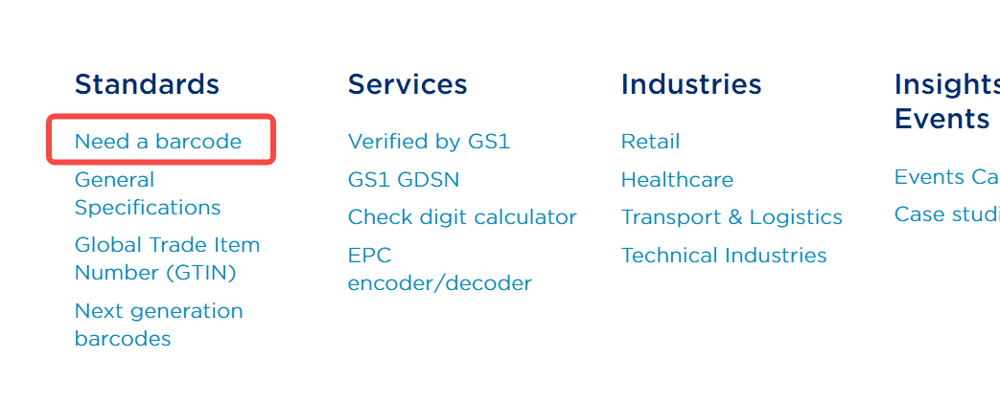

#### 第三步：在"Select Location“-选择”United States“，然后点击”Get a barcode/GTIN“

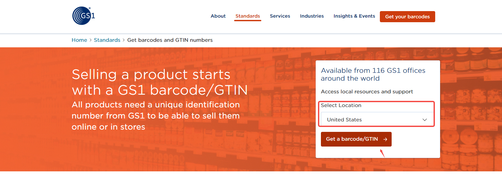

#### 第四步：点击一次性购买单个UPC条码

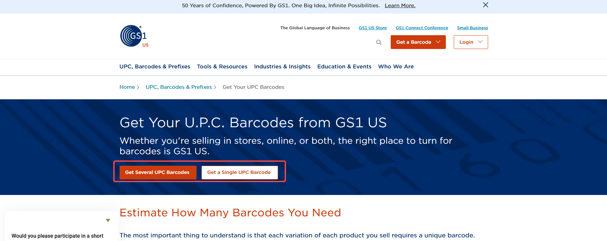

#### 第五步：填写基础信息（请保证Brand Name填写信息和后续创建VC listing信息一致），完成UPC条码购买，获取到合规的UPC条码

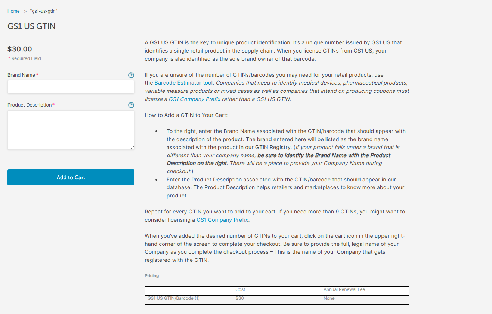

### GS1官网批量购买UPC前缀后如何生成UPC条形码

1. 下拉到网页底部，点击Standards下的Need a barcode

1. 在Select Location下选择United States，然后点击Get a barcode/GTIN

1. 到Get a Barcode操作主页面，下方有各种分类

#### 登录入口：

##### **入口一：**

1. UPC, Barcodes & Prefixes>Create a UPC Barcode 或者 Tools & Resources>Create a UPC Barcode

进入到Create a Barcode with GS1 US页面，点击Access Your Barcode

1. 用购买前缀的邮箱登录，按照提示操作

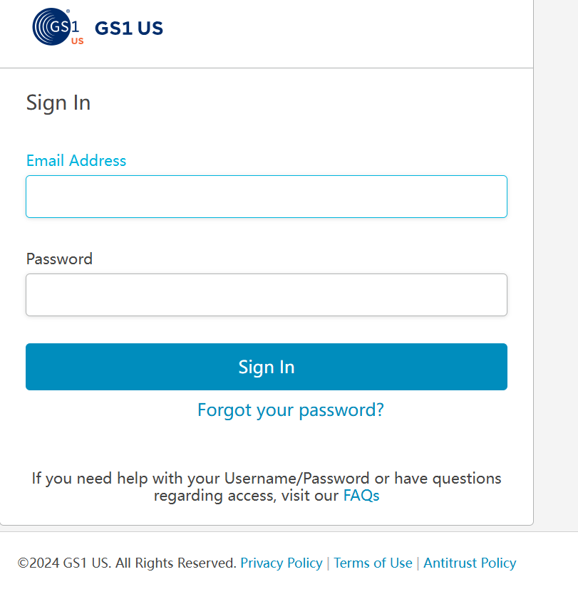

##### 入口二：

1. 从Tools & Resources>GS1 US Data Hub进入到Manage and Share Data in One Secure Platform页面，点击Explore GS1 US Data Hub | Create/Manage BenefitsS

1. 点击Log in to GS1 US Data Hub

1. 和入口一同样进入到登录页面，用购买前缀的邮箱登录，按照提示操作

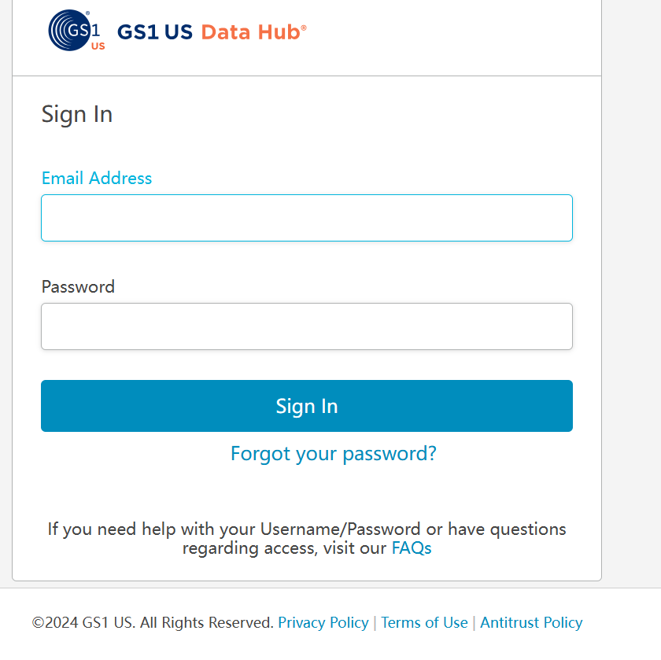

#### 登陆后操作指引：

##### 点击Create or Manage Barcodes

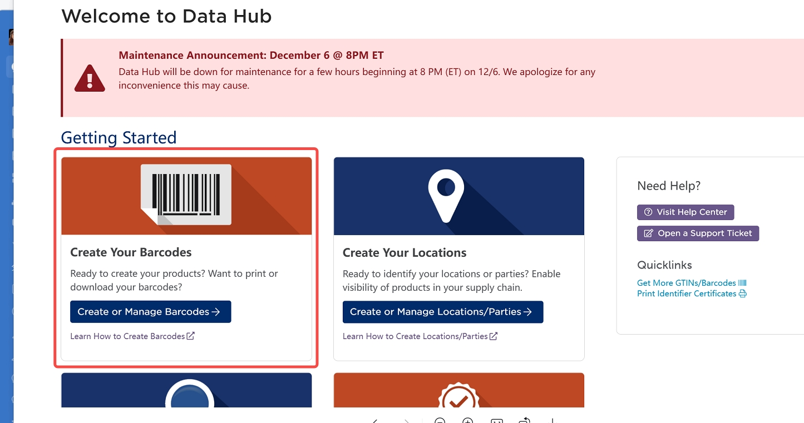

##### 点击Add New Product添加商品，确保信息正确，避免关联错误

##### 编辑详情，带required选项为必填项，编辑后可选保存为草稿或者点击保存继续下一步

##### 点击Skip this Step跳过继续下一步

##### 点击Skip this Step跳过继续下一步

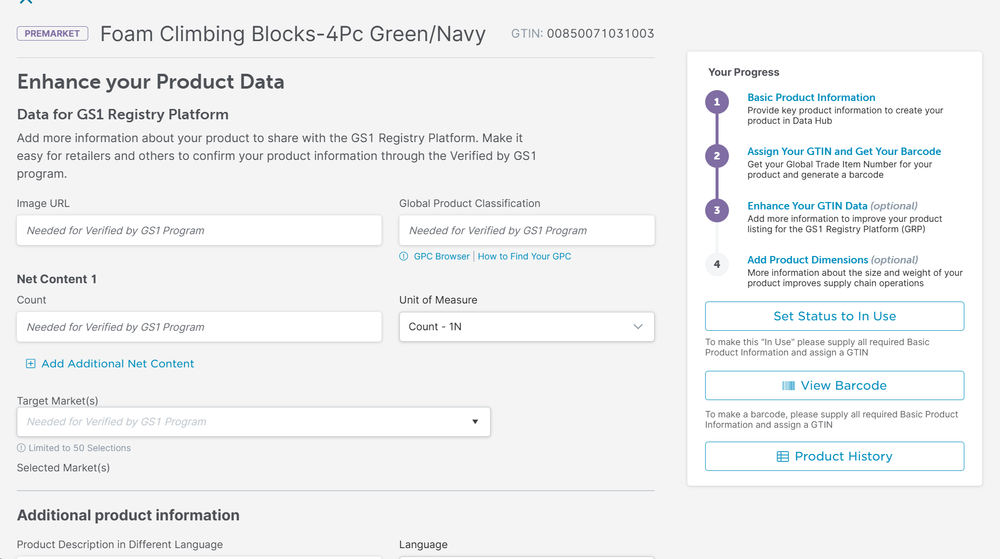

##### 点击Skip this Step跳过继续下一步

##### 填完信息后如下图所示生成具体信息，包括状态、UPC具体信息和上次操作时间

##### 可查看详情，亚马逊需要的是GTIN-12(U.P.C)对应的UPC条形码

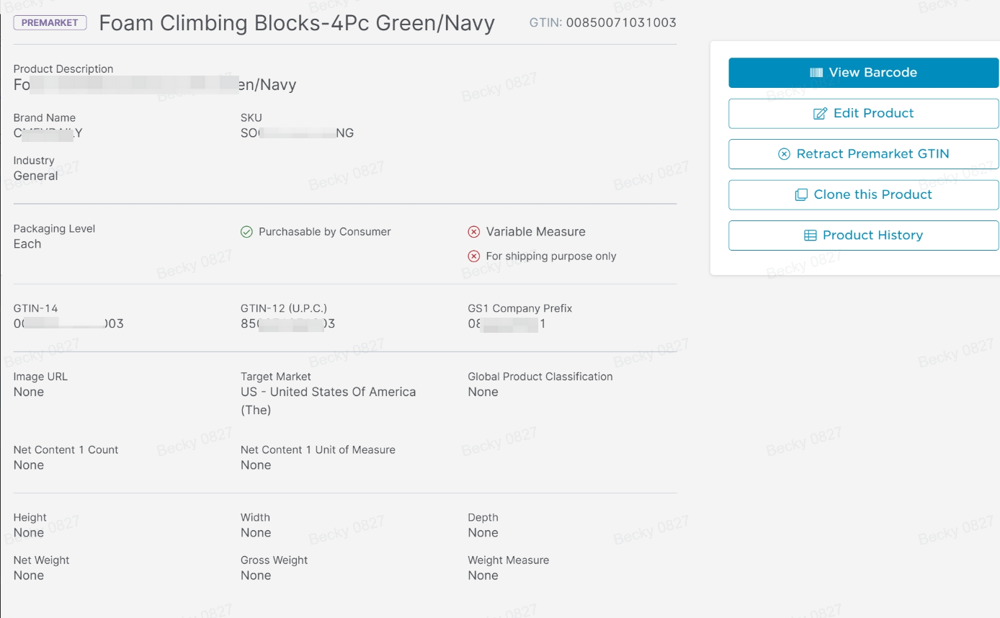

## 如何刷新UPC/EAN条码？

针对产品原先的UPC/EAN条码存在从非正规官方渠道GS1购买的情况下，请首先在SC后台将UPC刷新为正确的值，与ASIN建立关联性后再在Yurex系统上传VC的Offer。步骤如下：

#### **第一步：**在SC后台检查product id（US市场一般是UPC）是否合规

检查路径：Seller Central→Inventory→Manage (FBA)Inventory→Select Product→Edit

#### **第二步：**如果Product id不合规，则按照以下的方法进行UPC条码刷新

1. **方法1：**在SC后台下载模板填写新的UPC进行强制刷新更新路径Inventory →Add Products via Upload →Select Product Category →Download Inventory File →Upload File→ Monitor Upload Status请注意表格模板一定要把SKU填对，并且使用partial_update，否则listing容易出现信息错误篡改等情况。
2. **方法2：**通过SC后台发Case找客服刷新UPC
3. **方法3：**以上方法尝试后如果仍然不行，再联系Yurex运营经理找VM帮忙刷新UPC，这种方法需提供：① ASIN② 已贴好UPC条码的产品图片或者产品包装图片，至少提供3张不同角度的产品图片。VM协助刷新的效率在2-5个工作日左右。

## 如何下载UPC标签

### **方法一：通过在线工具生成**

**下载网址：**[**https://barcode.tec-it.com/en/UPCA?data=%0A**](https://barcode.tec-it.com/en/UPCA?data=%0A)

注意：建议在VPN环境下打开，否则网速很慢；建议使用Google浏览器或者Microsoft Edge浏览器打开，否则可能不兼容。

### 方法二：WPS生成UPC标签

此操作可能要求已开通WPS会员（也可以网上搜索Excel生成UPC标签的方法操作）

**操作步骤：**【插入】-【更多素材】-【条形码】，“编码”下拉选择“UPC-A”（如果是EAN则选择EAN编码），输入编码，点“插入”即可生成对应的UPC条形码

### 方法三：Excel生成UPC标签

**操作步骤：**

1. 文件-更多-选项-自定义功能区-主选项卡-勾选“开发工具”-确定
2. 点击“开发工具”-插入“其它控件”-选中“Microsoft BarCode”相关选项-确定
3. 鼠标变为"+"，在目标区域拖拽合适大小，绘制UPC标签大小
4. 选中初步绘制的UPC标签，鼠标右键-Microsoft BarCode对象“属性”-选择样式：UPC选“0-UPC-A”，EAN选“2-EAN-13”-确定
5. 任一目标单元格，输入UPC或者EAN编号
6. 选中初步绘制的UPC标签-鼠标右键选择“属性”-LinkedCell 输入编码所在的单元格（该操作可随着单元格内数值变化而生成对应的标签）；或在 Value 输入对应的编码（该操作生成的标签是固定的，只能通过更改属性-value变更条码）
7. 调整标签大小：开发工具必须要在“设计模式”下才能生效，选中标签-点击绘图工具-形状格式-按需求调整标签大小即可

**操作视频示例：**

## 打印机**批量打印UPC标签设置**

**如何进行UPC标签排版（适用于打印纸为-US Letter-30）**

第一步：新建一个Excel表格，建议使用WPS打开，设置页面纸张大小为信纸

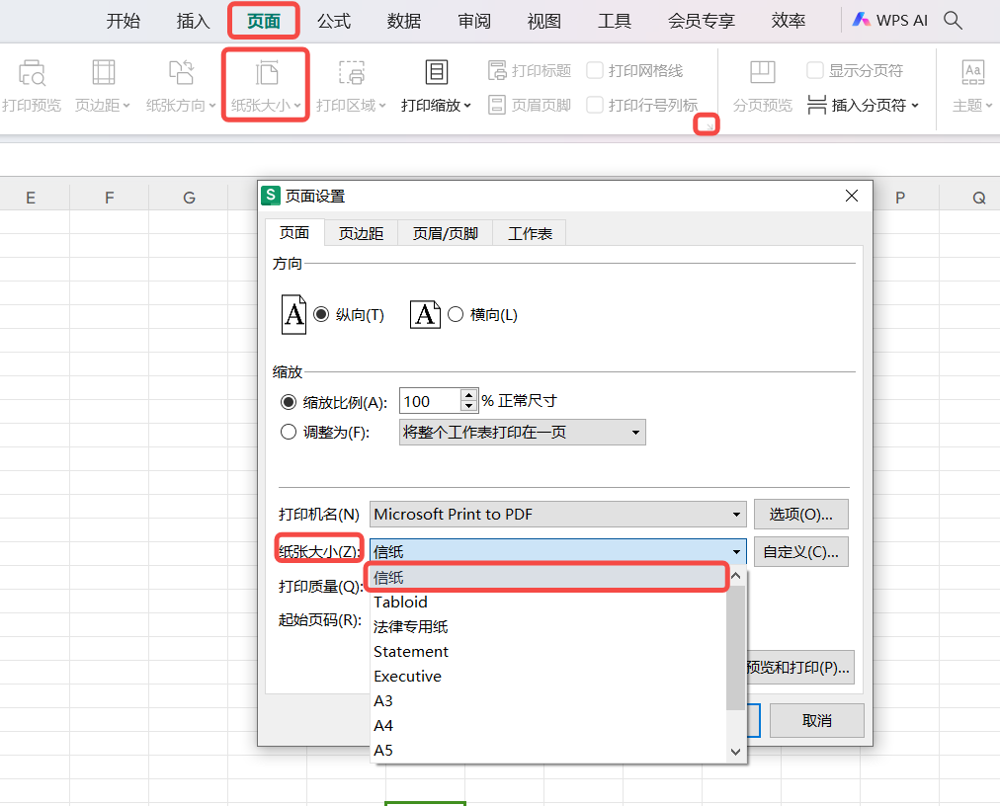

第二步：将之前下载好的UPC标签插入到表格

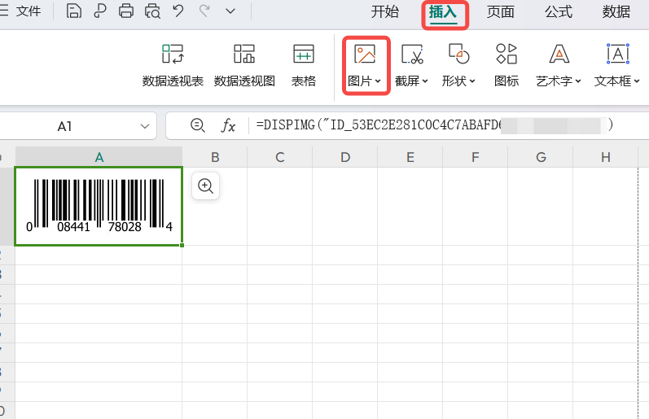

第三步：复制单元格A1，3列10行，共计30个标签

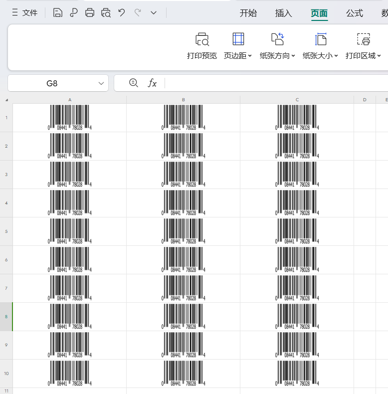

第四步：调整标签和单元格大小，确保UPC标签规格至少为：长5cm，高3 cm

> 需要将单元格图片设置为浮动图片，取消锁定纵横比，设置长5cm、高3cm

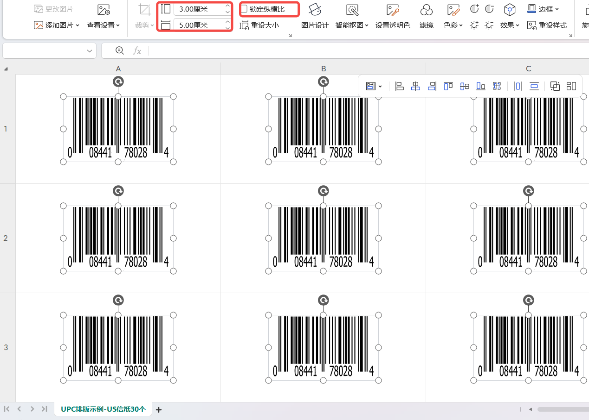

第五步：点击页面>打印预览，确认纸张大小、页面内容和页边距调整

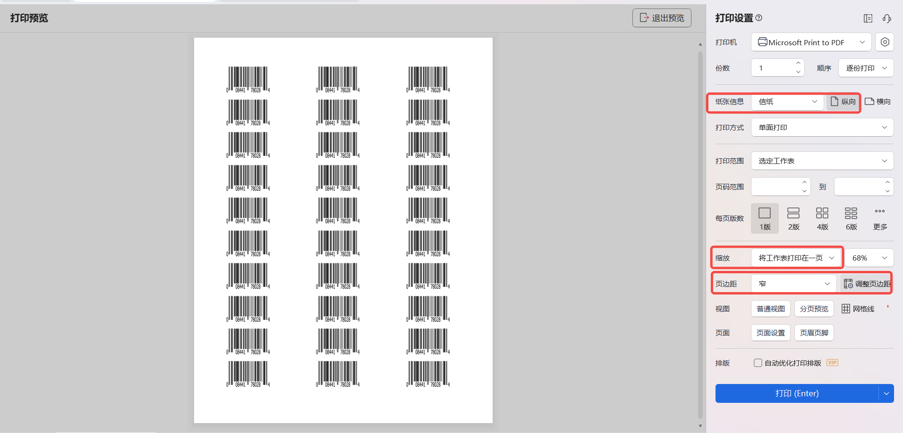

第六步：点击打印发送到打印机，或者保存为PDF

> 保存后的文件可以打开再次确认

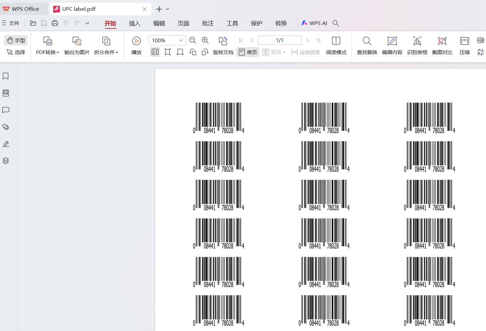
