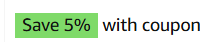
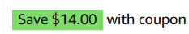
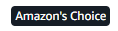
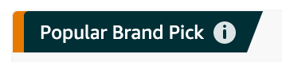
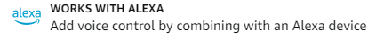

# 飞书文档：亚马逊Badge标

## 文档信息

| 项 | 内容 |
| --- | --- |
| 远程文档 | https://q1njej8cpab.feishu.cn/wiki/CS1NwapFwi6hoik67O5cQa8Vnpe |
| 图片处理 | 本地下载（assets/images） |
| 快照时间 | 2026-08-06 |
| 来源命令 | `lark-cli docs +fetch --api-version v2 --doc https://q1njej8cpab.feishu.cn/wiki/CS1NwapFwi6hoik67O5cQa8Vnpe --doc-format markdown --as user --format json --jq .data.document.content` |
| 格式处理 | fd-doc-markdown-sync/scripts/normalize-feishu-doc-markdown.mjs |

---

## 亚马逊Badge标

### 一、常见徽标

#### Deal Badge

限时促销徽章，通常正常运行的BD，LD，TOP Deal等Deal会在SEO及Listing页面，today's deal页面等位置显示。SEO及Listing界面样式如图：

#### Coupon

优惠券徽标，日常提交的不同额度Coupon会展示在SEO及Listing页面。不同位置样式如图：

1. SEO百分比折扣形式

 
2. SEO具体金额折扣形式

 
3. Listing内形式

 

#### Amazon's Choice

简称AC，亚马逊精选徽章，顾客在搜索特定关键词时可以在Listing页面及SEO页面看到。**美国站目前有所调整**，现在有Overall Pick，Popular Brand Pick，New Arrival Pick三种徽标。

1. Overall Pick可视为原Amazon Choice标，作为词下总体被选择最多的item，可以巩固词下最佳销售产品，让热卖品持续爆单，前台说明如下：Amazon's Choice: Overall PickProducts highlighted as 'Overall Pick' are:

 - Rated 4+ stars
 - Purchased often
 - Returned infrequently

 
2. New Arrival PickNew Released产品的鼓励标志，助力新品在市场推广
3. Popular Brand Pick“潮牌”流量品牌选择，词下做垂直覆盖面最广、数据最漂亮的品牌，鼓励卖家品牌建设、打造垂直品牌，前台说明如下：

 Amazon's Choice: Popular Brand Pick

 This brand is popular with other customers, and this product is:

 - Rated 4+ stars
 - Purchased often
 - Returned infrequently

 

#### Best Seller Badge

亚马逊某一细分类目下一定时间内销量排行第一的产品拥有Best Seller标志，系统会实时刷新。（要求该类目必须有100条Listing销售时该目录下才会有BS）。样式如图：

#### New Release

新上线的产品有机会获取，获得该徽章说明该产品在对应目录的所有新发布的产品中，当前时间内（亚马逊系统刷新周期内）销量第一

#### WWA：Work with Alexa

产品可以与亚马逊Alexa/Echo设备进行联动使用时，在获取对应认证后，可以在SEO页面和产品详情页展示

#### FFS：Frustration-Free Setup

亚马逊无障碍安装设置：是亚马逊提供的一项服务。

其主要特点是让消费者能够更轻松、便捷地设置和使用所购买的产品，减少在安装和启动过程中可能遇到的困扰和麻烦。

这通常意味着产品的包装更易于打开，包含清晰易懂的安装说明，可能还配备了必要的工具和配件，以简化安装流程，提升用户的购物和使用体验。

产品可以与亚马逊Alexa/Echo设备进行联动使用，且需要使用Amazon Simplified Setup配网技术，更快配网，获得对应认证之后，可在产品详情页展示

#### CFH：Certified for Humans

亚马逊人类认证：是亚马逊推出的一种认证标识。

获得这个认证意味着相关的产品在易用性、便捷性和智能连接性等方面达到了一定的标准，旨在为消费者提供更简单、直观和方便使用的产品体验。这些产品通常经过测试和评估，以确保它们能够轻松地融入人们的日常生活，减少使用过程中的复杂操作和困扰。

产品可以与亚马逊Alexa/Echo设备进行联动使用，且需要使用Amazon Simplified Setup配网技术，更快配网，与此同时，产品本身的质量、网络、信息等需要进一步保证，获得对应认证之后，可在Search Rank页面及产品详情页展示

#### CPF：Climate Pledge Friendly

气候友好承诺徽章：亚马逊参与了气候友好承诺项目，并且计划在2040年前实现零碳计划，获得条件为产品需要通过气候友好相关的任意19项产品认证中的1项，以及亚马逊自己的Compact by Design认证，获取后可以在SEO页面和产品详情页展示

- 认证获取要求：

 - 认证周期：预计3-6个月
 - 认证费用：7-8w人民币
 - 认证简介：申请此认证后，需要提供产品的BOM（含每种材料重量），从产品和包装原材料采购运输、进料、生产、加工、包装、出厂运输到产品报废等过程审厂培训、核查数据，通过计算出一份声明
- 作用：

 - 符合亚马逊保护环境、可持续发展宗旨
 - 有专门的展示版块
 - 增加顾客购买的理由

### 二、首图Badge展示优先级

亚马逊产品在SEO搜索页会展示不同的Badge，其中首图左上角会展示一些重要Badge，会影响用户浏览产品时的点击率（CTR）和转化率（CR），在一个产品同时获得多个Badge时，在SEO界面会有展示优先级，具体如下：

**Amazon's Choice** > **Best Seller** > **New Release**

### 三、核心Badge的获取

#### Best Seller获取

1. 获取方式：提升销量，通过运营策略，提升产品销量提升至目录#1，即可获得BS徽标
2. 作用：吸引顾客点击listing，提升产品流量和转化，提升SEO

#### Amazon's Choice获取

1. 获取方式：通过运营策略，调整有竞争力的价格，提升产品利润；在产品拥有获取AC资格时，进一步通过BD+SP Keyword广告策略获取关键词AC
2. 作用：吸引顾客点击listing，提升产品流量和转化，提升SEO；用户可通过Alexa语音购买产品

#### New Release获取

1. 获取方式：和Release Date有关，产品销量在新品排行榜销量达到#1，新品期三个月内都有可能获得
2. 作用：吸引顾客点击listing，提升产品流量和转化，提升SEO
