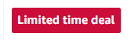
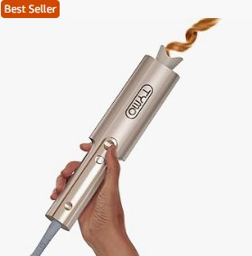
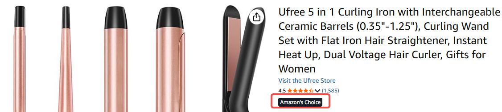
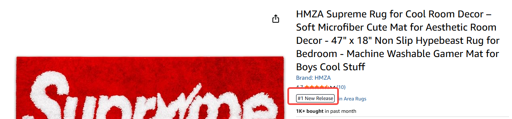

# 飞书文档：亚马逊名词释义

## Offer

- Offer：一个"offer"代指一个可供购买的商品销售链接，同一个卖家，offer创建的SKU不同，也可以对应创建多个不同的offer
- 1P offer：通常指VC供应商的销售offer，在前台显示为“ship from and sold by Amazon.com”
- 3p offer：通常指SC第三方卖家的销售offer，在前台显示为“ship from Amazon.com and sold by xxx（seller）”

## Listing

- ASIN：Amazon Standard Identification Number的缩写，亚马逊标准标识码，具有唯一性，不和其它产品共用，也不在其它平台通用
- Title：产品的标题，一般要求在200个字符以内
- Main Image：产品主图，特指产品第一张图
- LP：Listing Photo产品套图，一般情况下前台可以显示6张，点击图片可以查阅剩余未显示图片，后台可以上传更多
- BP：Bullet Points产品卖点描述，SC后台最多上传5条，VC后台至多上传10条，简洁扼要的说明产品的卖点
- Buybox：黄金购物车，买家最便捷的购物方式，当一个产品有多个卖家提供报价时，拥有buybox的卖家会取得最多的订单
- NM：Newer model或Newer Version，产品的新版本。卖家可以找客服添加。
- A+：图文版品牌描述，A+里面可以添加更多的图片和视频用于吸引顾客提升转化率
- PA+：高级A+，可以添加更多的展示模块和视频（VC付费、SC品牌卖家满足一定条件后免费）
- BSR：Best Seller Rank的缩写，指的是该品类目录下热销排行榜Top100，会显示产品在该目录下的实时排名
- SEO：Search Engine Optimization，搜索引擎优化。即产品在所搜索关键词下的位置排名，通过提高SEO位置给产品带来更多流量和销量
- Variation：变体关系，通常有一个父体和多个子体构成。根据产品的一个或者多个关键属性进行区分。
- Bundle：捆绑，即将多个ASIN捆绑在同一条listing内，可以合并Review，蹭流量，顾客仍旧可以下单某一个ASIN的产品
- Virtual Bundle：虚拟Bundle，即将多个产品捆绑销售，相当于顾客下单需要购买VB里面的所有产品，亚马逊系统可能自动创建，卖家也可以发case创建
- Feedback：客户下单才能给feedback，且只能针对服务或者物流，保留一年，直接决定账号表现，差评会导致评分降低
- Rating：亚马逊的一种评分方式，用户可以直接留评分，而无需留评论。通常一个产品下的rating数量会高于review数量。
- Review：只针对产品的评论，客户是否下单都可以留review，评论没有违反亚马逊政策的情况下会一直保留。通过领用VINE Voice产品留下的review有绿色的VINE徽标，真实购买后留下的review有橙色的Verified Purchase徽标（通常称作VP评论），未进行购买留下的review没有任何标识（一般叫做直评、可能是刷单留评、可能会消失）
- FBT：Frequently bought together，经常同时购买，亚马逊系统根据顾客的购物习惯自动生成
- Q&A：Customer Questions and Answers，用户针对产品在listing提出的问题及回复互动版块
- Sponsored：亚马逊AMS广告，用于卖家帮自己产品在亚马逊站内投流，展示在首页、SEO、Listing内不同位置

## Badge徽标类

- Deal Badge：Deal徽标，除Price Discount以外其他的Deal(秒杀活动)正常情况下都有该徽标（LD/BD/DOTD)，较为显眼，可以提升产品点击率

- Best Seller Badge：Best Seller Rank销量Top1的产品徽标，根据BSR排名实时变化更换产品，可以提升产品点击率和转化率

- Amazon's Choice：亚马逊精选徽章，顾客在搜索特定关键词时可以在搜索结果页和Listing页面看到，说明产品在该词下的表现较好

- New Release：专门针对新品，并且在新品榜单中销量表现最佳的产品会获得New Release标志

- CPF：Climate Pledge Friendly，气候友好承诺微章。亚马逊参与了气候友好承诺项目，并且承诺在2040年实现零碳计划，获取条件是产品要通过气候友好相关的任意一项认证，获取后可以在Search Rank页面及产品评情页看到

- Gift Guide：亚马逊节日礼物推荐，卖家或供应商需要投入较多资金才能获取，在亚马逊搜索结果页和Gift Guide专栏可以看到
- WWA：Work with Alexa，产品可以与亚马逊Alexa、Echo等设备进行联动使用，并且获得对认证后，即可在搜索结果页及产品详情页面显示

## Promotion类

- BD：Best Deal，持续一定时间的折扣，折扣要求最低10%off，大促15%off及以上（≤30天内最低价），最长可跑30天，建议跑7天或14天（避免影响到参考价）
- Coupon：优惠券，可自行设置百分比或者金额折扣，5%off-50%off
- LD：Lighting Deal，限时秒杀，不同站点，不同时间长度不一样；一般12h，大促节点可能时间会更长
- Top Deal：即以前的DOTD，一般为24h，大促节点时间可能会更长
- Spolight Deal/Wow Deal：特殊大促的DOTD，例如Prime Day，BFCM黑五网一，一般折扣要求20%以上
- PD：Price Discount，直接降价活动，无Deal标志
- PD：Prime Day，亚马逊会员日，每年7月推出亚马逊会员购物大型促销活动，持续2天，会员可在当天购买到秒杀价商品（一般折扣要求20%以上），卖家也可在活动期间获得更高的流量与销量
- FPD：Fall Prime Day，亚马逊秋季会员日，每年10月推出亚马逊会员购物大型促销活动，持续2天，会员可在当天购买到秒杀价商品（一般折扣要求20%以上），卖家也可在活动期间获得更高的流量与销量
- BFCM：Black Friday & Cyber Monday，黑色星期五&网络星期一，一般为11月第四个星期五以及紧接着的周一，美国、欧洲当地商场会推出大量降价促销活动，亚马逊也会在期间安排促销活动（一般折扣要求20%以上）
- Business Discount/Price：批发折扣价，供应商针对亚马逊批发类型商户设置的专属折扣价，与Promotion不叠加
- SNS：Subscribe & Save，亚马逊针对一些特定的消耗品提供的折扣服务，顾客勾选该选项后，购买满5个该产品时，后续继续购买该产品可以享受对应折扣，一般在5%-15%，亚马逊会按照约定的周期向顾客寄送产品；VC渠道通过case取设置
- PMP/PED：Prime Memmber Price/Prime Exclusive Discount，亚马逊会员专属折扣价，通常最低为10%
- Code：优惠码，顾客结算时可用该兑换码抵扣对应折扣金额/百分比，1%off以上（\$0.01)，可选择是否展示在详情页上
- OPS：Ordered Product Sales，为提交BD，LD等促销活动时预估的Promotion期间的销售额
- Lead Time：指从后台最早可以提交某种Promotion活动的时间，针对相同的promotion类型，不同供应商可能不同
- Promotion ID/PAWS ID：一般是指VC渠道提交promotion后系统生成的推广ID，一般会在和VM以及客服的沟通中使用该种说法
- PAWS(Promotion Approval Workflow Service)为亚马逊Deal团队审批Promotion的服务，VM或者客服一般会使用该说法
- Ever Green：亚马逊内部常见说法，指普通日常的时间段，对promotion的折扣和OPS要求比较低
- Deal Event：亚马逊内部常见说法，指大型的推广时间段，例如Primeday，BFCM，FPD，对折扣和OPS要求比较高
- Funding：通常是说供应商提交的Promotion时，需要返还给亚马逊MSRP-Deal Price的差额，或者协商的差额（可能收取Additional Funding）；Funding两种扣款方式，Funding直接在账户划走
- Flex Funding：按照卖出去的数量返给亚马逊差额，（MSRP-推广价格）\*销量
- Co Funding：按照卖出去的数量返给亚马逊差额，MSRP-推广价格-亚马逊愿意承担的金额
- Additional Funding：指MSRP-推广价格以外，亚马逊额外要求的funding。如果是由VM提交的促销，一般可以协商，主要是针对部分ASIN MSRP设置不合理，亚马逊觉得利润低了的情况

## 库存订单类

- VC：Vendor Central，即亚马逊的供应商账号。一般卖家账号为Seller Central。
- FC： Fulfillment Center，即FBA仓，也叫Amazon Facility
- PO：Purchase Order，亚马逊定期对VC进行商品采购，PO是VC最主要的订单类型
- DF：Direct Fulfillment，亚马逊VC模式下客户下单后产品直接从卖家的海外仓发货给客户，运费一般由亚马逊承担
- Ship Window：亚⻢逊规定VC的PO订单应完成发货的时间段
- Product identification Number：产品编码，常见的有：UPC， EAN， GTIN-14， JAN， ISBN， ASIN
- ARN： Amazon Reference Number，即 shipment ID
- ASN： Advance Shipping Notice， 每个ARN发货后，都要进行submit ASN的步骤，可理解为通知给亚马逊“我方已发货，商品已被装运”
- POA：亚马逊使用Purchase Order Acknowledgement (POA) 来下达PO，规划入库流量、预测库存水平，并确保有需求的Fulfillment Center为客户保留适量的产品
- Carrier：亚马逊合作承运人，亚马逊把要运输到Fulfillment Center的商品分配给各个合作承运人，承运人在约定时间到海外仓提走商品
- SCAC：Standard Carrier Alpha Code，用4个字符代码标识carrier，例如：【UPSN】代表 UNITED PARCEL SERVICE INC、【AMZX】代表 Amazon Freight LTL、【TFIN】代表 Tforce Freight 等等
- Shipment Mode：分为小包裹快递 (Small Parcel）和汽运零散托板/整车运输配送 (LTL/TL)
- BOL：Bill of lading，提货单。承运人(Carrier)来提走打托的货物时，VC会要求承运人(Carrier)在BOL上签名，并提供PRO，证明VC已将货物交付给carrier。如果货物在运输途中丢失则可以通过BOL等资料索赔
- PRO number：Progressive Rotating Order number，即tracking number，用于标识和跟踪待交付的货物。对于整车运输(FTL)和零担运输(LTL)，承运人来提货会提供PRO。如果没有PRO，就无法操作submit ASN
- POD：Proof of Delivery，物流证明。当货物被提走而Fulfillment没有接收到时时，可以用POD作为证据索赔
