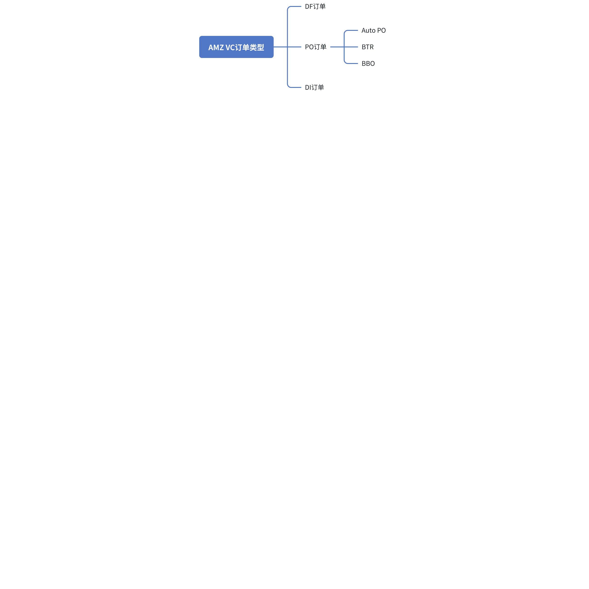
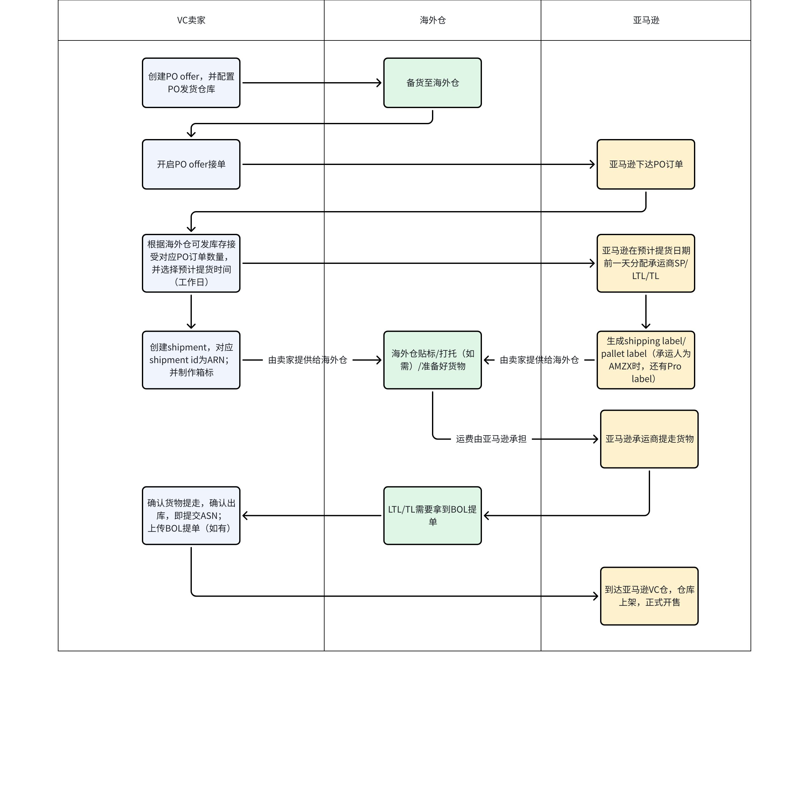
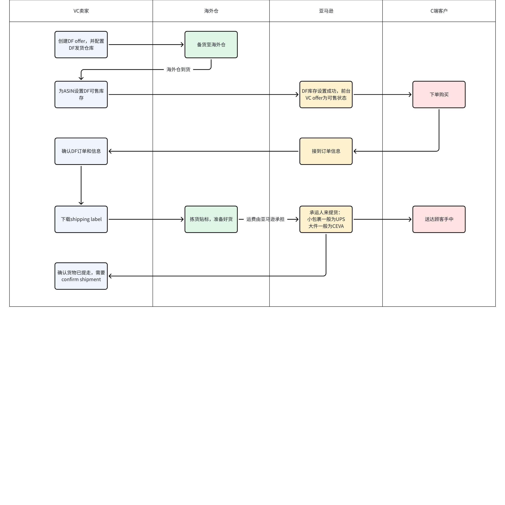

# 飞书文档：VC订单类型介绍

VC订单类型介绍

## VC订单类型

### PO订单**（Purchase Order，采购订单）**

PO订单是亚马逊与供应商之间达成的正式采购协议，通常由亚马逊发出，要求供应商提供一定数量的商品并发货到亚马逊的仓库。PO订单分为：

- **Auto PO订单：**

 - 亚马逊自动下达采购订单；
- **BTR订单：**

 - 上架VC初期不想做DF，也没有自动来PO单，可以申请BTR，亚马逊审核通过后会来对应的PO订单，处理流程和自动PO订单一样
 - 已经在VC是成熟的产品，自动PO单数量不够支撑后续推广销售，可以申请BTR，提前把货备至VC仓库
- **BBO订单：**

 - 亚马逊认为您的产品在VC的销售表现比较好且亚马逊利润率合理的情况下，会下大批量的BBO采购订单。
 - 特点：采购数量较大，留给卖家的备货周期较一般PO更长，但要求给采购价打折。因此，可以选择不接受、全部接受、部分接受

### DF订单

DF订单是指亚马逊作为平台销售商时，供应商直接将商品发货给最终消费者的订单。也就是说，当消费者在亚马逊下单后，亚马逊会将订单信息传递给供应商，供应商直接从其仓库发货给消费者。

- 刚转入VC，由于历史数据积累不足，亚马逊还没有下PO采购单
- 成熟产品VC仓可售库存数量不足，VC在途库存无法衔接VC可售库存
- 多包裹产品（单SKU就需要多个箱子来装）入驻VC
- 电池功率超过300W的产品无法使用PO订单，只能做DF

### DI订单

通常是指货物在产地国港口交货，然后由亚马逊指定的货代运往亚马逊的配送中心，海运费由亚马逊负责。

## PO订单

### PO订单流程

### PO订单常见问题

1. **PO订单下单影响因素：**我们无法得知亚马逊准确的PO下单逻辑，但有以下几个因素给大家进行参考

 - **产品销量水平：**亚马逊会根据产品的历史销量水平评估产品未来销量表现，参考此数据下PO采购订单。
 - **产品VC库存水位：**亚马逊会保持产品在VC的库存量处于一个健康的水位，库存过多会导致亚马逊仓储成本增加，库存过低会有VC断货风险丢失销售机会造成损失；一般在4-6周的库存水位。黑五大促、淡旺季产品亚马逊会提前下单。
2. **下单时间：**亚马逊自动PO采购订单基本会在中国时间**每周一下午4点左右**下达，有时可能会延迟几个小时。
3. **SC老品转入VC多久下单：**按照目前的情况来看，有一定基础的产品基本上第二周就会来PO订单
4. **PO订单发货会分配几种运输模式：**SP（小包裹）、LTL（零担卡派）、TL（整车卡派）；具体取决于这票货物的量/或者产品本身较大无法走小包裹模式。
5. **PO发货要贴什么标签：**

 1. SP：产品条码、箱标、运输标签
 2. LTL/TL：产品条码、箱标、托盘标签；还要填写BOL（注意：当运输模式为LTL，且承运人(运输商)为AMZX时，还需要张贴PRO label（运输标签））
 3. 如果您的产品在SC做过透明计划，则PO发货的时候需要贴上T-code，建议备货到海外仓时提前贴好T code

## DF订单介绍

### DF订单流程

### DF订单常见问题

1. **DF销售时，亚马逊前台配送时效较长**

 1. 可能由于您的海外仓距离您所选择的邮编地址较远，配送时效需要很久【解决办法：多DF仓库发货】
 2. 可能由于您的海外仓处理该产品的发货时效太差，亚马逊自动延长了你“处理DF订单发货所需时间”【解决办法：提高海外仓DF订单发货效率 或使用平台仓】
2. **DF订单的发货时间有多久**

 1. 根据亚马逊分配的物流商可能有所不同，每一笔DF订单都会有一个发货截止时间，请保证在发货截止时间前发货，并确认出库“即Confirm Shipment”
3. **亚马逊的DF订单的承运商有哪些**

 1. UPS：一般承接小包裹，一般的海外仓UPS都会定时来取货
 2. CEVA: 一般承接大件重货，可能需要打托发货；CEVA来提货的频率比较低，如果您的产品被分配了CEVA，需及时联系物流同事预约CEVA获取对应标签，避免迟发

 【注：DF订单分配的承运商无法修改，必须按照对应的承运商进行发货】

4. **DF订单发货需要贴什么标签**

 1. 必备：Shipping Label标、托盘标（如有）
