# Transparency 透明计划操作指南

> 说明：本文已结合原 PDF 文本层整理为可检索 Markdown，保留关键业务信息、重要链接和模板图片，移除了水印、页脚、页码和整页截图占位。

**最后更新时间**：2026-06-25

## 目录

- Transparency 上线流程图概览
- 1. 阶段一：完成账户创建
- 2. 阶段二：注册 ASIN，贴标出货
  - 2.1 标签类型选择及贴标规范
  - 2.2 服务商打印 VS. 自助打印方式对比
  - 2.3 配置 ASIN 方式
  - 2.3.1 （新）分步指南配置 ASIN
  - 2.3.2 电子表格模板配置 ASIN
  - 2.4 ASIN 配置注意事项/失败原因
  - 2.5 自助编辑商品信息
  - 2.6 如何请求/下载标签
- 3. 阶段三：OPR 评估
  - 3.1 OPR（运营表现评估）介绍
  - 3.2 【重点】什么时候开启 OPR
  - 3.3 操作开启 OPR
  - 3.4 纯自发货 OPR 快速通道
- 4. 阶段四：保护开启
  - 4.1 【重点】什么时候触发保护
  - 4.2 保护机制解析、保护逻辑解读、保护效果查询
- 5. Transparency 附加功能/政策
  - 5.1 Customer Engagement（CE 买家互动功能/售后信息卡）
  - 5.2 T-Badge（小蓝标）
  - 5.3 退货分析
  - 5.4 应用两个代码
- 6. Transparency 透明计划费用相关问题
- 7. 常见问题问答
- 8. 发送邮件模板

## Transparency 上线流程图概览

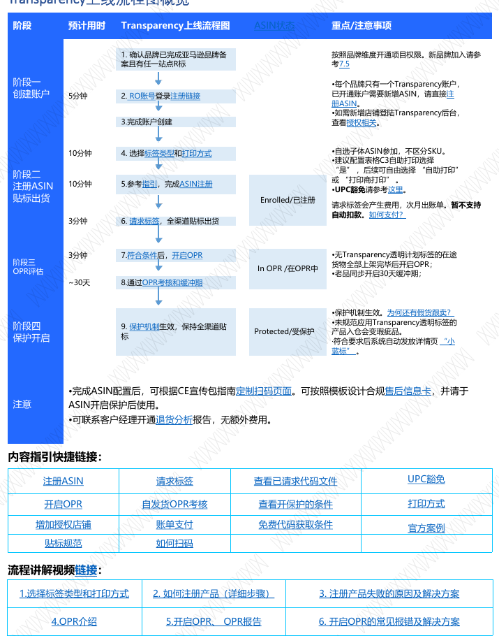

| 阶段 | 预计用时 | 关键动作 | ASIN 状态 | 重点/注意事项 |
| --- | --- | --- | --- | --- |
| 阶段一：创建账户 | 约 5 分钟 | 确认品牌已完成亚马逊品牌备案且有任一站点 R 标；RO 账号登录注册链接；完成账户创建 | - | 按品牌维度开通项目权限。每个品牌只有一个 Transparency 账户；已开通账户需要新增 ASIN 时直接注册 ASIN；如需新增店铺登录 Transparency 后台，参考授权相关说明。 |
| 阶段二：注册 ASIN、贴标出货 | 约 10 分钟 + 3 分钟 | 选择标签类型和打印方式；参考指引完成 ASIN 注册；请求标签并全渠道贴标出货 | Enrolled/已注册 | 自选子体 ASIN 参加，不区分 SKU。建议配置表格 C3 自助打印选择“是”，后续可自由选择“自助打印”或“打印商打印”。请求标签会产生费用，次月出账单，暂不支持自动扣款。 |
| 阶段三：OPR 评估 | 约 30 天 | 符合条件后开启 OPR；通过 OPR 考核和缓冲期 | In OPR/在 OPR 中 | 无 Transparency 透明计划标签的在途货物全部上架完毕后开启 OPR；老品同步开启 30 天缓冲期。 |
| 阶段四：保护开启 | 系统自动触发 | 保护机制生效，保持全渠道贴标 | Protected/受保护 | 保护机制生效后仍需排查历史库存、跟卖站点等情况；未规范应用 Transparency 透明标签的产品入仓会变瑕疵品；符合要求后系统自动发放详情页“小蓝标”。 |

**注意事项**

- 完成 ASIN 配置后，可根据 CE 宣传包指南定制扫码页面。
- 可按照模板设计合规售后信息卡，并请于 ASIN 开启保护后使用。
- 可联系客户经理开通退货分析报告，无额外费用。

**内容指引快捷链接**：注册 ASIN、请求标签、查看已请求代码文件、UPC 豁免、开启 OPR、自发货 OPR 考核、查看开保护的条件、打印方式、增加授权店铺、账单支付、免费代码获取条件、官方案例、贴标规范、如何扫码。

**流程讲解视频链接**：选择标签类型和打印方式；如何注册产品（详细步骤）；注册产品失败的原因及解决方案；OPR 介绍；开启 OPR、OPR 报告；开启 OPR 的常见报错及解决方案。

## 1. 阶段一：完成账户创建
祝贺您完成第一阶段：成功注册Transparency透明计划账户。您现在可用RO账号登陆
Transparency透明计划后台，请参考如下页面功能导览：
### 阶段一常见问题：如何添加新用户？

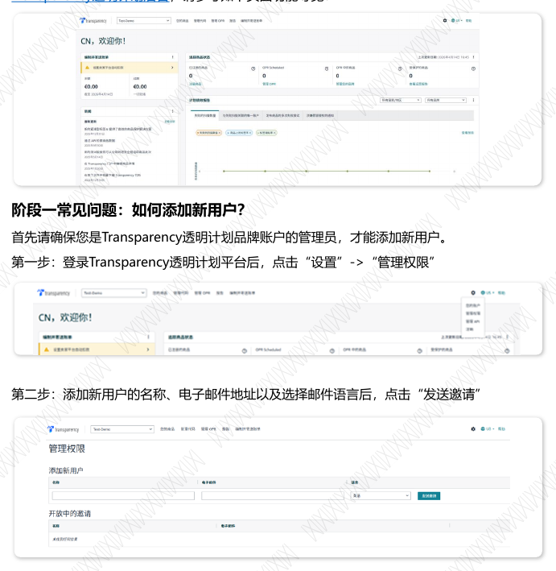

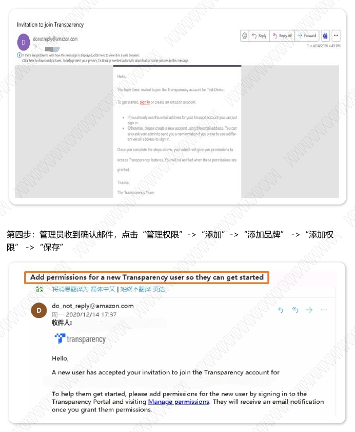

首先请确保您是Transparency透明计划品牌账户的管理员，才能添加新用户。
第一步：登录Transparency透明计划平台后，点击“设置”->“管理权限”
第二步：添加新用户的名称、电子邮件地址以及选择邮件语言后，点击“发送邀请”

第四步：管理员收到确认邮件，点击“管理权限”->“添加”->“添加品牌” ->“添加权
限” ->“保存”
第三步：新用户点击邀请邮件中的“登录”按钮，使用受邀邮箱及密码完成登录。

完成后，新用户和品牌都将收到权限开通成功的邮件
## 2. 阶段二：注册 ASIN，贴标出货
在第二阶段，您需要先确认以下三个信息，即可操作完成商品注册：视频讲解
• 选择需要开启保护的商品 ：您可以注册品牌下的所有 ASIN，也可以注册部分 ASIN。
ASIN维度推进Transparency开启保护流程。
• 选择商品的标签样式：根据您想要呈现的信息及包装设计，选择不同的Transparency透
明计划标签样式，具体请阅读后文2.1标签类型选择及贴标规范
• 选择如何打印标签 ：请确认自助打印或者服务商打印 。具体请阅读后文 2.2自助打印或
服务商打印对比。
o 自助打印: 使用热转印打印机(300像素及以上)，自行打印代码标签。

打印商列表
官网
透明计划后台帮助页面Transparency
o 通过服务商打印: 您可以选择将请求的标签CSV文件发给标签打印服务商进行标签打印。您可在打印商列表里
找到服务商列表和联系方式。如您选择服务商打印，需要提供品牌编号Brand ID给服务商，请发邮件给
Transparency透明计划客户经理查询该编号。
o 其他方式：Transparency透明计划还支持代码互通（如果您的产品已具备序列化代码），详情请参考官网 ；
以及API接入（兼容您的系统操作标签打印），详情请参考Transparency透明计划后台帮助页面。
完成以上三步信息确认后，您就可以开始注册ASIN。具体操作指引请阅读2.3如何配置ASIN。
### 2.1 标签类型选择及贴标规范

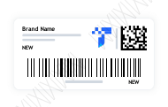

预定义标签
品牌可以从六种预定义的
Transparency透明计划标签中
选择最符合其包装或运营要
求的标签类型。
自定义标签
品牌可以选择将Transparency透
明计划代码内容整合至自定义
标签或商品特定标签中，再粘
贴至商品包装上。
嵌入式标签
品牌可以将Transparency透明计
划代码内容直接整合 （嵌入设计）
至现有面向消费者的包装中。选
择此方案时，商品的UPC或
FNSKU码与Transparency透明计划
代码需放置在相邻位置。
LOGO
BRAND
Bottle Label
Brand Na m e
N E W
N E W
Brand Name
NEW
NEW
Transparency透明计划一共有三种代码标签类型：

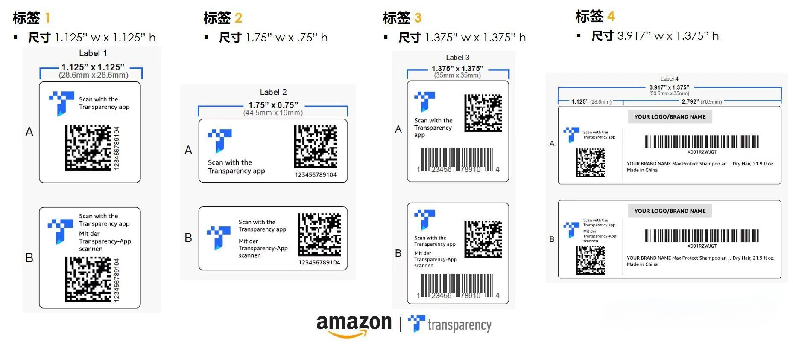
方案 1 方案 2 方案 3
Transparency 透明计划贴标指南现已全面更新！请点击下方链接获取最新的贴标指南：
点击获取最新Transparency透明计划贴标指南
点击获取
最新Transparency 透明计划贴标指南

标签5
标签2的放大版本，与标签2样式一致。标签
5仅适用于自助打印下载PDF格式的标签。
标签6
标签4的缩小版本，专为包装空间有限的商品设计。此标
签无需包含品牌标识（LOGO）和扫码指引（CTA）。
Scan withtheTrans-
parencyapp
123456789104
Label 5
2.0”x 1.0”
(50.5mmx 25.3mm)
Label 6
2.0”x 1.0”
(50.5mmx 25.3mm)
Brand Name
Product name...description
20 fl oz.
NEW
Do not cover
123456789104 NEW
标签1和标签2
推荐用于商品包装上已印刷有GTIN条形
码的情况。这两种标签必须包含产品标
识码信息，确保Transparency透明计划
代码被正确粘贴至对应商品。品牌方可
以自行确定所使用的产品标识码类型
（GTIN、SKU等）。
标签3
推荐用于希望将
Transparency透明计划代
码与GTIN条形码（UPC,
EAN等）合并使用的情况。
GTIN条形码与FBA入库条
形码一致。
您可以选择自助打印标签或由服务商（TSP）或其他印刷供应商打印，两种方式对比和要求参阅详情。
下图展示了六种预定义的标签样式及其最小尺寸要求，二维码和数据矩阵码尺寸要求参阅详情。
ScanwiththeTrans-
parencyapp
123456789104
Scan withtheTrans-
parency app
123456789104
Label 1
1.125”x 1.125”
(28.6mmx 28.6mm)
Label 2
1.75”x 0.75”
(44.5mmx 19mm)
Product ID
Scan with the
Transparency
app
Label 3
1.375”x 1.375”
(35mm x 35mm)
1 23456 78910 4
Scan with the Trans-
parency ap p
Label 4
4.00”x 1.375”
(101.6mmx 35mm)
123456789104
YOURLOGO/BRANDNAME
1.125”(28.6mm) 2.875”(75.0mm)
YOURBrANDNAME Your Product Name NEW
推荐使用 标签4
推荐用于将Transparency透明计划代
码与FNSKU或GTIN条形码合并使用
的情况。此标签需包含品牌标识
（LOGO）并标注商品状态（NEW或
USED）。FNSKU/GTIN条形码与FBA
入库条形码一致。
标签3、标签4与标签6将Transparency透明计划代码与产品识别码合并，适配包括有限包装空间内的更多场景。更多信息请查看
Transparency透明计划后台关于标准标签的内容。
#### 2.1.1 预定义标签
推荐使用
推荐使用
推荐使用

#### 2.1.2 自定义标签

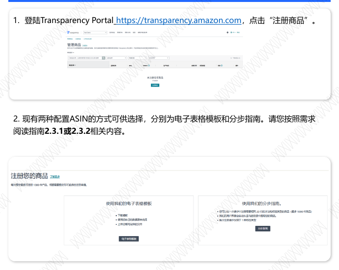

若您的商品已贴有标签，可选择将Transparency透明计划代码整合至现有标签中，无需黏贴额外
标签。如需要修改预定义的标签以满足贴标需求，您也可以使用自定义标签，通过与
Transparency透明计划服务商（TSP）或其他印刷供应商合作来制作。您需要将自定义标签发送
给Transparency透明计划经理协助查看，确保标签可正常扫描。标签示例参阅详情。
打印商联系方式：点击链接下载：
https://drive.weixin.qq.com/s?k=AMkAYwcEAA4g4FigVk
### 2.2 服务商打印 VS. 自助打印方式对比
方式 Transparency 服务提供商打印（TSP） 自助打印（IPP）
简介
A.可直接将下载的标签CSV文件发送至打印商打印（打印商列表参
考下方，自行联系）
B.打印商代为操作请求标签和打印事宜（联系打印商获取API授权
详情）
需提前在ASIN配置表格填写自助打印信息（参考
下文“自助打印标签类型怎么填”）。成功后，
即可下载含有标签图像的PDF文件，自行打印。
费用 ￥0.04-￥0.1/张，需自行联系打印商确定标签类型和数量确定价
格 自备耗材
提前配置 否（API授权需操作邮件授权） 是
文件格式 CSV PDF
颜色 彩色 黑白
耗时 2-3工作日 自行安排，节省订购/交货时间
注意事项 1.已配置成功的ASIN后续需要增加自助打印，可根据指南2.5添加自助打印方式。
自助打印需准备耗材：
#### 2.1.3 嵌入式标签
您可以通过与服务商（TSP）或其他印刷供应商合作，将Transparency透明计划代码内容整合到
现有包装设计中。具体嵌入式设计的流程以及最小尺寸要求参阅详情。
### 2.3 配置 ASIN 方式
1. 登陆Transparency Portal https://transparency.amazon.com，点击“注册商品”。
2. 现有两种配置ASIN的方式可供选择，分别为电子表格模板和分步指南。请您按照需求
阅读指南2.3.1或2.3.2相关内容。
#### 2.3.1 （新）分步指南配置 ASIN

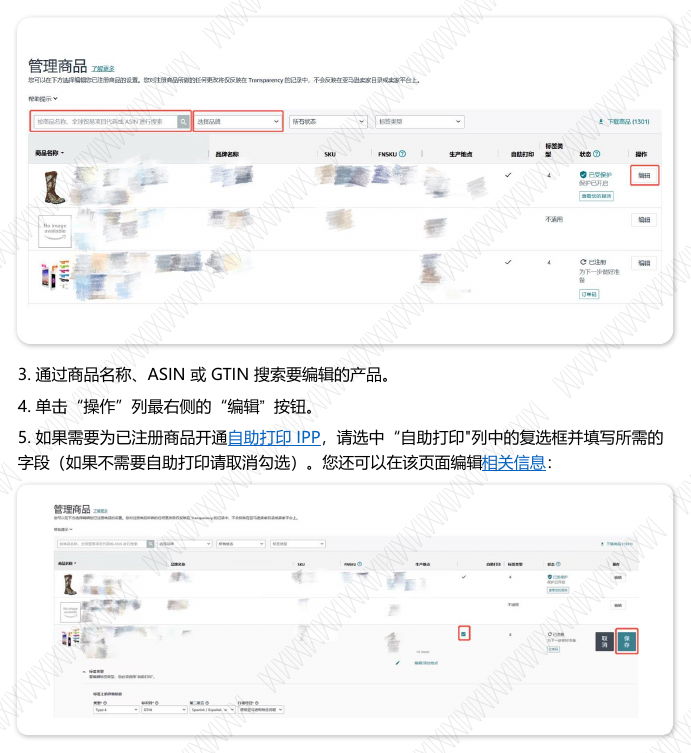

1. 选择商品
在页面中勾选您计划配置的ASIN。
##### 注意事项
a. 若您的商品没有出现在列表中，建议您选择填写电子表格模板来注册对应商品。
b. 所勾选的ASIN需要选择相同的打印方式及标签类型。若您需要选择不同的打印方式及
标签类型，建议您分开提交配置申请。

2.选择标签打印方式
自助打印请勾选：我想自行打印。接下来会跳转到选择标签类型。
打印商打印请勾选：我想使用服务提供商或商用打印机。无需选择标签类型。
##### 注意事项
a.建议您选择自助打印，后续生成标签同时保留 PDF 和 CSV 两种格式，可以自由切换打
印方式。如果选择打印商打印，则只有 CSV 格式，只可选择打印商打印。
3. 选择标签类型和商品识别码
根据需求，请你为标签选择：
a. 标签类型（共6种标签类型）

b. 商品识别码ID（SKU,GTIN,FNSKU）
i. 选择“标签 1”或“标签 2”的自助打印标签类型需要手动输入 SKU和GTIN 信息，
选择“标签4”或“标签6”需要手动输入GTIN和FNSKU信息。（如果是FNSKU
入仓，识别ID请选择FNSKU ）。
ii. Transparency 透明计划要求 ASIN 必须有 GTIN（UPC/EAN）。
如果您的 ASIN 本身有 UPC，系统将自动同步。
如果您的 ASIN 是 UPC 豁免，请为您的 ASIN 准备一个全新未使用过的 UPC，仅
用于 Transparency 透明计划配置，不需要对 listing 进行更新，listing 可保持豁
免不变。
注意这个 UPC 请不要重复使用。每个UPC豁免的 ASIN 都需要配备未使用过的全
新 UPC。
c. 行动呼吁：使用Transparency透明计划app/亚马逊app扫描
d.（选填）标签上的第二种语言
e. 每件商品应用两张 Transparency 标签：非服饰鞋靴类目产品建议您选择“我不需要双
代码”。若您的 ASIN为服饰鞋靴类目产品，请您阅读 5.4 部分了解双码选项。若您确认
能为每个产品贴两个代码 ，分别应用于产品外包装与产品本身 ，您可选择“我需要双代
码”。

⚫ C3（自助打印或服务商打印选项）：若选“是”，则代表需要设置自助打印，请填写表
格关于自助打印的内容；选 “否”，代表联系服务商打印，无需填写表格中关于自助打
印的内容。
【小提示：建议您此项选择 “是”，后续生成标签同时保留 PDF和CSV两种格式，可以自
由切换打印方式。如果选择“否”，则只有CSV格式，只可选择打印商打印】
⚫ C4（每件商品应用两张 Transparency标签）：非服饰鞋靴类目产品建议您选择 “否”，
O列留空。若您的ASIN为服饰鞋靴类目产品，请您阅读5.4部分了解双码选项。若您确认
能为每个产品贴两个代码，分别应用于产品外包装与产品本身，您可选择“是” ，并在
O列选择具体第二个代码应用的位置。
⚫ Transparency透明计划要求 ASIN必须有 GTIN（UPC/EAN）。如果您的 ASIN本身有
UPC，请填写其对应UPC号即可。如果您的ASIN是UPC豁免，请为您的ASIN准备一个
全新未使用过的UPC，仅用于Transparency透明计划配置，不需要对listing进行更新，
Listing可保持豁免不变。
注意这个UPC请不要重复使用。每个ASIN都需要配备未使用过的全新UPC。
a.表格的C3, C4单元格为必选项：
b. GTIN（UPC/EAN）怎么填：
#### 2.3.2 电子表格模板配置 ASIN（视频讲解）

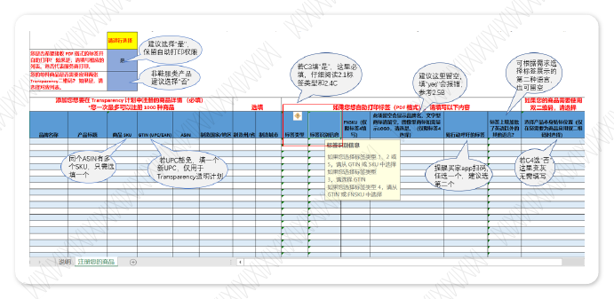

##### 操作流程

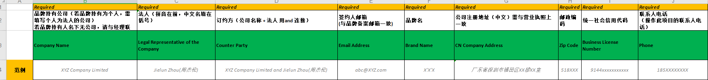

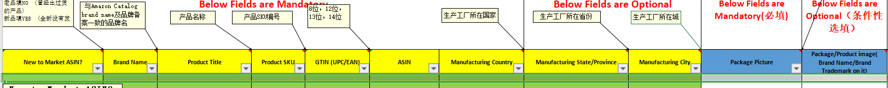
1. 点击“下载文件”下载PCT模板，再完成填写并保存。

### 2.4 ASIN 配置注意事项/失败原因
#### A. 注意事项
⚫ 配置以ASIN为单位，即便多个站点有不同的SKU，ASIN号相同则只需配置一次，可选择
方便识别的SKU填写。后续按照ASIN维度请求代码，即便是不同的店铺/站点/SKU发货，
都按照对应ASIN号来一物一码应用Transparency透明计划二维码。
#### B. 配置失败原因（视频讲解）
当您使用电子表格模板配置ASIN，上传后任务状态出现“失败”字样，说明配置失败，请单击
“查看文件”，查看表格中“后续步骤”一栏的系统报错提示内容。
##### 失败类型一：表格信息填写重复或错误
c. 自助打印标签识别信息(J列) 怎么选：
⚫ 如果确定需要自助打印（C3选择“是”），请注意：
标签1/标签2/标签5对应的标签识别信息为SKU或GTIN；标签3对应的标签识别信息为
GTIN；标签4对应的标签识别信息为GTIN/FNSKU，请正确选择。标签识别信息（产
品识别符）只是帮助品牌识别标签属于哪个产品，没有站点和店铺的区分，也不会影响
标签扫描效果。具体见本指南2.1标签图示中的红色框内内容。
⚫ L列建议留空，届时标签上会显示品牌名。
d. 行动号召/贴行动呼吁的标签 (M列) 怎么选：
⚫ 此列为必选项。 提醒买家用哪一个app扫码，建议选择“scan with Amazon app”.
系统报错提示内容（原文） 可能的原因 需要采取的行动
该商品已注册。请访问代码请求页面以订购
Transparency 代码。如果您尝试编辑或更
新任何商品信息，请访问管理商品页面，您
可以在那里直接编辑您的商品。
ASIN已被注册
请在Code Requests页面搜
索该ASIN，若已出现，则
代表该ASIN已注册过，无
法也无需重复添加。
所提供的全球贸易项目代码已针对其他
ASIN 进行了注册。如果您想注册所提供的
ASIN，请使用目录中列出的全球贸易项目
代码重试
GTIN (UPC/EAN)
信息有误
请在Code Requests页面搜
索是否已有其他ASIN使用
了该GTIN，如已使用，则
需更换其他未使用过的
GTIN。
您似乎没有注册此商品的权限。请检查您登
录的账户是否正确，或者您可以联系您的
Transparency 管理员或权利所有者以获得
相应的权限。
登录品牌A的账号但
上传了品牌B的
ASIN表格
（报错提示：您没
有权限上传表格）
请自查登陆的邮箱是否属于
申请ASIN的品牌下，具有
权利所有者权限的邮箱，或
右上角切换主体再次尝试
（若有多个品牌），并使用
与品牌对应的账号上传表格

### 2.5 自助编辑商品信息
用户可以在 Transparency 透明计划自助服务平台上对已注册商品信息进行自助编辑，包括：
商品标题，SKU，FNSKU，开通/取消 IPP，标签信息（标签类型，标识符，行动号召，和标
签上的第二种语言）。
#### 2.5.1 操作步骤

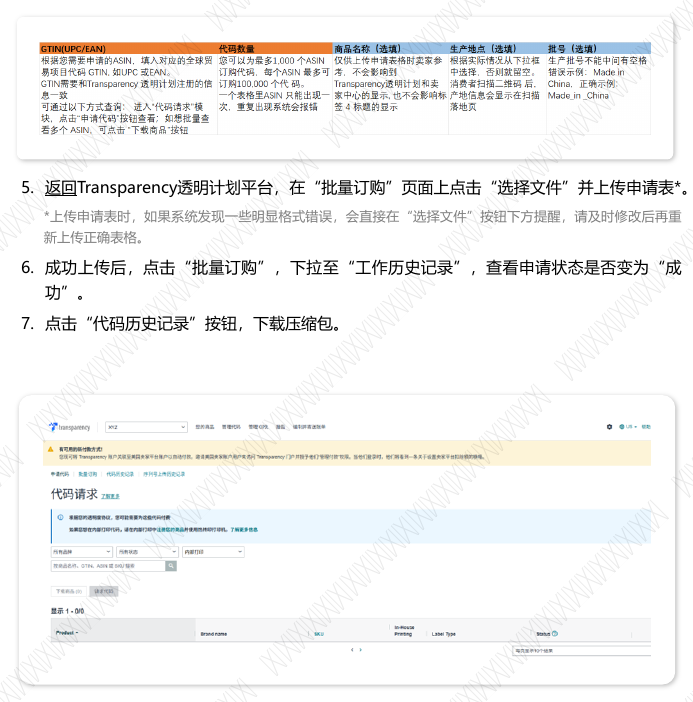

1. 登录到 Transparency 透明计划自助服务平台 - “您的商品”，下拉菜单选择“管理商品”
可以进入到 商品列表。
如果排除上述所有情况，仍未发现可能原因，请勿重新上传表格，请耐心等待3个工作日。在
此期间，您的Transparency客户经理会做进一步查询并发送邮件给您。请您收到邮件后，根
据邮件内容提供相应信息。
2. 单击“管理商品”可以查看商品列表上方的帮助提示。如果您有多个品牌, 请首先确保您已
从页面顶部的下拉菜单中选择适当的品牌账号。
系统报错提示内容（原文） 可能的原因 需要采取的行动
您似乎没有注册此商品的权限。 请检查您登录
的账户是否正确，或者您可以联系您的
Transparency 管理员或权利所有者以获得相应
的权限。
ASIN与品牌归
属问题
无需行动，请等待客户经理邮
件联系。
若您的ASIN品类与申请
Transparency的品牌商标品类
不一致，则可能无法加入。
商标/品牌名不
匹配
##### 失败类型二：ASIN/商标/品牌名不匹配
续前表
系统报错提示内容（原文） 可能的原因 需要采取的行动
提供的全球贸易项目代码与亚马逊目录中列
出的全球贸易项目代码不匹配。请使用目录
中的全球贸易项目代码重试。有关如何获取
目录中所列出全球贸易项目代码的说明，请
参阅此处：Link
ASIN在亚马逊卖家
后台已有对应的
GTIN，并且和产品
添加表格中填写的
GTIN不符
无需更多操作，我们会以卖
家后台的GTIN进行配置，
请在2-3个工作日后查看
Code Requests页面是否已
出现相关ASIN。

3. 通过商品名称、ASIN 或 GTIN 搜索要编辑的产品。
4. 单击“操作”列最右侧的“编辑” 按钮。
5. 如果需要为已注册商品开通自助打印 IPP，请选中“自助打印"列中的复选框并填写所需的
字段（如果不需要自助打印请取消勾选）。您还可以在该页面编辑相关信息：
6. 完成所有编辑后,请单击"操作"列中的"保存"按钮。
#### 2.5.2 注意事项
1. 目前每次您只能编辑一个商品的信息。并且“双码”和“产地信息”是无法编辑的。
若需要修改“双码”，请参考邮件模板8.2发送邮件至Transparency 透明计划客户经理邮
箱申请处理。

如果您的ASIN数量较多，可选择【批量订购】，步骤如下：
1. 使用Rights Owner 账号登录登录Transparency透明计划平台
2. 点击 “代码请求” ->“批量订购”->“下载文件” -> 下载模板表格
3. 打开表格模板，仔细阅读“说明”里的填写指引，点击表格上方“启用编辑”开始填表。
4. 切换并填写“订购您需要的代码 ”， “GTIN(UPC/EAN)”和“代码数量”为必填项，
其他为选填。
请点击此链接请求标签: https://transparency.amazon.com/v2/codes/request
目前标签请求支持【单独请求】及【批量请求】2种方式。
如果您的ASIN数量不多，你可选择【单独申请】，步骤如下：
1. 点击您要申请的 ASIN 在下列空白格里输入数量，在lot number（批次号）那边输入本次
下载数量的批次号 ，用于追踪后续的 退货分析。该批次号会显示在标签下方 ，自行定义，
根据需求填写，没有可以不填。
2. 点击 Submit（提交）。请勿重复点击，请求代码提交之后就会产生费用 ，出现在次月产
生的账单中。
若需要修改“产地信息”，请写明ASIN号，原产地，新产地，修改理由等信息，以“修改
ASIN产地信息”为邮件主题，发送邮件至Transparency 透明计划客户经理邮箱申请处理。
2. Transparency 透明计划商品信息修改仅影响 Transparency 透明计划的商品信息，不会同
步到卖家平台。
3. 若您自助修改了标签类型为标签4，会默认在标签4上显示品牌logo（如有）或品牌名。若
您需要显示品牌LOGO，请写明ASIN号，修改理由等信息，以“自助修改标签类型4后需要显
示品牌LOGO”为邮件主题，将清晰的品牌logo图片作为附件, 发送邮件至Transparency透明
计划客户经理邮箱申请处理。
### 2.6 如何请求/下载标签（视频讲解）
#### 2.6.1 请求标签

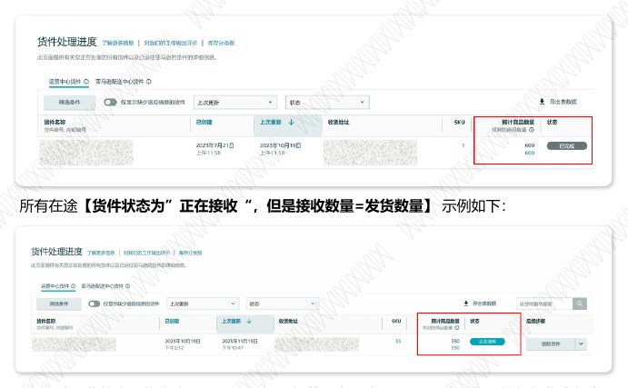

5. 返回Transparency透明计划平台，在“批量订购”页面上点击“选择文件”并上传申请表*。
*上传申请表时，如果系统发现一些明显格式错误 ，会直接在“选择文件”按钮下方提醒，请及时修改后再重
新上传正确表格。
6. 成功上传后，点击“批量订购”，下拉至“工作历史记录”，查看申请状态是否变为 “成
功”。
7. 点击“代码历史记录”按钮，下载压缩包。
#### 2.6.2 下载代码
请点击以下链接查看/下载标签文件: https://transparency.amazon.com/v2/codes/history
在请求标签页面左上角-点击“编码历史记录”查询历史申请记录，按照需求下载PDF（自助
打印）或CSV文件（联系打印商打印）。

相关提示1：
• 一物一码，每个代码都是独一无二的，且不会过期。同一个标签只能用一次，请不
要重复使用。
• 请按照ASIN维度全渠道贴标出货（多站点/多店铺也需要贴标）。
• 亚马逊配送 (FBA) 货件：请参考下文 3.2 和 3.3， 在合适的时间为对应 ASIN 操作开启
OPR。不开启OPR，仓库不会检查Transparency代码，无法进行贴标评估，ASIN不会开保
护。 开启OPR评估后，请务必正确贴标发货，以便早日通过评估、开启保护。
• 自行配送 （MFN）或通过非亚马逊物流服务配送的货件：请参考下文 3.4，提交照片进行
OPR考核。
## 3. 阶段三：OPR 评估
### 3.1 OPR（运营表现评估）介绍
什么是OPR？-视频讲解
OPR（运营表现评估）可让亚马逊验证您是否为已注册 Transparency 计划的商品正确贴标。
注意： OPR评估通过是开启保护的先决条件。您用于配送货件的方式决定了您启用 OPR 的方
式：

相关提示2：
1. 开启OPR和贴标发货二者没有前后顺序要求，并无要求开 OPR 后才能发货。注册ASIN成
功后即可开始维持全渠道贴标发货。在 OPR 评估开启后确保有贴标货入仓即可计入考核
2. OPR评估是以ASIN为单位进行考核，因此，
⚫ 参加Transparency透明计划的ASIN 发货可以与未参加Transparency的ASIN混发；
⚫ 开启OPR时，只要参加Transparency透明计划的ASIN已完成所有未贴标货物的接收，即
可操作开启OPR，即使同票货物其他不参加Transparency透明计划的ASIN未完成签收，
也不影响。
所有在途【货件状态为”正在接收“，但是接收数量=发货数量】 示例如下：
2. 后续出货的商品均会应用Transparency标签。在开启 OPR后，建议您尽快根据您常规发
货周期/数量，安排较快的物流模式将下一批贴有Transparency 标签的商品发往 FBA 仓
库进行OPR 评估。
### 3.2 【重点】什么时候开启 OPR（视频讲解）
开启OPR的具体时间由您自己设置。若您配置成功的ASIN满足如下条件，请尽快为对应ASIN操
作开启OPR：
1. 所有在途未贴Transparency透明计划标签的货件/海外仓库存已被FBA接收完毕，即【货件
状态为 “已完成 ”】或者【货件状态为 “正在接收 ”，但满足 接收数量 =发货数量 】。开启
OPR前已在FBA仓库的库存商品不受影响 ，正常销售，无需统计。需要您自查对应ASIN10大
站点的所有在途货件，如下为具体示例：
所有在途【货件状态为“已完成”】示例如下：
### 3.3 操作开启 OPR

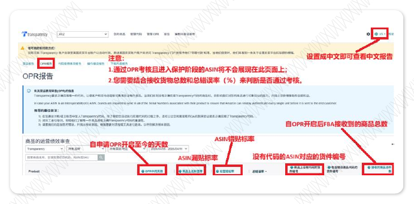

请点击此链接操作开启OPR：https://transparency.amazon.com
1. 右上角选择“中国”切换语言。在主页点击“您的商品”“管理OPR”板块
2. 依次点击“下载文件”->填写文件-> “选择文件”->“上传”完成申请提交

3. 等待5-10分钟左右，通过刷新当前界面或者在 “请求代码”中查看ASIN状态。若ASIN状
态显示为是“In OPR”，则代表该ASIN开启OPR成功。
4. 开启OPR后，FBA仓库会开始考核对应ASIN在10个站点的Transparency标签贴标准确率。
请您在该ASIN后续发货中（所有销售店铺/站点）都要保证正确贴标。为了尽快通过评估，建
议您为每个ASIN发货至少超过10件，最好超过100件。
请注意： 在您订购代码之前，OPR 状态将为“待处理”，订购 Transparency 码以激活 OPR
并打印标签。

填写OPR开启表格：
A. 您需要填写“添加商品和OPR日期”和“添加分销商”两个表格，分别对应ASIN信息和您的发货
店铺信息。
B. “添加商品和OPR日期” 表格的A列要填GTIN而不是ASIN，如果不确定 GTIN 号，可在 “主页-
请求代码” 界面查看。如果 GTIN 号以 “00” 开头，需删掉 “00” 。
C. OPR启用日期建议填写当天，不能填过去的日期。老品的缓冲期（缓冲期概念见下文4.1）会
根据您填写的启用日期开始计算。请注意，若填写未来日期，则在未来相应日期才会开启OPR。
D. “添加分销商” 指ASIN的发货店铺。A列一定要填写该ASIN（您自己及您授权）的所有发货
店铺对应的卖家记号，漏写/错写卖家记号会影响考核结果。若添加分销商失败，OPR状态可
能显示为“已完成，但部分任务失败”。分销商发送的贴标货也无法记录到OPR考核中，导致
OPR无法成功通过。这种情况需根据指南8.1发送添加分销商邮件手动添加。
E. 若允许A列填写的店铺可以售卖本次开启OPR的所有ASIN，B列GTIN信息请直接留空。若发货
店铺销售权限只开放给特定ASIN，B列填写对应GTIN即可。
F. OPR开启成功状态示例：
相关提示3：自助开启 OPR 失败可能原因：视频讲解
1. 日期格式相关：格式：月/日/年，如 04/01/2023。若符合开启OPR条件（参考3.2），建
议填写当天。
2. 产品信息相关： 若 GTIN 号以“00”开头，需删掉“00”。
3. 文件为空：重新下载表格，在 Example 下一行（即第 5 行）开始填写。

### 3.4 纯自发货 OPR 快速通道
纯自发货（MFN）ASIN（无FBA 在途货件且无FBA Offer无任何FBA库存），请通过提交
照片通道进行OPR评估。对开启OPR评估的自发货ASIN，后续发货都需要张贴
Transparency透明计划标签。
每个ASIN提供10张贴有Transparency透明计划标签的产品包装图片（系统批量扫描，对二
维码的清晰度要求很高，确保二维码清晰可扫描且能看到是贴在真实产品包装上，不要反光，
请控制照片不要过大，通过压缩包提供，压缩包以ASIN号命名）提交给处理该诉求的邮箱。
（*请参考指南8.3）

## 4. 阶段四：保护开启
### 4.1 【重点】什么时候触发保护
保护开启是符合条件后系统自动触发，10大站点同步开启保护。根据您的发货物流情况，亚马
逊配送 (FBA) 货件或纯自发货物流模式，会存在2种不同的保护开启方式，若您的发货是FBA
与自发货相结合的模式，则评估方式以FBA为准。
【OPR加速福利】
如果您所有开启保护的产品贴标准确率持续达到100%并符合亚马逊的其他评估标准：
1）您的新品ASIN在未来开启OPR后，无需等待其满足标准OPR审核要求，该ASIN会被移至
保护状态。
2）您的非新品ASIN在未来开启OPR后，无需等待其满足标准OPR审核要求，会在30天缓冲期
结束后被移至保护状态。
*请注意:您必须严格遵守贴标要求，在开启OPR 后，您必须100%准确地给所有产品贴标。亚马逊会持续监测贴
标表现，如果您的产品未能达到贴标要求，亚马逊会将ASIN调整回 OPR状态。这些ASIN 需要重新通过 OPR 标
准流程。亚马逊还可能会评估其他因素来确定品牌是否能参加本项福利。如果您想了解更多，或想提供任何反馈，
请联系您的Transparency透明计划联系人。
4. 提示无权限：A. GTIN号尚未注册或者GTIN号错误，请在“请求代码”页面查看。B. 若有多
个品牌，右上角切换主体再次尝试。C. 点击“设置”—点击 “管理权限” ，检查开启OPR的
权限。
若排除以上所有原因，检查无误仍无法开启成功，请不要重复提交表格。使用品牌权利所有者
账号发邮件至您的Transparency客户经理邮箱,提供品牌、ASIN、您开启OPR时填写的原始表
格、报错原因做进一步查询。
相关提示4：缓冲期到期并不意味着不再考核，OPR 考核期内会持续考核贴标正确率。请
参考如下两个有缓冲期的ASIN示例：
⚫ 2024.1.1 开启 OPR，2024.1.7 贴标货到仓库且考核通过，ASIN会在2024.1.31 满足 2
个条件自动开启保护。
⚫ 2024.1.1 开启 OPR，2024.2.10贴标货到仓库且考核通过，ASIN会在2024.2.10满足 2
个条件自动开启保护。
B. FBA配送—全新品：
全新品无30天缓冲期，在第一批贴有 Transparency 标签的商品发往 FBA 仓库，并且通过
OPR考核标准后，即可自动开启保护。
#### 4.1.1 亚马逊配送（FBA）货件保护开启条件

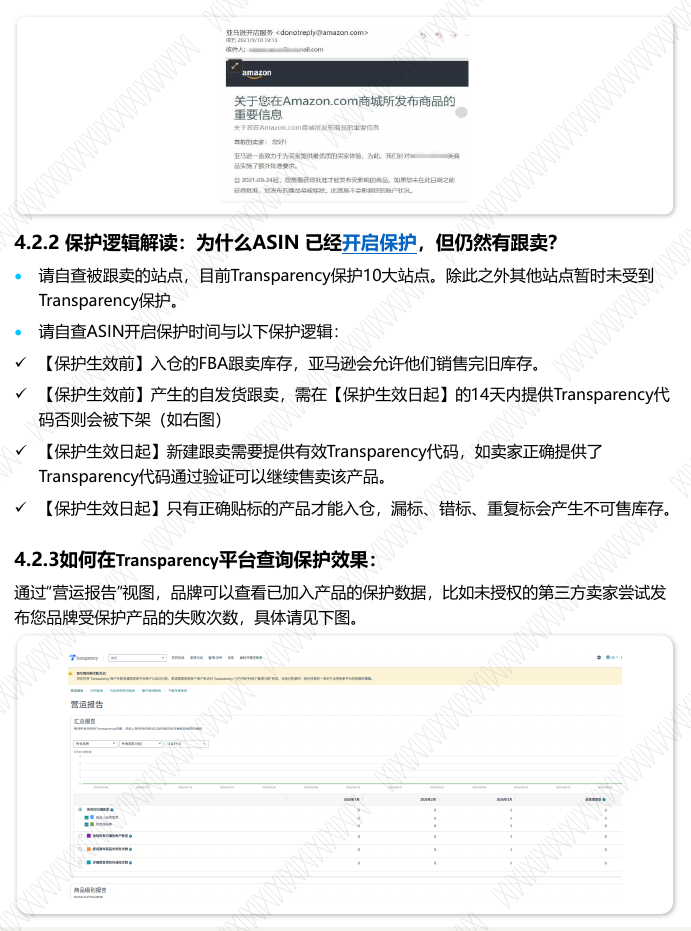

A.FBA 配送—老品：
需要通过OPR(Transparency贴标准确率考核) 且30天缓冲期到期，两个条件同时满足，
才会正式开启Transparency保护。
*缓冲期：OPR开启成功的当天，一封通知邮件（如右图）会发送至销售该ASIN的所有卖
家（包括您自己），告知其ASIN需要在30天后应用Transparency代码方可正常上架
（右图中，红框内为缓冲期结束日期，该日期默认为自您开启OPR成功日期后30天，是
预计的最早开启保护日期，OPR考核期内会持续检查贴标准确率）。
*OPR考核：开启OPR后，Transparency上线的10个站点
的FBA仓库会对该ASIN进行持续的transparency透明计划
标签贴标准确率检查。请您务必每票货都准确张贴标签。
您可通过查看OPR报告获取考核结果。

Transparency客户经理邮箱，告知品牌名+ASIN号+FBA 货件号+发货店铺卖家记号+您遇到
的问题以便调查。
相关提示5: 如何查看OPR报告(*重点*)
您可点击https://transparency.amazon.com/v2/reports/opr ，【登录
Transparency.amazon.com >点击“报告” Reports >点击下级菜单中 “OPR Report”】，
查看在OPR期间的ASINs贴标表现（该网页右上角可设置中文后查看）。
请留意OPR报告只会在OPR期间更新，更新频率以周为单位，在ASIN变为“受保护”状
态后则不再出现在该报告中，请注意100%准确贴标发货，避免出现瑕疵库存。若接收到的
商品总数小于10件，会由于数量不足，而无法通过评估，请继续发送贴标货进仓，并注意
100%正确贴标。
⚫ 若漏贴标率或错贴标率较高，请注意严格要求正确贴标，继续发送贴标货进仓（建议
100件以上）以便刷新检查数据，早日开启保护。
⚫ 一般开启OPR评估的天数大于30天，接收货物数量大于10件，且“总错误率“等于0，
ASIN会自动变为“受保护”状态。
⚫ 若 OPR 评估开启后新进仓的贴标货已接收超过 2 周但报告中仍无检查数据（接收商品
数量显示为0），请自查开启OPR时是否漏填卖家记号，注意：仅有开启 OPR 时提供过卖
家记号的店铺发出的货件，会被计入 OPR 评估。若漏填，请参考本文 7.2【添加授权店铺】
发邮件添加店铺，添加后该店铺再 进仓的贴标货可以被检查到，请继续贴标发货。若确定
填写过，请发送邮件到

B. FBA入仓检查：
自保护开启后，10大站点的FBA 仓库在商品入仓和出仓时都将检查商品外包装上是否正确应
用了 Transparency 标签，只有正确应用 Transparency 标签的商品才可以通过 FBA 仓库检查，
否则将无法进出 FBA 仓库。
C.自配送(MFN)的保护:
除了 Listing 的保护之外，自配送卖家在发货的同时，需要回传与发货商品个数相等，并且独
立不重复的Transparency 代码进行验证。对于未回传 Transparency 代码或者回传无
效 Transparency 代码的卖家，亚马逊会下架他们的商品。
#### 4.1.2 纯自发货模式下的保护开启条件
如果 ASIN 是纯自发货配送，请查询本指南的第 3.4 条。
### 4.2 保护机制解析、保护逻辑解读、保护效果查询
#### 4.2.1 保护机制解析
当 Transparency 透明计划保护开启，以下3类机制会被触发：
A. Listing保护(10大站点同步生效)：
如果有亚马逊卖家想售卖该商品 ，在亚马逊卖家平台尝试进行跟卖时 ，该商品的“销售限制”
描述中，会提示需要上传 Transparency 代码并通过验证，进行销售许可申请，才可跟卖该商
品。
相关提示 6 ： “ 销 售 限 制” 有多种形式 ， 只有提示需要 Transparency 代 码 的 才 是
Transparency的拦截机制。

相关提示7：您可以从“代码历史记录“里面下载CSV文件，直接获取Transparency代码，即
以AZ或ZA开头的26位字母数字编码。如您需要批量上传代码，请点击卖家后台左上角导航栏
按钮，选择“订单”并点击“上传订单相关文件”下载模板文件，在“ transparency_code”
这一栏填写 Transparency 代码并回传文件。请注意，一个订单如有多个数量商品，请上传同
等数量的代码，并且使用逗号来分隔。
相关提示8：ASIN开启保护后，您作为品牌方，请务必确保所有店铺全渠道全站点正确贴标，
漏贴标、错误贴标或者重复使用标签，都视为不正确的贴标，货物会被标记为瑕疵品。
【自发货卖家如何在卖家后台上传 Transparency 透明计划序列号】
您已注册 Transparency 计划的亚马逊商品编码 (ASIN) 会以蓝色 Transparency 标记
或橙色序列号标记
突出显示在卖家平台中
的管理订单页面上。
请按照以下步骤确认、上传和配送带有 Transparency 码或序列号的商品：
• 前往管理订单，找到带有 Transparency 或序列号标记的订单。
• 点击【订单编号】，前往【订单详情】页面。
• 点击【购买配送服务】或【确认发货】，在底部打开一个新的板块。在底部的新板块中输入
Transparency 码或序列号。
• 在【订单详情】页面底部的【数量】字段正下方有一个【T】 标记。点击【输入
Transparency 码或序列号】链接。在文本框中输入或扫描 Transparency 码或序列号。
• 输入代码或序列号后，您可以继续发出订单。

#### 4.2.2 保护逻辑解读：为什么 ASIN 已经开启保护，但仍然有跟卖？
• 请自查被跟卖的站点，目前Transparency保护10大站点。除此之外其他站点暂时未受到
Transparency保护。
• 请自查ASIN开启保护时间与以下保护逻辑：
✓ 【保护生效前】入仓的FBA跟卖库存，亚马逊会允许他们销售完旧库存。
✓ 【保护生效前】产生的自发货跟卖，需在【保护生效日起】的14天内提供Transparency代
码否则会被下架（如右图）
✓ 【保护生效日起】新建跟卖需要提供有效Transparency代码，如卖家正确提供了
Transparency代码通过验证可以继续售卖该产品。
✓ 【保护生效日起】只有正确贴标的产品才能入仓，漏标、错标、重复标会产生不可售库存。

#### 4.2.3 如何在 Transparency 平台查询保护效果
通过“营运报告”视图，品牌可以查看已加入产品的保护数据，比如未授权的第三方卖家尝试发
布您品牌受保护产品的失败次数，具体请见下图。
## 5. Transparency 附加功能/政策
### 5.1 Customer Engagement（CE 买家互动功能/售后信息卡）
#### 5.1.1 互动页面

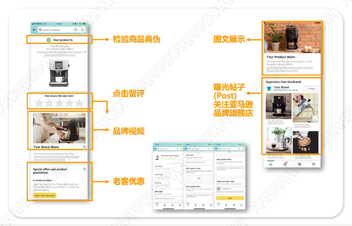

品牌卖家可以通过提交内容模板，定制消费者扫码界面的内容，来传递信息。目前扫码页面
元素包含：
⚫ 检验商品真伪
⚫ 产品基本信息（默认会有，可跳转listing进行复购）
⚫ 一键评论（默认会有）
⚫ Video视频（需自定义，分享品牌故事/产品特点/使用指南）
⚫ 促销（可自定义或系统自动抓取）
⚫ 图文（需自定义）
⚫ Posts&品牌旗舰店(符合条件自动抓取)
⚫ 售后安装/指导操作(符合条件自动抓取)。

小卡片正面模板一共有4种类型可以选择。其中模板1为通用非定制，模板2为部分定制（橙色
方框内为可定制的，有七种引导语供选择），模板3和模板4为全定制。
您可以点击5.1.3相关提示的链接下载“CE功能资料”压缩包，打开“1.内容提交”文件夹，
查阅详细资料了解具体操作流程。
#### 5.1.2 售后信息卡

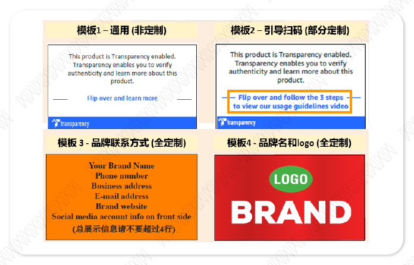

售后信息卡可以放置在商品包装袋中，向消费者展示您的品牌官网网址，联系邮箱，社交媒
体账号，并引导消费者扫码浏览落地页，了解更多品牌资讯。
售后信息卡的展示内容分为正面模板和反面模板。
正面模板

#### 5.1.3 相关提示
1. 内容提交指南、提交模板，定制化标签、售后信息卡模板等均可从常用文件链接下载CE压
缩包获取。https://drive.weixin.qq.com/s?k=AMkAYwcEAA4g4FigVk
2. 定制内容需要通过填写模板发送邮件提交。定制内容审核成功后，您可以使用定制化标签
（打印商打印可在标签上定制行动号召语，目前自助打印暂不支持）、合规售后信息卡
（需ASIN开启保护后使用）来引导消费者扫码和浏览定制化内容。
3. CE功能目前没有额外费用，只有加入Transparency透明计划、正确应用标签的ASIN才能
参与该功能。按照资料包进行内容制作与提交。售后信息卡作为提醒消费者扫码的工具，
完成设计和审批后，可放置在贴标货物内一并发出。建议优先推动ASIN开启保护，同时可
根据运营余力安排新功能内容发布和售后信息卡设计印刷。
4. 请严格按照售后信息卡模板设计，以确保合规，并于ASIN开启保护后投入使用。尺寸为一
般名片大小，自行按照包装微调。设计完成后可发送至Transparency透明计划客户经理邮
箱进行审核，提供【品牌名、ASIN、售后信息卡设计图、计划投入使用的日期】，在收到
回复后再进行实际使用。
5. 售后信息卡反面的Transparency透明计划的二维码为展示作用，不能替换成自己品牌的二
维码。该二维码用来引导卖家扫描Transparency透明计划标签，浏览落地页。
小卡片反面模板一共有2种类型可以选择。其中模板1为通用非定制，模板2为部分定制（橙色
方框内为可定制的，有七种引导语供选择）。
您可以点击5.1.3相关提示的链接下载“CE功能资料”压缩包，打开“2.宣传包”文件夹，查
阅详细资料了解具体操作流程。
反面模板

我们根据其它品牌的经验，目前摸索出了一些成功经验的关键条件：1. ASIN 是正常售卖的 2.
维持 Transparency 透明计划保护状态至少 30 天 3. 持续确保正确贴标发货（这点尤其重要）
4. 老品的在库无标库存产品的清售 （这是指以前的老库存何时能销售完毕） 5. 如果是服饰鞋
靴品类，单件产品需要贴 2 个标，这一点请见本文 5.4 【应用两个代码】
相关提示10:
所有加入Transparency的ASIN都有可能获得Transparency标记，但是小蓝标的获取要求比开
启保护更严格，并不是完成Transparency注册或者成功开启保护就会获取，而是要求ASIN需
开启保护且达到一定天数(至少成功开启保护以后30天)，同时保持高水平的贴标准确率，并且
亚马逊仓库的库存都已贴上Transparency代码。对于符合要求的ASIN ，系统会自动发放
“小蓝标”，若后期不满足条件，系统也会自助移除该标记。
### 5.2 T-Badge（小蓝标）
对于符合要求的ASIN，消费者可以在该ASIN的商品详情页“更多信息” 部分看到这个标记，
让他们知道所购买的每一件商品，在配送前都已经过验证并确认为正品，也展现您对保护品牌
和消费者的重视。
### 5.3 退货分析

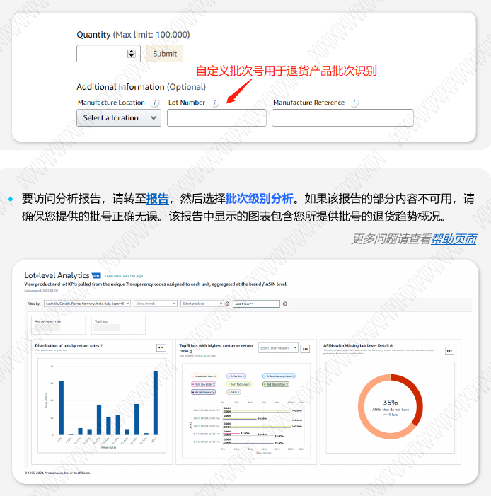

批次级别分析报告(测试版)，使用您的 Transparency 码追踪商品的退货率和缺陷原因：
⚫ 分析不同批次的产品退货率。提供每个批次的退货信息，包括批次的退货率、退货率最高的
批次。助您了解不同批次退货情况，更直观的跟工厂对接退货批次，防止订货差异过大。
⚫ 直面退货原因。针对每个批次的退货信息，分析造成这些退货的主要原因，如退货原因大部
分为尺寸问题，可以通过反馈问题，获得产品和优化思路，持续提升客户满意度。

相关提示11:
 要启用该报告，您必须为每个商品提供至少一个批号才能查看相关指标。
 如何操作: 品牌需要在请求代码时，在lot number（批号）处填写自定义的批次号信息，且
把这批代码的标签确实应用到这个批次的产品上，这样后续如果这批产品有买家退货，才可
以得到具体批次号等信息。（如下图）
• 要访问分析报告，请转至报告，然后选择批次级别分析。如果该报告的部分内容不可用，请
确保您提供的批号正确无误。该报告中显示的图表包含您所提供批号的退货趋势概况。
更多问题请查看帮助页面

### 5.4 应用两个代码

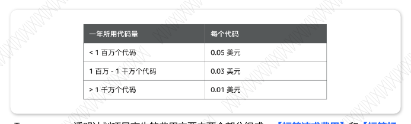

亚马逊致力于寻求最佳方式以确保客户收到品牌商的正品。由于服饰和鞋靴品类商品的退货率
相对较高，且退货商品不一定带有原始包装。如果您在销售服装鞋靴品类产品，您可以选择为
服饰和鞋靴品类产品应用2个Transparency代码，亚马逊不强制要求服装鞋靴品类品牌卖家应
用2个Transparency代码。
例如，您的商品有吊牌，那么您需要将一个标签应用于商品外包装上，另一个标签应用于商
品的吊牌上（如图1和图4）；如果您的商品没有吊牌，请将一个标签应用于商品外包装上，
另一个标签应用于品牌标识的标签上，或品牌标识标签附件相对平整的区域（如图2和图3）
针对服饰鞋靴类目产品，两个标签分别应用于产品外包装与产品本身，如需申请，请在配置
ASIN填写表格时，在C4单元格选“是”并在N 列选择具体第二个代码应用的位置。注意：二者
缺一不可，否则双码不会配置成功。如需为已配置的单码ASIN修改成双码或者为ASIN取消
已配置的双码，请参考邮件模板8.2发送邮件处理。
请注意，申请双码后，您需要根据出货产品数量申请双倍代码，每个代码只能用一次。例如
您发货量100，请申请200个代码，每个产品贴两个。亚马逊会在次月账单中为您返还一半代
码的费用。请参考本文6.2的账单图例。
有关应用两个Transparency代码或1个Transparency代码功能的比较，请参阅下表。

功能 两个Transparency代码(推荐选择) 一个Transparency代码
正品验证及扫码获取产品更多信息
即使外包装丢失，买家也能验证正
品以及扫描Transparency 代码查
看更多产品信息
如果外包装丢失，买家将不能验证正品
以及扫描Transparency代码查看更多产
品信息
关于退货产品的Transparency检
查
产品退货时，会进行Transparency
检查以验证正品
产品退货时，不会进行Transparency
检查以验证正品
在商品详情页体现商品加入
Transparency
遵循Transparency ,商品详情页内
容指导，品牌可以在商品详情页面
体现商品加入Transparency
Transparency将无法保证没有
Transparency代码退货产品的真实性，
将不会给客户设立收到的商品上始终有
Transparency代码的期望
代码成本
适用标准成本;亚马逊将免费提供第
二个代码（抵扣账单形式返还，即
先出具正常代码数量的账单，次月
出具双码抵扣账单，参考本文6.2）
适用标准成本
## 6. Transparency 透明计划费用相关问题
### 6.1 Transparency 透明计划相关费用组成
Transparency透明计划项目产生的费用主要由两个部分组成：【标签请求费用】和【标签打
印费用】
【标签请求费用】：当月下载标签，次月月初您可以在Transparency透明计划后台看到系统
出具的账单。
Transparency透明计划项目产生的费用主要由两个部分组成：【标签请求费用】和【标签打
印费用】
【标签请求费用】：当月下载标签，次月月初您可以在Transparency透明计划后台看到系统
出具的账单。

情况二：未结余额总额为0，代表您目前暂无需要支付的金额。
您可点击https://transparency.amazon.com/v2/billing/history 查阅和下载发票（请查阅
下图示例）。
情况一：未结余额总额为正数，代表您需要支付的全部金额，包含逾期余额。
### 6.2 Transparency 透明计划标签费用查询

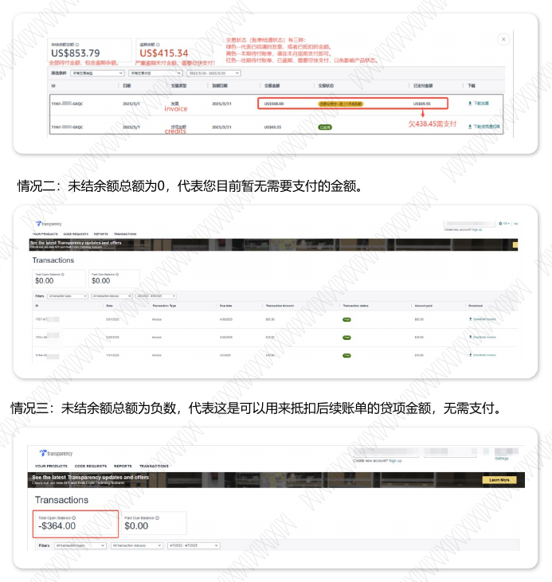

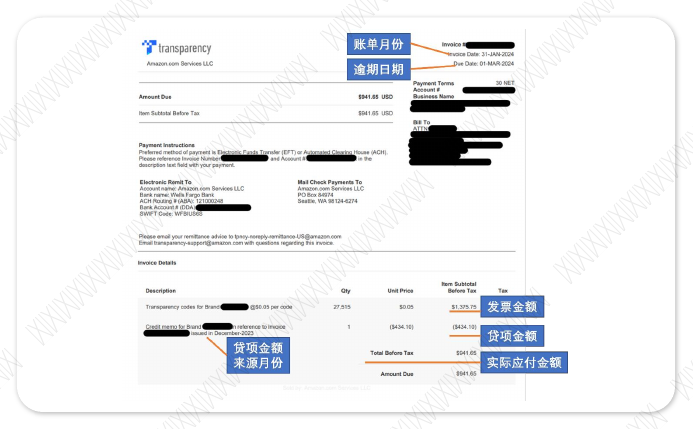

情况三：未结余额总额为负数，代表这是可以用来抵扣后续账单的贷项金额，无需支付。

在交易界面中，交易类型分为两种，分别为发票和贷项金额。发票的交易金额为当月因下载
标签产生的金额。贷项金额为当月产生的抵扣金额（比如免费代码返还），这部分数额在付
款的时候可以直接进行扣除。您也可以通过筛选条件来查看其中一种交易类型。
如何查看某个月份的实际应付金额：
（1）如上图所示，您可以下载该月份的PDF账单，查看最后一行的实际应付金额，每个月只
会产生一张PDF账单，在最右侧下载一次即可，若一个月存在两行信息，下载结果是相同的。
下载账单PDF后，请看最后一行的数字：
若最后一行数字带括号：用括号括起来的金额表示负数。这是由于优惠活动或者双码返还的抵
扣额度，可用于抵扣以后的 Transparency 账单。此类负数账单不需要付款，每一张是单独的，
不是滚动累积的，请品牌自己留好并记得自己有这些抵扣额度。
若最后一行数字不带括号：这是正数，说明这是该账单的最终需支付金额。
（2）您可以将同一月份、同一账单号的发票金额与贷项金额相抵，来计算该月份需要付款的
净金额、或可以用于后续抵扣的剩余贷项金额。
例1：发票金额900，贷项金额500，那么需要付款的金额是400。
例2：发票金额300，贷项金额500，那么需要付款的金额是0。剩余200的贷项金额可用于后
续抵扣。

相关提示12:
若您在付款后发现交易面板处的账单仍显示未支付，请自查您的付款是否成功、银行或付款平
台是否发生失败退款，若付款成功，请您耐心等待付款到账、核销。核销后，交易面板处的账
单状态会变更为已支付。
我们推荐您在付款后，使用您预留的账单联系邮箱，将付款水单或含有时间、金额、账户明细
的付款凭证邮件发送给应收账款团队ar-us-transparency@email.amazon.com ，帮助应收
账款团队更快地定位、核销您的付款。
相关提示13:
咨询财务问题时，请使用您注册Transparency时登记的用于接收账单、付款提醒的Invoice
Email发送邮件。财务系统无法识别其他邮箱，若使用其他邮箱发送，将只能得到无法识别品
牌的模板答复。
发送邮件时建议您提供的信息：
1) 账户ID（账单PDF右上角A开头的Transparency Account ID）、品牌名称
2) 具体问题
3) 所涉及的账单月份，能提供账单右上角的账单号XXXX-XXXX-XXXX则更佳
4) 如需致电沟通，请留下具体的有效联系电话及方便沟通的时间
若您需要更新账单联系相关信息，请参考指南8.6。
若您的后台没有交易功能权限，请点击此处查阅如何申请发票功能。
更多关于账单及支付的疑问，可直接发邮件咨询应收账款团队：
ar-us-transparency@email.amazon.com
您需要在亚马逊发出发票之后30 天内支付全款，即发票右上角的“逾期日期“之前。如果
您未在发票发出之日起 30 个自然日内对任何已开发票的费用提出书面异议，该笔费用即被
视为正确无误。
您可以通过从卖家平台账户余额自动扣款来管理您的 Transparency 透明计划账单，或者通
过常见第三方支付工具支付或银行电汇转账支付账单。
#### 6.3.1 卖家平台自动扣款功能使用条件
• 拥有账户健康状况良好的活跃卖家平台账户
• 拥有您的 Transparency 透明计划账户和卖家平台账户的账户管理员权限
• 拥有在美国站运营的卖家平台账户
### 6.3 Transparency 透明计划标签费用支付

#### 6.3.2 第三方支付工具或银行电汇支付
Invoice Number，方便亚马逊及时为您核销账单。
• 可读取PDF账单：连连跨境支付，PingPong，网易云，Skyee
• 手动输入付款信息：P卡（Payoneer），WF万里汇（World First），空中云，ipaylinks，
亚马逊卖家钱包，银行电汇转账等，直接支付对应账号。（收款银行信息以PDF账单为准）
如何注册使用卖家平台自动扣款功能？
要注册使用卖家平台扣款功能，请执行以下操作：
1. 使用账户管理员账号登录 Transparency透明计划平台
2. 在首页顶部查找“需要确认： 新付款方式”的横幅弹窗
3. 点击“查看付款更新”链接
4. 系统将自动检测您登录使用的账号对应的卖家账号
5. 选择要用于自动支付的卖家平台账户
6. 查看并接受条款和条件
7. 点击“选择账户”
您将收到一条确认消息，显示您的卖家账号 (xxxx) 已成功设置为Transparency透明计划发票
的自动扣款账户。完成后即全部设置完毕！
相关提示：只有在您注册 使用卖家平台自动扣款功能后生成的发票 ，才会被自动扣款 。发票
于每月第一天生成 ，涵盖前一个月的代码费用 。发票生成时已启用的付款方式和卖家平台账
户决定了该发票的处理方式 。在注册使用卖家平台扣款功能之前创建的所有发票都必须通过
您之前的付款方式支付。
重要提示： 发票生成后，其付款方式和关联的卖家平台账户将无法更改 。对付款方式首选项
所做的任何更改仅适用于未来的发票，不会影响之前生成的发票。
如何添加系统未检测到与账户管理员账号关联的美国站卖家平台账户？
如果您看到横幅但没有看到"查看付款更新"，这表示您是账户管理员，但系统未检测到您的
登录账号具有美国站卖家平台账户的所有权权限。请按以下步骤操作：
1. 在您的公司中找到美国站卖家平台账户所有者，并使用"添加新用户"功能邀请他们加入
Transparency门户网站。
2. 授予“管理付款”权限 – 当卖家平台账户所有者出现在Transparency门户网站，为他
们授予新的“管理付款”权限。
3. 卖家平台账户所有者现在可以关联账户 - 新邀请的卖家平台所有者账号具有“管理付
款”权限后，将看到带有“查看付款更新”链接的横幅弹窗，可以设置关联他们的卖家
平台账户。 更多问题请查看卖家平台自动扣款功能常见问题
更多问题请查看
卖家平台自动扣款功能常见问题

### 6.4 Transparency 透明计划标签下载费用完成支付后确认

#### 6.4.1 开通付款通知功能
请查看Transparency透明计划账单功能常见问题
#### 6.4.2 发送付款凭证

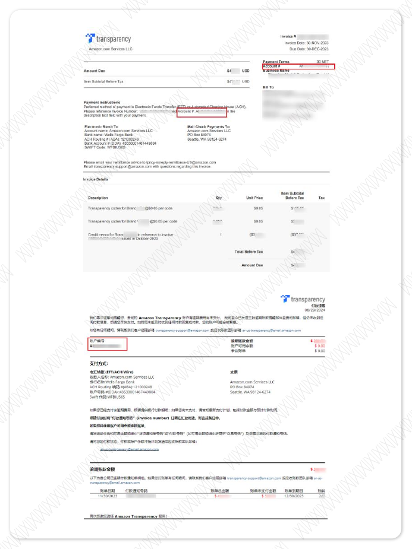

备注Invoice Number（付款通知单号码），以便为您及时核销账单。（非必须）
收款银行信息：
Account description（收款人名称）: Amazon.com Services LLC
Entity Address（收款人地址）: 1209 Orange Street, Wilmington, Delaware, 19801
Branch description（银行名称）: Wells Fargo Bank
Branch Address（银行地
址）: 420 MONTGOMERY STREET, SAN FRANCISCO, CA 94104
Swift Code（SWIFT 代码）: WFBIUS6S
ACH Routing(ABA编码 ): 121000248
Bank Account # (DDA): 以PDF账单上显示的为准
如下填写信息用于通过Payoneer（派安盈/P卡）支付：
联系电话：626-572-1554
联系邮箱：Vanessa.Cabrera@wellsfargo.com
*收款账户类型Saving account/Checking account均可
选择“广告或营销服务提供商“以及”我为我获得的服务付款“。

#### 付款凭证邮件发送模板
特别提示：请使用您注册Transparency时登记的用于接收账单、付款提醒的Invoice Email发
送邮件。否则将无法收到财务部门的核销回复邮件。
邮件标题：【品牌名】付款凭证确认
邮件正文：品牌已完成付款，付款凭证见附件/附图，Invoice Number：*********，请及时
核销。
• 已注册(Enrolled)：产品已加入Transparency透明计划，未受保护。可以申请标签，在所
有未贴标货物都完成入仓并准备发贴标货时，请为ASIN【开启OPR】，进行贴标正确率
评估。
• OPR待处理(OPR Pending)：OPR开启表格已提交成功，但由于尚未为该ASIN申请
Transparency代码，OPR暂无法启动。请先申请代码，完成代码申请后系统将自动启动
OPR。
• 已安排 OPR(OPR scheduled)：OPR开启表格已提交成功，由于您设置OPR开启时间为
未来日期，系统将在您设定的日期自动启动OPR。
• 在OPR(In OPR)：即贴标正确率评估阶段，请尽快发送贴标商品进仓参与评估，通过评
估后方可开启正式保护。若您的ASIN为纯自发货产品，可回复邮件至文末提及邮箱，了解
提供照片快速通过OPR评估的方法（处理时效约1周）。
• 已受保护(Protected)：保护已生效，未正确贴标的货物将被拦截，无法正常入仓上架。
请确保全渠道正确贴标发货，以便维持保护状态，预防假货跟卖。
请先参考上文7.1查询ASIN状态，“已注册”状态的ASIN在后续开启OPR时可自助添加销售
店铺，“在OPR中“和”受保护“的ASIN需要发送邮件至专门处理该诉求的邮箱，具体邮箱
和邮件模板请参考下文邮件模板8.1。请注意，添加分销商成功后，历史OPR状态页面不会再
做更新。
## 7. 常见问题问答
### 7.1 查询 ASIN 状态
用品牌权利所有者账号登录https://transparency.amazon.com/v2/codes/request，在代码请求页
面查看对应ASIN状态, 或者点击 “下载商品” 查看所有ASIN的状态。
### 7.2 添加授权店铺

A. 如何授权其他账户登陆Transparency透明计划后台？
方法一：Right owner/权利所有者帐号可直接登陆Transparency透明计划后台。故您可登陆
亚马逊品牌备案后台—用户权限（User permission）—授权新店铺为“权利所有者/Right
Owner”权限即可。
方法二：用权利所有者权限帐号登陆Transparency透明计划后台—点击“设置”—点击“管
理权限” —添加新用户的名称、电子邮件以及邮件语言后，点击“发送邀请”。请新用户点
击邮件中的“登录”，用受邀邮箱和密码完成登陆后，您可回到“管理权限”页面，进行添
加权限的动作并保存。
B. 若Right owner/权利所有者帐号可成功登陆Transparency透明计划后台却看不到 “交
易” ，请按以下方法解决：
1. 用最初注册Transparency透明计划的权利所有者账号登录后，在”管理权限“页面，为其
添加“查看账单历史记录”权限。
2. 若尝试所有权利所有者账号登录均无“交易”功能，请参考指南8.7发送邮件申请新增或替
换账户管理员。
3. 您可以为品牌指定主要账单联系人并添加多位账单联系人。账户管理员可通过”您的账户”
→ “账单联系人信息”页面来指定或更新主要账单联系人。要添加账单联系人，请通过账户管
理员登录Transparency透明计划平台执行以下操作：
1. 登录Transparency透明计划平台的”管理权限”页面
2. 选择”添加新用户”
3. 输入联系人的名字、姓氏和电子邮件地址
4. 点击”发送邀请”
5. 新联系人接受邀请后（须在14天内接受），将授予其”管理付款”和”查看账单历史记录”权限。
更多问题请查看
Transparency透明计划账单功能常见问题
### 7.3 用户授权及查看账单

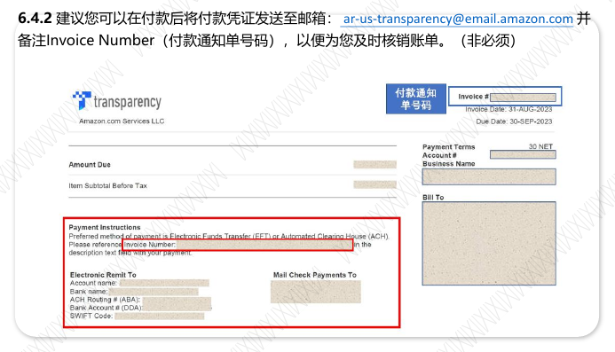

### 7.4 如何扫描 Transparency 透明计划代码？

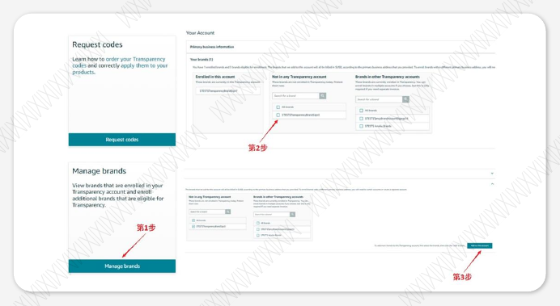

方法一：下载“亚马逊购物 “APP ，登陆帐号，在设置里将 ‘国家&地区’调整到对应国家
地区，按右上角照相机按钮-切换到Barcode就可以扫码。（IOS用户需到非CN地区的App
Store下载，Android用户需要到Google Play下载） 。
方法二：下载“Transparency” APP。（IOS用户需到非CN地区的App Store下载，
Android用户到Google Play下载）
### 7.5 新品牌加入
Transparency透明计划的加入条件是完成亚马逊品牌备案，以及有任一站点R标即可，您可
以参考以下指引，5分钟完成自注册签约：
注册链接：
https://transparency.amazon.com/v2/tpncyaccount/signup?ref=IRCNTRLGNSSRGUI
DE

2.登陆后，选择国家和地区，点击next，勾选对应条款，并选择想要加入Transparency透明
计划的品牌。
3.填写企业信息(订约方和地址)：
如您的商标为公司持有，建议填写该商标的持有公司名称（英文填写），和该公司注册地址
（可用中文填写）；如您商标为个人持有，建议填写权利所有者权限店铺公司名称（英文填
写），和该公司的注册信息（可用中文填写）。
4.提供账单联系人信息：如您的地址在中国/美国，请选择按美元结算。
5.勾选条款，点击右下角”提交”
稍等几分钟后，您会收到标题为《Welcome to Transparency》的邮件，代表
Transparency 品牌账户已设置成功。
操作指引：
1.请用品牌注册邮箱（权利所有者权限）进行登陆；
*如何寻找权利所有者(RO)权限邮箱：登录Brand Registry，点击右上角 “设置”- “用户权
限” ，查看品牌权利所有者对应的邮箱账号。
相关提示14：如需在现有账户添加新品牌（享受同一个账单地址），请登陆您的现有账户：
https://transparency.amazon.com。点击“管理品牌”→ 选择还未加入Transparency透明
计划的品牌 → 点击“添加”按钮，一键注册新品牌

### 7.6 退出 Transparency 透明计划

请使用品牌权利所有者角色的邮箱发送邮件，具体请参考下文邮件模板8.4。预计3个工作日
生效，届时请在code request请求代码界面自查ASIN状态是否从“受保护”变成“已注册”。
相关提示15:
1. ASIN 实时状态可参考上文7.1自查。只有“在OPR中”、“受保护”的 ASIN 需要关闭，
请勿发送“已注册”状态的 ASIN。2.如果您的ASIN正在优惠周期中，关闭保护会失去优惠
资格，无法再享受免费代码。3. 正式关闭保护后可以自查，在Code Requests页面ASIN状态
会显示为【Enrolled】，该状态的ASIN无论是否贴有二维码，都不影响入仓。想要重新开保
护需要从OPR考核开始（该ASIN已经没有在途未贴Transparency标签的货物才能开启），不
能马上恢复。
### 7.7 Transparency 流程介绍和官方案例
Transparency自助服务平台帮助界面:
https://transparency.amazon.com/v2/help/getting-started
Transparency流程视频讲解：
https://amazon-226.wistia.com/folders/451whrlntv
Transparency流程概述：
https://sellercentral.amazon.com/learn/courses?ref_=su_course_accordion&mod
uleId=3a80cc4e-b9cb-42fa-8de8-4118f317fc8e&courseId=0c9a2713-0112-43d8-
99cd-4cbd84483c7c&modLanguage=Chinese&videoPlayer=airy
Transparency质量保证：
https://sellercentral.amazon.com/learn/courses?ref_=su_course_accordion&mod
uleId=50ffbc2d-a948-4285-a791-000ad008d92f&courseId=0c9a2713-0112-
43d8-99cd-4cbd84483c7c&modLanguage=Chinese&videoPlayer=airy
请使用品牌权利所有者身份的邮箱发送以下信息至transparency-aad-cn@amazon.com ，
并关注后续邮件回复，处理时效为 1-2 个工作日。 【注意：该邮箱只处理按照模板发送的
“添加或替换授权店铺”请求，无法处理其他请求。】
邮件正文模板（请注意保留所有英文，若需要补充信息，也请使用英文）：
ASIN:
Brand Name 品牌名称:
Merchant Token 卖家记号:
Action to be taken 待执行操作 <ADD 添加/Remove 移除/Replace 替换>:
If Replace Authorized Distributor 若选择替换,
From 从 < >
To 替换为< >
## 8. 发送邮件模板
为了最大程度地保护品牌， 请务必使用品牌主账户（权利所有者身份的账号）发送邮件至
Transparency透明计划客户经理邮箱，收到回复后务必仔细阅读。请不要重复发送邮件，若
有任何相关的追加邮件或问题，请在原邮件基础上发送，方便客户经理快速定位问题。
开启OPR/保护之后无法自助添加新的卖家记号销售权限，建议您卖家在后续开启OPR时在分
销商那里填上所有自己销售这个ASIN的卖家记号。
发布日期 文章关键内容 文章入口
2024.02.29 2024年优惠政策，定制售后信息卡和CE扫码定制页案例 Link
2023.07.24 “扫码”习惯报告，增强Transparency扫码吸粉解析 Link
2023.03.21 定制售后信息卡场景，CE扫码落地页留评页展示 Link
2023.02.20 Transparency深度退货报告分析案例解析 Link
2023.01.04 消费者视角展示Transparency四个触点（销售转化） Link
2021.08.09 Transparency标签引导语展示（服务商打印） Link
#### Transparency 官文案例
### 8.1 添加或替换卖家记号/销售权限

1. 添加授权店铺
ASIN: B0XXXXXX
Brand Name 品牌名称: XXXX
Merchant Token 卖家记号: AXXXXXXXXXXX
Action to be taken 待执行操作 <ADD 添加/Remove 移除/Replace 替换>: ADD
2.替换授权店铺
ASIN: B0XXXXXX
Brand Name 品牌名称: XXXX
Merchant Token 卖家记号: B0XXXXXXX2
Action to be taken 待执行操作 <ADD 添加/Remove 移除/Replace 替换>: Replace
If Replace Authorized Distributor 若选择替换,
From 从 <AXXXXXXX1>
To 替换为<AXXXXXXX2>
举例：
特别注意：请关注 ASIN 状态，本操作适用于：
（1）在 OPR 中的 ASIN 需要新增店铺进入考核范围
（2）受保护的 ASIN 需要新增店铺进行 跟卖销售。已注册状态的 ASIN 不适用，请在开启
OPR 时填写所有发货店铺。
相关提示16：届时可自己尝试跟卖验证是否授权成功，所有发货店铺务必全渠道贴标发货。
### 8.2 增加或取消双码
请将配置ASIN时上传的表格作为附件发送至邮箱，标题和正文如下。请注意，增加或取消双
码后，之前下载的代码依然可以使用，不会作废。

邮件标题：【品牌名称】增加/取消双码申请
邮件附件：表格
邮件正文：
您好，以下ASIN已配置，需要增加双码/取消双码，具体信息如下，附件是配置ASIN时上传
的表格。
• ASIN号：
• 需求：增加/取消双码
请参考指南3.4部分，按照要求通过品牌所有者身份的邮箱提供以下信息到
transparency-csops@amazon.com. 若邮件超过10MB，可能发送不成功，可分开多封
邮件发送。发送后2-3个工作日会有邮件回复告知处理进度，请注意查收。请严格按以下模
板并保留中英文发送，否则无法识别。
邮件标题：OPR exception request-brand name XX
邮件附件：Zip格式压缩包，以ASIN号命名压缩包。切勿发送下载链接，无法打开
邮件正文：
Brand Name品牌名:
ASINs: BXXX
Merchant token卖家记号:
Total Number of ASINs ASIN数量:
Policy type政策类型: MFN
### 8.3 纯自发货 OPR 快速通道

请注意，如果您的 ASIN 正在优惠周期中，关闭保护会失去优惠资格。发送后会有邮件回复
告知处理进度，请注意查收。若您的关闭理由为忘记贴标，请务必写明重启保护与否与日期，
如果不重启保护，请写明不考虑重启的具体原因。关闭理由和重启日期（如果不重启，提供
理由）这两项信息必须提供，否则无法处理。请按ASIN当前状态归类后分批发送，不同状态
的ASIN请勿混在一起。
请查看指南4.2.2部分，对比跟卖原因是否符合列出来的情况。若为描述之外的情况，请填
写以下信息发邮件调查，提交后请等待调查反馈：
### 8.4 ASIN 关闭保护/OPR 请求
### 8.5 调查开启保护以后疑似假货的情况
邮件标题：【品牌名】调查开启保护以后疑似假货的情况
邮件正文：
• 品牌名：
• ASIN号：
• 开启保护时间（如有）：
• 跟卖卖家记号（如有）：
• 跟卖店铺名称：
• 跟卖站点：
• 跟卖类型：FBA/自发货/二手/其他
• 跟卖英文页面截图或跟卖链接
邮件标题：【品牌名】关闭保护/OPR请求
邮件正文：
• 品牌名：
• ASIN号：
• ASIN状态：OPR中/保护中
• 理由：
• 是否重启：是/否
• 预计重启保护/OPR日期：

若您有账单联系信息的更新请求，请通过品牌权利所有者身份的邮箱提供以下信息到
transparency-csops@amazon.com 。请严格按以下模板并保留中英文发送，否则无法
识别，无法处理。
Subject标题:Billing information update request -brand name XX
Main body正文:
Brand Name 品牌名称:
Account #: 账户编号:
Information to be updated需更新信息： billing address账单联系地址/billing phone账
单联系电话/billing email账单联系邮箱
New information新信息:
1. Billing address账单联系地址:
Address line 地址行 ：
City城市：
State州/省/地区：
Postal code邮政编码：
2. Billing phone账单联系电话:
3. Billing email账单联系邮箱:
##### 注意事项
1. 您可在账单上或者财务付款提醒邮件中找到账户编号。
2. 现有信息：地址、电话号码都可在Transparency后台右上角点击“设置-您的账户-主要
企业信息”找到，邮箱即为您最开始注册Transparency时提供的账单联系邮箱。
3. “需更新信息”、“新信息”都只列需要更新的一项或多项。
### 8.6 账单联系信息更新

Transparency账户管理员角色拥有品牌Transparency后台的全部权限，包括(1) 管理品牌, (2)
管理API权限, (3) 查看发票账单, (4)管理付款（设置卖家平台自动扣款）,(5) 对其他用户授予
以上4项权限。最开始注册和签约Transparency时使用的权利所有者账号是默认的账户管理
员，若您想新增或替换账户管理员角色或者“仅增加查看发票账单权限”，请通过品牌权利
所有者身份的邮箱提供以下信息到transparency-csops@amazon.com 。请严格按以下模板
并保留中英文发送，否则无法识别，无法处理。
Subject标题:User permission request -brand name XX
Main body正文:
Brand Name 品牌名称:
ASIN #: ASIN号:
Action to be taken 待执行操作 : <ADD account admin user添加账户管理员/Replace
account admin user替换账户管理员/ADD billing invoice access添加查看发票账单权限>
### 8.7 新增/替换账户管理员角色或者“仅增加查看发票账单权限”

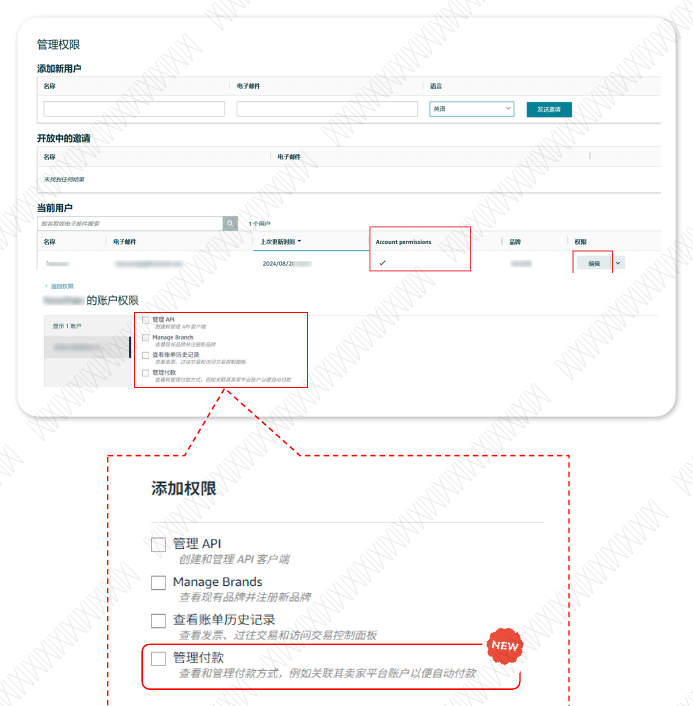

##### 注意事项
1. ASIN号只需填一个已注册到 Transparency的任意状态的 ASIN即可。可在Transparency
后台“代码请求”页面查找。“待执行操作 ”按需保留一个 ，移除其他两项即可 。以上
1.2按需填写一类，移除多余内容即可。
2. 新增账户管理员或者新增账单权限的用户也必须是品牌的权利所有者账号。
3. 现有账户管理员可以在Transparency后台右上角点击“设置-管理权限”看到有
Account Permissions的用户并点击“编辑”查看到四项均打勾的用户。（如下图）
1. New Email ID of the account admin user新增账户管理员的邮箱:
New CID of the account admin user新增账户管理员的卖家记号:
Existing Email ID of the account admin user【in case of change in Account admin】
现有账户管理员的邮箱:【若选择替换】
Existing CID of the account admin user【in case of change in Account admin】现
有账户管理员的卖家记号:【若选择替换】
2. New Email ID of billing invoice access user新增查看发票账单权限用户的邮箱:
New CID of billing invoice access user新增查看发票账单权限用户的卖家记号:
