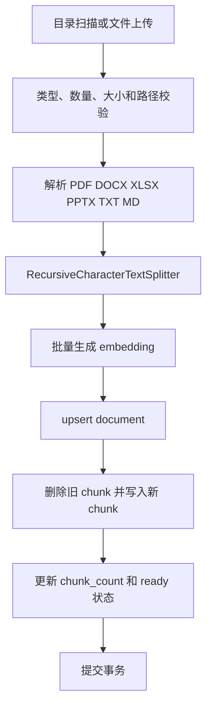
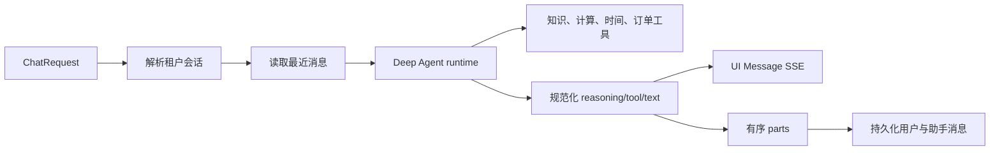

# 模块与数据流

## 模块总览

| 模块 | 路由前缀 | 鉴权 | 主要 service | 主要状态 |
| --- | --- | --- | --- | --- |
| 本地认证 | `/auth` | 登录公开；用户管理要求系统管理员 | `AuthService` | `rag_admin_users` |
| RAG 管理 | `/ai/rag/admin` | Bearer JWT | `RagAdminService`、`DocumentIngestService` | 文档、分块、会话、消息、原始文件 |
| RAG Chat | `/ai/rag/chat` | Bearer JWT | `RagChatService`、`RagMemoryService` | 检索结果、Redis 记忆、会话消息 |
| Agent 知识库 | `/agent/knowledge` | Bearer JWT | `AgentKnowledgeService` | Agent 文档、分块和向量 |
| Agent Chat | `/agent/chat` | JWT 或固定 token | `AgentChatService`、`AgentMemoryService` | Agent 会话、消息、parts、工具调用 |
| DS Order Mock | `/oms/admin/dsOrder` | JWT 或固定 token | `DsOrderService` | 进程内、按租户隔离的 fixture |
| 健康检查 | `/health` | 无 | `database_ready`、`redis_ready` | 进程与依赖就绪状态 |

## 本地认证

登录按当前租户和用户名查询用户，使用 scrypt 校验密码，并签发包含用户、租户和登录时间的 HS256 JWT。用户管理接口仅允许系统管理员访问，所有查询与写入都限定当前租户。启动阶段可通过 `RAG_ADMIN_BOOTSTRAP_*` 配置创建或更新初始管理员。

## RAG 文档入库

`DocumentIngestService` 使用文件 hash 判断是否需要重新处理。单个文件失败时回滚对应事务并记录失败结果，其余文件可以继续处理。原始文件路径必须位于配置根目录内，预览接口再次验证路径边界。

## RAG 检索与回答

`RagChatService` 从请求中的最后一条用户消息提取问题，并解析会话标识。非直接回答场景执行以下检索：

- zhparser 全文检索，使用 `to_tsvector` 和 `ts_rank_cd`。
- pgvector 余弦距离检索，使用 `<=>`。
- 使用 Reciprocal Rank Fusion 合并候选并截取 `top_k`。

服务将历史消息、问题和检索片段组织为 prompt，通过 OpenAI-compatible chat model 流式生成推理和正文。主模型流式调用失败时使用 fallback model 生成完整回答。用户问题和最终回答写入会话存储。

## Agent 知识库

`AgentKnowledgeService` 扫描租户对应的 Markdown 文档，读取 front matter 与正文，生成分块和 embedding，并将远程文档标识、面包屑、版本等元数据写入数据库。

搜索模式包括：

- `fulltext`：仅执行 zhparser 全文检索。
- `vector`：仅执行 pgvector 检索。
- `hybrid`：分别检索后使用 RRF 合并。

所有查询同时限制 chunk 与 document 的 `tenant_code`。

## Agent Chat

Agent runtime 使用 Deep Agents 创建模型代理，并注册以下工具：

- `search_knowledge`、`get_document`、`get_document_chunks`。
- `get_current_time`、`calculate`。
- `list_ds_orders`、`get_ds_order`、`list_ds_order_logs`。
- `audit_ds_order`、`cancel_ds_order`。

单次运行最多执行 5 次工具调用。runtime 将原始模型事件规范化为 reasoning、tool 和 text 事件；service 再转换为 UI Message SSE，并按可见顺序构建 `parts`。最终消息同时保存正文、工具调用摘要和有序 parts。

## DS Order Mock

`DsOrderService` 保存进程内 fixture，并在首次访问时按租户复制初始状态。分页、详情和日志为只读操作；审核和取消会校验状态迁移并追加操作日志。状态在进程重启后恢复为初始 fixture，不提供数据库持久化。

