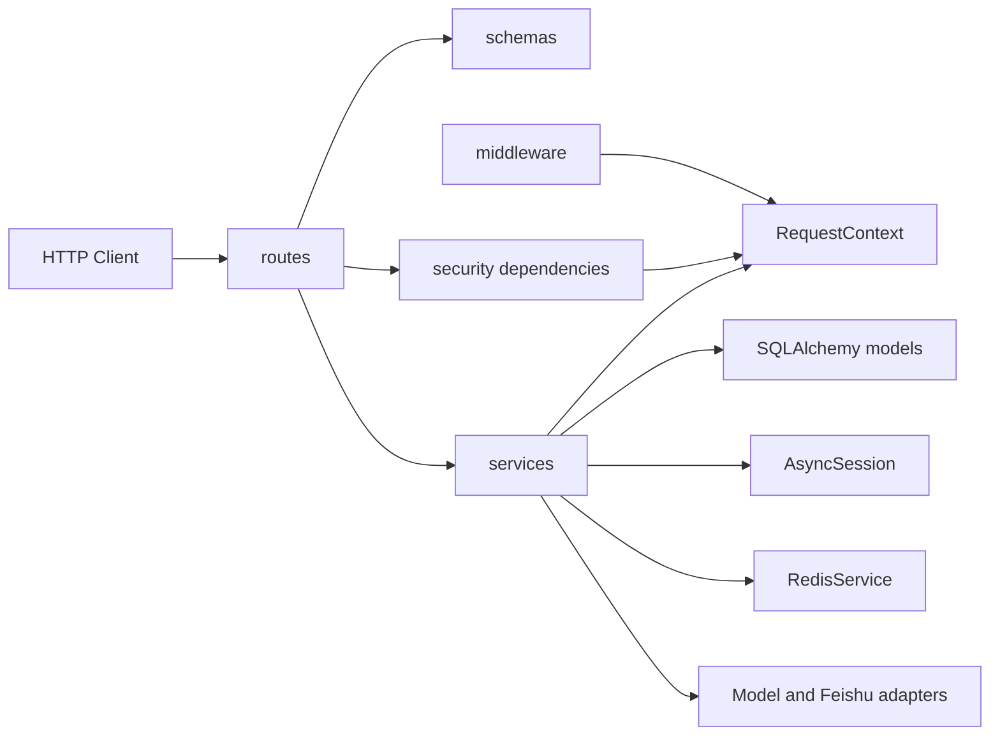
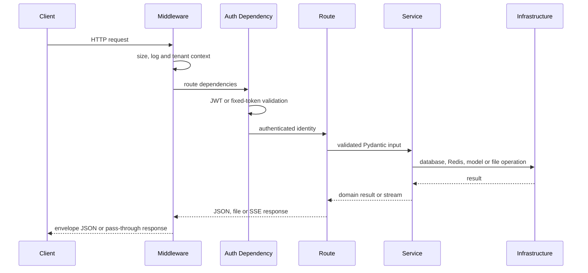

# 项目架构

## 项目定位

Python API 是一个可独立启动和部署的 FastAPI 服务，默认监听 `8000` 端口。它提供本地用户认证、RAG 管理与问答、业务 Agent、Agent 知识库以及 DS Order Mock 接口。

核心技术栈：

- Python 3.12、FastAPI、Uvicorn。
- Pydantic v2 与 `pydantic-settings`。
- SQLAlchemy asyncio 与 asyncpg。
- `redis.asyncio`。
- LangChain、LangGraph、Deep Agents 和 OpenAI-compatible API。
- pgvector、zhparser、lark-oapi。
- uv、Hatchling、Ruff、mypy 和 pytest。

## 目录结构

```text
apps/python-api/
├── docs/                    # 架构和开发规范
├── src/python_api/
│   ├── routes/              # HTTP 路由和依赖声明
│   ├── schemas/             # Pydantic 请求契约与公共转换
│   ├── services/            # 业务用例、检索、入库和会话编排
│   ├── config.py            # 环境选择、配置校验和派生配置
│   ├── core/context.py      # 请求级租户与用户上下文
│   ├── database.py          # 异步数据库引擎和 session
│   ├── core/errors.py       # 应用异常与全局异常处理
│   ├── feishu.py            # 飞书客户端、表格读取和告警
│   ├── main.py              # FastAPI 工厂、中间件和路由装配
│   ├── middleware.py        # 租户、日志、请求大小和响应包裹
│   ├── models.py            # 既有表的 SQLAlchemy 映射
│   ├── core/redis/redis_service.py # Redis 客户端和通用状态操作
│   ├── run.py               # Uvicorn 启动入口
│   ├── security.py          # 密码、JWT 和路由鉴权依赖
│   └── ui_stream.py         # AI SDK UI Message SSE 编码
├── tests/                   # 单元、契约和配置测试
├── Dockerfile
├── pyproject.toml
└── uv.lock
```

## 分层和依赖方向



依赖规则：

- route 接收 HTTP 输入、声明鉴权与数据库依赖，然后调用 service。
- schema 只负责输入约束、字段别名和公共 JSON 转换，不访问基础设施。
- service 负责编排业务流程，可使用数据库、Redis、模型、文件和外部服务。
- model 只映射既有表结构，不负责迁移。
- `config.py`、`database.py`、`core/redis/redis_service.py`、`feishu.py` 等模块提供基础设施能力。

## 应用生命周期

`python_api.main:create_app` 创建应用并完成以下装配：

1. 从缓存的 `Settings` 读取运行配置。
2. 根据环境决定 Swagger 与 OpenAPI 是否启用。
3. 注册响应包裹、租户、请求日志、请求大小限制和 CORS middleware。
4. 注册全局异常处理器。
5. 注册 health、auth、RAG、Agent 和 DS Order 路由。
6. 当公共静态目录存在时挂载 `/public`。

应用 lifespan 启动时可按配置创建初始管理员；关闭时依次关闭 Redis client 和 SQLAlchemy engine。

## 请求生命周期



Starlette 按 middleware 包装顺序执行请求。业务代码不得依赖肉眼推断的顺序，应以 `main.py` 的注册顺序和针对性的请求测试为准。文件、SSE 和显式带有 `x-skip-transform: 1` 的响应不会被 JSON envelope 改写。

